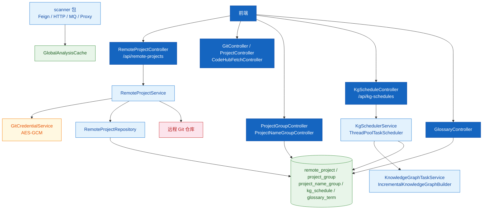
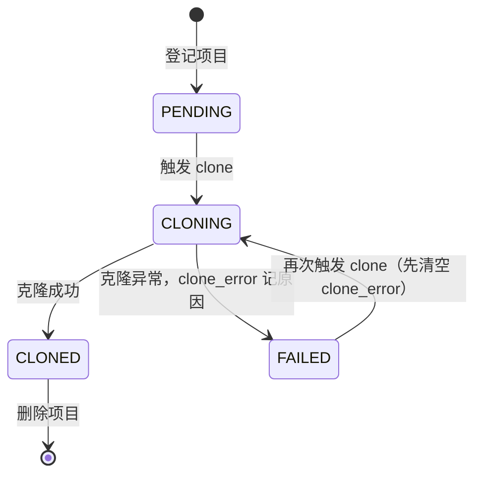

# 远程项目管理

> 自动生成于 2026-11-26，基于 `99d0037` 版本

| 属性 | 值 |
|------|-----|
| **所属层** | 领域服务层 |
| **目录** | `project/`（12：`remote` / `group` / `namegroup`）、`scheduler/`（5）、`glossary/`（3）、`scanner/`（5）；相关控制器 `controller/GitController`、`ProjectController`、`CodeHubFetchController` |
| **核心类** | `RemoteProjectService`、`GitCredentialService`、`RemoteProjectRepository`、`KgSchedulerService`、`ProjectServiceImpl` |
| **REST** | 8 个 Controller，共 35 个端点 |
| **SQLite 表** | `remote_project`、`project_group`、`project_name_group`、`kg_schedule`、`glossary_term` |

---

## 1. 模块概述

### 1.1 职责定义

**核心职责**：管理「有哪些代码、从哪来、怎么更新」——远程仓库的登记与克隆、本地 Git 操作、项目分组、按 cron 定时重建知识图谱、领域术语表；并为图谱构建提供桥接端点扫描器。

| 本模块负责 | 本模块不负责 | 由谁负责 |
|-----------|-------------|---------|
| 远程项目登记、克隆、拉取、删除；凭据加密 | 构建知识图谱 | [知识图谱构建](./知识图谱构建.md) |
| 本地 Git 状态、切分支、拉取、提交历史 | 图谱构建用的 git 状态检查 | `knowledgegraph.service.GitStatusService` |
| 按 appId、按名称模式给项目分组 | 前后端项目绑定 | `knowledgegraph.binding` |
| 按 cron 触发 KG 增量或全量 | 任务的排队与执行 | `KnowledgeGraphTaskServiceImpl`、`KgGenerationQueue` |
| 术语表 CRUD | 把术语注入提示词 | `knowledgegraph.service.LLMDescriptionService` 等 |
| 扫描桥接端点并写入全局缓存 | 调用关系解析 | `KnowledgeGraphBuilder` |
| 定时拉取日志 | 日志分析 | [日志云与运维](./日志云与运维.md)（`scheduler/LogPullScheduler`） |

---

## 2. 模块架构

---

## 3. 远程项目 `project/remote`

### 3.1 机制

| 项目 | 说明 |
|------|------|
| 克隆根目录 | `<app.project_dir>/remote-repos/<localPath>`；源码注释另提到未配置时的回退目录 |
| 鉴权类型 `AuthType` | `PASSWORD`、`SSH_KEY`、`TOKEN` |
| 凭据加密 | `GitCredentialService`：`AES/GCM/NoPadding`，GCM 标签 128 位，IV 12 字节；密钥取 `hisi.encrypt.key` |
| 异步 | 克隆与拉取由控制器用 `CompletableFuture.runAsync` 触发，接口立即返回 |
| 路径回填 | 仓储 `@PostConstruct migrateSchema()` 幂等补列（`auth_type`、`ssh_key_path`、`encrypted_token`、`group_id`、`full_path`）并回填 `full_path` |
| 凭据复用 | `resolveCredentialsByPath(path)`：按路径找远端项目并解密凭据，供 `GitController` 使用 |

### 3.2 克隆状态

状态值 `PENDING`、`CLONING`、`CLONED` 出现在服务代码中，`FAILED` 写在仓储的 SQL 里；建表时 `clone_status` 默认 `PENDING`。

### 3.3 端点 `/api/remote-projects`

鉴权：GET 放行；POST / PUT / DELETE 需要管理员。

| 方法 | 路径 | 说明 |
|------|------|------|
| GET | `/api/remote-projects` | 列表 |
| POST | `/api/remote-projects` | 登记（名称、Git 地址、凭据、鉴权类型、分支、分组等） |
| PUT | `/api/remote-projects/{id}` | 更新 |
| DELETE | `/api/remote-projects/{id}` | 删除记录与本地目录 |
| POST | `/api/remote-projects/{id}/clone` | 异步克隆，立即返回「Clone started」 |
| POST | `/api/remote-projects/{id}/pull` | 异步拉取，立即返回「Pull started」 |

---

## 4. 本地 Git 与项目

| 方法 | 路径 | 说明 |
|------|------|------|
| GET | `/api/git/status` | 参数 `path` |
| POST | `/api/git/checkout` | `{path, branch}` |
| POST | `/api/git/pull` | `{path, ...}` |
| GET | `/api/git/logs` | 参数 `path`、`limit`（默认 10） |
| GET | `/api/git/commits` | 参数 `path`、`limit`（默认 50）；含远程分支的最新提交 |
| GET | `/api/git/commit-diff` | 参数 `path`、`commitId` |
| POST | `/api/git/update-all` | `{projectDir}` |
| POST | `/api/git/fetch` | 批量克隆 / 拉取 `GitFetchDto` 数组：仓库已存在则拉取并切分支，不存在则克隆 |
| GET | `/api/projects/list` | 项目列表（`ProjectServiceImpl` 从 Neo4j 查询） |
| POST | `/api/projects/clone` | 克隆 |
| GET | `/api/projects/status` | 参数 `project` |
| GET | `/api/projects/scan-git-repos` | 扫描本地 Git 仓库 |

Git 凭据取 `app.codeHubUser` / `app.codeHubPassword`（环境变量 `CODEHUB_USERNAME` / `CODEHUB_PASSWORD`）或经 `RemoteProjectService` 按路径解析。鉴权规则同上。

---

## 5. 项目分组

| 前缀 | Controller | 端点 | 表 |
|------|-----------|------|-----|
| `/api/project-group` | `ProjectGroupController` | `GET`、`GET /{appId}`、`POST`、`DELETE /{appId}`、`GET /by-path?path=` | `project_group`（`app_id` 唯一、`app_name`、`project_paths`、`description`） |
| `/api/project-name-group` | `ProjectNameGroupController` | `GET`、`GET /{groupName}`、`POST`、`DELETE /{groupName}` | `project_name_group`（`group_name` 唯一、`group_pattern`、`project_names`、`description`） |

两组都没有 Service 层，Controller 直接调用 Repository。`/by-path` 用 `findContainingPath` 找包含给定路径的分组。

---

## 6. KG 定时调度 `scheduler/`

### 6.1 `KgSchedulerService`

| 项目 | 说明 |
|------|------|
| 调度器 | 自建 `ThreadPoolTaskScheduler`（2 线程，线程前缀 `kg-scheduler-`） |
| 启动 | `@PostConstruct initSchedules()` 注册所有启用的任务 |
| 触发 | `CronTrigger`；执行 `executeTask(schedule)` |
| 方法 | `registerTask`、`cancelTask`、`reRegisterTask` |

`executeTask` 的步骤：

1. 若 `git_pull_enabled`，用外部 `git` 命令拉取（`branch` 非空则拉指定分支）；非 Git 目录跳过。
2. `BuildMode.fromString`（大小写不敏感，未知值回退 `REUSE`）：
   - `INCREMENTAL`：`IncrementalKnowledgeGraphBuilder.incrementalRefresh(projectPath, refreshDescription, refreshArchitecture)`，在调度线程同步执行；
   - `REUSE` / `WIPE`：`KnowledgeGraphTaskService.startTask(projectPath, [], refreshDescription, refreshArchitecture, buildMode)`，进入生成队列。
3. 成功后 `updateLastRunAt`；异常只记日志。

`kg_schedule.next_run_at` 列存在，但服务只读不写。

### 6.2 端点 `/api/kg-schedules`

| 方法 | 路径 | 说明 |
|------|------|------|
| GET | `/api/kg-schedules` | 列表 |
| POST | `/api/kg-schedules` | 新建；`buildMode` 只能是 `INCREMENTAL` / `REUSE` / `WIPE` |
| PUT | `/api/kg-schedules/{id}` | 更新（未传的字段保持不变） |
| DELETE | `/api/kg-schedules/{id}` | 删除并取消任务 |

### 6.3 `kg_schedule` 表

`id`、`project_path`、`cron_expression`、`build_mode`（默认 `REUSE`）、`enabled`（默认 1）、`last_run_at`、`next_run_at`、`created_at`；后补列 `git_pull_enabled`、`branch`、`refresh_description`、`refresh_architecture`。

---

## 7. 术语表 `glossary/`

| 方法 | 路径 | 说明 |
|------|------|------|
| GET | `/api/glossary?projectPath=` | 按项目列出 |
| POST | `/api/glossary` | 新增 `{projectPath, term, synonym, context}` |
| PUT | `/api/glossary/{id}` | 更新 |
| DELETE | `/api/glossary/{id}` | 删除 |

表 `glossary_term`：`project_path`、`term`、`synonym`、`context`。建表时会把旧列名 `wrong_term` / `correct_term` 迁移为 `term` / `synonym`。读取方：`knowledgegraph.service.LLMDescriptionService`、`EntryPointDescriptionService` 与 `knowledgegraph.binding.repository.ProjectBindingRepository`。

---

## 8. 桥接端点扫描器 `scanner/`

顶层包 `scanner/` 的 5 个文件只被 `KnowledgeGraphBuilder` 的桥接扫描使用（结果经 `cache.GlobalAnalysisCache` 传递）。`GlobalAnalysisCache` 另持有 beanMap、extendMap、implementationMap、uriMap、typeSolver、MQ 端点等共享数据，是多个静态变量的集中处。

| 类 | 识别对象 |
|----|---------|
| `EndpointScanner` | 扫描器接口：`scanFile`、`scanFiles`、`canScan`、`getScannerName`、`getSupportedAnnotations` |
| `FeignClientScanner` | `@FeignClient` 接口及其 HTTP 端点（`GetMapping` / `PostMapping` 等） |
| `HttpCallScanner` | `RestTemplate` 与 `WebClient` 的 HTTP 调用 |
| `MQEndpointScanner` | Kafka、RabbitMQ、RocketMQ、JMS 的生产者与监听器 |
| `ProxyClassScanner` | MyBatis Mapper、JPA Repository、Spring AOP Aspect |

---

## 9. 配置项

| 键 | 说明 |
|----|------|
| `app.project_dir` | 克隆根目录的基准；经静态字段 `DataSourceConfig.PROJECT_DIR` 被读取 |
| `app.codeHubUser` / `app.codeHubPassword` | Git 凭据；环境变量 `CODEHUB_USERNAME` / `CODEHUB_PASSWORD` |
| `hisi.encrypt.key` | 凭据加密密钥；`application.yml` 未定义，可按 Spring 松散绑定用环境变量 `HISI_ENCRYPT_KEY` 提供（启动日志也提示该变量名） |

---

## 10. 错误处理

| 场景 | 处理 |
|------|------|
| 远程项目 id 不存在 | `getById` 抛 `RuntimeException` → HTTP 500 |
| 鉴权类型非法 | `IllegalArgumentException` → HTTP 400 |
| 克隆失败 | 状态置 `FAILED`，原因写入 `clone_error`；异常在异步线程内只记日志 |
| 目标目录非空 | 先清空目录再克隆 |
| 拉取时项目尚未克隆 | 抛 `RuntimeException`（异步线程内记日志） |
| 删除项目时删目录失败 | `deleteDirectory` 捕获 `IOException` 只记日志，记录照删 |
| 定时任务执行失败 | 只记日志，`last_run_at` 不更新 |
| cron 非法 | `registerTask` 捕获异常并记日志 |
| `buildMode` 非法 | 接口返回 `code=400` |
| 调度 id 不存在 | `code=404` |

---

## 11. 已知问题与扩展点

| 问题 | 说明 |
|------|------|
| 凭据密钥有内置回退 | 未配置 `hisi.encrypt.key`（或短于 16 字符）时回退到源码内置的默认密钥并打印告警；密钥字节直接补零 / 截断到 32 字节，未经 KDF。未配置时口令与令牌等同明文存储 |
| 路径回填含硬编码目录 | `RemoteProjectRepository` 启动回填 `full_path` 时使用了源码内置的历史目录列表 |
| `next_run_at` 不回写 | 接口返回的下次触发时间恒为空 |
| 调度器自建 | 未注册为 Spring bean，无销毁钩子 |
| `INCREMENTAL` 绕过队列 | 在调度线程同步直调构建器，无任务记录 |
| 分组与术语表无 Service 层 | Controller 直连 Repository |
| 扫描器位于顶层包 | 只服务于 `knowledgegraph` |

| 扩展点 | 方式 |
|-------|------|
| 新增扫描器 | 实现 `EndpointScanner` 并注册为 bean |
| 新增触发方式 | 在 `KgSchedulerService` 增加注册入口 |

---

## 12. 依赖关系

| 方向 | 依赖 | 用途 |
|------|------|------|
| 上游 | JGit + `org.eclipse.jgit.ssh.jsch` | 克隆、拉取、SSH |
| 上游 | [应用启动与全局配置](./应用启动与全局配置.md) | `PROJECT_DIR`、建表 |
| 上游 | [知识图谱构建](./知识图谱构建.md) | `KnowledgeGraphTaskService`、`IncrementalKnowledgeGraphBuilder`、`BuildMode` |
| 下游 | [知识图谱构建](./知识图谱构建.md) | 扫描结果、术语表 |
| 下游 | [技能市场与提示词](./技能市场与提示词.md) | `McpController` 等读取项目路径 |

---

> **相关文档**：
> - 架构总览 → [02-架构设计](../02-架构设计/index.md)
> - 定时构建数据流 → [04-数据流程](../04-数据流程/index.md)
> - 表结构 → [06-数据模型](../06-数据模型/index.md)
