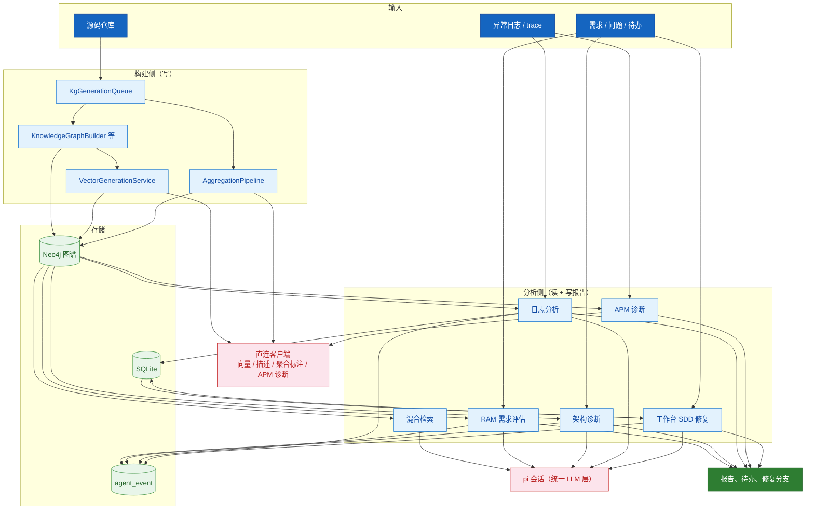
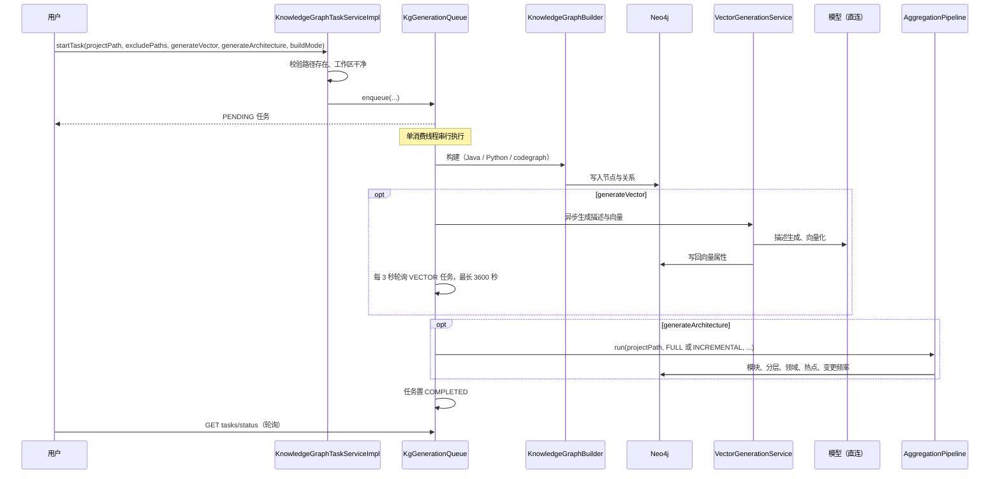
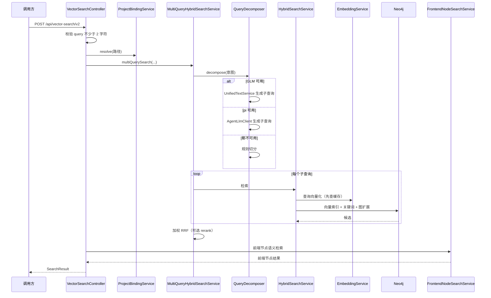
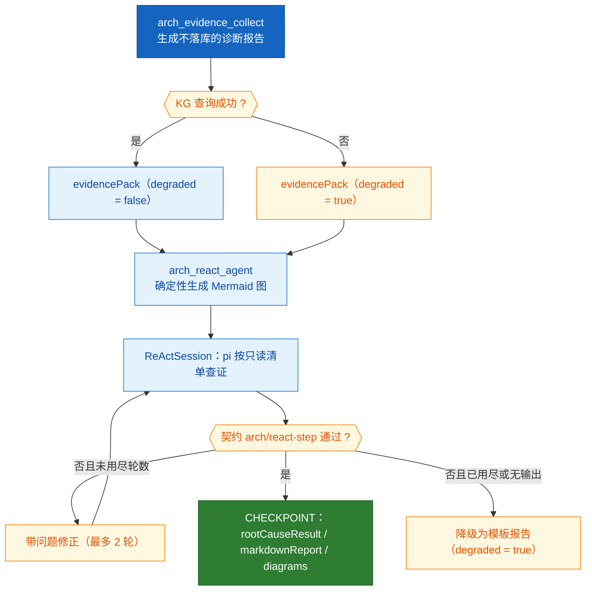
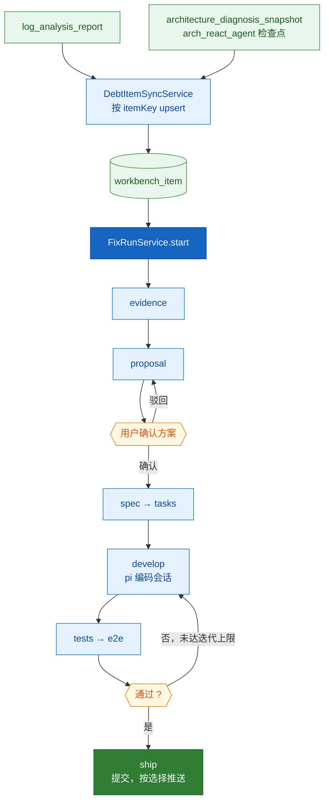
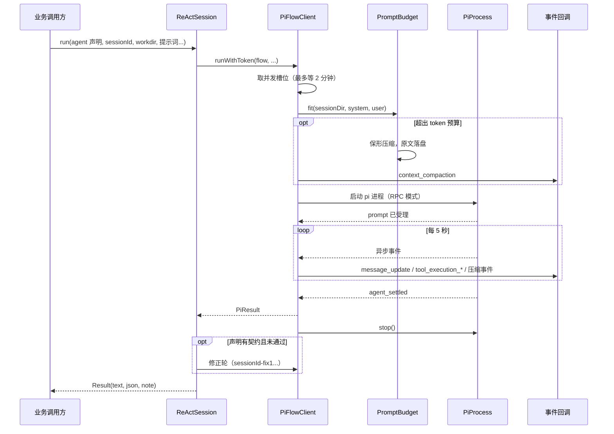
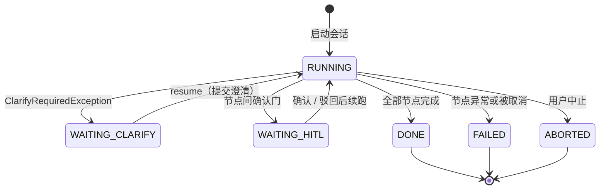

# 核心数据流

> 自动生成于 2026-11-26，基于 `99d0037` 版本

---

## 1. 数据流概览

### 1.1 核心数据流清单

| # | 流程名 | 触发方 | 关键路径 | 频率 | 重要性 |
|---|--------|--------|---------|------|--------|
| 1 | 知识图谱构建 | 用户 `POST /api/knowledge-graph/tasks/generate`、cron 调度 | 任务队列 → 多语言解析 → Neo4j → 描述与向量 → 架构聚合 | 低频，每仓库一次加增量 | 核心 |
| 2 | 混合检索 | 用户、各 agent 的 MCP 工具 | 路径展开 → 意图子查询 → 多路召回 → 加权 RRF →（可选）重排 | 高频 | 核心 |
| 3 | 需求评估工作流 | 用户 `POST /api/ram/sessions` | clarify → impact → implement → verify → tech_plan，带澄清与确认门 | 中频 | 核心 |
| 4 | 架构深度分析 | 用户经 `POST /api/v2/workflow/start` | 证据收集 → pi ReAct 查证 → 报告组装 | 低频 | 核心 |
| 5 | 日志根因分析 | 手动提交、定时拉取、采集上报 | 解析 → 图谱取证 → 假设 → 验证 → 综合 → 报告 | 中频 | 核心 |
| 6 | 工作台待办聚合与 SDD 自动修复 | 定时聚合、用户启动 | 聚合 → 待办 → 八阶段修复（确认门、迭代回路） | 中频 | 核心 |
| 7 | APM 故障诊断 | 用户 `POST /api/apm/diagnose` | 异常 span → KG 丰富 → LLM → 报告状态机 | 低频 | 辅助 |
| 8 | pi 会话执行 | 上述各 agent 流的每一次模型调用 | 预算压缩 → 起进程 → 事件转发 → 回收 | 高频 | 底座 |

### 1.2 数据流全景图

图中有两类模型调用：经 pi 的（agent 流程）与直连的（批量、向量、APM 诊断），边界说明见 [pi-agent底座](../03-模块说明/pi-agent底座.md)。

---

## 2. 流程 1：知识图谱构建

| 属性 | 值 |
|------|-----|
| 触发方式 | 用户操作（REST）或 cron 调度 |
| 触发条件 | 项目路径存在；工作区没有未提交改动 |
| 涉及模块 | [知识图谱构建](../03-模块说明/知识图谱构建.md)、[Neo4j图存储与检索](../03-模块说明/Neo4j图存储与检索.md) |
| 数据流向 | 源码 → Neo4j 节点与关系 → 向量 → 聚合结果 |

### 2.1 正常流程

### 2.2 数据转换节点

| 节点 | 输入 | 输出 | 实现位置 |
|------|------|------|---------|
| 语言识别 | 项目目录 | 语言组合 | `knowledgegraph.util.ProjectLanguageDetector` |
| Java 解析 | `.java` 源码 | `Method`、`Class`、`EntryPoint`、`DataModel`、`CALLS` 等 | `KnowledgeGraphBuilder` |
| Python 解析 | `.py` 源码 | 同上 | `python/PythonKnowledgeGraphBuilder` |
| 前端解析 | TS / JS / Vue | `Component`、`ApiClient`、`FrontendRoute` | `codegraph/*` |
| 描述生成 | 类名、方法名、签名、注释 | `description` | `LLMDescriptionService` 等 |
| 向量化 | 描述、代码、SQL 文本 | `*Embedding` 属性 | `VectorGenerationService` |
| 风险分 | 复杂度、变更频率、入度、环 | `riskScore` | `aggregation.RiskScoreCalculator` |

### 2.3 异常流程

| 异常场景 | 处理策略 | 用户感知 | 数据影响 |
|---------|---------|---------|---------|
| 路径不存在 | `IllegalArgumentException` → HTTP 400 | 报错 | 无 |
| 工作区有未提交改动 | `IllegalStateException` → HTTP 400 | 提示先提交 | 无 |
| 后端重启时任务在跑 | 启动时把遗留 `KG` 任务标 `FAILED` | 状态变为失败，需重新触发 | 半成品数据留在图里，靠下次构建清理 |
| 向量任务迟迟不结束 | 队列最多等 3600 秒 | 构建完成但向量可能未齐 | 部分节点缺向量 |
| 聚合第 1 或第 5 阶段失败 | 写检查点并终止后续阶段 | 架构看板数据不全 | 图谱本身不受影响 |
| 模型调用失败 | 描述或向量留空，流程继续 | 相应检索面结果变少 | — |

---

## 3. 流程 2：混合检索

| 属性 | 值 |
|------|-----|
| 触发方式 | `POST /api/vector-search/v2`、`POST /api/search/semantic/v2`，或 agent 经 MCP 工具 `hybrid_search` |
| 涉及模块 | [Neo4j图存储与检索](../03-模块说明/Neo4j图存储与检索.md) |
| 数据流向 | 查询文本 → 向量 → 候选节点 → 融合排序 → 结果（含前端节点） |

---

## 4. 流程 3：需求评估工作流 `ram-demand`

| 属性 | 值 |
|------|-----|
| 触发方式 | `POST /api/ram/sessions` |
| 涉及模块 | [RAM需求评估](../03-模块说明/RAM需求评估.md)、[工作流引擎](../03-模块说明/工作流引擎.md)、[pi-agent底座](../03-模块说明/pi-agent底座.md) |
| 数据流向 | 需求文本 → 结构化需求 → 影响面 → 实现方案 → 验证结果 → 技术方案；节点产物写入 `agent_event` |

节点间的数据传递：每个节点读上一个节点的输出 `Map`，返回新的 `Map`；`DagExecutor` 把输出写入 `CHECKPOINT` 事件，并计算输入哈希供续跑时复用。

| 事件 | 含义 | 前端的下一步 |
|------|------|------------|
| `CLARIFY_REQ` | clarify 节点需要更多信息 | `POST /sessions/{sid}/clarify` |
| `HITL_REQ` | 某节点输出待人确认 | `POST /sessions/{sid}/confirm` |
| `CHECKPOINT` | 节点产物已落库 | — |
| `ERROR` | 节点失败 | — |

---

## 5. 流程 4：架构深度分析 `arch-deep-analysis`

| 属性 | 值 |
|------|-----|
| 触发方式 | `POST /api/v2/workflow/start`，`workflowType = arch-deep-analysis` |
| 涉及模块 | [架构诊断](../03-模块说明/架构诊断.md)、[工作流引擎](../03-模块说明/工作流引擎.md) |
| 数据流向 | 项目路径 → 诊断报告与证据包（确定性）→ pi 查证 → 问题清单与路线图 |

`arch_react_agent` 的检查点会被工作台的聚合同步读取，其中的问题转成 `arch_ai` 待办。

---

## 6. 流程 5：日志根因分析（v2）

| 属性 | 值 |
|------|-----|
| 触发方式 | 手动提交 `POST /api/v2/log/analyze`（或 v1 的 `/api/log/analyze`）；每 10 分钟的定时拉取；采集信封 |
| 涉及模块 | [日志云与运维](../03-模块说明/日志云与运维.md) |
| 数据流向 | 日志文本 → 解析后的异常与栈帧 → 证据包 → 假设 → 验证结论 → 报告 |

| 节点 | 输入 | 输出 | 确定性 |
|------|------|------|-------|
| `ParseNode` | 原始日志、堆栈 | 异常类型、根因异常、关键栈帧、抛出点 | 是 |
| `LogKgEvidenceNodeV2` | 栈帧、项目路径 | `evidencePackV2`、源码片段、上游调用链 | 是（图谱 + 本地源码） |
| `LogHypothesisNodeV2` | 证据表、源码 | `hypothesesV2`（最多 3 条） | 否，LLM |
| `LogVerifyNodeV2` | 假设、证据包 | `verificationV2`（引用、落点、因果链） | 是；可选的 LLM 评审 |
| `LogSynthesisNodeV2` | 通过验证的假设、证据 | Markdown 报告 | 否，LLM；失败时确定性生成 |
| `ReportNode` | 全部产物 | 待落库的报告 | 是 |

每条结论必须以 `[[E n]]` 引用证据编号；引用不在证据包里的会被替换为「未验证」。v2 没有产出报告时回退 v1 流程。

---

## 7. 流程 6：工作台待办聚合与 SDD 自动修复

| 属性 | 值 |
|------|-----|
| 触发方式 | 聚合：定时（`workbench.sync.interval-ms`）或 `POST /api/workbench/items/sync`；修复：`POST /api/workbench/items/id/{id}/autofix` |
| 涉及模块 | [工作台与自动修复](../03-模块说明/工作台与自动修复.md) |
| 数据流向 | 日志报告 + 架构问题 → `workbench_item` → `workbench_fix_run` + git worktree 上的分支与提交 |

---

## 8. 流程 7：APM 故障诊断

| 属性 | 值 |
|------|-----|
| 触发方式 | `POST /api/apm/diagnose` |
| 涉及模块 | [APM故障诊断](../03-模块说明/APM故障诊断.md) |
| 数据流向 | OTLP span → `apm_span` + 异常 span 索引 → KG 证据 → LLM 诊断 → 内存中的报告 |

上报链路：目标 JVM 上的 OTel agent → `POST /v1/traces`（protobuf）→ `SpanIngestionService` → `apm_span`（带 KG 映射）→ `/ws/apm` 推送。

诊断链路：`FailureLocatorService.startDiagnose` 去重 → 建 `PENDING` 报告 → 专用线程池异步执行 → 取异常 span → KG 丰富（可关）→ LLM → 终态。

---

## 9. 流程 8：pi 会话执行（底座）

所有 agent 流的每一次模型调用都走这一条路径，细节见 [pi-agent底座](../03-模块说明/pi-agent底座.md)。

---

## 10. 状态流转

### 10.1 agent 流程会话 `SessionStatus`

| 当前状态 | 事件 | 目标状态 | 前置条件 | 副作用 | 实现位置 |
|---------|------|---------|---------|--------|---------|
| `RUNNING` | 节点抛 `ClarifyRequiredException` | `WAITING_CLARIFY` | — | 追加 `CLARIFY_REQ` | `workflow.DagExecutor` |
| `RUNNING` | 非首跑、非强制重跑、策略开启确认门、节点未确认 | `WAITING_HITL` | — | 追加 `HITL_REQ` | 同上 |
| `RUNNING` | 节点抛其他异常 | `FAILED` | — | 追加 `ERROR` | 同上 |
| `RUNNING` | 节点链走完 | `DONE` | — | 清 `rerun_from_node` | 同上 |
| `WAITING_HITL` | 用户确认 | `RUNNING` | 续跑时命中检查点，跳到下一节点 | 追加 `HITL_RES` | 业务的确认接口（如 RAM 的 confirm） |

不变量：

| 不变量 | 说明 | 校验方式 |
|--------|------|---------|
| 事件序号单调 | `(session_id, seq)` 唯一 | 数据库约束 |
| 事件幂等 | `idempotency_key` 唯一，重复追加被拒 | 数据库约束 |
| 检查点可复用 | 同一节点、同一输入哈希的输出不变 | `DagExecutor` 查最近一条 `CHECKPOINT` |

### 10.2 其他状态机

| 对象 | 状态序列 | 实现位置 |
|------|---------|---------|
| 图谱任务 `generation_task.status` | `PENDING` → `RUNNING` → `COMPLETED` / `FAILED` | `KgGenerationQueue` |
| 日志报告 `log_analysis_report.status` | `pending` → `processing` → `completed` / `failed` | `LogAnalysisExecutor`、`LogAnalysisExecutorV2` |
| 诊断报告 `DiagnoseReport.Status` | `PENDING` → `RUNNING` → `DONE` / `FAILED` / `CANCELLED` / `TIMEOUT` / `LOW_CONFIDENCE` | `apm.cache.DiagnosisReportStore` |
| 工作台修复运行 `workbench_fix_run.status` | `RUNNING` ↔ `WAITING_CONFIRM` → `DONE` / `FAILED` / `ABORTED`；重启时 `RUNNING` → `INTERRUPTED` | `workbench.service.FixRunRunner` |
| 待办 `workbench_item.status` | `NEW` → `RUNNING` / `WAITING` → `DONE` / `FAILED`；`IGNORED` 可恢复为 `NEW` | `WorkbenchController`、`FixRunService` |
| 远程项目 `remote_project.clone_status` | `PENDING` → `CLONING` → `CLONED` / `FAILED` | `RemoteProjectService` |
| APM 会话 `ApmSession` | `CREATED` → `LAUNCHING` → `READY` → `RUNNING` → `COMPLETED` / `ERROR` | `apm.model.ApmSession`（类注释） |

---

## 11. 数据校验规则

### 11.1 输入校验

| 数据 | 校验规则 | 校验位置 | 失败行为 |
|------|---------|---------|---------|
| 图谱构建的项目路径 | 目录必须存在 | `KnowledgeGraphTaskServiceImpl` | `IllegalArgumentException` → HTTP 400 |
| 图谱构建的工作区 | 没有未提交改动 | 同上 | `IllegalStateException` → HTTP 400 |
| 检索请求 | `query`、`projectPath` 非空；`query` 至少 2 字符 | `VectorSearchController` | 400 |
| 工作流启动 | `workflowType` 已注册；`input.projectPaths` 为非空数组 | `WorkflowV2Controller` | `ApiResponse(code=400)` |
| 对话请求 | `agentType` 已配置；`message` 非空 | `AgentChatController` | HTTP 404 / 400 |
| 诊断请求 | `traceId`、`projectPath` 非空 | `DiagnoseController`（`@Valid`） | 400 |
| 定时任务 | `buildMode` 只能是 `INCREMENTAL` / `REUSE` / `WIPE` | `KgScheduleController` | `ApiResponse(code=400)` |
| 注册 | 用户名 2–32 字符，口令至少 4 位 | `AuthController` | `ApiResponse(code=400)` |
| 角色修改 | `role` 只能是 `ADMIN` / `MEMBER` | `UserController` | `ApiResponse(code=400)` |

### 11.2 数据一致性保障

| 一致性约束 | 保障方式 | 违反时处理 | 实现位置 |
|-----------|---------|-----------|---------|
| 会话事件不重复、不乱序 | 唯一约束 + 幂等键 | 插入失败 | `agent_event` 的两个 UNIQUE 约束 |
| 工作台待办不被同步覆盖用户决定 | 同步只 upsert 内容与计数 | — | `DebtItemSyncService` |
| 同一待办同时只有一个活跃修复 | 启动前查活跃运行 | `code=409` | `FixRunService.start` |
| 修复运行产物可恢复 | 每阶段产物写 `CHECKPOINT` | — | `FixRunRunner` |
| 节点向量不被无谓重算 | `REUSE` 模式按 `codeHash` 判定 | — | `KnowledgeGraphBuilder` |
| 原始提示词可回看 | 压缩前把完整原文落盘 | 写失败则提示词里不给路径 | `PromptBudget.saveFullPrompt` |

---

## 12. 性能关键路径

只列代码中能看到采取措施的路径，没有实测数字。

| 路径 | 瓶颈点 | 现有措施 | 实现位置 |
|------|--------|---------|---------|
| 多项目构建 | 同时构建互相干扰 | 单消费线程串行；全量与增量共用信号量 | `KgGenerationQueue` |
| 向量生成 | 外部接口限流、队列积压 | 令牌桶限流；分批提交；线程数取两个模型 `burst` 的较小值 | `VectorGenerationService`、`TokenBucketRateLimiter` |
| 描述生成 | 外部接口限流 | 令牌桶 + 429 退避重试 | `UnifiedTextService` |
| 语义检索 | 重复向量化同一查询 | `QueryEmbeddingCache` | `neo4j.service` |
| 向量召回 | 取数不足 | 按上限的 20 倍取候选 | `VECTOR_INDEX_TOPK_MULTIPLIER` |
| 影响分析 | 全项目扫描结果复用 | `GlobalAnalysisCache` | `cache` |
| pi 会话 | 提示词撑爆上下文 | 提交前预算与保形压缩、运行中会话压缩 | `PromptBudget`、pi `settings.json` |
| pi 并发 | 进程数失控 | 信号量限并发，deadline 到点强杀 | `PiFlowClient` |
| 诊断并发 | 上游限流 | 专用线程池 + LLM 并发信号量 | `ApmDiagnoseConfig`、`ApmClaudeLlmClient` |
| SSE | 轮询压力 | 合并窗口把多条日志并成一条 `NODE_DELTA` | `WorkbenchEventSink` |

---

## 13. 数据安全与脱敏

| 数据类型 | 敏感级别 | 存储方式 | 传输 | 脱敏规则 |
|---------|---------|---------|------|---------|
| 模型与向量服务密钥 | 高 | 环境变量或本机文件 | — | 不写仓库；pi 进程经环境变量获得 |
| JWT 密钥、管理员初始口令 | 高 | 环境变量 | — | 未配置则随机生成 |
| Git 凭据 | 高 | AES-GCM 密文 | — | 日志不输出明文 |
| 请求中的令牌 | 高 | — | 请求头或查询参数 | 异常日志里查询串的敏感参数替换为 `***` |
| 源码、方法体 | 中 | Neo4j | — | 送给模型的是描述、压缩后的方法体与证据 |
| 日志原文 | 中 | SQLite | — | — |
| 用户提问与模型输出 | 中 | `agent_event`、pi 会话目录 | — | 被压缩的完整原文落盘在 pi 会话目录 |

数据安全分类的完整表见 [06-数据模型](../06-数据模型/index.md)。

---

> **延伸阅读**：
> - 各模块的实现细节 → [REST接口层](../03-模块说明/REST接口层.md) 末尾的模块索引
> - 接口定义 → [05-接口文档](../05-接口文档/index.md)
> - 数据模型结构 → [06-数据模型](../06-数据模型/index.md)
