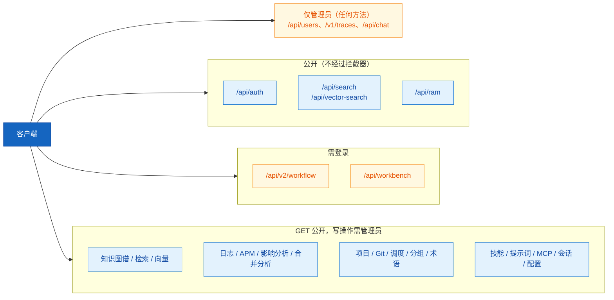
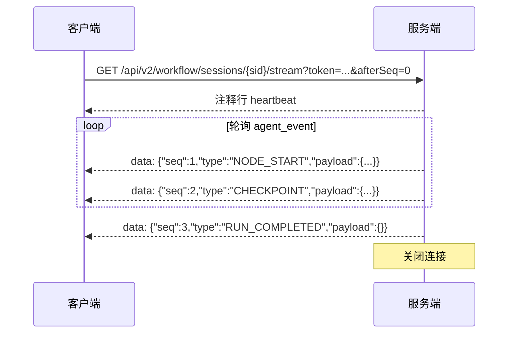

# 接口文档

> 自动生成于 2026-11-26，基于 `99d0037` 版本

本页列出后端全部 HTTP 接口与 WebSocket 端点。路径、方法、鉴权要求逐个对照控制器源码的映射注解得出；入参与出参只在读到了源码的地方写明，其余以「—」表示未展开。

---

## 1. 接口概览

### 1.1 总览

| 类型 | 数量 | 基础路径 | 协议 | 认证方式 |
|------|------|---------|------|---------|
| REST 接口 | 49 个控制器、359 条映射（358 个不同的「方法 + 路径」） | 多以 `/api` 开头，另有 `/v1/traces` | HTTP / JSON | JWT Bearer；235 条公开、21 条需登录、103 条需管理员 |
| SSE 接口 | 6 个（含在 REST 之内） | — | `text/event-stream` | 同各自接口 |
| WebSocket 端点 | 7 个 | `/ws/*` | 文本帧 JSON | 握手不校验令牌 |

方法分布：GET 226、POST 109、DELETE 14、PUT 8、PATCH 2。两条映射同为 `POST /v1/traces`，按请求体类型各有一个处理方法。

### 1.2 鉴权标记

本页「鉴权」列的三个取值由 `config.AdminOnlyInterceptor` 的路径规则决定：

| 标记 | 含义 |
|------|------|
| 公开 | 不要求登录 |
| 登录 | 任何方法都要有效令牌，否则 HTTP 401 |
| 管理 | 要求有效令牌且角色为 `ADMIN`，否则 HTTP 401 / 403 |

规则原文与令牌格式见 [应用启动与全局配置](../03-模块说明/应用启动与全局配置.md)。

### 1.3 通用约定

| 项目 | 说明 |
|------|------|
| 请求头 | `Content-Type: application/json`；需要身份时带 `Authorization: Bearer <token>` |
| SSE 的令牌 | 浏览器 `EventSource` 设不了请求头，可用查询参数 `?token=<token>` |
| 响应包装 | 多数为 `ApiResponse`：`{code, message, data}`，`code = 200` 表示成功 |
| 状态码语义 | 拦截器返回的 401 / 403 是真实 HTTP 状态码；参数类异常是 HTTP 400；未预期异常 HTTP 500；其余业务错误多为 HTTP 200 + `code` |
| 数值 | `Long` 一律序列化为字符串 |
| 不走 `ApiResponse` 的接口 | 见各表「说明」中的标注 |

```json
// 成功
{ "code": 200, "message": "success", "data": { } }
// 失败示例：未登录访问需要登录的接口（HTTP 401）
{ "code": 401, "message": "请先登录后再执行此操作", "data": null }
```

### 1.4 路由关系图



---

## 2. REST 接口

### 2.1 认证与用户

`AuthController`（`/api/auth`，公开）与 `UserController`（`/api/users`）。模块：[应用启动与全局配置](../03-模块说明/应用启动与全局配置.md)。

| 方法 | 路径 | 鉴权 | 说明 |
|------|------|------|------|
| POST | `/api/auth/login` | 公开 | `{username, password}` → `{token, username, role}`；失败 `code=401` |
| POST | `/api/auth/register` | 公开 | 注册，角色固定 `MEMBER`；用户名 2–32 字符、口令至少 4 位；重名 `code=409` |
| GET | `/api/auth/me` | 公开 | 当前身份 `{username, role}`；未登录 `data=null` |
| GET | `/api/users` | 管理 | 用户列表 |
| PUT | `/api/users/{id}/role` | 管理 | 改角色，`{role}` 取 `ADMIN` 或 `MEMBER` |

### 2.2 知识图谱

模块：[知识图谱构建](../03-模块说明/知识图谱构建.md)。

#### `KnowledgeGraphController`（`/api/knowledge-graph`，58 条）

| 方法 | 路径 | 鉴权 | 说明 |
|------|------|------|------|
| POST | `/api/knowledge-graph/tasks/generate` | 管理 | 创建构建任务。查询参数 `projectPath`（必填）、`excludePaths`、`generateVector`（默认 true）、`generateArchitecture`（默认 true）、`buildMode`（默认 `reuse`） |
| GET | `/api/knowledge-graph/tasks/status` | 公开 | 任务状态，参数 `projectPaths` |
| GET | `/api/knowledge-graph/tasks/latest` | 公开 | 最近一次任务，参数 `projectPath` |
| POST | `/api/knowledge-graph/tasks/generate-batch` | 管理 | 批量创建任务 |
| GET | `/api/knowledge-graph/tasks/queue` | 公开 | 队列状态 |
| GET | `/api/knowledge-graph/projects` | 公开 | 已建图项目 |
| GET | `/api/knowledge-graph/classes` | 公开 | 类列表 |
| GET | `/api/knowledge-graph/git-status` | 公开 | Git 状态 |
| POST | `/api/knowledge-graph/incremental` | 管理 | 增量更新（旧实现） |
| GET | `/api/knowledge-graph/status` | 公开 | 是否已建图 |
| GET | `/api/knowledge-graph/status/batch` | 公开 | 批量查询建图状态 |
| GET | `/api/knowledge-graph/root-entries` | 公开 | 上游根入口 |
| GET | `/api/knowledge-graph/callees-tree` | 公开 | 下游调用树 |
| GET | `/api/knowledge-graph/entry-types` | 公开 | 入口类型 |
| GET | `/api/knowledge-graph/entry-points` | 公开 | 入口点 |
| GET | `/api/knowledge-graph/type/schema` | 公开 | 类型 schema |
| GET | `/api/knowledge-graph/call-chain/by-key` | 公开 | 按入口键查调用链 |
| GET | `/api/knowledge-graph/call-chain/by-type` | 公开 | 按类型查调用链 |
| GET | `/api/knowledge-graph/call-chain/affecting` | 公开 | 上游（影响）调用链 |
| GET | `/api/knowledge-graph/implementations` | 公开 | 接口实现 |
| GET | `/api/knowledge-graph/call-chain/downstream` | 公开 | 下游调用链 |
| GET | `/api/knowledge-graph/call-chain/graph` | 公开 | 调用链图数据 |
| GET | `/api/knowledge-graph/cycles/detect` | 公开 | 环检测 |
| GET | `/api/knowledge-graph/interfaces` | 公开 | 接口列表 |
| GET | `/api/knowledge-graph/method/search` | 公开 | 方法检索 |
| GET | `/api/knowledge-graph/method/detail` | 公开 | 方法详情 |
| GET | `/api/knowledge-graph/method/by-class` | 公开 | 类内方法 |
| POST | `/api/knowledge-graph/mybatis/scan` | 管理 | MyBatis XML 扫描 |
| GET | `/api/knowledge-graph/mybatis/mappers` | 公开 | Mapper 列表 |
| GET | `/api/knowledge-graph/mybatis/sql` | 公开 | SQL 列表 |
| GET | `/api/knowledge-graph/call-chain/{nodeId}/bridges` | 公开 | 节点的桥接点 |
| GET | `/api/knowledge-graph/mapper/{mapperInterface}/sql` | 公开 | 单个 Mapper 的 SQL |
| GET | `/api/knowledge-graph/feign/{serviceName}/call-chain` | 公开 | Feign 服务调用链 |
| GET | `/api/knowledge-graph/mq/{topic}/call-chain` | 公开 | MQ topic 调用链 |
| GET | `/api/knowledge-graph/bridge-stats` | 公开 | 桥接统计 |
| GET | `/api/knowledge-graph/bridges/by-type` | 公开 | 按类型查桥接 |
| GET | `/api/knowledge-graph/dashboard` | 公开 | 架构看板 |
| GET | `/api/knowledge-graph/module-dependency-graph` | 公开 | 模块依赖图 |
| GET | `/api/knowledge-graph/domain-dependency-graph` | 公开 | 领域依赖图 |
| GET | `/api/knowledge-graph/build-modules` | 公开 | 构建模块 |
| GET | `/api/knowledge-graph/build-module-cycles` | 公开 | 构建模块间的环 |
| GET | `/api/knowledge-graph/build-module-layer-violations` | 公开 | 构建模块分层违例 |
| GET | `/api/knowledge-graph/package-dependencies` | 公开 | 包依赖 |
| GET | `/api/knowledge-graph/package-cycles` | 公开 | 包间环 |
| GET | `/api/knowledge-graph/module-cycles` | 公开 | 模块间环 |
| GET | `/api/knowledge-graph/class-layer-violations` | 公开 | 类级分层违例 |
| GET | `/api/knowledge-graph/class-dependencies` | 公开 | 类依赖 |
| GET | `/api/knowledge-graph/class-ego-net` | 公开 | 类的自我中心网 |
| GET | `/api/knowledge-graph/layer-domain-matrix` | 公开 | 分层 × 领域矩阵 |
| GET | `/api/knowledge-graph/dsm` | 公开 | 依赖结构矩阵 |
| GET | `/api/knowledge-graph/dsm/drill-down` | 公开 | DSM 下钻 |
| GET | `/api/knowledge-graph/hotspots` | 公开 | 热点 |
| GET | `/api/knowledge-graph/domains` | 公开 | 领域 |
| GET | `/api/knowledge-graph/domains/{domainId}/classes` | 公开 | 领域下的类 |
| POST | `/api/knowledge-graph/architecture-analysis` | 管理 | 触发架构现状分析 |
| GET | `/api/knowledge-graph/architecture-analysis/status` | 公开 | 架构分析状态 |
| GET | `/api/knowledge-graph/service-topology` | 公开 | 服务拓扑 |
| GET | `/api/knowledge-graph/blast-radius/{nodeId}` | 公开 | 爆炸半径 |

#### `KnowledgeGraphV2Controller`（`/api/v2/knowledge-graph`，56 条）

类注释：所有查询接口统一用 `projectPaths`（必填），不再接受单个 `projectPath`；委托 V1 执行。

| 方法 | 路径 | 鉴权 | 说明 |
|------|------|------|------|
| GET | `/api/v2/knowledge-graph/status` | 公开 | 同 V1 |
| GET | `/api/v2/knowledge-graph/status/batch` | 公开 | 同 V1 |
| GET | `/api/v2/knowledge-graph/classes` | 公开 | 同 V1 |
| GET | `/api/v2/knowledge-graph/git-status` | 公开 | 同 V1 |
| GET | `/api/v2/knowledge-graph/root-entries` | 公开 | 同 V1 |
| GET | `/api/v2/knowledge-graph/callees-tree` | 公开 | 同 V1 |
| GET | `/api/v2/knowledge-graph/entry-types` | 公开 | 同 V1 |
| GET | `/api/v2/knowledge-graph/entry-points` | 公开 | 同 V1 |
| GET | `/api/v2/knowledge-graph/call-chain/by-key` | 公开 | 同 V1 |
| GET | `/api/v2/knowledge-graph/call-chain/by-type` | 公开 | 同 V1 |
| GET | `/api/v2/knowledge-graph/call-chain/affecting` | 公开 | 同 V1 |
| GET | `/api/v2/knowledge-graph/implementations` | 公开 | 同 V1 |
| GET | `/api/v2/knowledge-graph/call-chain/downstream` | 公开 | 同 V1 |
| GET | `/api/v2/knowledge-graph/call-chain/graph` | 公开 | 同 V1 |
| GET | `/api/v2/knowledge-graph/cycles/detect` | 公开 | 同 V1 |
| GET | `/api/v2/knowledge-graph/interfaces` | 公开 | 同 V1 |
| GET | `/api/v2/knowledge-graph/method/search` | 公开 | 同 V1 |
| GET | `/api/v2/knowledge-graph/method/detail` | 公开 | 同 V1 |
| GET | `/api/v2/knowledge-graph/method/by-class` | 公开 | 同 V1 |
| GET | `/api/v2/knowledge-graph/mybatis/mappers` | 公开 | 同 V1 |
| GET | `/api/v2/knowledge-graph/mybatis/sql` | 公开 | 同 V1 |
| GET | `/api/v2/knowledge-graph/call-chain/{nodeId}/bridges` | 公开 | 同 V1 |
| GET | `/api/v2/knowledge-graph/mapper/{mapperInterface}/sql` | 公开 | 同 V1 |
| GET | `/api/v2/knowledge-graph/feign/{serviceName}/call-chain` | 公开 | 同 V1 |
| GET | `/api/v2/knowledge-graph/mq/{topic}/call-chain` | 公开 | 同 V1 |
| GET | `/api/v2/knowledge-graph/bridge-stats` | 公开 | 同 V1 |
| GET | `/api/v2/knowledge-graph/bridges/by-type` | 公开 | 同 V1 |
| GET | `/api/v2/knowledge-graph/projects` | 公开 | 同 V1 |
| GET | `/api/v2/knowledge-graph/entry-points/grouped` | 公开 | V2 独有：分组后的入口点 |
| GET | `/api/v2/knowledge-graph/dashboard` | 公开 | 同 V1 |
| GET | `/api/v2/knowledge-graph/dsm` | 公开 | 同 V1 |
| GET | `/api/v2/knowledge-graph/dsm/drill-down` | 公开 | 同 V1 |
| GET | `/api/v2/knowledge-graph/hotspots` | 公开 | 同 V1 |
| GET | `/api/v2/knowledge-graph/domains` | 公开 | 同 V1 |
| GET | `/api/v2/knowledge-graph/domains/{domainId}/classes` | 公开 | 同 V1 |
| POST | `/api/v2/knowledge-graph/architecture-analysis` | 管理 | 同 V1 |
| GET | `/api/v2/knowledge-graph/architecture-analysis/status` | 公开 | 同 V1 |
| GET | `/api/v2/knowledge-graph/service-topology` | 公开 | 同 V1 |
| GET | `/api/v2/knowledge-graph/blast-radius/{nodeId}` | 公开 | 同 V1 |
| GET | `/api/v2/knowledge-graph/module-dependency-graph` | 公开 | 同 V1 |
| GET | `/api/v2/knowledge-graph/domain-dependency-graph` | 公开 | 同 V1 |
| GET | `/api/v2/knowledge-graph/build-modules` | 公开 | 同 V1 |
| GET | `/api/v2/knowledge-graph/build-module-cycles` | 公开 | 同 V1 |
| GET | `/api/v2/knowledge-graph/build-module-layer-violations` | 公开 | 同 V1 |
| GET | `/api/v2/knowledge-graph/package-cycles` | 公开 | 同 V1 |
| GET | `/api/v2/knowledge-graph/package-dependencies` | 公开 | 同 V1 |
| GET | `/api/v2/knowledge-graph/module-cycles` | 公开 | 同 V1 |
| GET | `/api/v2/knowledge-graph/class-layer-violations` | 公开 | 同 V1 |
| GET | `/api/v2/knowledge-graph/class-dependencies` | 公开 | 同 V1 |
| GET | `/api/v2/knowledge-graph/layer-domain-matrix` | 公开 | 同 V1 |
| GET | `/api/v2/knowledge-graph/class-ego-net` | 公开 | 同 V1 |
| POST | `/api/v2/knowledge-graph/test-suggestions` | 管理 | 测试建议 |
| POST | `/api/v2/knowledge-graph/refactor-suggestions` | 管理 | 重构建议 |
| GET | `/api/v2/knowledge-graph/api-consumers` | 公开 | V2 独有：接口的消费方 |
| GET | `/api/v2/knowledge-graph/backend-deps` | 公开 | V2 独有：后端依赖 |
| GET | `/api/v2/knowledge-graph/frontend-backend/graph` | 公开 | V2 独有：前后端关联图 |

#### 其余知识图谱控制器

| 方法 | 路径 | 鉴权 | 说明 |
|------|------|------|------|
| POST | `/api/knowledge-graph/test-suggestions` | 管理 | `GenerationController`：`nodeId` + `projectPath` 或 `projectPaths` → 测试建议 |
| POST | `/api/knowledge-graph/refactor-suggestions` | 管理 | `GenerationController`：`moduleName` + 路径 → 重构建议 |
| POST | `/api/knowledge-graph/refresh` | 管理 | `RefreshController`：同步增量刷新 |
| POST | `/api/knowledge-graph/cross-service/build` | 管理 | `CrossServiceBuildController`：跨服务链接构建 |
| GET | `/api/knowledge-graph/admin/paths/diagnosis` | 公开 | `KgPathAdminController`：路径诊断 |
| POST | `/api/knowledge-graph/admin/paths/migrate` | 管理 | `KgPathAdminController`：路径迁移 |
| GET | `/api/knowledge-graph/binding` | 公开 | `ProjectBindingController`：绑定列表 |
| POST | `/api/knowledge-graph/binding` | 管理 | 新建前后端绑定 |
| DELETE | `/api/knowledge-graph/binding/{id}` | 管理 | 删除绑定 |
| POST | `/api/knowledge-graph/binding/build` | 管理 | 按绑定构建 |
| GET | `/api/vector-generation/test-embedding` | 公开 | `VectorGenerationController`：向量接口连通性测试 |
| GET | `/api/vector-generation/status` | 公开 | 向量生成状态 |
| POST | `/api/vector-generation/start` | 管理 | 启动向量生成 |
| POST | `/api/vector-generation/regenerate` | 管理 | 全部重新生成 |
| GET | `/api/vector-generation/stats` | 公开 | 统计 |
| GET | `/api/vector-generation/status/batch` | 公开 | 批量状态 |
| GET | `/api/vector-generation/missing` | 公开 | 缺失向量的节点 |
| POST | `/api/vector-generation/refresh-missing` | 管理 | 补生成缺失向量 |

### 2.3 检索

模块：[Neo4j图存储与检索](../03-模块说明/Neo4j图存储与检索.md)。两段路径都不经过登录拦截。

| 方法 | 路径 | 鉴权 | 说明 |
|------|------|------|------|
| POST | `/api/vector-search/v2` | 公开 | 混合检索。`SearchRequest`：`query`（必填，至少 2 字符）、`projectPath`（必填）、`limit`、`graphDepth`、`projectPaths`、`language`、`searchType`（`METHOD` / `CLASS` / `SQL` / `ENTRY` / `ALL`）。返回 `ApiResponse<SearchResult>` |
| GET | `/api/vector-search/diagnose/{projectPath}` | 公开 | 检索诊断，可带 `testQuery` |
| POST | `/api/search/semantic/v2` | 公开 | 语义搜索（多路召回 + RRF）；请求体为 `Map`，返回 `Map` |
| GET | `/api/search/history` | 公开 | 搜索历史，`limit` 默认 20，可带 `projectPath` |
| GET | `/api/search/node/{nodeId}` | 公开 | 代码节点详情 |
| GET | `/api/search/node/{nodeId}/relations` | 公开 | 节点关系 |
| GET | `/api/search/suggestions` | 公开 | 搜索建议，`query` 必填，`limit` 默认 5 |

### 2.4 架构诊断

模块：[架构诊断](../03-模块说明/架构诊断.md)。

| 方法 | 路径 | 鉴权 | 说明 |
|------|------|------|------|
| GET | `/api/architecture-diagnosis/report` | 公开 | `projectPaths`（必填）、`language`、`persist`（默认 true） |
| GET | `/api/architecture-diagnosis/snapshots` | 公开 | `scope` 或 `projectPath` 二选一，`limit` 默认 20 |
| GET | `/api/architecture-diagnosis/report/snapshot` | 公开 | `snapshotId` |
| GET | `/api/architecture-diagnosis/report/export` | 公开 | 导出 Markdown；`projectPaths` 或 `snapshotId`，可带 `language` |

### 2.5 工作台

模块：[工作台与自动修复](../03-模块说明/工作台与自动修复.md)。全部要求登录，不要求管理员。

| 方法 | 路径 | 鉴权 | 说明 |
|------|------|------|------|
| GET | `/api/workbench/summary` | 登录 | 总览数字 |
| GET | `/api/workbench/items` | 登录 | 待办列表（含近 7 日趋势） |
| POST | `/api/workbench/items/sync` | 登录 | 手动聚合 |
| POST | `/api/workbench/items/id/{id}/ignore` | 登录 | 忽略 |
| POST | `/api/workbench/items/id/{id}/restore` | 登录 | 恢复 |
| POST | `/api/workbench/items/id/{id}/autofix` | 登录 | 启动自动修复，`{pushRequested}` |
| POST | `/api/workbench/items/autofix` | 登录 | 批量启动，`{itemIds, itemKeys, pushRequested}` |
| GET | `/api/workbench/runs` | 登录 | 运行列表（最多 20 条） |
| GET | `/api/workbench/runs/{id}` | 登录 | 运行详情 |
| POST | `/api/workbench/runs/{id}/confirm` | 登录 | `{optionId, pushRequested}` |
| POST | `/api/workbench/runs/{id}/reject` | 登录 | `{feedback}` |
| POST | `/api/workbench/runs/{id}/abort` | 登录 | 中止 |
| POST | `/api/workbench/runs/{id}/resume` | 登录 | 继续 |

### 2.6 工作流

模块：[工作流引擎](../03-模块说明/工作流引擎.md)。全部要求登录。

| 方法 | 路径 | 鉴权 | 说明 |
|------|------|------|------|
| POST | `/api/v2/workflow/start` | 登录 | `{workflowType, input}`，`input.projectPaths` 必须是非空数组 → `{sessionId}` |
| GET | `/api/v2/workflow/definitions` | 登录 | 已注册的工作流 |
| GET | `/api/v2/workflow/nodes` | 登录 | 可用节点 |
| GET | `/api/v2/workflow/sessions/{sid}/status` | 登录 | `{status, currentNode}` |
| GET | `/api/v2/workflow/sessions/{sid}/report` | 登录 | 最新检查点，可带 `nodeName` |
| GET | `/api/v2/workflow/sessions/{sid}/events` | 登录 | 全部事件 |
| GET | `/api/v2/workflow/sessions/{sid}/stream` | 登录 | SSE，可带 `afterSeq` |
| POST | `/api/v2/workflow/sessions/{sid}/abort` | 登录 | 中止 |

`sid` 是会话的 UUID 句柄。7 条已注册工作流中只有 4 条能经此入口解析出节点链，见 [工作流引擎](../03-模块说明/工作流引擎.md)。

### 2.7 RAM 需求评估

模块：[RAM需求评估](../03-模块说明/RAM需求评估.md)。`/api/ram/**` 不经过登录拦截，读写都公开。

| 方法 | 路径 | 鉴权 | 说明 |
|------|------|------|------|
| POST | `/api/ram/sessions` | 公开 | 创建需求评估会话 |
| GET | `/api/ram/sessions` | 公开 | 会话列表 |
| GET | `/api/ram/sessions/{sid}` | 公开 | 会话信息 |
| GET | `/api/ram/sessions/{sid}/stream` | 公开 | SSE，可带 `afterSeq` |
| GET | `/api/ram/sessions/{sid}/events` | 公开 | 事件回放 |
| POST | `/api/ram/sessions/{sid}/clarify` | 公开 | 提交澄清 |
| POST | `/api/ram/sessions/{sid}/resume` | 公开 | 恢复 |
| POST | `/api/ram/sessions/{sid}/confirm` | 公开 | 节点确认 |
| POST | `/api/ram/sessions/{sid}/nodes/tech-plan` | 公开 | 手动触发技术方案节点 |
| POST | `/api/ram/sessions/{sid}/abort` | 公开 | 中止 |
| GET | `/api/ram/health` | 公开 | 健康检查 |
| GET | `/api/ram/sessions/{sid}/clarify-rounds` | 公开 | 澄清轮次 |
| POST | `/api/ram/sessions/{sid}/rerun-from/{nodeName}` | 公开 | 从节点重跑 |
| POST | `/api/ram/sessions/{sid}/rerun-from-round/{roundNo}` | 公开 | 从澄清轮重跑 |
| GET | `/api/ram/sessions/{sid}/export/md` | 公开 | 导出 Markdown |
| POST | `/api/ram/status/start` | 公开 | 项目现状分析 |
| GET | `/api/ram/status/{sid}/report` | 公开 | 现状报告 |
| POST | `/api/ram/status/phase2/start` | 公开 | Phase2 精准定位 |
| GET | `/api/ram/status/phase2/{sid}/report` | 公开 | Phase2 报告 |
| POST | `/api/ram/chat/sessions` | 公开 | 创建对话会话 |
| POST | `/api/ram/chat/{sid}/messages` | 公开 | 发消息 |
| GET | `/api/ram/chat/{sid}/events` | 公开 | 对话事件 |
| GET | `/api/ram/chat/sessions` | 公开 | 对话会话列表 |
| PATCH | `/api/ram/chat/{sid}/title` | 公开 | 重命名 |
| DELETE | `/api/ram/chat/{sid}` | 公开 | 删除会话 |
| POST | `/api/ram/chat/{sid}/inject` | 公开 | 轮次进行中插入消息（成功返回 202） |
| POST | `/api/ram/chat/{sid}/interrupt` | 公开 | 中断当前轮 |

### 2.8 日志与运维

模块：[日志云与运维](../03-模块说明/日志云与运维.md)。

| 方法 | 路径 | 鉴权 | 说明 |
|------|------|------|------|
| POST | `/api/log/query` | 管理 | 查询日志云，请求体 `LogQueryDto` |
| POST | `/api/log/analyze` | 管理 | 提交分析（`LogAnalyzeRequest`），返回 `reportId` |
| GET | `/api/log/reports` | 公开 | 报告列表 |
| GET | `/api/log/reports/by-app/{appId}` | 公开 | 按应用 |
| GET | `/api/log/reports/by-config/{configId}` | 公开 | 按拉取配置 |
| GET | `/api/log/report/{id}` | 公开 | 报告详情 |
| POST | `/api/log/report/{id}/reanalyze` | 管理 | 重新分析 |
| GET | `/api/log/report/{id}/status` | 公开 | 状态 |
| DELETE | `/api/log/report/{id}` | 管理 | 删除 |
| GET | `/api/log/report/{id}/export/md` | 公开 | 导出 Markdown |
| GET | `/api/log/reports/export/zip` | 公开 | 批量导出 ZIP |
| POST | `/api/log/report/{id}/followup` | 管理 | 发起追问 |
| POST | `/api/log/followup/{sessionId}/message` | 管理 | 继续追问 |
| GET | `/api/log/followup/{sessionId}` | 公开 | 追问会话信息 |
| POST | `/api/v2/log/analyze` | 管理 | v2 分析，请求体与响应同 v1 |
| POST | `/api/v2/log/report/{id}/reanalyze` | 管理 | v2 重新分析 |
| GET | `/api/v2/log/report/{id}/status` | 公开 | 委托 v1 |
| GET | `/api/v2/log/report/{id}` | 公开 | 委托 v1 |
| GET | `/api/log/config/graphed-projects` | 公开 | 已建图项目 |
| GET | `/api/log/config` | 公开 | 拉取配置列表 |
| GET | `/api/log/config/{appId}` | 公开 | 单条配置 |
| POST | `/api/log/config` | 管理 | 保存配置 |
| DELETE | `/api/log/config/{appId}` | 管理 | 删除配置 |
| POST | `/api/log/config/{appId}/toggle` | 管理 | 启用 / 停用 |
| GET | `/api/ops/health` | 公开 | 健康检查 |
| POST | `/api/ops/analysis/impact` | 管理 | 影响分析 |
| GET | `/api/ops/docs/interface` | 公开 | 按 `uri` 生成接口文档 |
| POST | `/api/ops/logs/download` | 管理 | 下载错误日志 |

### 2.9 APM

模块：[APM故障诊断](../03-模块说明/APM故障诊断.md)。

| 方法 | 路径 | 鉴权 | 说明 |
|------|------|------|------|
| POST | `/api/apm/launch` | 管理 | 启动目标进程 |
| POST | `/api/apm/execute` | 管理 | 向目标发 HTTP 请求 |
| POST | `/api/apm/stop` | 管理 | 停止目标进程 |
| GET | `/api/apm/sessions` | 公开 | 会话列表，`limit` 默认 20 |
| GET | `/api/apm/session/{id}` | 公开 | 会话详情 |
| GET | `/api/apm/spans/{sessionId}` | 公开 | span 列表 |
| GET | `/api/apm/trace/{traceId}` | 公开 | span 树 |
| GET | `/api/apm/report/{sessionId}` | 公开 | 调试报告 |
| GET | `/api/apm/process-output/{sessionId}` | 公开 | 进程输出，`maxLines` 默认 100 |
| POST | `/api/apm/dev/register-session` | 管理 | 开发用：注册会话 |
| POST | `/api/apm/diagnose` | 管理 | 提交诊断；`traceId`、`projectPath` 必填 → `reportId` |
| GET | `/api/apm/diagnose/{reportId}` | 公开 | 诊断报告 |
| GET | `/api/apm/diagnose/{reportId}/status` | 公开 | 状态 |
| DELETE | `/api/apm/diagnose/{reportId}` | 管理 | 取消 |
| GET | `/api/apm/test-cases` | 公开 | 用例列表，参数 `projectPath` |
| GET | `/api/apm/test-cases/{id}` | 公开 | 单条 |
| POST | `/api/apm/test-cases` | 管理 | 新建 |
| PUT | `/api/apm/test-cases/{id}` | 管理 | 更新 |
| DELETE | `/api/apm/test-cases/{id}` | 管理 | 删除 |
| POST | `/v1/traces` | 管理 | OTLP/HTTP protobuf 上报 |
| POST | `/v1/traces` | 管理 | OTLP/JSON 上报（与上一行同路径，按请求体类型分流） |

### 2.10 影响分析与合并影响分析

模块：[影响分析与风险评估](../03-模块说明/影响分析与风险评估.md)、[合并影响分析](../03-模块说明/合并影响分析.md)。

| 方法 | 路径 | 鉴权 | 说明 |
|------|------|------|------|
| POST | `/api/impact/analyze` | 管理 | 影响分析，返回 `ImpactReport`（不包 `ApiResponse`） |
| POST | `/api/impact/testcases` | 管理 | 推荐用例 |
| POST | `/api/impact/risk` | 管理 | 风险评估，返回 `RiskAssessment` |
| GET | `/api/impact/preview` | 公开 | `className`、`methodName` |
| POST | `/api/impact/batch` | 管理 | 批量分析 |
| GET | `/api/impact/summary/{reportId}` | 公开 | 摘要 |
| GET | `/api/merge-analysis/branches` | 公开 | 分支列表，参数 `projectPath` |
| POST | `/api/merge-analysis/diff` | 管理 | `{projectPath, sourceBranch, targetBranch}` |
| POST | `/api/merge-analysis/sessions` | 管理 | 创建会话并异步分析 |
| GET | `/api/merge-analysis/sessions/{sid}` | 公开 | 会话信息 |
| POST | `/api/merge-analysis/sessions/{sid}/rerun-from/{nodeName}` | 管理 | 从节点重跑 |
| GET | `/api/merge-analysis/sessions/{sid}/stream` | 公开 | SSE |
| GET | `/api/merge-analysis/sessions` | 公开 | 会话列表，`limit` 默认 50 |
| GET | `/api/merge-analysis/sessions/{sid}/events` | 公开 | 事件 |
| GET | `/api/merge-analysis/sessions/{sid}/export/md` | 公开 | 导出 Markdown |

### 2.11 对话与诊断

模块：[智能诊断与对话](../03-模块说明/智能诊断与对话.md)。

| 方法 | 路径 | 鉴权 | 说明 |
|------|------|------|------|
| POST | `/api/chat/{agentType}` | 管理 | SSE 对话；`agentType` 取自 `hisi.agents.*`，未配置返回 HTTP 404 |
| POST | `/api/chat/_list` | 管理 | 可用的 `agentType` |
| POST | `/api/diagnosis/analyze` | 管理 | 同步诊断 |
| POST | `/api/diagnosis/analyze/async` | 管理 | 异步诊断 |
| POST | `/api/diagnosis/analyze/stream` | 管理 | SSE 流式诊断（超时 300 秒） |
| POST | `/api/diagnosis/analyze/reactive` | 管理 | NDJSON 响应式诊断 |
| GET | `/api/diagnosis/agents` | 公开 | 已注册 agent |
| GET | `/api/diagnosis/health` | 公开 | 健康检查 |

### 2.12 修复会话

模块：[修复引擎fixengine](../03-模块说明/修复引擎fixengine.md)。

| 方法 | 路径 | 鉴权 | 说明 |
|------|------|------|------|
| POST | `/api/fix/sessions` | 管理 | 参数 `reportId` → 会话 ID |
| POST | `/api/fix/sessions/{sessionId}/follow-up` | 管理 | 请求体为纯文本消息 |
| GET | `/api/fix/sessions/{sessionId}/history` | 公开 | 对话事件 |
| GET | `/api/fix/sessions` | 公开 | 参数 `reportId` |
| GET | `/api/fix/sessions/{sessionId}` | 公开 | 会话信息 |

### 2.13 项目、Git 与分组

模块：[远程项目管理](../03-模块说明/远程项目管理.md)。

| 方法 | 路径 | 鉴权 | 说明 |
|------|------|------|------|
| GET | `/api/git/status` | 公开 | 参数 `path` |
| POST | `/api/git/checkout` | 管理 | `{path, branch}` |
| POST | `/api/git/pull` | 管理 | — |
| GET | `/api/git/logs` | 公开 | `path`、`limit`（默认 10） |
| GET | `/api/git/commits` | 公开 | `path`、`limit`（默认 50） |
| GET | `/api/git/commit-diff` | 公开 | `path`、`commitId` |
| POST | `/api/git/update-all` | 管理 | `{projectDir}` |
| POST | `/api/git/fetch` | 管理 | 批量克隆 / 拉取 |
| GET | `/api/projects/list` | 公开 | 项目列表 |
| POST | `/api/projects/clone` | 管理 | 克隆 |
| GET | `/api/projects/status` | 公开 | 参数 `project` |
| GET | `/api/projects/scan-git-repos` | 公开 | 扫描本地 Git 仓库 |
| GET | `/api/remote-projects` | 公开 | 列表 |
| POST | `/api/remote-projects` | 管理 | 登记 |
| PUT | `/api/remote-projects/{id}` | 管理 | 更新 |
| DELETE | `/api/remote-projects/{id}` | 管理 | 删除 |
| POST | `/api/remote-projects/{id}/clone` | 管理 | 异步克隆 |
| POST | `/api/remote-projects/{id}/pull` | 管理 | 异步拉取 |
| GET | `/api/project-group` | 公开 | 分组列表 |
| GET | `/api/project-group/{appId}` | 公开 | 单个分组 |
| POST | `/api/project-group` | 管理 | 保存分组 |
| DELETE | `/api/project-group/{appId}` | 管理 | 删除分组 |
| GET | `/api/project-group/by-path` | 公开 | 按路径找分组 |
| GET | `/api/project-name-group` | 公开 | 名称分组列表 |
| GET | `/api/project-name-group/{groupName}` | 公开 | 单个 |
| POST | `/api/project-name-group` | 管理 | 保存 |
| DELETE | `/api/project-name-group/{groupName}` | 管理 | 删除 |
| GET | `/api/kg-schedules` | 公开 | 定时任务列表 |
| POST | `/api/kg-schedules` | 管理 | 新建 |
| PUT | `/api/kg-schedules/{id}` | 管理 | 更新 |
| DELETE | `/api/kg-schedules/{id}` | 管理 | 删除 |
| GET | `/api/glossary` | 公开 | 参数 `projectPath` |
| POST | `/api/glossary` | 管理 | 新增术语 |
| PUT | `/api/glossary/{id}` | 管理 | 更新 |
| DELETE | `/api/glossary/{id}` | 管理 | 删除 |

### 2.14 技能、提示词与 MCP

模块：[技能市场与提示词](../03-模块说明/技能市场与提示词.md)。

| 方法 | 路径 | 鉴权 | 说明 |
|------|------|------|------|
| GET | `/api/skills/list` | 公开 | — |
| GET | `/api/skills/status` | 公开 | 参数 `projectDir` |
| GET | `/api/skills/detail/{id}` | 公开 | — |
| GET | `/api/skills/categories` | 公开 | — |
| GET | `/api/skills/by-category` | 公开 | 参数 `category` |
| GET | `/api/skill-market/list` | 公开 | — |
| GET | `/api/skill-market/project-status` | 公开 | 参数 `projectDir` |
| GET | `/api/skill-market/detail/{id}` | 公开 | — |
| POST | `/api/skill-market/install` | 管理 | — |
| POST | `/api/skill-market/uninstall` | 管理 | — |
| GET | `/api/skill-market/check-updates` | 公开 | 参数 `projectDir` |
| POST | `/api/skill-market/update` | 管理 | — |
| GET | `/api/kg-skills-kit/list` | 公开 | — |
| POST | `/api/kg-skills-kit/install/{skillId}` | 管理 | — |
| POST | `/api/kg-skills-kit/uninstall/{skillId}` | 管理 | — |
| POST | `/api/kg-skills-kit/install-all` | 管理 | — |
| POST | `/api/kg-skills-kit/uninstall-all` | 管理 | — |
| GET | `/api/kg-skills-kit/guide` | 公开 | — |
| GET | `/api/mcp/info` | 公开 | 返回 `Map` |
| GET | `/api/mcp/download` | 公开 | 下载安装包 |
| POST | `/api/mcp/install` | 管理 | SSE 安装进度 |
| GET | `/api/mcp/status` | 公开 | 参数 `mcpDir`；返回 `Map` |
| GET | `/api/mcp/config-template` | 公开 | 返回 `Map` |
| GET | `/api/mcp/install-script` | 公开 | 返回 `Map` |
| GET | `/api/prompts` | 公开 | 模板列表 |
| GET | `/api/prompts/{key}` | 公开 | 单个模板 |
| PUT | `/api/prompts/{key}` | 管理 | `{content, variables}` |
| POST | `/api/prompts/{key}/render` | 管理 | 请求体为变量 `Map` |
| POST | `/api/prompts/extract-variables` | 管理 | `{content}` |

### 2.15 会话与工作区

模块：[会话与工作区](../03-模块说明/会话与工作区.md)。

| 方法 | 路径 | 鉴权 | 说明 |
|------|------|------|------|
| GET | `/api/sessions` | 公开 | `status`、`page`（默认 1）、`pageSize`（默认 20） |
| GET | `/api/sessions/{id}` | 公开 | 详情与消息 |
| PATCH | `/api/sessions/{id}` | 管理 | 更新 |
| DELETE | `/api/sessions/{id}` | 管理 | 删除（级联删消息） |
| POST | `/api/sessions/{id}/archive` | 管理 | 归档 |
| GET | `/api/sessions/{id}/export` | 公开 | `format` 默认 `markdown` |
| DELETE | `/api/sessions/{id}/messages` | 管理 | 清空消息 |
| GET | `/api/workspace-sessions` | 公开 | 可带 `status` |
| GET | `/api/workspace-sessions/{id}` | 公开 | — |
| POST | `/api/workspace-sessions` | 管理 | `{scene, initialPrompt, workingDirectory}` |
| PUT | `/api/workspace-sessions/{id}` | 管理 | — |
| DELETE | `/api/workspace-sessions/{id}` | 管理 | — |
| POST | `/api/workspace-sessions/{id}/archive` | 管理 | — |
| POST | `/api/workspace-sessions/{id}/bind-claude-session` | 管理 | `{claudeSessionId}` |

### 2.16 配置与设置

模块：[REST接口层](../03-模块说明/REST接口层.md)。

| 方法 | 路径 | 鉴权 | 说明 |
|------|------|------|------|
| GET | `/api/config` | 公开 | 参数 `key` |
| PUT | `/api/config` | 管理 | `{key, value, updatedBy}` |
| GET | `/api/config/project-dir` | 公开 | — |
| GET | `/api/config/selected-project` | 公开 | — |
| GET | `/api/settings/config` | 公开 | 读取设置 |
| POST | `/api/settings/config` | 管理 | 保存设置并持久化 |
| GET | `/api/settings/proxy` | 公开 | 代理设置 |
| POST | `/api/settings/proxy` | 管理 | 修改代理（运行时生效并持久化） |

---

## 3. SSE 接口

| 接口 | 事件形态 |
|------|---------|
| `POST /api/chat/{agentType}` | 命名事件 `session`；未命名 `data` 为 `{"choices":[{"delta":{"content":"<增量>"}}]}`；结束 `data: [DONE]`；出错为命名事件 `error` |
| `GET /api/ram/sessions/{sid}/stream`、`GET /api/v2/workflow/sessions/{sid}/stream` | 每个 tick 发注释行 `heartbeat`；按 `seq` 回放 `{seq, type, payload}`；补发合成事件 `CLARIFY_REQUIRED`、`HITL_REQUIRED`、`RUN_COMPLETED`、`RUN_FAILED`、`RUN_ABORTED` 后关流 |
| `GET /api/merge-analysis/sessions/{sid}/stream` | 回放事件；结束时补发 `RUN_COMPLETED` 或 `RUN_FAILED` |
| `POST /api/mcp/install` | 命名事件为进度类型（如 `info`、`error`），`data` 为消息文本 |
| `POST /api/diagnosis/analyze/stream` | agent 执行事件 |



---

## 4. WebSocket 端点

| 端点 | 连接要求 | 用途 |
|------|---------|------|
| `/ws/terminal` | 无 | 浏览器内的 `claude` CLI 终端 |
| `/ws/diagnosis` | 无 | 诊断事件 |
| `/ws/apm` | 连接后发 `{"action":"connect","sessionId":"..."}` | APM 调试的 span 与进程输出 |
| `/ws/ram-chat`、`/ws/ram-chat/{sid}` | 需带会话 ID，否则被关闭 | RAM 对话的流式回复 |
| `/ws/log-analysis` | 查询参数 `reportId` | 日志分析节点进度 |
| `/ws/log-followup` | 查询参数 `sessionId` | 日志追问 |
| `/ws/agent` | 无 | 统一网关；当前没有已注册的频道 |

握手不校验令牌；允许来源取 `cors.allowed-origins`。终端与网关的完整协议见 [终端与WebSocket](../03-模块说明/终端与WebSocket.md)。

---

## 5. 错误码总表

### 5.1 HTTP 状态码

| HTTP 状态 | 来源 | 典型场景 |
|-----------|------|---------|
| 400 | `GlobalExceptionHandler` | `IllegalArgumentException`、缺参、校验失败 |
| 401 | `AdminOnlyInterceptor` | 未登录访问需登录的接口 |
| 403 | `AdminOnlyInterceptor` | 非管理员执行写操作 |
| 404 | 个别控制器（如 `AgentChatController`、导出接口） | `agentType` 未配置、参数缺失 |
| 500 | `GlobalExceptionHandler` | 未预期异常 |
| 503 / 504 / 500 | `SearchErrorCode` | 向量服务不可用、超时、图谱服务异常 |
| 202 | 个别接口的语义返回值 | 如 RAM 对话的 `inject`（类注释所述） |

### 5.2 响应体 `code`

| `code` | 含义 |
|-------|------|
| 200 | 成功 |
| 400 | 参数错误（多数控制器用 `ApiResponse.error(400, ...)`） |
| 401 | 未登录 / 用户名或口令错误（`/api/auth/login`） |
| 403 | 无权限 |
| 404 | 资源不存在（会话、快照、待办、运行等） |
| 409 | 状态冲突（用户名已存在、待办已有运行、运行不在可确认状态） |
| 500 | 业务失败 |

### 5.3 领域错误码

APM 诊断的数值错误码（1xxx / 2xxx / 3xxx / 4xxx / 5xxx / 9001）见 [APM故障诊断](../03-模块说明/APM故障诊断.md)。

---

## 6. 认证与安全

| 关注点 | 现状 |
|--------|------|
| 认证机制 | JWT（JJWT），`sub` 为用户名，`role` 声明；有效期 `jwt.expiration-ms` |
| 速率限制 | 接口层没有限流。限流只存在于出站方向：`UnifiedTextService`、`UnifiedEmbeddingService` 的令牌桶 |
| CORS | 来源取 `cors.allowed-origins`（默认 `*`），允许全部请求头与方法，允许携带凭证，预检缓存 3600 秒 |
| 敏感查询参数 | 全局异常处理写日志前会把 `token`、`password`、`secret` 等参数值替换为 `***` |
| WebSocket | 握手不做令牌校验 |

---

> **延伸阅读**：
> - 控制器清单与响应约定 → [REST接口层](../03-模块说明/REST接口层.md)
> - 鉴权规则实现 → [应用启动与全局配置](../03-模块说明/应用启动与全局配置.md)
> - 数据模型 → [06-数据模型](../06-数据模型/index.md)
> - 数据流 → [04-数据流程](../04-数据流程/index.md)
