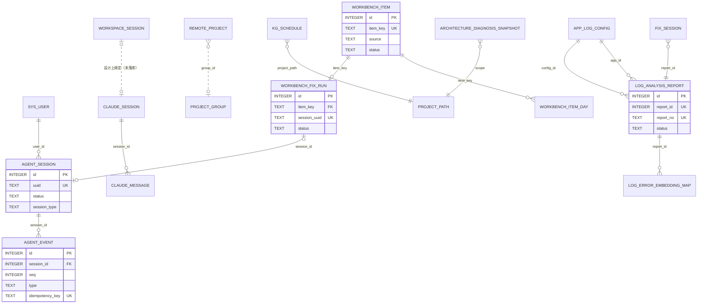

# 数据模型

> 自动生成于 2026-11-26，基于 `99d0037` 版本

---

## 1. 模型概览

### 1.1 存储分布

| 存储 | 技术 | 内容 | 建表 / 初始化 |
|------|------|------|--------------|
| SQLite | `sqlite-jdbc`，文件 `${user.home}/.hisi-devtool/devtool.db` | 会话、任务、报告、配置、待办、修复运行等 28 张表 | 启动时由各模块的 SchemaInitializer 以 `CREATE TABLE IF NOT EXISTS` 创建 |
| Neo4j | 外部 Bolt 服务器或进程内 harness | 知识图谱：15 种节点标签、17 种关系、约束与索引 | `neo4j.config.Neo4jInitializer` 在 `ApplicationReadyEvent` 时创建 |
| 进程内缓存 | Caffeine、`ConcurrentHashMap` | 诊断报告、异常 span 索引、去重缓存、查询向量、全局分析缓存 | 不持久化，重启丢失 |
| 文件系统 | — | pi 的配置与 skills、日志文件、git worktree、codegraph 数据库 | 由对应模块写入 |

### 1.2 SQLite 建表归属

| 初始化类 | 表数 | 表名 |
|---------|------|------|
| `config.SQLiteSchemaInitializer` | 21 | `app_config`、`claude_session`、`claude_message`、`workspace_session`、`prompt_template`、`generation_task`、`log_analysis_report`、`apm_session`、`apm_span`、`apm_test_case`、`glossary_term`、`kg_project_binding`、`log_error_embedding_map`、`app_log_config`、`remote_project`、`kg_schedule`、`sys_user`、`project_group`、`project_name_group`、`architecture_diagnosis_snapshot`、`vertical_domain_name` |
| `ram.config.RamSchemaInitializer` | 2 | `agent_session`、`agent_event` |
| `workbench.config.WorkbenchSchemaInitializer` | 3 | `workbench_item`、`workbench_item_day`、`workbench_fix_run` |
| `fixengine.config.FixSchemaInitializer` | 1 | `fix_session` |
| `service.impl.CaseMatchingServiceImpl`（`@PostConstruct`） | 1 | `diagnosis_cases` |

没有迁移框架：`pom.xml` 中没有 Flyway / Liquibase，`resources/db/migration/` 下的 SQL 文件不会被执行。老库的升级靠启动时的「尝试 `ALTER TABLE ... ADD COLUMN`，失败则忽略」和 `pragma_table_info` 判断。

### 1.3 实体关系图



> 图中 `PROJECT_PATH` 只是示意（多张表用 `project_path` 文本列指向同一个项目目录，没有独立的项目表）。`WORKSPACE_SESSION` 与 `CLAUDE_SESSION` 之间是虚线：模型上有 `claudeSessionId`，表里没有对应列，见 [会话与工作区](../03-模块说明/会话与工作区.md)。

---

## 2. SQLite 数据字典

类型按建表语句原样书写。时间列除特别说明外为 Unix 秒（`strftime('%s','now')`）。

### 2.1 会话、用户与配置

**`sys_user`** — 登录账号。首次启动时由 `SQLiteSchemaInitializer.seedRootAccount()` 创建 `root`（`ADMIN`）。

| 字段 | 类型 | 约束 | 说明 |
|------|------|------|------|
| `id` | INTEGER | PK，自增 | |
| `username` | TEXT | NOT NULL，UNIQUE | 用户名 |
| `password` | TEXT | NOT NULL | BCrypt 哈希 |
| `role` | TEXT | NOT NULL，默认 `MEMBER` | `ADMIN` / `MEMBER` |
| `created_at` / `updated_at` | INTEGER | 默认当前时间 | |

**`app_config`** — 运行时键值配置。

| 字段 | 类型 | 约束 |
|------|------|------|
| `key` | TEXT | PK |
| `value` | TEXT | |
| `updated_at` | INTEGER | 默认当前时间 |

**`claude_session`** — 浏览器终端里与 `claude` CLI 的对话。

| 字段 | 类型 | 约束 | 说明 |
|------|------|------|------|
| `id` | TEXT | PK | |
| `title` | TEXT | | |
| `scene` | TEXT | | 场景 |
| `status` | TEXT | 默认 `active` | 归档后为 `archived` |
| `metadata` | TEXT | | |
| `working_directory` | TEXT | | |
| `claude_session_code` | TEXT | | CLI 的会话 ID |
| `created_at` / `updated_at` | INTEGER | 默认当前时间 | |

**`claude_message`** — 终端对话消息。

| 字段 | 类型 | 约束 |
|------|------|------|
| `id` | INTEGER | PK，自增 |
| `session_id` | TEXT | NOT NULL，外键 → `claude_session(id)` |
| `role` | TEXT | NOT NULL |
| `content` | TEXT | NOT NULL |
| `created_at` | INTEGER | 默认当前时间 |

**`workspace_session`** — 工作区会话。

| 字段 | 类型 | 约束 | 说明 |
|------|------|------|------|
| `id` | TEXT | PK | |
| `project_path` | TEXT | | 实际存的是 `workingDirectory` |
| `initial_prompt` | TEXT | | |
| `status` | TEXT | 默认 `active` | |
| `created_at` | INTEGER | 默认当前时间 | |

**`prompt_template`** — 提示词模板，变量语法 `#{name}`。

| 字段 | 类型 | 约束 | 说明 |
|------|------|------|------|
| `template_key` | TEXT | PK | 如 `log-analysis`、`free-chat` |
| `name` | TEXT | NOT NULL | |
| `content` | TEXT | NOT NULL | |
| `variables` | TEXT | | JSON 数组 |
| `description` | TEXT | | |
| `updated_at` | INTEGER | 默认当前时间 | |

### 2.2 agent 流程会话

**`agent_session`** — 全部 agent 类流程共用的会话表（RAM、工作流、日志追问、合并分析、对话、修复、工作台修复）。

| 字段 | 类型 | 约束 | 说明 |
|------|------|------|------|
| `id` | INTEGER | PK，自增 | 后端内部 ID |
| `user_id` | TEXT | NOT NULL | 来源标识，如 `anonymous`、`merge-analysis`、`workbench` |
| `plan_id` | TEXT | | 多处用来存 `projectPath` |
| `status` | TEXT | NOT NULL | 见 5.1 的 `SessionStatus` |
| `current_node` | TEXT | | 当前节点 |
| `step_count` | INTEGER | NOT NULL，默认 0 | |
| `last_checkpoint_event_id` | INTEGER | | |
| `cache_key` | TEXT | | |
| `version` | INTEGER | NOT NULL，默认 0 | |
| `uuid` | TEXT | 后补 | 对外句柄；索引 `idx_agent_session_uuid` |
| `intent` | TEXT | 后补 | |
| `project_paths` | TEXT | 后补 | |
| `rerun_from_node` | TEXT | 后补 | 从该节点起强制重跑 |
| `source_branch` / `target_branch` | TEXT | 后补 | 合并分析用 |
| `session_type` | TEXT | 后补，默认 `DEMAND` | 见 5.1 的 `SessionType` |
| `created_at` / `updated_at` | INTEGER | 默认当前时间 | |

索引：`idx_agent_session_user(user_id)`、`idx_agent_session_status(status)`。

**`agent_event`** — 追加写的事件日志，SSE 推流与回放的数据源。

| 字段 | 类型 | 约束 | 说明 |
|------|------|------|------|
| `id` | INTEGER | PK，自增 | |
| `session_id` | INTEGER | NOT NULL，外键 → `agent_session(id)` | |
| `seq` | INTEGER | NOT NULL | 与 `session_id` 联合唯一 |
| `type` | TEXT | NOT NULL | 见 5.1 的 `EventType` |
| `payload` | TEXT | | JSON |
| `tool_use_id` | TEXT | | |
| `parent_event_id` | INTEGER | | |
| `idempotency_key` | TEXT | NOT NULL，UNIQUE | 重复追加按此键去重 |
| `cumulative_tokens` | INTEGER | NOT NULL，默认 0 | |
| `retry_count` | INTEGER | NOT NULL，默认 0 | |
| `clarify_round_no` | INTEGER | | `CLARIFY_REQ` 的轮次 |
| `inputs_hash` | CHAR(64) | | `CHECKPOINT` 的节点输入哈希 |
| `circuit_state` | TEXT | NOT NULL，默认 `OK` | |
| `cost_usd_cents` | INTEGER | NOT NULL，默认 0 | |
| `validator_status` | TEXT | NOT NULL，默认 `OK` | 失败时为 `FAIL` |
| `created_at` | INTEGER | 默认当前时间 | |
| `interrupted` | INTEGER | 后补，NOT NULL，默认 0 | |
| `turn_id` | TEXT | 后补 | 对话轮次 |

约束：`uk_agent_event_idem(idempotency_key)`、`uk_agent_event_seq(session_id, seq)`。索引：`idx_agent_event_session_tokens`、`idx_agent_event_session_seq`、`idx_agent_event_turn_id`。

### 2.3 知识图谱任务与绑定

**`generation_task`** — 图谱构建、向量生成、架构分析的统一任务表。

| 字段 | 类型 | 约束 | 说明 |
|------|------|------|------|
| `id` | INTEGER | PK，自增 | |
| `task_type` | TEXT | NOT NULL | `KG` / `VECTOR` / `ARCH_ANALYSIS` |
| `project_path` | TEXT | NOT NULL | |
| `status` | TEXT | 默认 `PENDING` | `PENDING` → `RUNNING` → `COMPLETED` / `FAILED` |
| `progress` | INTEGER | 默认 0 | |
| `total_count` / `success_count` / `fail_count` | INTEGER | 默认 0 | |
| `error_message` | TEXT | | |
| `started_at` / `finished_at` | INTEGER | | |
| `created_at` | INTEGER | 默认当前时间 | |

**`kg_project_binding`** — 前后端项目绑定。

| 字段 | 类型 | 约束 |
|------|------|------|
| `id` | INTEGER | PK，自增 |
| `backend_path` | VARCHAR(500) | NOT NULL |
| `frontend_path` | VARCHAR(500) | NOT NULL |
| `created_at` / `updated_at` | INTEGER | 默认当前时间 |

约束：`UNIQUE(backend_path, frontend_path)`。

**`glossary_term`** — 领域术语表。

| 字段 | 类型 | 约束 |
|------|------|------|
| `id` | INTEGER | PK，自增 |
| `project_path` | VARCHAR(500) | NOT NULL |
| `term` | VARCHAR(100) | NOT NULL |
| `synonym` | VARCHAR(100) | NOT NULL |
| `context` | VARCHAR(200) | |
| `created_at` / `updated_at` | INTEGER | 默认当前时间 |

索引：`idx_glossary_project(project_path)`。旧列名 `wrong_term` / `correct_term` 在启动时被重命名为 `term` / `synonym`。

### 2.4 日志

**`log_analysis_report`** — 日志分析报告，v1 与 v2 流程共用。

| 字段 | 类型 | 说明 |
|------|------|------|
| `id` | INTEGER PK，自增 | |
| `report_id` | INTEGER，UNIQUE | 对外的报告 ID |
| `report_no` | TEXT，UNIQUE | |
| `user_id` | TEXT | 默认 `sys_admin` |
| `query_params` | TEXT | |
| `log_message` / `log_stack_trace` / `filtered_stack_trace` | TEXT | 原始与过滤后的日志 |
| `error_type` | TEXT | |
| `trace_id` / `service_name` | TEXT | |
| `log_summary` / `error_summary` | TEXT | |
| `root_cause` | TEXT | v2 另存 `evidenceAnchors` 与 `verification` |
| `fix_suggestions` / `code_snippets` | TEXT | |
| `status` | TEXT，默认 `pending` | `pending` → `processing` → `completed` / `failed` |
| `created_at` / `updated_at` | INTEGER | 默认当前时间 |
| `error_fingerprint` | TEXT，后补，默认 `''` | 去重指纹 |
| `embedding_id` | TEXT，后补 | |
| `similarity_threshold` | REAL，后补，默认 `0.85` | |
| `analysis_status` | VARCHAR(20)，后补，默认 `pending` | |
| `occurrence_count` | INTEGER，后补，默认 1 | |
| `root_cause_text` / `fix_suggestion_text` | TEXT，后补 | |
| `config_id` | INTEGER，后补 | 来源拉取配置 |
| `app_id` | TEXT，后补 | 来源应用 |

**`log_error_embedding_map`** — 报告与向量嵌入的对应。

| 字段 | 类型 | 约束 |
|------|------|------|
| `id` | INTEGER | PK，自增 |
| `report_id` | INTEGER | NOT NULL |
| `embedding_id` | TEXT | NOT NULL |
| `similarity_score` | REAL | NOT NULL |
| `matched_report_id` | INTEGER | |
| `created_at` | INTEGER | 默认当前时间 |

**`app_log_config`** — 定时拉取配置。

| 字段 | 类型 | 约束 | 说明 |
|------|------|------|------|
| `id` | INTEGER | PK，自增 | |
| `app_id` | TEXT | NOT NULL，UNIQUE | |
| `project_path` | TEXT | NOT NULL | |
| `dsl_query` | TEXT | NOT NULL | |
| `pull_interval_minutes` | INTEGER | 默认 10 | |
| `enabled` | INTEGER | 默认 1 | |
| `last_pull_at` | INTEGER | | |
| `project_package_prefixes` | TEXT | 后补 | |
| `created_at` / `updated_at` | INTEGER | 默认当前时间 | |

**`diagnosis_cases`** — 历史诊断案例；由 `CaseMatchingServiceImpl` 建表，该服务在主代码中没有调用方。

| 字段 | 类型 |
|------|------|
| `id` | TEXT PK |
| `project_path` / `error_type` / `error_message` | TEXT |
| `stack_trace_summary` / `root_cause_analysis` / `solution_description` | TEXT |
| `verification_status` | TEXT |
| `usage_count` | INTEGER，默认 0 |
| `created_at` / `updated_at` | TIMESTAMP |

### 2.5 APM

**`apm_session`** — 一次目标 JVM 的调试会话。

| 字段 | 类型 | 约束 |
|------|------|------|
| `id` | TEXT | PK |
| `project_path` | TEXT | NOT NULL |
| `service_name` | TEXT | |
| `target_port` | INTEGER | |
| `status` | TEXT | 默认 `CREATED` |
| `created_at` | INTEGER | 默认当前时间 |
| `finished_at` | INTEGER | |

**`apm_span`** — OTel span。

| 字段 | 类型 | 约束 | 说明 |
|------|------|------|------|
| `id` | INTEGER | PK，自增 | |
| `session_id` | TEXT | NOT NULL | |
| `trace_id` / `span_id` | TEXT | NOT NULL | |
| `parent_span_id` | TEXT | | |
| `service_name` | TEXT | | |
| `operation_name` | TEXT | NOT NULL | |
| `span_kind` | TEXT | | `INTERNAL` / `SERVER` / `CLIENT` 等 |
| `start_time_ns` / `end_time_ns` | INTEGER | NOT NULL | 纳秒 |
| `status_code` / `status_message` | TEXT | | `UNSET` / `OK` / `ERROR` |
| `attributes` / `resource_attrs` | TEXT | | |
| `kg_node_id` | TEXT | | 映射到的图谱节点 |
| `kg_match_level` | INTEGER | 默认 3 | 0 精确、1 唯一、2 重载、3 未匹配 |
| `created_at` | INTEGER | 默认当前时间 | |

索引：`idx_apm_span_trace`、`idx_apm_span_session`、`idx_apm_span_created`。

**`apm_test_case`** — 可回放的请求配置。

| 字段 | 类型 | 约束 |
|------|------|------|
| `id` | INTEGER | PK，自增 |
| `name` | VARCHAR(200) | NOT NULL |
| `project_path` | VARCHAR(500) | NOT NULL |
| `entry_node_id` | VARCHAR(200) | |
| `method` | VARCHAR(10) | |
| `url` | VARCHAR(500) | |
| `headers` / `params` / `body` | TEXT | |
| `created_at` / `updated_at` | INTEGER | 默认当前时间 |

索引：`idx_apm_test_case_project`。

### 2.6 项目与调度

**`remote_project`** — 远程仓库登记。

| 字段 | 类型 | 约束 | 说明 |
|------|------|------|------|
| `id` | INTEGER | PK，自增 | |
| `name` / `git_url` | TEXT | NOT NULL | |
| `username` | TEXT | | |
| `encrypted_password` | TEXT | | AES-GCM 密文 |
| `branch` | TEXT | 默认 `main` | |
| `local_path` | TEXT | | |
| `clone_status` | TEXT | 默认 `PENDING` | `PENDING` / `CLONING` / `CLONED` / `FAILED` |
| `last_sync_at` | INTEGER | | |
| `created_at` | INTEGER | 默认当前时间 | |
| `clone_error` | TEXT | 后补 | |
| `auth_type` | VARCHAR(20) | 后补，默认 `PASSWORD` | `PASSWORD` / `SSH_KEY` / `TOKEN` |
| `ssh_key_path` | VARCHAR(255) | 后补 | |
| `encrypted_token` | VARCHAR(500) | 后补 | |
| `group_id` | INTEGER | 后补 | |
| `full_path` | VARCHAR(500) | 后补 | 克隆时固化的完整路径 |

**`project_group`** — 按 appId 的项目分组：`id`、`app_id`（唯一索引 `idx_project_group_app_id`）、`app_name`、`project_paths`（NOT NULL）、`description`、`created_at`、`updated_at`。

**`project_name_group`** — 按名称模式的分组：`id`、`group_name`（唯一索引 `idx_project_name_group_name`）、`group_pattern`（NOT NULL）、`project_names`（NOT NULL）、`description`、`created_at`、`updated_at`。

**`kg_schedule`** — 图谱定时构建。

| 字段 | 类型 | 说明 |
|------|------|------|
| `id` | INTEGER PK，自增 | |
| `project_path` | TEXT NOT NULL | |
| `cron_expression` | TEXT NOT NULL | |
| `build_mode` | TEXT，默认 `REUSE` | `REUSE` / `INCREMENTAL` / `WIPE` |
| `enabled` | INTEGER，默认 1 | |
| `last_run_at` / `next_run_at` | INTEGER | `next_run_at` 只读不写 |
| `created_at` | INTEGER | |
| `git_pull_enabled` | INTEGER，后补，默认 0 | |
| `branch` | TEXT，后补 | |
| `refresh_description` / `refresh_architecture` | INTEGER，后补，默认 0 | |

### 2.7 架构诊断

**`architecture_diagnosis_snapshot`** — 诊断报告快照：`id`（INTEGER PK）、`scope`（TEXT NOT NULL，单个项目路径）、`health_score`（INTEGER）、`grade`（TEXT）、`high_count` / `medium_count` / `low_count`（INTEGER）、`report_json`（TEXT，全量报告）、`created_at`（TEXT，本地时间）。索引：`scope`。

**`vertical_domain_name`** — 领域词到中文名的缓存：`domain_word`（TEXT PK）、`name`（TEXT NOT NULL）、`created_at`。

### 2.8 修复与工作台

**`fix_session`** — 修复引擎会话。

| 字段 | 类型 | 约束 | 说明 |
|------|------|------|------|
| `id` | TEXT | PK | 雪花式字符串 |
| `report_id` | TEXT | NOT NULL | 来源日志报告 |
| `chat_session_id` | TEXT | | |
| `session_type` | TEXT | 默认 `FIX` | |
| `status` | TEXT | 默认 `RUNNING` | 见 [修复引擎fixengine](../03-模块说明/修复引擎fixengine.md) |
| `worktree_path` / `branch_name` / `commit_hash` | TEXT | | |
| `throw_point_sig` / `error_msg` | TEXT | | |
| `tenant_id` / `create_by` / `update_by` | TEXT | 默认 `default` / `system` / `system` | |
| `del_flag` | INTEGER | 默认 0 | |
| `created_at` / `updated_at` | INTEGER | 默认当前时间 | |

索引：`report_id`、`chat_session_id`、`branch_name`、`tenant_id`。

**`workbench_item`** — 跨项目待办。

| 字段 | 类型 | 约束 | 说明 |
|------|------|------|------|
| `id` | INTEGER | PK，自增 | |
| `item_key` | TEXT | UNIQUE，NOT NULL | 去重键 |
| `source` | TEXT | NOT NULL | `log` / `arch_rule` / `arch_ai` |
| `project_path` / `title` | TEXT | NOT NULL | |
| `location` | TEXT | | 如 `类名#方法名` |
| `severity` | TEXT | 默认 `P2` | `P0` / `P1` / `P2` |
| `status` | TEXT | 默认 `NEW` | `NEW` / `RUNNING` / `WAITING` / `DONE` / `FAILED` / `IGNORED` |
| `confidence` / `chain_status` | TEXT | | 证据强度 |
| `why` / `suggestion` | TEXT | | |
| `evidence_json` / `source_ref_json` | TEXT | | |
| `occurrence_count` | INTEGER | 默认 1 | |
| `first_seen_at` / `last_seen_at` | INTEGER | | |
| `current_run_id` | INTEGER | | |
| `created_at` / `updated_at` | INTEGER | 默认当前时间 | |

索引：`status`、`project_path`、`source`。

**`workbench_item_day`** — 每日出现次数：`item_key`（TEXT NOT NULL）、`day`（TEXT NOT NULL）、`count`（INTEGER 默认 0）；主键 `(item_key, day)`。

**`workbench_fix_run`** — 一次 SDD 自动修复。

| 字段 | 类型 | 约束 | 说明 |
|------|------|------|------|
| `id` | INTEGER | PK，自增 | |
| `item_key` | TEXT | NOT NULL | |
| `session_uuid` | TEXT | UNIQUE，NOT NULL | 对外会话 UUID |
| `session_id` | INTEGER | | `agent_session.id` |
| `project_path` | TEXT | NOT NULL | |
| `status` | TEXT | 默认 `RUNNING` | `RUNNING` / `WAITING_CONFIRM` / `DONE` / `FAILED` / `ABORTED` / `INTERRUPTED` |
| `current_stage` | TEXT | | 阶段键 |
| `stage_index` | INTEGER | 默认 0 | |
| `iteration` | INTEGER | 默认 1 | |
| `chosen_option` | TEXT | | 选定的方案 |
| `push_requested` / `pushed` | INTEGER | 默认 0 | |
| `worktree_path` / `branch_name` / `commit_hash` | TEXT | | |
| `error_message` | TEXT | | |
| `created_at` / `updated_at` | INTEGER | 默认当前时间 | |

索引：`item_key`、`status`。

---

## 3. Neo4j 图模型

完整的字段表、约束与索引清单见 [Neo4j图存储与检索](../03-模块说明/Neo4j图存储与检索.md)，此处给全貌。

```mermaid
erDiagram
    CLASS ||--o{ METHOD : "HAS_METHOD"
    METHOD ||--o{ METHOD : "CALLS / IMPLEMENTS / OVERRIDE / EXTENDS / PROXY"
    METHOD ||--o{ SQL : "EXECUTES_SQL"
    METHOD ||--o{ DATA_MODEL : "USES_MODEL"
    SERVICE ||--o{ ENTRY_POINT : "HAS_ENTRY"
    ENTRY_POINT }o--|| METHOD : "methodNodeId"
    DOMAIN_NODE ||--o{ CLASS : "BELONGS_TO"
    DOMAIN_NODE ||--o{ DOMAIN_NODE : "INTERACTS_WITH"
    MODULE_NODE ||--o{ MODULE_NODE : "DEPENDS_ON"
    MODULE_NODE ||--o{ METHOD : "CONTAINS"
    COMPONENT ||--o{ API_CLIENT : "INVOKES"
    API_CLIENT ||--o{ ENTRY_POINT : "INVOKES_API"

    METHOD {
        STRING nodeId PK
        STRING className
        STRING methodName
        STRING projectPath
        STRING language
    }
    CLASS {
        STRING classId PK
        STRING className
        STRING classRole
    }
    ENTRY_POINT {
        STRING entryId PK
        STRING entryKey
        STRING entryType
        STRING methodNodeId
    }
    SQL {
        STRING nodeId PK
        STRING sqlId
        STRING mapperInterface
    }
    MODULE_NODE {
        STRING moduleId PK
        STRING level
        STRING layerRole
    }
    DOMAIN_NODE {
        STRING domainId PK
        STRING domainName
    }
```

| 标签 | 主键 | 向量属性 | 说明 |
|------|------|---------|------|
| `Method` | `nodeId` | `descriptionEmbedding`、`codeEmbedding` | 方法 |
| `Class` | `classId` | `descriptionEmbedding` | 类 |
| `EntryPoint` | `entryId` | `briefEmbedding`、`detailedEmbedding` | 入口点 |
| `Sql` | `nodeId` | `sqlEmbedding` | MyBatis SQL |
| `Service` | `serviceId` | — | 服务 |
| `DataModel` | `nodeId` | — | 数据模型 |
| `ModuleNode` | `moduleId` | — | 构建模块 / 包 |
| `DomainNode` | `domainId` | — | 图谱社区检测的领域 |
| `Component` | `componentId` | `descriptionEmbedding` | 前端组件 |
| `ApiClient` | `apiClientId` | `descriptionEmbedding` | 前端 API 客户端 |
| `FrontendRoute` | `frontendRouteId` | `descriptionEmbedding` | 前端路由 |
| `LogChunk` | `nodeId` | `embedding` | 日志块 |
| `ChurnNode` | `nodeId` | — | 文件变更频率 |
| `GenerationCheckpoint` | `checkpointId` | — | 全量构建检查点 |
| `AggregationCheckpoint` | `checkpointId` | — | 聚合阶段检查点 |

全部向量索引为 cosine，维度取自 `embedding.dimension`（代码默认 4096）。图里没有独立的项目节点，各节点以 `projectPath` 属性标识归属。

---

## 4. 进程内模型（不持久化）

| 模型 | 位置 | 要点 |
|------|------|------|
| `ApiResponse<T>` | `model` | `code`、`message`、`data` |
| `PiFlowClient.PiResult` | `piagent` | `finalText`、`toolCalls`、`stopReason`、`timedOut`、`note` |
| `ReActSession.Result` | `agentbase` | `text`、`json`、`note` |
| `PromptBudget.Report` / `Fitted` | `piagent.context` | 压缩前后的字符数与估算 token、是否保形、截断列表数、原文落盘路径 |
| `FlowToolManifest` | `piagent` | `flow`、工具集合、最高级别、是否连 MCP、是否关闭思考 |
| `ExecutionResult` / `ExecutionPolicy` | `workflow` | 已执行与跳过的节点、末节点输出；确认门与节点事件开关 |
| `DiagnoseReport` | `apm.model` | 状态机 `PENDING` → `RUNNING` → `DONE` / `FAILED` / `CANCELLED` / `TIMEOUT` / `LOW_CONFIDENCE` |
| `ApmErrorCode` | `apm.model` | 数值错误码，按区段分组 |
| `EvidencePack` / `EvidenceAnchor` | `agentflow` | 日志分析 v2 的证据编号与引用 |
| `ChangeRequest` / `ImpactReport` / `RiskAssessment` | `service.impact.model` | 静态影响分析的输入输出 |
| `WorkbenchStages` | `workbench.model` | 8 个阶段的键、名称、提示 |

缓存：

| 缓存 | 键 | 容量 / 过期 |
|------|-----|------------|
| `DiagnosisReportStore` | `reportId` | 500 条，访问后 2 小时 |
| `DiagnosisDedupCache` | `traceId + "|" + projectPath` | 2000 条，30 分钟 |
| `ExceptionSpanIndex` | `traceId` | 10000 个，2 小时，每 trace 最多 50 个 span |
| `QueryEmbeddingCache` | 查询文本的 MD5 | 1000 条，1 小时 |
| `GlobalAnalysisCache` | 多个共享 Map | 预扫描的 bean、继承、URI、MQ 端点等 |
| `SessionMappingService` | 会话 UUID ↔ 后端 ID | 内存；合并分析控制器另有一份上限 10000 的映射 |

---

## 5. 枚举与状态值

### 5.1 agent 流程

| 枚举 | 取值 |
|------|------|
| `SessionStatus` | `RUNNING`、`WAITING_CLARIFY`、`WAITING_HITL`、`PAUSED`、`DONE`、`FAILED`、`ABORTED`、`ARCHIVED` |
| `SessionType` | `DEMAND`、`STATUS`、`PHASE2`、`MERGE_ANALYSIS`、`LOG_FOLLOWUP`、`FIX`、`WORKFLOW` |
| `EventType` | `USER_MSG`、`ASSISTANT_DELTA`、`TOOL_USE`、`TOOL_RESULT`、`CHECKPOINT`、`CLARIFY_REQ`、`CLARIFY_RES`、`HITL_REQ`、`HITL_RES`、`NODE_START`、`NODE_COMPLETE`、`NODE_DELTA`、`NODES_CLEARED`、`ERROR`、`TURN_INTERRUPTED`、`MESSAGE` |

### 5.2 检索

| 枚举 | 取值 |
|------|------|
| `QueryType` | `NATURAL_LANGUAGE`、`METHOD_NAME`、`FULL_QUALIFIED_NAME`、`FULL_QUALIFIED_CLASS_NAME`、`CLASS_NAME`、`SQL_SNIPPET`、`HTTP_URI`、`CODE_SNIPPET`、`ANNOTATION`、`EXCEPTION_TYPE` |
| `SearchType` | `METHOD`、`CLASS`、`SQL`、`ENTRY`、`ALL` |
| `IntentType`（括号内为默认权重） | `GENERAL`(1.0)、`SCHEDULE`(2.0)、`HTTP`(2.0)、`SQL`(1.8)、`EXCEPTION`(1.8)、`LISTENER`(1.8)、`CONFIG`(1.8)、`AUTH`(1.8)、`TRANSACTION`(1.8)、`KEYWORD_SUPPLEMENT`(0.1) |
| `SearchErrorCode`（HTTP 状态） | `QUERY_TOO_SHORT`(400)、`EMBEDDING_SERVICE_UNAVAILABLE`(503)、`GRAPH_SERVICE_ERROR`(500)、`TIMEOUT`(504)、`UNKNOWN_ERROR`(500) |

### 5.3 图谱与构建

| 枚举 / 常量 | 取值 |
|------------|------|
| `BuildMode` | `INCREMENTAL`、`REUSE`、`WIPE` |
| `ModuleNode.level` | `build-module`、`package` |
| `ModuleNode.layerRole`（类注释） | `CONTROLLER`、`SERVICE`、`REPOSITORY`、`MAPPER`、`DATA`、`UTILITY`、`UNKNOWN`；启动回填把 `DATA` → `MODEL`、`MAPPER` → `REPOSITORY` |
| `ClassNode.classRole` | `CONTROLLER`、`SERVICE`、`REPOSITORY`、`MODEL`、`UTILITY`、`UNKNOWN` |
| span 匹配级别 | 0 `EXACT`、1 `UNIQUE`、2 `OVERLOADED`、3 `UNMATCHED` |

---

## 6. 数据流转矩阵

**C** = 创建，**R** = 读取，**U** = 更新，**D** = 删除。粗体 C 表示该模块是数据的创建者。

| 表 | 会话与配置 | 知识图谱 | RAM / 工作流 | 工作台 | 日志 | APM | 远程项目 | 修复引擎 |
|----|-----------|---------|------------|-------|------|-----|---------|---------|
| `sys_user` | **C** R U（启动种 root、登录注册、改角色） | | | | | | | |
| `app_config` | R **C** U | | | | | | R | |
| `claude_session` / `claude_message` | **C** R U D | | | | | | | |
| `workspace_session` | **C** R U D | | | | | | | |
| `prompt_template` | **C** R U | | | | | | | |
| `agent_session` / `agent_event` | | | **C** R U | **C** R U | **C** R U | | | **C** R U |
| `generation_task` | | **C** R U | | | | | R（调度触发） | |
| `kg_project_binding` | | **C** R U D | | | | | | |
| `glossary_term` | | R | | | | | **C** R U D | |
| `log_analysis_report` | | | | R | **C** R U D | | | R |
| `log_error_embedding_map` | | | | | **C** R | | | |
| `app_log_config` | | | | | **C** R U D | | | |
| `diagnosis_cases` | | | | | （建表，无调用方） | | | |
| `apm_session` | | | | | | **C** R U | | |
| `apm_span` | | | | | | **C** R U D | | |
| `apm_test_case` | | | | | | **C** R U D | | |
| `remote_project` | | | | | | | **C** R U D | |
| `project_group` / `project_name_group` | | | | | | | **C** R U D | |
| `kg_schedule` | | R | | | | | **C** R U D | |
| `architecture_diagnosis_snapshot` | | **C** R | | R | | | | |
| `vertical_domain_name` | | **C** R D | | | | | | |
| `workbench_item` / `workbench_item_day` | | | | **C** R U | | | | |
| `workbench_fix_run` | | | | **C** R U | | | | |
| `fix_session` | | | | | | | **C** R U |

Neo4j 侧：`knowledgegraph` 是全部业务节点的创建者；`archdiagnosis`、检索、RAM、日志、APM（映射）为只读消费者。`LogChunk` 节点的写入只出现在 `service.AnalysisPipelineService` 中，而该服务在主代码里没有调用方。

---

## 7. 数据生命周期

| 数据 | 创建 | 更新 | 删除 / 过期 |
|------|------|------|------------|
| 图谱节点 | 全量或增量构建 | 增量刷新、`REUSE` 模式按 `codeHash` 复用 | 构建末尾清理孤儿节点 |
| 向量 | `VectorGenerationService` | 重新生成 | 随节点删除 |
| `generation_task` | 入队时 | 进度与状态 | 代码中未见清理 |
| `agent_event` | 节点执行时追加 | 不更新 | 代码中未见清理 |
| 日志报告 | 提交分析 | 状态与结论 | DELETE 接口 |
| `apm_span` | OTLP 上报 | KG 映射 | `ApmCleanupService` 按 `apm.span-ttl-hours` 清理 |
| 诊断报告、异常 span 索引 | 诊断提交 | 状态流转 | 缓存过期 |
| `workbench_item` | 聚合同步 | 每次同步、状态操作 | 代码中未见清理 |
| git worktree | 修复引擎或工作台创建 | — | 远程项目删除时清目录；修复 worktree 的清理未在代码中确认 |
| pi 的会话目录与完整提示词 | 每次 pi 会话 | — | 代码中未见清理 |

---

## 8. 数据安全分类

| 数据 | 敏感级别 | 存储方式 | 说明 |
|------|---------|---------|------|
| 模型与向量服务密钥 | 高 | 环境变量或本机 `application-local.yml` | 不写进仓库；pi 进程经环境变量 `HISI_LLM_KEY` 获得密钥，`models.json` 里只写引用 |
| JWT 签名密钥 | 高 | 环境变量 `JWT_SECRET` 或本机文件 | 未配置则每次启动随机生成 |
| 管理员初始口令 | 高 | 环境变量 `HISI_ROOT_PASSWORD` | 未配置则随机生成并打印到启动日志 |
| Git 凭据 | 高 | `remote_project` 表 | AES-GCM 加密；未配置 `hisi.encrypt.key` 时使用源码内置默认密钥 |
| 登录口令 | 高 | `sys_user` 表 | BCrypt 哈希 |
| 用户令牌（请求侧） | 高 | — | SSE 走查询参数；全局异常处理写日志前掩码 |
| 源码与方法体 | 中 | Neo4j `methodBody`、被分析仓库 | 本机或内网存储 |
| 日志原文与堆栈 | 中 | `log_analysis_report` | 持久化原始消息与堆栈 |
| 对话与终端历史 | 中 | `claude_message`、`agent_event` | 本地 SQLite |
| 提示词与模型输出 | 低–中 | `agent_event`、pi 会话目录 | 完整原文在上下文压缩时落盘 |

---

> **延伸阅读**：
> - 图模型的约束与索引 → [Neo4j图存储与检索](../03-模块说明/Neo4j图存储与检索.md)
> - 接口的入参与出参 → [05-接口文档](../05-接口文档/index.md)
> - 数据的流转路径 → [04-数据流程](../04-数据流程/index.md)
