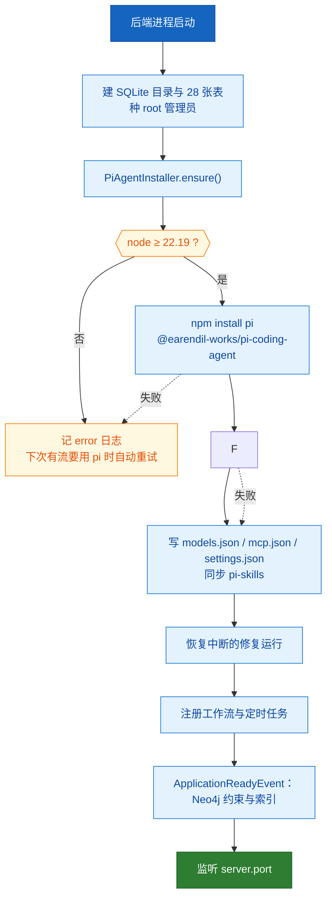
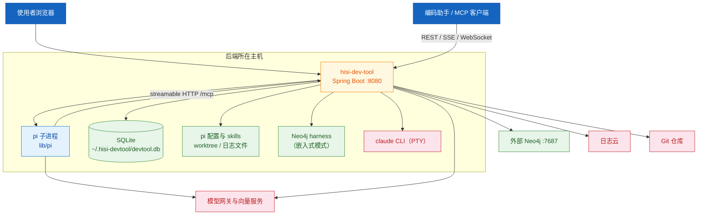

# 部署运维

> 自动生成于 2026-11-26，基于 `99d0037` 版本；2026-11-28 按 `ecc9370` 更新

本页只写键名、环境变量名与占位示例，不写任何密钥、口令、令牌、内网地址或本机绝对路径；具体取值以部署环境的 `application-local.yml` 与环境变量为准。

---

## 1. 环境要求

### 1.1 运行时依赖

| 依赖 | 版本要求 | 用途 | 验证命令 |
|------|---------|------|---------|
| JDK | 17（`pom.xml` 的 `java.version`） | 运行后端 | `java -version` |
| Maven | 3.x | 构建后端 | `mvn -v` |
| Node.js | **≥ 22.19.0** | 运行 pi（代码常量 `REQUIRED_NODE_MAJOR = "22.19.0"`） | `node -v` |
| npm | 随 Node | 安装 pi（Windows 上后端调用的是 `npm.cmd`；MCP 工具由进程内服务提供，不需要 npm 构建） | `npm -v` |
| Neo4j | ≥ 5.11（向量索引的最低版本，代码常量 `MIN_VECTOR_INDEX_VERSION`） | 图数据库；或改用进程内嵌入式模式 | 在 Neo4j Browser 执行 `RETURN 1` |
| Git | — | 克隆、增量构建判断、worktree | `git --version` |
| `claude` CLI | 可选 | 浏览器终端对话；默认从 PATH 解析 | `claude --version` |

### 1.2 操作系统兼容性

| 系统 | 说明 |
|------|------|
| Windows | 代码有针对性处理：pi 安装用 `npm.cmd`；终端 PTY 先起 `cmd.exe` 再键入 `claude` 命令；`methods-include` 超过 16000 字符时改走配置文件 |
| Linux / macOS | 终端 PTY 直接以 `claudePath` 启动；npm 命令名 `npm` |
| 其他 | 未在代码中确认 |

### 1.3 网络与外部服务

| 用途 | 目标 | 是否必需 |
|------|------|---------|
| 安装 pi | `piagent.registry` 指定的 npm 源 | 首次启动必需 |
| 模型调用 | Anthropic 协议模型网关（`piagent.model-base-url`）、OpenAI 兼容的文本与向量端点（`text-model.*`、`embedding.*`） | 用到 LLM 与检索时必需 |
| 图数据库 | `neo4j.uri`（外部）或本地目录（嵌入式） | 必需 |
| 日志云 | `logcloud.*` | 只有用日志拉取时 |
| OTel agent 下载 | Maven Central 镜像，失败回退 GitHub releases | 只有用 APM 调试时 |

内网环境需要代理时，用 `proxy.*` 配置或环境变量，也可在运行后经 `POST /api/settings/proxy` 修改。

---

## 2. 配置

### 2.1 配置来源与加载顺序

| 来源 | 说明 |
|------|------|
| `application.yml` | 仓库内，含全部默认值；激活 profile 为 `dev,local` |
| `application-local.yml` | `spring.config.import: optional:classpath:application-local.yml`；**不入库**，放密钥等本机覆盖值 |
| `application-prod.yml` | 激活 `prod` profile 时叠加；只含 `cors.allowed-origins`、`llm.*`、`springdoc.*`、`logging.level.*` |
| 环境变量 | 覆盖任意配置键（Spring 松散绑定），见 2.3 |
| 运行时修改 | `POST /api/settings/config`（写回 `application.yml`）、`POST /api/settings/proxy`（立即生效并写回） |

### 2.2 必须由部署方提供的键

| 键 | 用途 | 提供方式 |
|----|------|---------|
| `embedding.api-key` | 向量模型密钥 | `application.yml` 中没有这个键；在 `application-local.yml` 写，或用环境变量 `EMBEDDING_API_KEY` |
| `text-model.api-key` | 文本模型密钥（KG 描述生成） | 环境变量 `TEXT_MODEL_API_KEY`，或 `application-local.yml` |
| `neo4j.password` | Neo4j 口令 | 环境变量 `NEO4J_PASSWORD`，或 `application-local.yml` |
| `anthropic.api-key`、`anthropic.base-url`、`anthropic.model` | 模型网关：pi 的 `models.json`、`DeepseekJsonClient`、`QueryDecomposer` 回退都读这一段 | 环境变量 `ANTHROPIC_API_KEY`、`ANTHROPIC_URL`、`ANTHROPIC_MODEL`，或 `application-local.yml` |
| `hisi.apm.diagnose.llm.api-key` | 仅当需要 `ApmClaudeLlmClient` 时；留空则回退到 `UnifiedTextService` 支撑的默认 `LlmClient` | 环境变量 `APM_DIAGNOSE_LLM_API_KEY`，或 `application-local.yml` |
| `jwt.secret` | 令牌签名密钥，至少 32 字节；不配置则每次启动随机生成，重启后已签发令牌全部失效 | 环境变量 `JWT_SECRET`，或 `application-local.yml` |
| `hisi.auth.root-password` | 管理员 `root` 的初始口令，仅首次启动建库时使用；留空则随机生成并打印在启动日志 | 环境变量 `HISI_ROOT_PASSWORD` |
| `app.project_dir` | 后端项目根目录；仓库内默认值是某台开发机上的路径，**必须按环境覆盖** | `application-local.yml` 或启动参数 |
| `hisi.encrypt.key` | 远程项目凭据加密密钥；不配置时使用源码内置默认密钥 | 环境变量 `HISI_ENCRYPT_KEY` |

> `piagent.model-base-url` 与 `application-local.yml` 里的网关地址是同一个模型网关的两种配置入口：pi 读 `piagent.*`，`DeepseekJsonClient` 读 `anthropic.*`。

### 2.3 环境变量

**经 `application.yml` 占位符读取（39 个）**

| 分组 | 变量 | 对应键 | 缺省行为 |
|------|------|-------|---------|
| 模型 | `TEXT_MODEL_API_KEY` | `text-model.api-key` | 空 |
| 模型 | `ANTHROPIC_API_KEY` / `ANTHROPIC_URL` / `ANTHROPIC_MODEL` | `anthropic.api-key` / `base-url` / `model` | 空；`base-url` 为空时 `DeepseekJsonClient` 用代码内置地址 |
| 模型 | `APM_DIAGNOSE_LLM_API_KEY` | `hisi.apm.diagnose.llm.api-key` | 空（不装配 `ApmClaudeLlmClient`） |
| 模型 | `RERANK_BASE_URL` / `RERANK_MODEL` / `RERANK_API_KEY` | `search.rerank.*` | 空，重排关闭 |
| 认证 | `JWT_SECRET` | `jwt.secret` | 随机 |
| 认证 | `HISI_ROOT_PASSWORD` | `hisi.auth.root-password` | 随机 |
| 认证 | `CORS_ALLOWED_ORIGINS` | `cors.allowed-origins` | `*` |
| 图数据库 | `NEO4J_PASSWORD` | `neo4j.password` | 空 |
| 图数据库 | `NEO4J_DATABASE` | `neo4j.database` | `codeKnowledge` |
| 图数据库 | `NEO4J_EMBEDDED` / `NEO4J_DATA_DIR` | `neo4j.embedded.enabled` / `data-directory` | `false` / `./neo4j-data` |
| 代码拉取 | `CODEHUB_USERNAME` / `CODEHUB_PASSWORD` | `app.codeHubUser` / `app.codeHubPassword` | 占位值 |
| 代理 | `PROXY_ENABLED` / `PROXY_HOST` / `PROXY_PORT` / `PROXY_TYPE` / `PROXY_USERNAME` / `PROXY_PASSWORD` / `PROXY_NON_HOSTS` / `PROXY_DISABLE_SSL_VERIFICATION` | `proxy.*` | `false` / 空 / `0` / `HTTP` / 空 / 空 / 见 yml / `true` |
| 日志云 | `LOGCLOUD_USERNAME` / `LOGCLOUD_PASSWORD` / `LOGCLOUD_APPKEY` | `logcloud.username` / `password` / `api.header-appkey` | 空或占位值 |
| 日志拉取 | `LOG_PULL_ENABLED` / `LOG_PULL_INTERVAL` | `log.pull.enabled` / `default-interval-minutes` | **代码不读取这两个键** |
| 影响分析 | `IMPACT_DEFAULT_COVERAGE_SCORE` | `impact.default-coverage-score` | `50` |
| APM | `APM_OTEL_AGENT_PATH` / `APM_TARGET_READY_TIMEOUT` | `apm.otel-agent-path` / `target-ready-timeout-seconds` | 空 / `600` |
| 构建 | `MAVEN_SETTINGS` / `MAVEN_REPO` / `MAVEN_JAVA_HOME` / `MAVEN_SSL_INSECURE` / `MAVEN_SSL_ALLOWALL` / `MAVEN_SSL_IGNORE_VALIDITY_DATES` | `maven.*` | 见 yml；由构建脚本读取，不是 Java 配置 |

`application-prod.yml` 另有 `LLM_API_KEY`（键 `llm.api-key`）。

**只作为进程环境变量使用（不对应 Spring 配置键）**

| 变量 | 由谁设置 | 传给谁 | 用途 |
|------|---------|-------|------|
| `HISI_LLM_KEY` | 后端（取 `anthropic.api-key`） | pi 子进程 | `models.json` 里写的是 `$HISI_LLM_KEY` 引用，真实密钥不落盘 |
| `HISI_SCOPE_TOKEN` | 后端（取调用方传入的用户令牌） | pi 子进程 | 带用户的流经 `mcp.json` 的请求头引用把它带进进程内 MCP，动作工具以用户身份回调后端 |
| `PI_CODING_AGENT_DIR` | 后端 | pi 子进程 | pi 的配置目录（只读流用 `<agent-dir>`，带用户的流用 `<agent-dir>-act`） |
| `HISI_ENCRYPT_KEY` | 部署方 | Spring（松散绑定到 `hisi.encrypt.key`） | 凭据加密密钥 |

### 2.4 配置键清单

**`application.yml` 中定义的键**

| 分组 | 键 |
|------|-----|
| 应用 | `spring.application.name`、`spring.profiles.active`、`spring.datasource.url`、`spring.datasource.hikari.connection-init-sql`、`spring.websocket.max-text-message-buffer-size`、`spring.websocket.max-binary-message-buffer-size`、`spring.main.allow-circular-references`、`spring.autoconfigure.exclude`、`spring.config.import` |
| 限流（位置特殊） | `spring.qps`、`spring.burst`、`spring.acquire-timeout-seconds`（放在 `spring` 段下，Java 代码中未发现引用） |
| 文本模型 | `text-model.api-key`、`text-model.base-url`、`text-model.model`、`text-model.temperature`、`text-model.max-tokens`、`text-model.timeout`、`text-model.max-retries`、`text-model.retry-base-delay-ms`、`text-model.qps`、`text-model.burst`、`text-model.acquire-timeout-seconds` |
| 认证 | `hisi.auth.root-password`、`jwt.secret`、`jwt.expiration-ms` |
| APM 诊断 LLM | `hisi.apm.diagnose.llm.base-url`、`.model`、`.api-key`、`.timeout-seconds`、`.max-concurrency`、`.temperature`、`.max-tokens` |
| Agent 类型表 | `hisi.agents.<key>.system-prompt`、`.provider`（6 个 key）；`hisi.agents.fix.tool-call-limit`、`hisi.agents.fix.hitl.mode`、`hisi.agents.fix.hitl.timeout-minutes` |
| 应用路径与凭据 | `app.project_dir`、`app.codeHubUser`、`app.codeHubPassword` |
| 跨域 | `cors.allowed-origins` |
| 影响分析 | `impact.default-coverage-score` |
| 日志级别 | `logging.level.root`、`.com.example.llmapi`、`.com.huawei.hisi`、`.org.springframework.web`、`.org.springframework`、`.org.springframework.beans`、`.org.springframework.context`、`.org.springframework.data.neo4j.cypher.deprecation`、`.org.springframework.data.neo4j.cypher.unrecognized`、`.com.huawei.hisi.neo4j`、`.com.huawei.hisi.knowledgegraph` |
| 日志云 | `logcloud.base-url`、`logcloud.app-id`、`logcloud.username`、`logcloud.password`、`logcloud.api.base-url`、`logcloud.api.query-path`、`logcloud.api.header-xhw-id`、`logcloud.api.header-appkey`、`logcloud.api.timeout`、`logcloud.api.connect-timeout`、`logcloud.browser.headless`、`logcloud.browser.timeout`、`logcloud.browser.cache-expire` |
| 日志拉取 | `log.pull.enabled`、`log.pull.default-interval-minutes` |
| 异常继承 | `exception.inheritance.enable-defaults`（代码无引用） |
| 代码分析开关 | `analysis.features.enhanced-interface-resolution`、`.enhanced-field-call-resolution`、`.spring-annotation-aware`、`.debug-logging` |
| Neo4j | `neo4j.embedded.enabled`、`neo4j.embedded.data-directory`、`neo4j.uri`、`neo4j.database`、`neo4j.username`、`neo4j.password`、`neo4j.pool.max-connection-pool-size`、`neo4j.pool.connection-timeout` |
| 代理 | `proxy.enabled`、`proxy.host`、`proxy.port`、`proxy.type`、`proxy.username`、`proxy.password`、`proxy.non-proxy-hosts`、`proxy.disable-ssl-verification` |
| APM | `apm.otel-agent-version`、`apm.otel-agent-path`、`apm.target-ready-timeout-seconds`、`apm.span-ttl-hours`、`apm.target-shutdown-grace-seconds` |
| RAM SSE | `ram.sse.pool-size`、`ram.sse.poll-interval-ms` |
| 检索 | `search.intent-weights.GENERAL`、`.SCHEDULE`、`.HTTP`、`.SQL`、`.EXCEPTION`、`.LISTENER`、`.CONFIG`、`.AUTH`、`.TRANSACTION`、`.KEYWORD_SUPPLEMENT`；`search.rrf.k`、`search.rrf.log-scale-alpha`、`search.rrf.log-scale-base`、`search.rrf.max-multi-hit-ratio`、`search.rrf.callee-propagation-ratio`、`search.rrf.annotation-bonus-score`、`search.rrf.dual-channel-threshold`、`search.rrf.required-word-filter-enabled`；`search.rerank.enabled`、`search.rerank.base-url`、`search.rerank.model`、`search.rerank.api-key` |
| 模型网关 | `anthropic.api-key`、`anthropic.base-url`、`anthropic.model` |
| 熔断 | `resilience4j.circuitbreaker.configs.default.sliding-window-size`、`.failure-rate-threshold`、`.wait-duration-in-open-state`、`.permitted-number-of-calls-in-half-open-state`；`resilience4j.circuitbreaker.instances.llm-anthropic.base-config`、`resilience4j.circuitbreaker.instances.llm-zhipu.base-config`（Java 代码中未发现对这两个实例名的引用） |
| 构建脚本 | `maven.settings`、`maven.repo`、`maven.java-home`、`maven.ssl.insecure`、`maven.ssl.allowall`、`maven.ssl.ignore-validity-dates` |
| 工作台 | `workbench.sync.enabled`、`workbench.sync.interval-ms`、`workbench.fix.push-enabled`、`workbench.fix.max-concurrent-runs`、`workbench.fix.max-iterations` |
| pi | `piagent.enabled`、`piagent.install-dir`、`piagent.agent-dir`、`piagent.package-version`、`piagent.registry`、`piagent.model-base-url`、`piagent.model-id`、`piagent.max-concurrent-processes`、`piagent.deadline-minutes`、`piagent.context.max-input-tokens`、`piagent.context.compaction-reserve-tokens`、`piagent.context.compaction-keep-recent-tokens`、`piagent.flows.arch-react`、`piagent.flows.one-shot` |

**只在代码里给默认值、`application.yml` 未定义的键**

| 分组 | 键（代码默认值） |
|------|----------------|
| 服务 | `server.port`（8080，Spring 默认） |
| 向量 | `embedding.api-key`、`embedding.base-url`、`embedding.model`、`embedding.dimension`（4096）、`embedding.timeout`、`embedding.max-retries`、`embedding.retry-base-delay-ms`、`embedding.qps`、`embedding.burst`（10）、`embedding.acquire-timeout-seconds`、`embedding.batch-size`（20） |
| 向量生成 | `vector.generation.concurrency`（6）、`vector.generation.batch-size`、`vector.generation.progress-update-interval`（10） |
| codegraph | `codegraph.dist-path`（`lib/codegraph`）、`codegraph.timeout-seconds`（600） |
| 直连 JSON 客户端 | `deepseek.connect-timeout-ms`（10000）、`deepseek.read-timeout-ms`（600000） |
| 一次性调用 | `agentflow.llm.call-timeout-seconds`（300） |
| RAM | `ram.sse.timeout-ms`（300000）、`ram.chat.timeout-seconds`（300）、`ram.registry.path`（`ram/agents.yaml`） |
| 日志 | `log.followup.timeout-seconds`、`loganalysis.v2.max-frames`、`loganalysis.v2.max-bodies`、`loganalysis.v2.body-chars`、`loganalysis.v2.upstream-depth`、`loganalysis.v2.evidence-max-chars`、`loganalysis.v2.hypothesis-max-tokens`、`loganalysis.v2.synthesis-max-tokens`、`loganalysis.v2.evaluator-max-tokens`、`loganalysis.v2.evaluator.enabled` |
| 采集解码 | `hisi.capture.crypto.private-key-path`、`hisi.capture.crypto.private-key-b64` |
| 修复 | `hisi.fix.worktree-base-dir`、`hisi.encrypt.key` |
| 工作台 | `workbench.fix.e2e.start-service`（true）、`workbench.fix.e2e.isolate-home`（true） |
| APM | `hisi.apm.diagnose.enabled`、`.executor-core-pool-size`、`.executor-max-pool-size`、`.executor-queue-capacity`、`.executor-keep-alive-seconds`、`.timeout-seconds`、`.llm-enabled`、`.llm-timeout-seconds`、`.kg-enabled`、`.confidence-low-threshold`；`apm.otel-extension-path`、`apm.otlp-receiver-port` |
| 终端 | `claude.working-directory`、`claude.claude-path` |
| 技能 | `skill.market.codeai.path` |
| 其他 | `cost.limiter.daily-limit`、`snowflake.datacenter.id`、`snowflake.machine.id`、`zhipu.*` |

---

## 3. 构建与启动

### 3.1 启动时自动完成的事



| 步骤 | 行为 | 失败影响 |
|------|------|---------|
| 建表 | 5 处初始化器依次执行 | 启动失败 |
| 检查 node | `node -v` 低于 22.19.0 即失败 | pi 相关功能不可用；不阻断启动 |
| 安装 pi | 版本与锁定值一致且 CLI 入口存在才算已装；否则删旧目录后 `npm install` | 同上 |
| 写配置 | `models.json`、`mcp.json`、`settings.json` 写入 `piagent.agent-dir`（另写一份带令牌请求头的到 `<agent-dir>-act`） | 同上 |
| 同步 skills | `resources/pi-skills/` → `<agent-dir>/skills/`，并删除已下线的 | — |

每条外部命令最长等 10 分钟。pi 安装失败不阻断后端启动：之后任何流执行前都会调 `ensureReady()` 再试一次。

### 3.2 开发环境

```bash
# 1. 准备本机覆盖配置（不入库）
#    在 src/main/resources/ 下创建 application-local.yml，至少包含 2.2 节列出的键

# 2. （可选）启动外部 Neo4j；或不启动而用嵌入式模式：NEO4J_EMBEDDED=true

# 3. 构建并启动
mvn spring-boot:run
```

仓库的 `hisi-dev-tool/` 下另有 `build.sh`、`build.bat`、`start.sh`、`restart-backend.sh` 与 `docker-compose.neo4j.yml`、`.env.neo4j.example`；它们的具体行为未在本次阅读中逐个核对。

### 3.3 生产构建

```bash
mvn clean package -DskipTests
java -jar target/devTools-1.0.0.jar --spring.profiles.active=prod,local
```

`pom.xml` 中 `artifactId` 为 `devTools`、`version` 为 `1.0.0`。激活 `prod` 时 CORS 白名单没有默认值，必须通过 `CORS_ALLOWED_ORIGINS` 提供。

### 3.4 构建流程图


---

## 4. 部署架构



| 端口 / 目录 | 占用者 | 说明 |
|-----------|-------|------|
| 8080 | 后端 HTTP | `server.port`；`mcp.json` 里的回调地址跟着它走 |
| 7687 | 外部 Neo4j（Bolt） | 嵌入式模式下不需要 |
| 18080 起 | APM 调试的目标进程 | 自动分配端口的起点 |
| `~/.hisi-devtool/devtool.db` | SQLite | `spring.datasource.url` |
| `~/.hisi-devtool/devtool.log` | 应用日志 | `logback-spring.xml` |
| `<piagent.install-dir>` | pi 包 | 默认 `lib/pi`，相对后端工作目录 |
| `<piagent.agent-dir>` | pi 配置、skills、会话 | 默认 `lib/pi-agent` |

---

## 5. 健康检查

| 检查项 | 方式 | 预期 |
|-------|------|------|
| 应用存活 | `GET /api/ops/health` | `ApiResponse`，`code=200` |
| RAM 模块 | `GET /api/ram/health` | `ApiResponse` |
| 诊断框架 | `GET /api/diagnosis/health` | `ApiResponse` |
| 数据库已初始化 | 启动日志 | 出现各初始化器的 complete 日志 |
| Neo4j 就绪 | 启动日志「开始初始化 Neo4j 约束和索引」之后无失败告警 | 约束与索引全部创建成功 |
| pi 就绪 | 启动日志 `[PiAgent] 就绪` | 出现 CLI 入口与 agentDir |
| 首次登录 | 用 `root` 与初始口令调 `POST /api/auth/login` | 返回 `token` 与 `role=ADMIN` |

Spring Boot Actuator 依赖在 `pom.xml` 中，`application.yml` 没有修改暴露配置。

---

## 6. 日志

| 项目 | 值 |
|------|-----|
| 配置文件 | `src/main/resources/logback-spring.xml` |
| 控制台 | 全部日志 |
| 文件 | `${user.home}/.hisi-devtool/devtool.log` |
| 滚动策略 | 按日期与大小：单文件 100MB，文件名形如 `devtool.<日期>.<序号>.log` |
| 保留 | 30 天，总量上限 10GB |
| 格式 | `日期时间 [线程] 级别 类名 - 消息` |
| DEBUG 包 | `com.huawei.hisi.knowledgegraph`、`com.huawei.hisi.neo4j` |
| 其他包 | `com.huawei.hisi` info；`org.springframework` warn |
| 敏感信息 | 全局异常处理写查询串前掩码令牌与口令类参数 |

| 额外文件 | `VectorGenerationService` 另往后端工作目录下的 `logs/local-model/vector-generation.log` 写日志（代码常量） |

---

## 7. 备份与恢复

| 对象 | 位置 | 方式 |
|------|------|------|
| SQLite | `~/.hisi-devtool/devtool.db` | 停服后复制文件 |
| Neo4j（外部） | Neo4j 数据目录 | 用 Neo4j 自带的导出工具 |
| Neo4j（嵌入式） | `neo4j.embedded.data-directory` | 停服后复制目录 |
| 本机配置 | `application-local.yml` | 单独备份，不入库 |
| 远程项目克隆 | `<app.project_dir>/remote-repos/` | 可从远端重新克隆 |
| 修复 worktree | `hisi.fix.worktree-base-dir`、工作台修复现场 | 未提交的改动只在 worktree 里 |

---

## 8. 运维操作

| 操作 | 做法 |
|------|------|
| 首次获取管理员口令 | 未配置 `HISI_ROOT_PASSWORD` 时看启动日志里的一次性随机口令，登录后修改 |
| 修改代理 | `POST /api/settings/proxy`（需管理员），运行时立即生效 |
| 触发图谱重建 | `POST /api/knowledge-graph/tasks/generate`（需管理员） |
| 补装 pi | 无需重启：任一 agent 流执行前自动补装；也可重启后端 |
| 清理过期 span | 自动：每 10 分钟按 `apm.span-ttl-hours` 清理 |
| 手动聚合作台待办 | `POST /api/workbench/items/sync`（需登录） |
| 继续中断的修复 | `POST /api/workbench/runs/{id}/resume`（状态为 `INTERRUPTED` 或 `FAILED`） |

---

## 9. 常见问题

| 问题 | 原因 | 解决 |
|------|------|------|
| 启动报 pi 未就绪 | 没装 node，或版本低于 22.19.0 | 安装满足要求的 Node.js 与 npm |
| `npm install` 失败 | 网络或 npm 源不可达 | 检查 `piagent.registry` 与代理；修复后下一次 agent 流会自动重试 |
| MCP 工具不可用 | pi 连不上 `/mcp`（端口被占或非本机回环访问） | 确认 `server.port` 与回环网络；重启后端恢复 |
| `Connection refused 7687` | 外部 Neo4j 未启动 | 启动 Neo4j，或设 `NEO4J_EMBEDDED=true` 用嵌入式模式 |
| 向量索引创建失败 | Neo4j 版本低于 5.11 | 升级 Neo4j |
| 全新库首次启动报 `no such table` | 启动恢复跑在建表之前 | 升级到包含该修复的版本 |
| 重启后所有登录失效 | 未配置 `JWT_SECRET`，每次启动随机密钥 | 配置 `JWT_SECRET`（至少 32 字节） |
| JWT 密钥启动失败 | `jwt.secret` 短于 32 字节 | 换更长的密钥 |
| 写接口返回 401 / 403 | 未登录，或不是管理员 | 用管理员账号登录后带 `Authorization: Bearer <token>` |
| OTLP 上报被拒 | `POST /v1/traces` 受「写操作需管理员」约束 | 为上报方提供管理员令牌，或调整拦截规则 |
| 混合检索返回向量服务不可用（503） | `embedding.api-key` 未配置或服务不可达 | 补配置；检索会回退关键词 |
| 中文乱码（终端） | Windows 控制台代码页 | 切换到 UTF-8 代码页 |
| 端口 8080 被占用 | 其他进程占用 | 用 `server.port` 改端口；pi 的回调地址会跟着变 |

---

## 10. 安全清单

| # | 检查项 | 现状（代码） |
|---|--------|------------|
| 1 | 密钥不写进仓库 | `application.yml` 的密钥类键都是空默认值或占位值；本机值放 `application-local.yml` |
| 2 | JWT 密钥已配置 | 不配置则每次启动随机，重启即全员登出 |
| 3 | 管理员初始口令已修改 | 首次启动用随机口令或 `HISI_ROOT_PASSWORD` |
| 4 | CORS 白名单已收敛 | 默认 `*`；生产必须给 `CORS_ALLOWED_ORIGINS` |
| 5 | 代理未关闭证书校验 | `proxy.disable-ssl-verification` 默认 `true`，生产应改为 `false` |
| 6 | 凭据加密密钥已配置 | 未配置 `hisi.encrypt.key` 时用源码内置默认密钥 |
| 7 | WebSocket 握手鉴权 | 当前不校验令牌（`JwtHandshakeInterceptor` 未挂载） |
| 8 | 错误信息不泄露内部细节 | 500 响应会带异常消息，上线前需评估 |
| 9 | 日志不含敏感数据 | 异常日志已掩码查询串中的令牌与口令类参数 |
| 10 | `app.project_dir` 已按环境覆盖 | 仓库内默认值是开发机路径 |

---

> **延伸阅读**：
> - 系统架构 → [02-架构设计](../02-架构设计/index.md)
> - pi 的安装与运行 → [pi-agent底座](../03-模块说明/pi-agent底座.md)
> - 鉴权与启动顺序 → [应用启动与全局配置](../03-模块说明/应用启动与全局配置.md)
> - 技术决策 → [08-技术决策](../08-技术决策/index.md)
