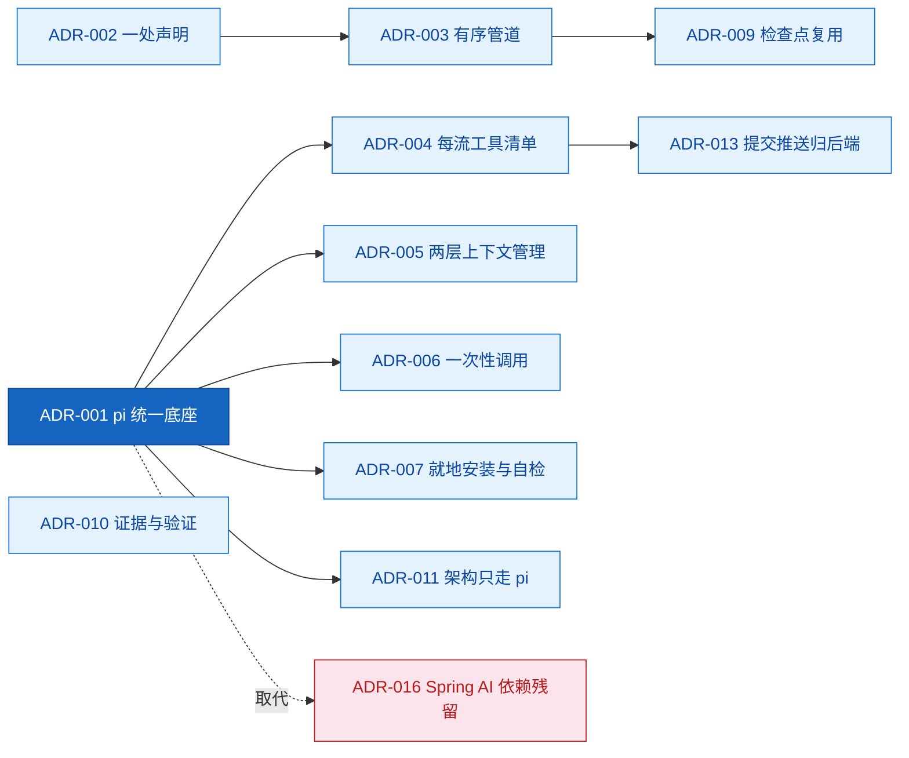
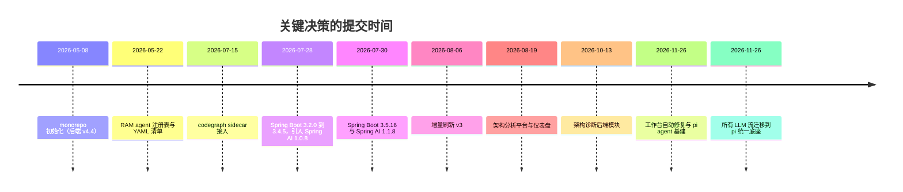

# 技术决策记录

> 自动生成于 2026-11-26，基于 `99d0037` 版本

> 每条决策的依据只有两类：代码里的注释，或 git 提交记录的标题。提交记录只引用日期与标题。凡属推断的备选方案与权衡，都标明「推断」；代码里找不到依据的，不写。

---

## 1. 决策概览

| ADR | 标题 | 状态 | 依据 | 影响范围 |
|-----|------|------|------|---------|
| ADR-001 | 采用 pi 作为统一 agent 底座 | 已采纳 | yml 与代码注释；提交 2026-11-26 | 全部 agent 流 |
| ADR-002 | agent 与工作流在代码里一处声明 | 已采纳 | `AgentRegistry` 类注释 | `agentbase`、全部业务节点 |
| ADR-003 | 工作流骨架用有序管道，责任链只用于节点内多选一 | 已采纳 | `FlowEngine` 类注释 | `workflow`、`agentbase` |
| ADR-004 | 每流工具清单即权限边界 | 已采纳 | `FlowToolManifest` 类注释 | `piagent`、全部 ReAct agent |
| ADR-005 | 两层上下文管理 | 已采纳 | `PromptBudget`、`PiFlowClient` 类注释与 yml 注释 | `piagent` |
| ADR-006 | 一次性结构化调用：无工具、不连 MCP、关闭思考 | 已采纳 | `FlowToolManifest`、`PiAgentLlmClient` 注释 | `AgentLlmClient` 的 15 处调用方 |
| ADR-007 | pi 就地安装、启动自检、失败自动补装 | 已采纳 | `PiAgentInstaller` 注释；两次 `fix(piagent)` 提交 | 部署与启动 |
| ADR-008 | SQLite + 启动建表，模块化初始化器，无迁移框架 | 已采纳 | 各 SchemaInitializer 注释 | 全部 SQLite 表 |
| ADR-009 | 检查点按输入哈希复用，执行策略与节点链分离 | 已采纳 | `DagExecutor`、`InputsHasher`、`ExecutionPolicy` 注释 | `workflow` 及全部工作流会话 |
| ADR-010 | 日志分析 v2：证据编号 + 确定性验证 | 已采纳 | `LogVerifyNodeV2`、`GroundingVerifier` 等注释 | `loganalysis.v2`、`agentflow` |
| ADR-011 | 架构分析只走 pi，手动 ReAct 循环删除 | 已采纳 | `ArchReActNodeV2Factory` 注释；yml 注释 | 架构深度分析 |
| ADR-012 | 仓库公开：令牌与管理员口令不放默认值 | 已采纳 | `JwtTokenProvider`、`SQLiteSchemaInitializer` 注释；yml 注释 | 认证 |
| ADR-013 | git 提交与推送不交给模型 | 已采纳 | `FlowToolManifest` 注释、`DevelopStage` 提示词 | 工作台自动修复 |
| ADR-014 | OTLP 走 http/protobuf | 已采纳 | `pom.xml` 注释、`OtlpReceiverController` 注释 | APM |
| ADR-015 | `Long` 序列化为字符串 | 已采纳 | `JacksonConfig` 注释 | 全部接口 |
| ADR-016 | Spring AI 依赖保留但排除其自动配置 | 现状（过渡） | `application.yml` 注释 | 构建与启动 |

### 决策关系图

---

## 2. ADR-001：采用 pi 作为统一 agent 底座

| 属性 | 值 |
|------|-----|
| **状态** | 已采纳 |
| **日期** | 2026-11-26（提交「feat(v5.0): 所有 LLM 流迁移到 pi 统一底座」） |
| **影响范围** | 全部 agent 流的 LLM 层 |

### 背景

`application.yml` 注释：「统一 agent 运行时：所有 agent 流的 LLM 层经 pi 执行，每个流启动时注册自己的工具清单」；另一处注释：「ChatClient 与 Spring AI 模型 bean 已全部移除（模型调用走 pi 或直连客户端）」。

git 记录显示此前有过两轮：2026-07-28 引入 Spring AI 1.0.8，2026-07-30 把 RAM Phase2 迁到 Spring AI `ChatClient` 并升到 Spring AI 1.1.8；2026-11-26 整体迁到 pi。

### 决策

agent 类流程的 LLM 层全部经 pi 子进程执行；`AgentLlmClient` 的唯一实现是 `PiAgentLlmClient`。

### 边界（代码现状）

| 类别 | 是否经 pi | 实现 |
|------|---------|------|
| ReAct 会话与一次性结构化调用 | 是 | `ReActSession`、`AgentLlmClient` |
| 批量 / 向量类 | 否 | `UnifiedEmbeddingService`、`UnifiedTextService`、`DeepseekJsonClient` |
| 单次结构化调用但沿用旧接口 | 否 | `apm.service.locator.LlmClient`（`ApmClaudeLlmClient` 或 `UnifiedTextService` 支撑的默认 bean） |
| 查询分解 | 先直连后 pi | `QueryDecomposer`：`UnifiedTextService` → `AgentLlmClient` → 规则 |

### 影响

- **正面**：工具白名单、skill、上下文预算、并发与 deadline 在底座统一实现。
- **代价**（代码可见）：每次模型调用一个进程（`PiAgentLlmClient` 注释称启动约 1.2 秒）；部署多了 Node 依赖；`pom.xml` 仍留着 Spring AI 依赖与 7 条自动配置排除项。

---

## 3. ADR-002：agent 与工作流在代码里一处声明

- **状态**：已采纳
- **依据**：`AgentRegistry` 类注释

### 决策

「所有 agent 的唯一声明处：每个 agent 一个定义（ReAct 或工作流），代码里一处声明、测试锁死。」

模式判定规则（注释原文的要点）：

| 用工作流 | 用独立 ReAct |
|---------|-------------|
| 步骤与顺序能事先定死；需要人在环、落库、确定性校验、失败回退 | 独立成入口的纯 ReAct 只有对话类（RAM 对话、日志追问、通用对话） |

工作流里「需要模型自己探索或动手」的节点是 ReAct agent。

### 影响

17 个 ReAct agent 与 7 条工作流都是静态声明；提示词正文在 `resources/pi-skills/`。

---

## 4. ADR-003：工作流骨架用有序管道

- **状态**：已采纳
- **依据**：`FlowEngine` 类注释

### 决策

「骨架是有序管道（用户确认的方式，责任链只用于节点内『多选一』）」。游标逐节点执行；节点可以等待或失败；`DagExecutor` 是纯机械执行，不关心流程是什么。

### 影响

新增执行策略在 `ExecutionPolicy` 上扩展，不在执行器里累加分支（`ExecutionPolicy` 注释）。

---

## 5. ADR-004：每流工具清单即权限边界

- **状态**：已采纳
- **依据**：`FlowToolManifest` 类注释

### 决策

清单在每次流启动时解析，规则（注释要点）：

1. 只读流只拿到 READ 级工具，不含写文件或执行命令的工具；
2. 写流额外拿 `write` / `edit` / `bash`，且 pi 的工作目录限定在 worktree 内；
3. git（commit / push）永远不属于任何清单；
4. pi 的工具白名单只在启动时生效，会话内不可改，因此清单即权限边界。

另：`--no-approve`（不信任工作目录里的项目级文件）与只读流的 `--no-context-files`（不读被分析仓库的 AGENTS.md / CLAUDE.md）。

### 影响

新增模型能力必须先进清单；未知流按纯只读处理（「宁缺毋滥」）。

---

## 6. ADR-005：两层上下文管理

- **状态**：已采纳
- **依据**：`PromptBudget`、`PiFlowClient` 类注释；yml 注释

### 背景（注释要点）

pi 自带的会话压缩解决「会话越跑越大」，但不会动用户消息本身：一条就占掉大半窗口的首条消息没有更早的轮次可裁，pi 只能把输出预算压到 1 个 token。

### 决策

| 层 | 负责 | 实现 |
|----|------|------|
| 提交前预算 | 输入本身过大 | `PromptBudget`：估算 token，超预算对结构化载荷保形压缩，完整原文落盘 |
| 运行中压缩 | 会话越跑越大 | pi 自带压缩，阈值由 `settings.json` 配置 |

---

## 7. ADR-006：一次性结构化调用关闭思考

- **状态**：已采纳
- **依据**：`FlowToolManifest` 与 `PiAgentLlmClient` 注释、`PiAgentInstaller` 注释

### 决策

清单 `one-shot`：不带任何工具、不连 MCP、关闭模型思考。注释给出的原因：思考 token 算在输出预算里，提示词一长正文就容易被挤空。

配套：`models.json` 里准备两个 provider，`hisi-gw-nothink` 声明推理能力，配合 `--thinking off` 才会显式发送关闭思考的参数。

---

## 8. ADR-007：pi 就地安装、启动自检、失败自动补装

- **状态**：已采纳
- **日期**：2026-11-26（提交「fix(piagent): 启动自检加固——装到一半不算已安装，启动失败后流执行前自动补装」「fix(piagent): mcp.json 里的后端地址跟着 server.port 走」）
- **依据**：`PiAgentInstaller`、`PiAgentProperties` 注释

### 决策

| 要点 | 说明 |
|------|------|
| 安装位置 | 默认在后端项目目录内（`lib/pi`、`lib/pi-agent`，已 gitignore）；注释：每台拉取分支的机器各有自己的一份，远端无需共享路径 |
| 已装判据 | 包版本等于锁定版本，且 CLI 入口文件存在（装到一半被打断不算已装） |
| 失败处理 | 安装失败不阻断启动；`ensureReady()` 在流执行前再装一次 |
| 进程内 MCP | MCP 工具由后端进程内的 Spring 原生 MCP 服务端（`/mcp`）提供，删除 Node 版 `hisi-mcp-server` 与启动时构建（提交 `4b6cbca`） |
| 回调地址 | `mcp.json` 里的后端地址取 `server.port` |

---

## 9. ADR-008：SQLite + 启动建表

- **状态**：已采纳
- **依据**：`SQLiteSchemaInitializer` 类注释；`WorkbenchSchemaInitializer` 类注释

### 决策

启动时用 `CREATE TABLE IF NOT EXISTS` 建全部表；每个模块有自己的初始化器（注释：「照 FixSchemaInitializer 的模块化写法」）。`pom.xml` 没有迁移框架，老库升级用幂等加列。

### 影响

- **正面**：零运维，单文件。
- **代价**：升级逻辑分散在 5 处初始化器与若干仓储的 `@PostConstruct` 里；`resources/db/migration/` 下的 SQL 不会被执行。

---

## 10. ADR-009：检查点按输入哈希复用

- **状态**：已采纳
- **依据**：`DagExecutor`、`InputsHasher`、`ExecutionPolicy` 类注释

### 决策

| 要点 | 说明 |
|------|------|
| 最小重算 | 节点输入做规范化 JSON 后取 SHA-256；同一会话、同一节点、同一哈希的 `CHECKPOINT` 命中即跳过执行 |
| 驳回即重算 | 拒绝反馈注入输入，哈希改变，缓存必然未命中 |
| 策略与结构分离 | 「执行什么」在 `WorkflowDefinition`，「如何执行」在 `ExecutionPolicy` |

---

## 11. ADR-010：日志分析 v2 用证据编号与确定性验证

- **状态**：已采纳
- **依据**：`LogVerifyNodeV2`、`GroundingVerifier`、`EvidencePack`、`LogSynthesisNodeV2` 类注释

### 决策

- 证据包在 LLM 调用之前由确定性代码构建，按顺序编号；模型只能引用已有编号，不能自行补充事实。
- `GroundingVerifier` 是注释所称的「外部验证模块」：不调用模型，只做集合运算，可单测、可复现。
- 成文后再做一次引用校验，编造的引用替换为「未验证」并拉低置信度。

---

## 12. ADR-011：架构分析只走 pi

- **状态**：已采纳
- **依据**：`ArchReActNodeV2Factory`、`ArchReActAgentNode`、`PiReActAgentNode` 类注释

### 决策

手动 ReAct 循环已删除，架构分析整体平替为 pi 会话；`piagent.flows.arch-react` 关闭时创建节点直接失败（注释：切回老实现的入口已不存在，那是本次版本刻意移除的旧代码）。

配套：替代节点不做成 bean，因为它必须与旧节点同名（前端写死 `arch_react_agent`），注册进 `WorkflowRegistry` 会覆盖。

---

## 13. ADR-012：仓库公开，令牌与管理员口令不放默认值

- **状态**：已采纳
- **依据**：`JwtTokenProvider`、`SQLiteSchemaInitializer.seedRootAccount` 注释；yml 注释

### 决策

| 要点 | 说明 |
|------|------|
| JWT 密钥 | 环境变量 `JWT_SECRET`，至少 32 字节；不配置则每次启动随机生成 |
| 管理员初始口令 | `hisi.auth.root-password`（环境变量 `HISI_ROOT_PASSWORD`）；为空时随机生成并打印到启动日志 |

### 遗留

同一原则没有覆盖到远程项目凭据：`GitCredentialService` 在未配置 `hisi.encrypt.key` 时仍回退到源码内置的默认密钥。

---

## 14. ADR-013：git 提交与推送不交给模型

- **状态**：已采纳
- **依据**：`FlowToolManifest` 类注释；`DevelopStage` 的提示词与校验逻辑

### 决策

清单里没有 git 工具；后端只做确定性的事：用 git 看实际改了哪些文件、复核编译、守住边界。`DevelopStage` 发现 worktree 的 HEAD 被改动时不采纳这次结果（注释：pi 的清单里没有 git 工具，但 bash 能跑 git）。

---

## 15. ADR-014：OTLP 走 http/protobuf

- **状态**：已采纳
- **依据**：`pom.xml` 注释；`OtlpReceiverController` 类注释

### 决策

OTel Java Agent 2.x 只支持 grpc 与 http/protobuf；后端直接接收 protobuf 字节，用 `JsonFormat` 转成 OTLP/JSON 后复用已有的反序列化，避免下游 `SpanIngestionService` 改动。OTLP/JSON 的处理方法仍保留。

---

## 16. ADR-015：`Long` 序列化为字符串

- **状态**：已采纳
- **依据**：`JacksonConfig` 类注释

### 决策

`Long` / `long` 一律输出为字符串，解决雪花算法 ID 超出 JS 安全整数范围导致前端精度丢失；同时显式注册 `JavaTimeModule`。

---

## 17. ADR-016：Spring AI 依赖保留但排除自动配置

- **状态**：现状（过渡）
- **依据**：`application.yml` 注释；`pom.xml`

### 现状

主代码里 `org.springframework.ai` 引用为 0，但 `pom.xml` 仍声明 `spring-ai-starter-model-anthropic`、`spring-ai-starter-model-openai` 与 `spring-ai-bom` 1.1.8。yml 注释：这些自动配置没有配置项可读，会直接启动失败，所以显式排除 7 个自动配置类（注释：「类名以依赖 jar 里实际存在的为准」）。

### 待办（推断）

移除依赖与排除项；测试代码里仍有 4 个文件引用 Spring AI。

---

## 18. 决策时间线

---

## 19. 决策原则

从上述注释与提交记录里能归纳出的原则：

| 原则 | 说明 | 体现 |
|------|------|------|
| 确定性的事交给代码 | 能用规则、图谱、集合运算解决的不交给模型 | ADR-004、ADR-010、ADR-013 |
| 声明集中，实现分散 | 结构一处声明，实现在各模块 | ADR-002、ADR-003 |
| 权限默认收紧 | 未知流只读；白名单启动时固定 | ADR-004 |
| 失败不阻断 | 外部依赖失败走降级，可自动补装 | ADR-007 |
| 公开仓库不放假密钥 | 默认值用随机或占位 | ADR-012 |

---

> **延伸阅读**：
> - 决策的架构体现 → [02-架构设计](../02-架构设计/index.md)
> - pi 底座的实现 → [pi-agent底座](../03-模块说明/pi-agent底座.md)
> - 部署相关决策 → [07-部署运维](../07-部署运维/index.md)
> - 技术栈总表 → [01-项目概览](../01-项目概览/index.md)
