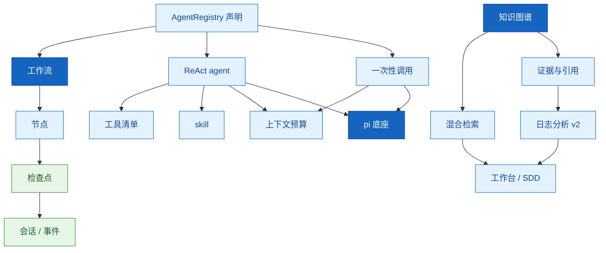

# 术语表

> 自动生成于 2026-11-26，基于 `99d0037` 版本

> 收录后端代码里出现的专有名词、缩写与领域概念。「代码对应」一列是代码中实际使用的标识符。遵循通用语言原则：同一个概念在本手册里只用一个说法。

---

## 1. 使用说明

- 按主题分组，组内不强行按字母排序
- **加粗**的术语是核心概念，在代码里有直接对应的类或字段
- 方括号里是模块文档的链接

---

## 2. agent 底座

| 术语 | 英文 / 代码 | 定义 | 代码对应 | 详见 |
|------|------------|------|---------|------|
| **pi** | `@earendil-works/pi-coding-agent` | 用作统一 agent 运行时的 Node 包；每次模型调用起一个子进程 | `piagent` 包 | [pi-agent底座](../03-模块说明/pi-agent底座.md) |
| **流** | flow | 一类 agent 运行的配置单元，决定工具白名单、是否连 MCP、是否关闭思考 | `FlowToolManifest.forFlow(flow)` | 同上 |
| **工具清单** | `FlowToolManifest` | 每流启动时解析的工具白名单，即权限边界 | `FlowToolManifest` | 同上 |
| 只读内置工具 | `READ_BUILTIN` | `read`、`grep`、`find`、`ls`、`codemode` | `FlowToolManifest.READ_BUILTIN` | 同上 |
| 写 / 执行工具 | `WRITE_BUILTIN` | `write`、`edit`、`bash`，只有写流拿得到 | `FlowToolManifest.WRITE_BUILTIN` | 同上 |
| **skill** | `pi-skills/<name>/SKILL.md` | agent 的提示词正文与领域知识，启动时同步到 pi 的 skills 目录 | `PiAgentInstaller.syncSkills` | 同上 |
| **ReAct agent** | `AgentRegistry.ReactAgent` | 一个声明：流、skill、契约、修正轮数 | `agentbase.AgentRegistry` | 同上 |
| **契约** | `contractSchema` | ReAct 输出必须满足的 JSON Schema 名；为 null 表示自由文本 | `ram.contract.SchemaValidator` | 同上 |
| **修正轮** | `repairRounds` | 输出不合契约时，带着问题重新生成的次数 | `ReActSession.run` | 同上 |
| **一次性调用** | `one-shot` | 无工具、不连 MCP、关闭思考的结构化调用 | `AgentLlmClient`、`PiAgentLlmClient` | 同上 |
| **上下文预算** | `PromptBudget` | 提交前估算 system + user 的 token，超预算先压缩 | `piagent.context.PromptBudget` | 同上 |
| **保形压缩** | shape-preserving compaction | 结构原样保留，只截短过长的列表与字符串，并加 `_truncated` 标记 | `piagent.context.JsonCompactor` | 同上 |
| 会话压缩 | compaction | pi 自带的运行中压缩：上下文接近窗口上限时总结较早轮次 | `settings.json` 的 `compaction` 段 | 同上 |
| 槽位 | slot | pi 进程的并发许可，上限 `piagent.max-concurrent-processes` | `PiFlowClient` 的信号量 | 同上 |
| **声明** | `AgentRegistry` | 全部 agent 与工作流的唯一声明处 | `agentbase.AgentRegistry` | [技术决策](../08-技术决策/index.md) |
| 清单键 | `ONE_SHOT`、`WORKBENCH_DEV` | 两个特殊流的键 | `FlowToolManifest.ONE_SHOT` 等 | [pi-agent底座](../03-模块说明/pi-agent底座.md) |

---

## 3. 工作流

| 术语 | 英文 / 代码 | 定义 | 代码对应 | 详见 |
|------|------------|------|---------|------|
| **工作流** | `AgentRegistry.Workflow` | 有序节点链加执行策略 | `agentbase.AgentRegistry` | [工作流引擎](../03-模块说明/工作流引擎.md) |
| **节点** | `DagNode` | 流程里的一步：`name()`、`agentId()`、`execute(input, sink)` | `workflow.DagNode` | 同上 |
| **检查点** | `CHECKPOINT` | 节点产物加输入哈希，写入事件表，续跑时复用 | `DagExecutor.appendCheckpoint` | 同上 |
| **输入哈希** | `inputsHash` | 节点输入规范化 JSON 的 SHA-256 | `workflow.InputsHasher` | 同上 |
| **执行策略** | `ExecutionPolicy` | 是否插入节点间确认门、是否发节点生命周期事件 | `workflow.ExecutionPolicy` | 同上 |
| 最小重算 | minimum recompute | 已有同哈希检查点的节点跳过执行 | `DagExecutor.findCachedOutput` | 同上 |
| 首跑 | `isFirstRun` | 会话还没有任何事件；全部执行且不插确认门 | `DagExecutor` | 同上 |
| 强制重跑 | `forceRerun` | 从指定节点起跳过缓存与确认门 | `agent_session.rerun_from_node` | 同上 |
| **确认门** | HITL gate | 非末位节点执行后停下等用户确认 | `ExecutionPolicy.interNodeHitlEnabled` | 同上 |
| 人在环 | HITL, Human-in-the-Loop | 流程在澄清或确认处暂停，等人输入 | `WAITING_CLARIFY`、`WAITING_HITL` | 同上 |
| 澄清轮次 | `clarifyRoundNo` | `CLARIFY_REQ` 的序号，可按轮重跑 | `agent_event.clarify_round_no` | [RAM需求评估](../03-模块说明/RAM需求评估.md) |
| **会话** | `agent_session` | 一次流程运行的记录，对外用 UUID 句柄 | `ram.model.AgentSession` | [数据模型](../06-数据模型/index.md) |
| **事件** | `agent_event` | 追加写的日志，SSE 推流与回放的数据源 | `ram.model.AgentEvent`、`EventType` | 同上 |
| 取消登记 | `AgentFlowCancelRegistry` | 让「中止」真正停掉执行：线程绑定流程 ID，节点在耗时步骤间检查 | `agentflow.AgentFlowCancelRegistry` | [工作流引擎](../03-模块说明/工作流引擎.md) |
| 合成事件 | synthetic event | SSE 流上补发的 `CLARIFY_REQUIRED`、`HITL_REQUIRED`、`RUN_COMPLETED` 等 | `WorkflowController` | [接口文档](../05-接口文档/index.md) |

---

## 4. 知识图谱

| 术语 | 英文 / 代码 | 定义 | 代码对应 | 详见 |
|------|------------|------|---------|------|
| **知识图谱** | KG, Knowledge Graph | 源码解析后得到的图 | `knowledgegraph` 包 | [知识图谱构建](../03-模块说明/知识图谱构建.md) |
| **构建模式** | `BuildMode` | `REUSE`（按 `codeHash` 复用向量）、`INCREMENTAL`（只重建变更文件）、`WIPE`（全删全插） | `knowledgegraph.service.BuildMode` | 同上 |
| **生成队列** | `KgGenerationQueue` | 保证多项目串行构建的单消费线程队列 | `knowledgegraph.service.KgGenerationQueue` | 同上 |
| `codeHash` | — | 方法源码的哈希，`REUSE` 模式据此决定是否复用向量 | `Method.codeHash` | 同上 |
| **codegraph** | sidecar | 外部的 Node 命令行工具，解析 TS / JS / Vue | `knowledgegraph.codegraph` | 同上 |
| **桥接** | bridge | 跨服务的 Feign / MQ / HTTP 调用关系 | `knowledgegraph.link`、`BridgeRelation` | 同上 |
| **入口点** | `EntryPoint` | 可被外部触达的方法：HTTP、定时、MQ 监听等 | `neo4j.model.EntryPointNode` | [Neo4j图存储与检索](../03-模块说明/Neo4j图存储与检索.md) |
| 抛出点 | throw site | 异常栈里最先抛出异常的那一帧 | `LogKgEvidenceNodeV2.ROLE_THROW_SITE` | [日志云与运维](../03-模块说明/日志云与运维.md) |
| **聚合管道** | `AggregationPipeline` | 构建后算出模块、分层、领域、热点、变更频率的 7 个阶段 | `knowledgegraph.aggregation` | [知识图谱构建](../03-模块说明/知识图谱构建.md) |
| **分层角色** | `layerRole` / `classRole` | 模块或类在架构中的角色：`CONTROLLER`、`SERVICE`、`REPOSITORY`、`MODEL`、`UTILITY`、`UNKNOWN` 等 | `ModuleNode.layerRole`、`ClassNode.classRole` | 同上 |
| **领域** | `DomainNode` | 图谱社区检测得到的领域 | `neo4j.model.DomainNode` | 同上 |
| **垂直领域** | `VerticalDomain` | 按领域词与分层角色聚合出的领域，与 `DomainNode` 是两条独立链路 | `archdiagnosis.domain` | [架构诊断](../03-模块说明/架构诊断.md) |
| 四层坏味道 | — | 项目 / 模块 / 类 / 方法四层的检测项：臃肿包、幽灵类、超长方法等 | `ArchSmellDetectorService` | 同上 |
| **DSM** | Dependency Structure Matrix | 依赖结构矩阵 | `GET /api/knowledge-graph/dsm` | 同上 |
| **爆炸半径** | blast radius | 一个节点的上游影响范围 | `GET /api/knowledge-graph/blast-radius/{nodeId}` | 同上 |
| 热点 | hotspot | 复杂度、变更、入度综合评分高的方法 | `HotspotScorer` | 同上 |
| 前后端绑定 | `kg_project_binding` | 把前端项目与后端项目配对，检索时展开范围 | `knowledgegraph.binding` | [知识图谱构建](../03-模块说明/知识图谱构建.md) |
| 全局分析缓存 | `GlobalAnalysisCache` | 扫描器与构建器共享的预扫描数据 | `cache.GlobalAnalysisCache` | [远程项目管理](../03-模块说明/远程项目管理.md) |

---

## 5. 检索

| 术语 | 英文 / 代码 | 定义 | 代码对应 | 详见 |
|------|------------|------|---------|------|
| **混合检索** | hybrid search | 按查询类型路由 + 多路召回 + 融合排序 | `HybridSearchService`、`MultiQueryHybridSearchService` | [Neo4j图存储与检索](../03-模块说明/Neo4j图存储与检索.md) |
| **查询类型** | `QueryType` | 10 种查询形态，如 `NATURAL_LANGUAGE`、`METHOD_NAME`、`SQL_SNIPPET` | `neo4j.model.QueryType` | 同上 |
| **意图类型** | `IntentType` | 子查询的意图分类，带默认权重 | `neo4j.model.IntentType` | 同上 |
| **RRF** | Reciprocal Rank Fusion | 倒数排名融合，`score = 1 / (k + rank)` | `HybridSearchService.RRF_K` | 同上 |
| 加权 RRF | W-RRF | 按意图权重缩放的 RRF | `MultiQueryHybridSearchService` | 同上 |
| 查询分解 | `QueryDecomposer` | 把需求拆成带意图的子查询 | `ram.nodes.impact.QueryDecomposer` | [RAM需求评估](../03-模块说明/RAM需求评估.md) |
| **向量索引** | vector index | Neo4j 原生索引，cosine 相似度 | `Neo4jInitializer.VECTOR_INDEX_SPECS` | [Neo4j图存储与检索](../03-模块说明/Neo4j图存储与检索.md) |
| 重排 | rerank | 可选的外部精排 | `neo4j.service.RerankService` | 同上 |
| 检索类型 | `SearchType` | 显式指定检索面：`METHOD` / `CLASS` / `SQL` / `ENTRY` / `ALL` | `neo4j.model.SearchType` | 同上 |

---

## 6. RAM 需求评估

| 术语 | 英文 / 代码 | 定义 | 代码对应 | 详见 |
|------|------------|------|---------|------|
| **RAM** | Requirement Analysis Master | 需求评估引擎：把需求文本变成影响面、实现方案与技术方案 | `ram` 包 | [RAM需求评估](../03-模块说明/RAM需求评估.md) |
| **影响环** | ring | 三层影响面：`InvolvedRing`（直接牵涉）、`ModifiedRing`（需修改）、`ImpactRing`（受影响） | `ram.nodes.impact` | 同上 |
| **验证节点** | `VerifyNode` | 对影响面与实现方案做 6 项确定性交叉检查 | `ram.nodes.VerifyNode` | 同上 |
| Phase2 | `phase2_analysis` | 针对追问的深层图谱数据采集 | `ram.nodes.Phase2AnalysisNode` | 同上 |
| 影响面（静态） | `ImpactReport` | 基于 JavaParser 的影响预测，与图谱影响面是不同路径 | `service.impact` | [影响分析与风险评估](../03-模块说明/影响分析与风险评估.md) |

---

## 7. 日志与 APM

| 术语 | 英文 / 代码 | 定义 | 代码对应 | 详见 |
|------|------------|------|---------|------|
| **证据包** | `EvidencePack` | 确定性代码构建的证据集合，按 `E1`、`E2`… 编号 | `agentflow.EvidencePack` | [日志云与运维](../03-模块说明/日志云与运维.md) |
| **证据锚点** | `EvidenceAnchor` | 一条可被引用的证据：堆栈帧、图谱方法、源码、调用链等 | `agentflow.EvidenceAnchor` | 同上 |
| **引用标记** | `[[E n]]` | 模型在结论里引用证据编号的写法 | `agentflow.Citations` | 同上 |
| **接地校验** | grounding | 检查引用的编号是否真实存在于证据包 | `agentflow.GroundingVerifier` | 同上 |
| 因果链状态 | `chainStatus` | `verified`、`stack_verified`、`unverified`、`unknown`、`at_throw_site` | `LogVerifyNodeV2` | 同上 |
| **指纹** | `error_fingerprint` | 错误类型加前 3 个非框架栈帧的去重指纹 | `service.FingerprintService` | 同上 |
| **OTLP** | OpenTelemetry Protocol | OTel 的数据上报协议；本后端接收 http/protobuf | `OtlpReceiverController` | [APM故障诊断](../03-模块说明/APM故障诊断.md) |
| **span** | `ApmSpanEntity` | 一次调用的时间片段 | `apm.model.ApmSpanEntity` | 同上 |
| KG 匹配级别 | `kg_match_level` | span 到图谱节点的匹配强度：0 精确、1 唯一、2 重载、3 未匹配 | `SpanToKgMapper` | 同上 |
| 诊断报告状态 | `DiagnoseReport.Status` | `PENDING`、`RUNNING`、`DONE`、`FAILED`、`CANCELLED`、`TIMEOUT`、`LOW_CONFIDENCE` | `apm.model.DiagnoseReport` | 同上 |
| **采集信封** | `HISI_CAPTURE` | `hisi-capture-spring-boot-starter` 产生的加密 JSON 信封 | `loganalysis.decoder.CaptureDecoder` | [日志云与运维](../03-模块说明/日志云与运维.md) |
| worktree | git worktree | 同一仓库的另一个工作目录，修复在这里进行 | `fixengine.service.WorktreeService` | [修复引擎fixengine](../03-模块说明/修复引擎fixengine.md) |

---

## 8. 工作台与修复

| 术语 | 英文 / 代码 | 定义 | 代码对应 | 详见 |
|------|------------|------|---------|------|
| **工作台** | workbench | 跨项目聚合技术债待办，并可自动修复 | `workbench` 包 | [工作台与自动修复](../03-模块说明/工作台与自动修复.md) |
| **待办** | `workbench_item` | 一条日志 issue 或架构 issue 的聚合视图 | `workbench.model.WorkbenchItem` | 同上 |
| **待办键** | `itemKey` | 待办的去重键，形如 `log:<项目>:<指纹>`、`arch:ai:<项目>:<标识>`、`arch:rule:<项目>:<哈希>` | `DebtItemSyncService` | 同上 |
| **SDD** | Spec-Driven Development | 先出 Spec 再开发；工作台修复的八阶段流程 | `WorkbenchStages` | 同上 |
| **阶段** | `StageHandler` | 八阶段之一：`evidence`、`proposal`、`spec`、`tasks`、`develop`、`tests`、`e2e`、`ship` | `workbench.service.stage` | 同上 |
| **修复运行** | `workbench_fix_run` | 一次自动修复的状态机记录 | `workbench.model.WorkbenchFixRun` | 同上 |
| 方案确认门 | `ConfirmGate` | 停在方案阶段等用户确认或驳回 | `workbench.service.ConfirmGate` | 同上 |
| **迭代回路** | retry | 回归或 E2E 失败回到 `develop`，上限 `workbench.fix.max-iterations` | `FixRunRunner` | 同上 |
| 修复引擎 | fixengine | 另一套修复机制：按日志报告走固定 9 步 | `fixengine` 包 | [修复引擎fixengine](../03-模块说明/修复引擎fixengine.md) |

---

## 9. 应用与接口

| 术语 | 英文 / 代码 | 定义 | 代码对应 | 详见 |
|------|------------|------|---------|------|
| **统一响应** | `ApiResponse` | `{code, message, data}`，`code = 200` 为成功 | `model.ApiResponse` | [REST接口层](../03-模块说明/REST接口层.md) |
| **映射** | mapping | 一条「HTTP 方法 + 路径」；共 359 条 | 控制器注解 | [接口文档](../05-接口文档/index.md) |
| **句柄** | handle | 会话对外暴露的 UUID | `SessionMappingService` | [工作流引擎](../03-模块说明/工作流引擎.md) |
| 管理员 | `ADMIN` | 可执行写操作的角色；另一角色为 `MEMBER` | `SecurityContext.isAdmin()` | [应用启动与全局配置](../03-模块说明/应用启动与全局配置.md) |
| **SSE** | Server-Sent Events | 服务端向浏览器的单向事件流 | `SseEmitter` | [接口文档](../05-接口文档/index.md) |
| **统一网关** | `/ws/agent` | 一条 WebSocket 连接承载多个频道的设计 | `websocket.UnifiedWebSocketHandler` | [终端与WebSocket](../03-模块说明/终端与WebSocket.md) |
| 频道 | `ChannelHandler` | 网关里的一路，按 `channel` 字段路由 | `websocket.ChannelHandler` | 同上 |
| **PTY** | Pseudo Terminal | 伪终端，承载 `claude` CLI | `TerminalWebSocketHandler` | 同上 |
| **令牌桶** | `TokenBucketRateLimiter` | 出站模型调用的客户端限流 | `utils.TokenBucketRateLimiter` | [知识图谱构建](../03-模块说明/知识图谱构建.md) |
| 雪花 ID | snowflake ID | 64 位递增 ID；因超出 JS 安全整数范围而序列化为字符串 | `utils.SnowflakeIdGenerator` | [数据模型](../06-数据模型/index.md) |
| 直连客户端 | — | 不经 pi 的模型调用实现 | `UnifiedTextService`、`UnifiedEmbeddingService`、`DeepseekJsonClient`、`ApmClaudeLlmClient` | [pi-agent底座](../03-模块说明/pi-agent底座.md) |

---

## 10. 缩写表

| 缩写 | 全称 | 说明 |
|------|------|------|
| ADR | Architecture Decision Record | 架构决策记录 |
| APM | Application Performance Monitoring | 应用性能监控 |
| API | Application Programming Interface | — |
| AST | Abstract Syntax Tree | 抽象语法树 |
| CORS | Cross-Origin Resource Sharing | 跨域资源共享 |
| DAG | Directed Acyclic Graph | 有向无环图；本手册里「DAG」多指有序节点链 |
| DSM | Dependency Structure Matrix | 依赖结构矩阵 |
| DTO | Data-Transfer Object | 数据传输对象 |
| E2E | End-to-End | 全链路测试 |
| HITL | Human-in-the-Loop | 人在环 |
| HMAC | Hash-based Message Authentication Code | JWT 的签名方式 |
| HIL | Human-in-the-Loop | 同 HITL；旧手册用词 |
| JDBC | Java Database Connectivity | — |
| JSON | JavaScript Object Notation | — |
| JGit | Java implementation of Git | — |
| JWT | JSON Web Token | 登录令牌 |
| KG | Knowledge Graph | 知识图谱 |
| LLM | Large Language Model | 大语言模型 |
| MCP | Model Context Protocol | 模型调用外部工具的协议 |
| MQ | Message Queue | 消息队列 |
| OTel / OTLP | OpenTelemetry / OpenTelemetry Protocol | 链路追踪 |
| PTY | Pseudo Terminal | 伪终端 |
| RAM | Requirement Analysis Master | 需求评估 |
| ReAct | Reasoning + Acting | 模型边推理边调用工具的模式 |
| RRF | Reciprocal Rank Fusion | 倒数排名融合 |
| SDD | Spec-Driven Development | 规格驱动开发 |
| SSE | Server-Sent Events | 服务器推送事件 |
| URI | Uniform Resource Identifier | — |
| WS | WebSocket | — |

---

## 11. 术语关系图

---

## 12. 易混淆术语辨析

| 术语 A | 术语 B | 区别 |
|--------|--------|------|
| `claude_session` | `agent_session` | 前者是浏览器终端里与 CLI 的对话；后者是 RAM / 工作流 / 日志等 agent 流程的会话 |
| `AgentRegistry`（`agentbase`） | `AgentRegistry`（`ram.registry`） | 前者是代码内的 agent 与工作流声明；后者读取 `ram/agents.yaml` |
| 会话 ID | 会话句柄 | 内部是自增整数 `agent_session.id`；对外给前端的是 `uuid` |
| `DomainNode`（领域） | 垂直领域 | 前者来自图谱社区检测；后者由 `archdiagnosis` 按领域词与分层角色聚合 |
| 影响面（RAM `impact` 节点） | 影响分析（`/api/impact`） | 前者基于图谱与检索；后者基于 JavaParser 静态分析，不查 Neo4j |
| 影响分析（静态） | 爆炸半径（`blast-radius`） | 后者是图谱上的上游遍历 |
| 工作台 SDD 修复 | 修复引擎 | 前者由 pi 编码会话改代码、经 pi 调模型；后者是固定 9 步、直连 `LlmClient` |
| 经 pi 的调用 | 直连调用 | 前者是 agent 流程；后者是批量 / 向量类，或沿用 `LlmClient` 的单次结构化调用 |
| 批量 / 向量直连 | 单次结构化调用仍直连 | 前者如向量化、KG 描述生成；后者如 APM 诊断、修复引擎的生成 |
| 工具清单（`FlowToolManifest`） | 技能（skill） | 清单决定能用哪些工具；技能是提示词正文 |
| 上下文预算（`PromptBudget`） | 会话压缩 | 前者在提交前处理输入；后者在运行中处理增长的上下文 |
| 技能市场条目 | pi skill | 前者安装到项目的 `.claude/` 给编码助手用；后者是后端 agent 流的提示词 |
| `hisi-mcp-server` | `ram.mcp.RamMcpServer` | 前者是独立的 Node 子项目；后者是后端进程内的工具派发门面 |
| 检查点（`CHECKPOINT` 事件） | 检查点节点（`GenerationCheckpoint`） | 前者是工作流节点产物；后者是全量图谱构建的 commit 记录 |

---

## 13. 已退役的术语

以下术语只在旧文档或提交记录里出现，当前代码里已不存在对应实现：

| 术语 | 现状 |
|------|------|
| Spring AI `ChatClient` | 主代码引用为 0；`pom.xml` 仍声明依赖并排除自动配置 |
| `RamClaudeJsonClient`、`ClaudeSessionService`、`AgentTools` | 类已删除 |
| `AnthropicHttpClient` | 源文件仍在，无调用方 |
| `service/intent`（意图识别、对话协调器） | 包已删除 |
| `ExceptionPathService`、`RiskAnalysisService`、`SuggestionService` | 类名不存在；相关的 `service/semantic`、`service/risk`、`service/suggestion` 仍在但没有调用方 |
| `publicProjectPath`（公共图谱） | 属性已退役：启动时删除索引并移除该属性 |
| 节点标签 `MethodNode` / `EntryPointNode` / `SqlNode` | 实际标签是 `Method` / `EntryPoint` / `Sql`；`*Node` 只是 Java 类名 |
| Playwright 日志云兜底模式 | 主代码无 Playwright 引用 |
| `ram/safety`（熔断器、幂等守卫） | 包已删除（提交记录：2026-07-30「delete ram/safety zombie code」） |

---

## 14. 术语维护规则

1. **新增术语**：代码中引入新的领域概念时，同步更新本表
2. **修改术语**：定义变化时更新并注明
3. **退役术语**：移到第 13 节，不在正文继续使用
4. **同名冲突**：出现同名类时在辨析表里列出来

---

> **延伸阅读**：
> - 核心概念 → [01-项目概览](../01-项目概览/index.md)
> - 术语的代码实现 → [06-数据模型](../06-数据模型/index.md)
> - 各模块专有术语 → [REST接口层](../03-模块说明/REST接口层.md) 末尾的模块索引
