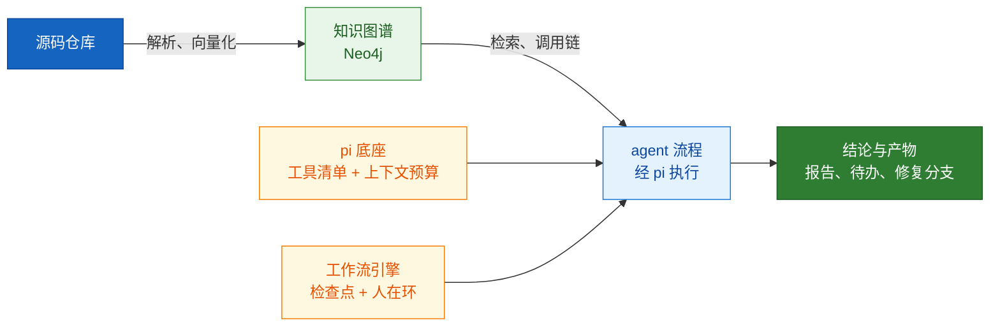

# HiSi DevTool Backend CodeWiki

> 自动生成于 2026-11-26，基于 `99d0037` 版本
> 由 codewiki-generator 技能产出，如需更新请重新运行该技能

---

## 项目简介

HiSi DevTool Backend 是面向研发的**代码理解与运维平台**后端：把 Java / Python / TS-JS-Vue 源码解析成 Neo4j 知识图谱，在图谱之上做混合检索、影响分析、架构诊断、需求评估、日志与 APM 故障诊断，并让 agent 在受控的工具清单内查证证据、给出结论、在工作台里自动修复技术债。

本手册只覆盖后端（`hisi-dev-tool/`）。前端与 MCP 服务各有独立手册。

---

## 项目速览

| 维度 | 信息 |
|------|------|
| **项目类型** | Spring Boot 单体后端（多能力 DevTool 平台） |
| **技术栈** | Java 17 + Spring Boot 3.5.16 + Neo4j（图 + 向量索引）+ SQLite + WebSocket / PTY4J + JavaParser + ANTLR4 + pi agent 运行时（Node） |
| **架构风格** | 分层单体：接入层 → 应用层（声明 + 编排）→ 领域服务层 → 基础设施层 |
| **代码规模** | 674 个 Java 源文件（主代码约 11.6 万行），246 个测试文件 |
| **模块数量** | 19 个 |
| **接口数量** | 49 个控制器、359 条 REST 映射（358 个不同的「方法 + 路径」），7 个 WebSocket 端点 |
| **存储** | Neo4j（15 种节点标签）；SQLite（28 张表，启动时自动建） |
| **agent** | 17 个 ReAct agent、7 条工作流，全部在 `AgentRegistry` 一处声明 |
| **部署方式** | 可执行 jar；首次启动自动安装 pi 并按需构建 `hisi-mcp-server` |

---

## 目录

### 理解项目（入门）

| 章节 | 说明 | 适合谁 |
|------|------|--------|
| [项目概览](01-项目概览/index.md) | 使命、技术栈、项目结构、快速启动、核心概念、演进 | 新成员 |
| [术语表](09-术语表/index.md) | 专有名词、缩写、易混淆术语、已退役术语 | 所有读者 |

### 理解设计（深入）

| 章节 | 说明 | 适合谁 |
|------|------|--------|
| [架构设计](02-架构设计/index.md) | C4 图、分层、模块依赖、LLM 调用架构、质量属性、跨切面 | 架构师、技术负责人 |
| [技术决策](08-技术决策/index.md) | 16 条决策记录，每条都有代码注释或提交记录作依据 | 架构师、想了解历史的人 |

### 开发参考（实操）

| 章节 | 说明 | 适合谁 |
|------|------|--------|
| 模块说明（见下方模块列表） | 各模块职责、内部结构、接口、依赖、配置、已知问题 | 开发者 |
| [数据流程](04-数据流程/index.md) | 8 条核心流程、5 个状态机、校验与一致性规则 | 开发者、测试 |
| [接口文档](05-接口文档/index.md) | 全部 359 条接口的路径、方法、鉴权；SSE 与 WebSocket | 前后端开发者 |
| [数据模型](06-数据模型/index.md) | 28 张 SQLite 表的数据字典、Neo4j 图模型、枚举 | 开发者 |

### 运维部署（运营）

| 章节 | 说明 | 适合谁 |
|------|------|--------|
| [部署运维](07-部署运维/index.md) | 环境要求、全部配置键与环境变量、启动自检流程、健康检查、常见问题 | 运维、DevOps |

---

## 模块列表

| # | 模块 | 文件 | 关键词 | 层级 |
|---|------|------|--------|------|
| 1 | 应用启动与全局配置 | [应用启动与全局配置](03-模块说明/应用启动与全局配置.md) | 启动顺序、建表、JWT 鉴权、角色拦截、CORS、Neo4j 装配、日志 | 基础设施层 |
| 2 | pi agent 底座 | [pi-agent底座](03-模块说明/pi-agent底座.md) | `AgentRegistry`、每流工具清单、上下文预算、pi 安装与运行 | 基础设施层 |
| 3 | 工作流引擎 | [工作流引擎](03-模块说明/工作流引擎.md) | `DagExecutor`、检查点、确认门、澄清、SSE、统一工作流接口 | 应用层 |
| 4 | 工作台与自动修复 | [工作台与自动修复](03-模块说明/工作台与自动修复.md) | 待办聚合、SDD 八阶段、方案确认门、迭代回路 | 应用层 |
| 5 | 架构诊断 | [架构诊断](03-模块说明/架构诊断.md) | 四层坏味道、健康评分、快照、垂直领域、深度分析工作流 | 领域服务层 |
| 6 | 知识图谱构建 | [知识图谱构建](03-模块说明/知识图谱构建.md) | 生成队列、多语言解析、聚合管道、向量与描述 | 领域服务层 |
| 7 | Neo4j 图存储与检索 | [Neo4j图存储与检索](03-模块说明/Neo4j图存储与检索.md) | 节点与关系、约束与索引、混合检索、加权 RRF | 基础设施层 + 领域服务层 |
| 8 | RAM 需求评估 | [RAM需求评估](03-模块说明/RAM需求评估.md) | 需求分析链、影响环、验证节点、对话助手 | 应用层 + 领域服务层 |
| 9 | 影响分析与风险评估 | [影响分析与风险评估](03-模块说明/影响分析与风险评估.md) | 静态调用链、风险权重、回归用例 | 领域服务层 |
| 10 | 合并影响分析 | [合并影响分析](03-模块说明/合并影响分析.md) | JGit diff、影响面、测试范围、SSE | 应用层 |
| 11 | APM 故障诊断 | [APM故障诊断](03-模块说明/APM故障诊断.md) | OTLP 接收、调试会话、span 到图谱映射、诊断流水线 | 应用层 + 基础设施层 |
| 12 | 智能诊断与对话 | [智能诊断与对话](03-模块说明/智能诊断与对话.md) | 通用对话 SSE、多 Agent 诊断框架 | 应用层 |
| 13 | 日志云与运维 | [日志云与运维](03-模块说明/日志云与运维.md) | 日志拉取、v1 / v2 分析流水线、证据与验证、追问、运维接口 | 应用层 + 领域服务层 |
| 14 | 修复引擎 fixengine | [修复引擎fixengine](03-模块说明/修复引擎fixengine.md) | 9 步修复流水线、worktree、复现用例 | 应用层 |
| 15 | 技能市场与提示词 | [技能市场与提示词](03-模块说明/技能市场与提示词.md) | 技能安装、KG Skills 套件、MCP 安装、提示词模板 | 应用层 |
| 16 | 远程项目管理 | [远程项目管理](03-模块说明/远程项目管理.md) | 远程仓库、克隆、项目分组、KG 定时调度、术语表、桥接扫描器 | 领域服务层 |
| 17 | 会话与工作区 | [会话与工作区](03-模块说明/会话与工作区.md) | 终端会话、消息、工作区会话 | 领域服务层 |
| 18 | REST 接口层 | [REST接口层](03-模块说明/REST接口层.md) | 49 个控制器、响应约定、鉴权矩阵、应用配置接口 | 接入层 |
| 19 | 终端与 WebSocket | [终端与WebSocket](03-模块说明/终端与WebSocket.md) | 伪终端、`claude` CLI、7 个 WebSocket 端点、统一网关 | 接入层 + 基础设施层 |

---

## 推荐阅读路径

| 角色 | 路径 |
|------|------|
| 新成员入职 | 项目概览 → 术语表 → 架构设计 → 所属模块文档 |
| 做图谱或检索 | [知识图谱构建](03-模块说明/知识图谱构建.md) → [Neo4j图存储与检索](03-模块说明/Neo4j图存储与检索.md) → [数据流程](04-数据流程/index.md) |
| 做 agent 相关功能 | [pi-agent底座](03-模块说明/pi-agent底座.md) → [工作流引擎](03-模块说明/工作流引擎.md) → 对应业务模块 |
| 接口对接 | [接口文档](05-接口文档/index.md) → [REST接口层](03-模块说明/REST接口层.md)（鉴权矩阵） → [数据模型](06-数据模型/index.md) |
| 排查问题 | [数据流程](04-数据流程/index.md)（找到对应流程） → 模块文档的「错误处理」 → [部署运维](07-部署运维/index.md) |
| 部署 | [部署运维](07-部署运维/index.md) → [应用启动与全局配置](03-模块说明/应用启动与全局配置.md) |
| 了解为什么这样设计 | [技术决策](08-技术决策/index.md) → [架构设计](02-架构设计/index.md) |

---

## 三分钟理解系统



读代码前先知道的三件事：

1. **模型调用有两条路**。agent 类流程全部经 pi；向量、KG 描述生成、架构聚合标注、APM 诊断与修复引擎仍是直连客户端。边界见 [pi-agent底座](03-模块说明/pi-agent底座.md)。
2. **agent 一处声明**。17 个 ReAct agent 和 7 条工作流都在 `AgentRegistry`；但只有 4 条工作流能经统一工作流接口启动，其余 3 条由各自的运行器驱动，见 [工作流引擎](03-模块说明/工作流引擎.md)。
3. **错误语义不统一**。拦截器返回真实的 401 / 403；多数业务接口 HTTP 200、错误看响应体的 `code`。见 [REST接口层](03-模块说明/REST接口层.md)。

---

## 技术栈标签云

```
Java 17 · Spring Boot 3.5.16 · Spring Web MVC · WebSocket · SSE · JWT ·
Neo4j · Spring Data Neo4j · neo4j-harness · SQLite · JGit · PTY4J ·
JavaParser · ANTLR4 · codegraph · Caffeine · Reactor · Jackson · FastJSON2 ·
pi-coding-agent · hisi-mcp-server · JaCoCo · Testcontainers
```

---

## 变更记录

| 日期 | 版本 | 变更内容 |
|------|------|---------|
| 2026-11-26 | v2 | 基于 `99d0037` 全量重写：模块文档由 14 份扩为 19 份，新增 pi agent 底座、工作台与自动修复、工作流引擎、架构诊断、修复引擎；全部接口、配置键、表名对照代码重新核实 |
| 2026-05-08 | v1 | 初始生成 |

---

> **延伸阅读**：
> - 快速了解项目 → [项目概览](01-项目概览/index.md)
> - 理解系统设计 → [架构设计](02-架构设计/index.md)
> - 查阅接口定义 → [接口文档](05-接口文档/index.md)
