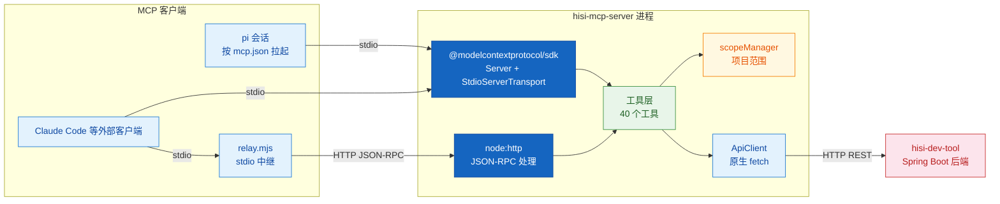
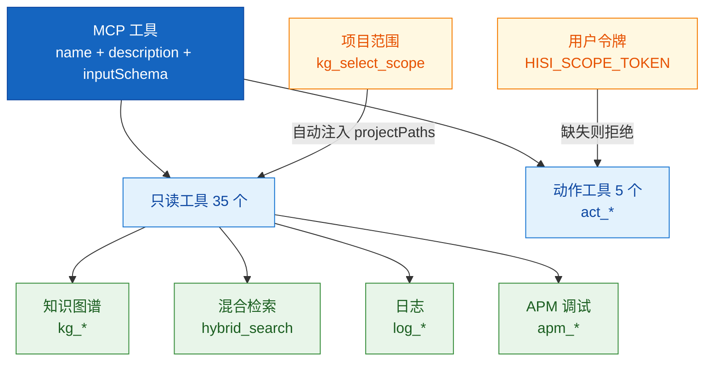

# 项目概览

> 自动生成于 2026-11-26，基于 `99d0037` 版本

---

## 1. 使命与定位

### 1.1 项目使命

> 把后端 `hisi-dev-tool` 已有的知识图谱、混合检索、日志分析、APM 调试能力，按 **Model Context Protocol（MCP）** 标准协议暴露给 AI 客户端，让 LLM 像调用函数一样查询代码与日志；同时提供 5 个必须带用户令牌的「动作工具」，让 agent 能以用户身份发起和推进需求分析会话。

### 1.2 目标用户

| 用户角色 | 使用场景 | 核心诉求 |
|---------|---------|---------|
| pi 会话（后端内置的 agent 运行时） | 后端按 `mcp.json` 以 stdio 拉起本服务，按流分配工具白名单 | 工具名稳定、入参简单、动作工具能识别用户身份 |
| Claude Code 等外部 MCP 客户端 | 本地代码理解、调用链分析、日志排错 | 标准 MCP、零额外安装、后端地址可配 |
| 远程客户端 | 通过 `relay.mjs` 或 HTTP JSON-RPC 接入 | 不依赖 SSE、有健康检查端点 |
| 后端 / 工具开发者 | 新增或修改工具 | 加一个文件、注册一行即可生效 |

### 1.3 项目边界

| 范围 | 说明 |
|------|------|
| **做** | MCP 协议适配（stdio 与 HTTP JSON-RPC）、工具 `inputSchema` 声明、入参整理（路径归一化、项目范围注入）、HTTP 回调后端、动作工具的令牌校验 |
| **不做** | 知识图谱构建、向量检索算法、日志采集与分析、APM 探针注入（全部由后端实现）；入参的 JSON Schema 校验；回调结果的重试与缓存 |
| **未来可能** | 未在代码中确认 |

---

## 2. 技术栈

### 2.1 技术栈总览

| 层 | 技术 | 版本 | 说明 |
|----|------|------|------|
| 运行时 | Node.js | `engines.node` `>=18.0.0` | 本服务的声明要求；原生 `fetch` / `AbortController` |
| 语言 | TypeScript | 声明 `^5.9.3`，lock 文件锁定 5.9.3 | `strict: true`，输出 ES2022 |
| 模块体系 | ESM（NodeNext） | — | `package.json` 中 `"type": "module"`，内部 import 带 `.js` 后缀 |
| MCP 协议 | `@modelcontextprotocol/sdk` | 声明 `^1.0.0`，lock 文件锁定 1.29.0 | `Server`、`StdioServerTransport`、`*RequestSchema`、`McpError`、`ErrorCode` |
| HTTP 服务 | `node:http` | 内置 | HTTP JSON-RPC 模式与健康检查 |
| HTTP 客户端 | 原生 `fetch` | 内置 | 回调后端 REST 接口 |
| 其它内置模块 | `node:crypto`、`node:test` | 内置 | 范围令牌生成；单元测试 |
| 构建 | `tsc` | 随 TypeScript | `npm run build` |
| 上游依赖 | `hisi-dev-tool`（Spring Boot） | — | 全部业务能力的提供方 |

> 运行时依赖只有一个（`@modelcontextprotocol/sdk`）。本服务**不读取 `.env` 文件**，环境变量只来自进程环境。

### 2.2 技术栈关系图



---

## 3. 项目结构

### 3.1 目录树

```
hisi-mcp-server/
├── src/
│   ├── index.ts                      # 入口：Server 装配、kg_select_scope、范围注入、HTTP JSON-RPC
│   ├── client/
│   │   └── apiClient.ts              # HTTP 客户端单例（fetch + 超时 + 错误归一）
│   ├── tools/
│   │   ├── index.ts                  # 工具定义聚合与按名分发
│   │   ├── knowledgeGraphTools.ts    # 23 个 kg_* 工具
│   │   ├── vectorTools.ts            # 1 个 hybrid_search 工具
│   │   ├── logTools.ts               # 4 个 log_* 工具
│   │   ├── apmTools.ts               # 6 个 apm_* 工具
│   │   └── actionTools.ts            # 5 个 act_* 动作工具（需用户令牌）
│   └── utils/
│       ├── scopeManager.ts           # 会话项目范围（scope）的存取与工具注册表
│       ├── pathUtils.ts              # normalizePathArgs：路径型入参的反斜杠归一
│       └── pathUtils.test.ts         # normalizePathArgs 的 node:test 用例
├── relay.mjs                         # stdio → HTTP JSON-RPC 中继（远程 Claude Code 用）
├── skills/                           # 4 份技能说明（供后端安装向导复制给 Claude）
├── dist/                             # tsc 编译产物（已 gitignore）
├── package.json / package-lock.json
├── tsconfig.json
└── docs/codewiki/                    # 本设计手册
```

### 3.2 目录职责详解

| 目录 / 文件 | 职责 | 核心文件 | 文件数 |
|------|------|---------|--------|
| `src/index.ts` | 进程入口，两种传输的装配与统一分发 | `index.ts` | 1（451 行） |
| `src/client/` | 与后端的 HTTP 通信 | `apiClient.ts` | 1（158 行） |
| `src/tools/` | 40 个工具中的 39 个的定义与实现 | `index.ts` 及 5 个工具文件 | 6（1778 行） |
| `src/utils/` | 项目范围管理、路径归一化及其测试 | `scopeManager.ts`、`pathUtils.ts` | 3（252 行） |
| `relay.mjs` | 把 stdio 流量转发到 HTTP JSON-RPC 服务 | `relay.mjs` | 1（43 行） |
| `skills/` | 业务流分析、日志分析、根因分析、单元测试 4 份技能说明 | `hisi-*.md` | 4（共 90 行） |
| `package.json` | 名称、版本、脚本、依赖、`engines` | — | 1 |
| `tsconfig.json` | `strict`、ES2022、NodeNext、输出到 `dist/` | — | 1 |

---

## 4. 快速启动

### 4.1 环境准备

```bash
node --version    # 本服务要求 >= 18.0.0
npm --version
```

> 后端代为构建时要求更高：后端启动流程先检查 `node >= 22.19.0`（pi 的 `engines` 约束），通过后才构建本服务。详见 [07-部署运维](../07-部署运维/index.md)。

### 4.2 安装与构建

```bash
cd hisi-mcp-server
npm ci              # 后端自动构建使用的命令；失败时后端会回退到 npm install
npm run build       # tsc → dist/
```

### 4.3 启动

本服务通常不需要手工启动：MCP 客户端会按配置把它作为子进程拉起。需要手工验证时：

```bash
# 方式一：stdio 模式（默认），在 stdin 上等待 JSON-RPC
node dist/index.js

# 方式二：HTTP JSON-RPC 模式
HISI_HTTP_PORT=3100 node dist/index.js
```

在 MCP 客户端中注册时，最小配置如下（与后端写入 `mcp.json` 的结构一致）：

```json
{
  "mcpServers": {
    "hisi-mcp-server": {
      "command": "node",
      "args": ["<hisi-mcp-server 目录>/dist/index.js"],
      "env": {
        "HISI_API_URL": "http://localhost:8080"
      }
    }
  }
}
```

需要动作工具（`act_*`）时，还要在 `env` 中提供 `HISI_SCOPE_TOKEN`。`package.json` 定义的脚本：

| 脚本 | 命令 | 说明 |
|------|------|------|
| `npm run build` | `tsc` | 编译到 `dist/` |
| `npm start` | `node dist/index.js` | 以编译产物启动 |
| `npm run dev` | `tsc && node dist/index.js` | 先编译再启动 |

### 4.4 验证运行

| 方式 | 操作 | 预期结果 |
|------|------|---------|
| HTTP 模式 | `GET http://localhost:<HISI_HTTP_PORT>/health` | 返回 JSON：`status` 为 `ok`，`tools` 为 40 |
| 任意模式 | `tools/list` | 返回 40 个工具 |
| 任意模式 | 调用 `kg_list_projects` | 返回后端的通用响应信封，`data` 为已建图项目路径数组 |
| stderr | `HISI_DEBUG=true` 启动 | 出现 `[DEBUG] hisi-mcp-server v2.2.0, backend: ...` |

### 4.5 常见启动问题

| 问题 | 原因 | 解决方案 |
|------|------|---------|
| 严格范围工具返回 `SCOPE_NOT_SET` | 未设置项目范围，入参里也没有 `projectPaths` / `projectPath` | 先 `kg_select_scope(action="set")`，或在入参里显式给出路径 |
| 动作工具返回「缺少用户令牌」 | 进程环境里没有 `HISI_SCOPE_TOKEN` | 由拉起方注入该变量；没有令牌时本服务不会代为请求后端 |
| 工具返回 `HTTP <code>: ...` | 后端返回非 2xx | 确认 `HISI_API_URL` 指向的后端已启动 |
| HTTP 模式返回 405 / 415 / 413 | 请求不是 POST、`Content-Type` 不是 JSON、请求体超过 5 MB | 改为 `POST` + `application/json`，缩小请求体 |
| 改了源码但行为没变 | `dist/` 是旧产物 | 重新 `npm run build` |

---

## 5. 核心概念

### 5.1 概念一览

| 概念 | 英文 | 定义 | 代码对应 |
|------|------|------|---------|
| **MCP 工具** | Tool | LLM 可调用的函数声明，含 `name`、`description`、`inputSchema` | 各 `*ToolDefinitions` 数组、`SCOPE_TOOL_DEF` |
| **传输** | Transport | 客户端与本服务之间的通道：stdio（默认）或 HTTP JSON-RPC | `StdioServerTransport`、`startHttpServer()` |
| **项目范围** | Scope | 一次会话内选定的项目路径集合；设置后自动注入到后续工具入参 | `scopeManager.ts`、`injectScope()` |
| **严格 / 宽松** | strict / soft | 严格工具没有范围就拒绝；宽松工具没有范围也照常放行 | `TOOL_SCOPE_REGISTRY` |
| **范围令牌** | scope token | HTTP 模式下区分不同客户端范围的键，放在请求头 `x-scope-token` | `setScope()`、`getScope()` |
| **用户令牌** | user token | 动作工具以用户身份回调后端用的凭据，来自环境变量 `HISI_SCOPE_TOKEN` | `tokenFromEnv()` |
| **动作工具** | action tool | 会改变后端状态的 `act_*` 工具，必须带用户令牌 | `actionTools.ts` |
| **只读工具** | read-only tool | 只查询、不改变后端状态的 35 个工具 | `knowledgeGraphTools.ts` 等 |
| **projectPaths / projectPath** | — | 多项目路径数组（schema 必填）与单路径（兼容字段，二者互为回填） | `resolveProjectParams()` |

### 5.2 概念关系图



### 5.3 概念详解

#### 项目范围（Scope）

- **定义**：会话内选定的项目路径数组。stdio 模式下是进程级的全局范围；HTTP 模式下按 `x-scope-token` 分客户端保存，有效期 30 分钟。
- **生命周期**：`kg_select_scope(action="set")` 创建 → 每次工具调用前自动注入 → `action="clear"` 清除或到期逐出。
- **关键规则**：
  - 入参里已显式给出 `projectPaths` 或 `projectPath` 时不注入（显式入参优先）。
  - 严格工具在没有范围且无显式入参时直接返回 `SCOPE_NOT_SET`。
  - `kg_list_projects`、`kg_select_scope`、`apm_start_session` 永不注入。

详见 [项目范围管理](../03-模块说明/项目范围管理.md)。

#### 用户令牌与动作工具

- **定义**：`HISI_SCOPE_TOKEN` 是后端签发的用户 JWT，由拉起方（后端的 pi 会话）通过进程环境变量传入，不写入任何文件。
- **关键规则**：
  - 5 个 `act_*` 工具在每次调用时读取令牌；取不到就直接返回权限错误，**不会**以匿名身份回调后端。
  - 其余 35 个工具不读取令牌，也不带 `Authorization` 头。

详见 [动作工具](../03-模块说明/动作工具.md)。

---

## 6. 项目演进

### 6.1 里程碑（依据提交记录）

| 日期 | 提交 | 关键变更 |
|------|------|---------|
| 2026-05-08 | `1fdfd6b` | 随 monorepo 初始化引入本服务（stdio、TypeScript strict、NodeNext） |
| 2026-05-09 | `a4a4925` | 补回缺失的 `utils/pathUtils.ts`，恢复 `normalizePathArgs` 并加 6 个 `node:test` 用例 |
| 2026-05-19 | `099c92e` | 新增 APM 调试工具 |
| 2026-05-30 / 05-31 | `b817859`、`9b8b119` | 知识图谱工具切到后端 v2 接口；schema 改为 `projectPaths` 必填、`projectPath` 兼容可选 |
| 2026-08-12 | `99783e4` | v2.1.0：项目范围协议（`kg_select_scope`）与 HTTP JSON-RPC 通道 |
| 2026-08-12 | `d35594c` | 新增 `relay.mjs`，供远程 Claude Code 以 stdio 接入 |
| 2026-08-20 | `0dac484` | `hybrid_search` 切到 `/api/search/semantic/v2`，去掉无效的 `threshold` 参数 |
| 2026-11-26 | `e718a5a` | 新增 `act_*` 动作工具；本服务改为随后端启动自动构建 |

### 6.2 当前状态

| 维度 | 状态 | 说明 |
|------|------|------|
| 版本号 | 不一致 | `package.json` 为 `1.0.0`，`index.ts` 的 `SERVER_VERSION` 为 `2.2.0`（MCP 握手与 `/health` 返回的是后者） |
| 测试覆盖 | 低 | 只有 `pathUtils.test.ts` 有单元测试；`package.json` 没有 `test` 脚本 |
| 已知问题 | 若干 | 见各模块文档的「已知问题」，汇总在 [07-部署运维](../07-部署运维/index.md) |

---

## 7. 与相关项目的关系

| 项目 | 关系 | 交互方式 | 说明 |
|------|------|---------|------|
| `hisi-dev-tool` | 上游依赖 | HTTP REST（`HISI_API_URL`） | 提供全部业务能力；启动时会自动构建本服务并生成 `mcp.json` |
| pi（后端内置的 agent 运行时） | 下游消费者 | stdio + JSON-RPC | 每次会话按 `mcp.json` 拉起本服务，并按流限定可用工具 |
| Claude Code 等外部 MCP 客户端 | 下游消费者 | stdio，或经 `relay.mjs` / HTTP JSON-RPC | 通过后端安装向导或手工配置注册 |
| `hisi-dev-tool-frontend` | 平行项目 | 无直接交互 | 本服务代码中没有对前端的引用 |

---

> **延伸阅读**：
> - 架构全貌 → [02-架构设计](../02-架构设计/index.md)
> - 工具与协议 → [05-接口文档](../05-接口文档/index.md)
> - 术语详解 → [09-术语表](../09-术语表/index.md)
> - 部署指南 → [07-部署运维](../07-部署运维/index.md)
