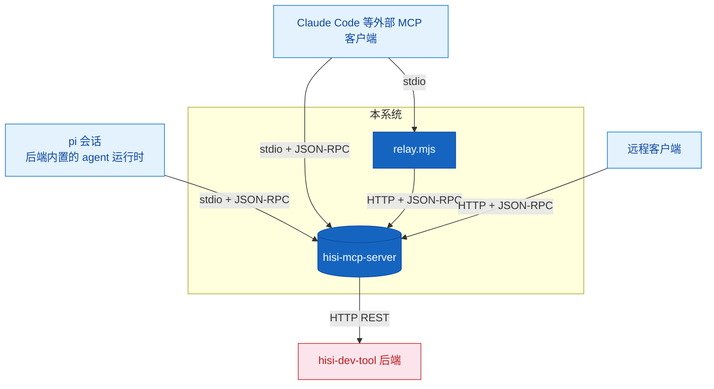
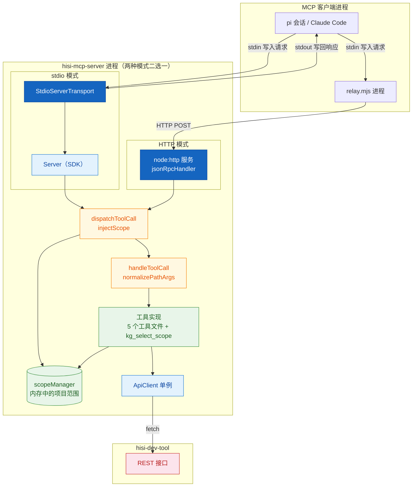
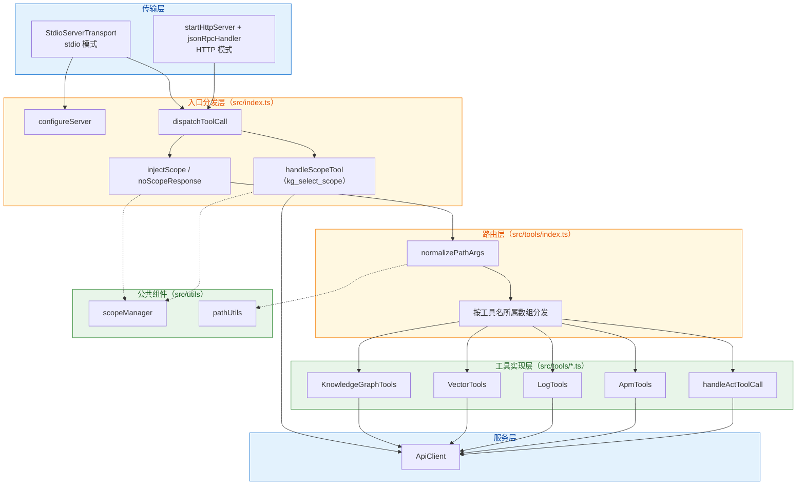
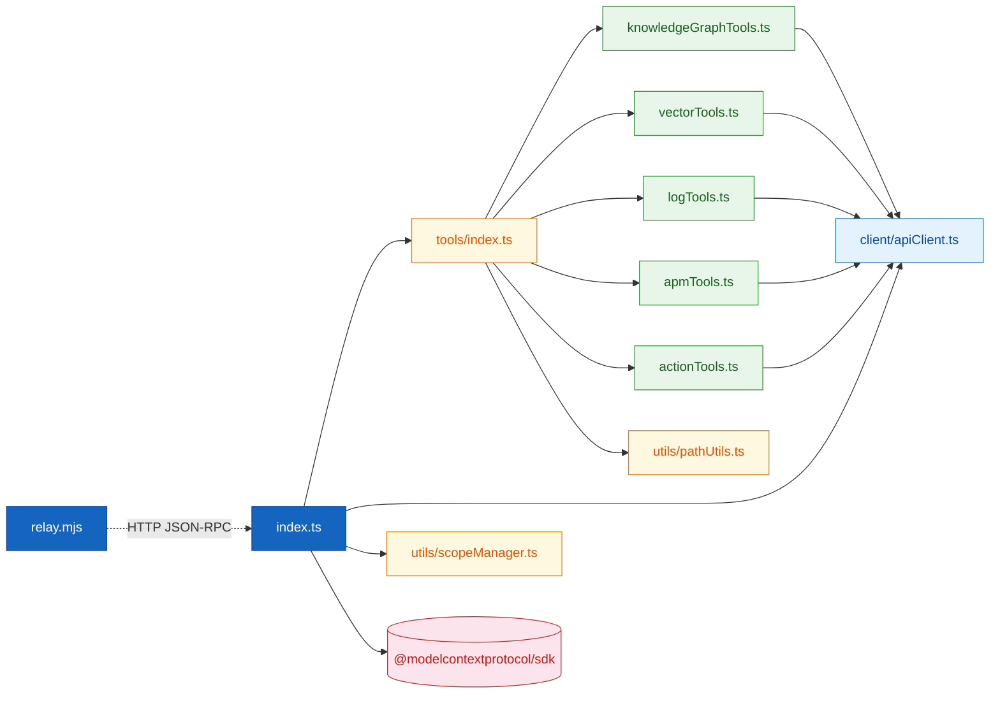
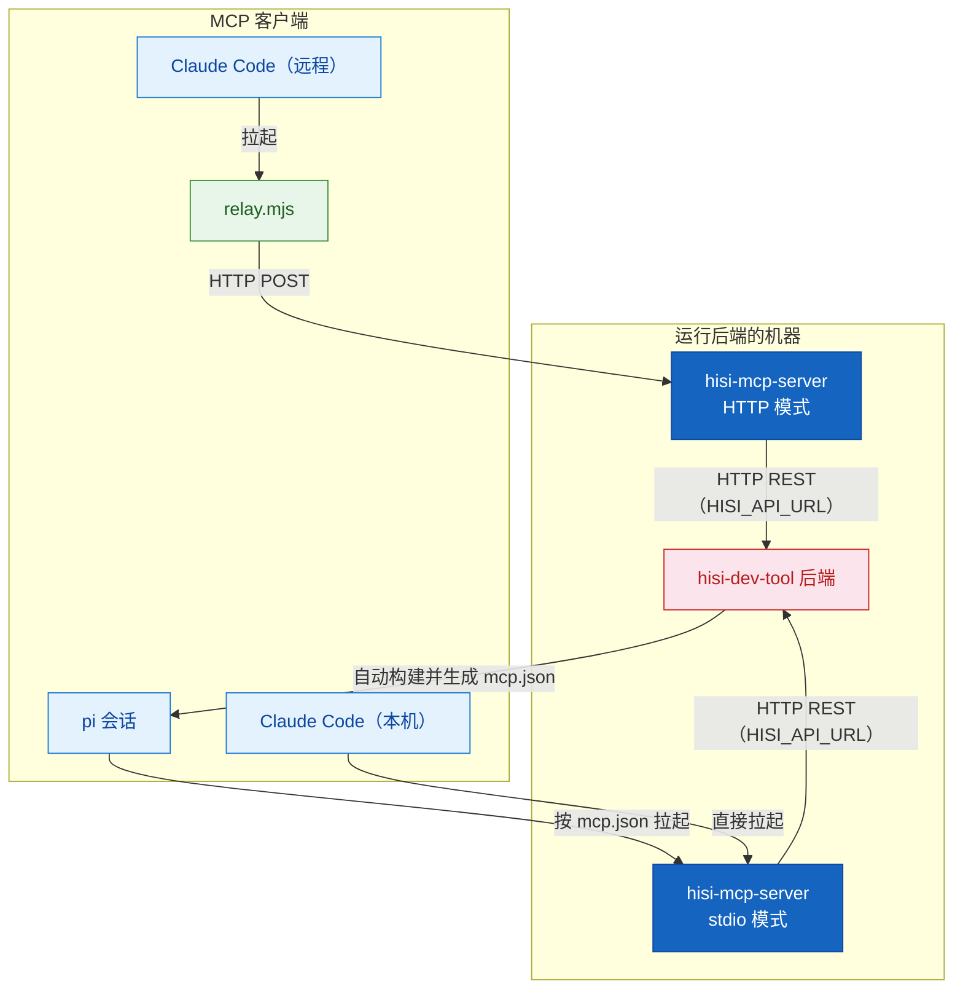

# 架构设计

> 自动生成于 2026-11-26，基于 `99d0037` 版本

---

## 1. 架构总览

### 1.1 系统上下文图（C4 Level 1）



**系统上下文说明**：

| 角色 / 系统 | 类型 | 交互方式 | 数据流向 |
|-----------|------|---------|---------|
| pi 会话 | 程序 | stdio + JSON-RPC | 拉起本服务；发 `tools/list`、`tools/call`；环境里带 `HISI_API_URL`，动作流另带 `HISI_SCOPE_TOKEN` |
| Claude Code 等外部客户端 | 程序 | stdio + JSON-RPC | 同上；无令牌时只能用 35 个只读工具 |
| relay.mjs | 本系统的另一个进程 | 一侧 stdio，一侧 HTTP | 把 stdio 收到的每行 JSON-RPC 转成 HTTP POST |
| 远程客户端 | 程序 | HTTP + JSON-RPC | 直接 POST；可用请求头 `x-scope-token` 区分范围 |
| hisi-dev-tool 后端 | 外部系统 | HTTP REST | 本服务的全部业务能力来源 |

### 1.2 容器图（C4 Level 2）



**容器说明**：

| 容器 / 组件 | 技术 | 职责 | 通信端 |
|------|------|------|--------|
| StdioServerTransport | MCP SDK | stdio 上的 JSON-RPC 收发 | stdin / stdout |
| Server（SDK） | MCP SDK | 注册 `tools/list`、`tools/call` 处理器 | 进程内 |
| HTTP 服务 | `node:http` | 健康检查 + JSON-RPC（`initialize`、`tools/list`、`tools/call`、`ping`） | 监听 `0.0.0.0:<HISI_HTTP_PORT>` |
| dispatchToolCall | 自研 | 两种传输共用的分发入口；处理 `kg_select_scope`；注入项目范围；统一错误包装 | 进程内 |
| handleToolCall | 自研 | 路径归一化 + 按工具名所属数组分发 | 进程内 |
| 工具实现 | 自研 | 声明 `inputSchema`，把入参转成对后端的 REST 调用 | 调 ApiClient |
| scopeManager | 自研 | 保存会话的项目范围；登记每个工具是否受范围约束 | 进程内（内存） |
| ApiClient | 原生 `fetch` | URL 拼接、超时、错误归一、单例 | 后端 `HISI_API_URL` |

---

## 2. 分层设计

### 2.1 分层架构图



> 图中 `A1 --> B1` 表示：stdio 模式下传输层先把请求交给 SDK 的 `Server`，再由 `configureServer` 注册的处理器调用 `dispatchToolCall`；HTTP 模式下 `jsonRpcHandler` 直接调用 `dispatchToolCall`。

### 2.2 各层职责

#### 传输层

- **职责**：接收 JSON-RPC 请求、写回响应。
- **核心组件**：`StdioServerTransport`（stdio 模式）；`startHttpServer()` / `jsonRpcHandler()`（HTTP 模式）。
- **设计约束**：stdio 模式下 stdout 是协议通道，本服务所有日志都走 stderr（`console.error`）。

#### 入口分发层

- **职责**：把工具名和入参变成一次工具调用；两种传输共用 `dispatchToolCall()`。
- **核心组件**：`dispatchToolCall()` — 统一分发与错误包装；`injectScope()` — 自动注入项目范围；`handleScopeTool()` — 实现 `kg_select_scope`；`noScopeResponse()` — 严格工具缺范围时的拒绝响应。
- **设计约束**：`kg_select_scope` 不经过 `tools/index.ts`，在 `dispatchToolCall()` 里就地处理。

#### 路由层

- **职责**：聚合工具定义；分发前做路径归一化；按工具名所属数组转交对应处理函数。
- **核心组件**：`allToolDefinitions`（39 个）、`handleToolCall()`。
- **设计约束**：路由只认工具名，不解析入参含义。

#### 工具实现层

- **职责**：声明 `inputSchema`；把入参转换成对后端的 REST 调用；需要时读取用户令牌。
- **核心组件**：`knowledgeGraphTools.ts`、`vectorTools.ts`、`logTools.ts`、`apmTools.ts`、`actionTools.ts`。
- **设计约束**：只依赖 `ApiClient`；各组用模块级惰性单例持有工具类实例；不校验入参是否符合 schema。

#### 服务层

- **职责**：URL 拼接、统一请求头、超时控制、HTTP 错误归一。
- **核心组件**：`ApiClient`（模块级单例 `getApiClient()`）。

#### 公共组件

- **职责**：`scopeManager.ts` 保存项目范围并登记工具的范围要求；`pathUtils.ts` 提供路径归一化。
- **设计约束**：两者都不依赖其它内部模块。

---

## 3. 模块依赖关系

### 3.1 依赖关系图



### 3.2 依赖规则

| 规则 | 说明 | 示例 |
|------|------|------|
| **单向依赖** | 工具实现层只依赖 `ApiClient`；`ApiClient` 不依赖任何内部模块 | `knowledgeGraphTools.ts` → `apiClient.ts` |
| **路由层不反向依赖入口** | `tools/index.ts` 不知道 `index.ts` 的存在 | 入口 import 路由，反之没有 |
| **范围逻辑集中在入口** | 只有 `index.ts` 调用 `scopeManager`；工具实现层不感知范围 | `injectScope()` 在分发前改写入参 |
| **归一化只在分发入口做一次** | `handleToolCall()` 开头调用 `normalizePathArgs()`，工具实现层不再处理 | 见 `pathUtils.ts` 文件头注释 |
| **中继脚本零依赖** | `relay.mjs` 不 import 任何内部模块，只依赖内置 `fetch` | 可单独拷走运行 |

### 3.3 共享模块

| 共享模块 | 使用者 | 说明 |
|---------|--------|------|
| `client/apiClient.ts` | `index.ts` 与全部 5 个工具文件 | 导出 `ApiClient`、`getApiClient`、类型 `ApiResponse<T>`、`RequestOptions` |
| `utils/scopeManager.ts` | 仅 `index.ts` | 导出 `setScope`、`getScope`、`clearScope`、`generateToken`、`isScopedTool`、`isStrictScopedTool` |
| `utils/pathUtils.ts` | 仅 `tools/index.ts` | 导出 `normalizePathArgs` |

---

## 4. 架构质量属性

### 4.1 质量属性优先级

| 优先级 | 质量属性 | 具体要求 | 架构保障措施 |
|--------|---------|---------|-------------|
| **P0** | 身份安全 | 动作工具绝不以匿名身份执行 | `handleActToolCall()` 入口统一取令牌，取不到即返回权限错误（ADR-008） |
| **P0** | 协议合规 | stdio 模式下 stdout 只能是 JSON-RPC | 使用官方 SDK；日志全部 `console.error` |
| **P0** | 错误透明 | 工具失败的原因要能回传给调用方 | `dispatchToolCall()` 统一包装为 `isError: true` + JSON 文本 |
| **P1** | 可扩展 | 新增一类工具不影响其它工具 | 一个能力域一个文件 + 一个 `*_TOOLS` 名单数组（ADR-007） |
| **P1** | 跨平台 | Windows 反斜杠路径可直接使用 | 分发入口统一做路径归一化（ADR-010） |
| **P2** | 可观测 | 能判断服务是否起来了、连的哪个后端 | HTTP 模式 `/health`；`HISI_DEBUG` 调试日志 |
| **P2** | 后端保护 | 列项目范围时不要压垮后端 | 统计查询并行但最多取前 20 个项目 |

### 4.2 架构权衡

| 权衡点 | 选择 | 放弃 | 说明 |
|--------|------|------|------|
| 传输方式 | stdio 为默认，另提供 HTTP JSON-RPC 与中继脚本 | 只维护一种传输 | `index.ts` 里多了一段约 120 行的 HTTP 处理代码，换来远程客户端可接入（ADR-001、002、003） |
| 项目范围 | 存在进程内存里，30 分钟过期 | 持久化、跨进程共享 | 实现简单；进程重启后范围丢失，stdio 模式范围是进程级的（ADR-005） |
| 入参校验 | 只声明 schema，不在本服务内校验 | 服务端强校验 | 入参是否合法取决于客户端是否按 schema 调用；后端会对必填项再校验（例如知识图谱 v2 接口的 `projectPaths` 是必填查询参数） |
| HTTP 模式鉴权 | 不做鉴权，不设 CORS | 令牌校验、来源限制 | 代码注释与提交说明都表明这是有意的现状；部署时需靠网络隔离（见 5.3） |
| 结果包装 | 原样透传后端 JSON | 统一信封再包装 | 后端各接口信封不统一（多数是 `code/message/data`，语义检索是裸对象），本服务不再加一层 |

---

## 5. 跨切面关注点

### 5.1 错误处理策略

```
协议层（stdio）：
  未知工具名            → throw McpError(MethodNotFound, "Unknown tool: <name>")   → JSON-RPC 错误响应
协议层（HTTP）：
  请求体不是 JSON       → HTTP 200 + JSON-RPC 错误 -32700
  未知工具名 / 未知方法 → HTTP 200 + JSON-RPC 错误 -32601
  请求不是 POST         → HTTP 405
  Content-Type 非 JSON  → HTTP 415
  请求体超过 5 MB       → HTTP 413
  其它异常              → HTTP 500 + JSON-RPC 错误 -32603
分发层：
  kg_select_scope 抛错  → { success:false, error }                + isError:true
  严格工具缺少范围      → { success:false, error:"SCOPE_NOT_SET", message } + isError:true
  其它工具抛错          → { success:false, error, tool }           + isError:true
路由层 / 工具层：
  名字不在名单或落到 default 分支 → throw Error("Unknown ... tool")，被分发层捕获
服务层（ApiClient）：
  非 2xx                → throw Error("HTTP <status>: <body>")
  超时                  → throw Error("Request timeout after <ms>ms")
  非 Error 类型的异常   → throw Error("Unknown error occurred")
进程级：
  SIGINT / SIGTERM      → exit(0)
  uncaughtException     → stderr "Uncaught:" + exit(1)
  unhandledRejection    → stderr "Unhandled:" + exit(1)
  main() 启动失败       → stderr "Start failed:" + exit(1)
```

> 后端多数接口在业务失败时仍返回 HTTP 200，只在响应体的 `code` 字段里给出非 200 的值。这类失败不会触发 `ApiClient` 抛错，会作为「成功」的工具结果原样透传，调用方需要自己看 `code`。

### 5.2 日志策略

| 触发条件 | 内容 | 输出目标 |
|---------|------|---------|
| `HISI_DEBUG=true` 启动 | `[DEBUG] hisi-mcp-server v2.2.0, backend: <HISI_API_URL>` | stderr |
| `HISI_DEBUG=true` 且 stdio 连接完成 | `[DEBUG] stdio connected` | stderr |
| `HISI_DEBUG=true` 且 `kg_select_scope` 的 list 动作里某项目状态查询失败 | `[DEBUG] kg_status failed for <path>: <message>` | stderr |
| HTTP 模式启动完成 | `[hisi-mcp-server v2.2.0] HTTP JSON-RPC → ...` 与 `[hisi-mcp-server] Health: ...` | stderr |
| HTTP 模式处理请求抛出异常 | `[hisi-mcp-server] HTTP error:` + 异常 | stderr |
| 进程级异常 | `Uncaught:` / `Unhandled:` / `Start failed:` | stderr |
| stdio 模式响应 | JSON-RPC 报文 | stdout（仅此用途） |

### 5.3 安全策略

| 关注点 | 策略 | 实现位置 |
|--------|------|---------|
| 动作工具身份 | 必须有 `HISI_SCOPE_TOKEN`，否则直接拒绝 | `handleActToolCall()` |
| 令牌透传 | 以 `Authorization: Bearer <token>` 头回调后端，只加在 5 个动作工具的请求上 | `actionTools.ts` |
| 令牌存储 | 只从进程环境读取，不写文件、不打日志 | `tokenFromEnv()` |
| 只读工具 | 不带任何凭据 | 其余 5 类工具 |
| HTTP 模式访问控制 | **没有鉴权**，监听 `0.0.0.0`，不设 CORS | `startHttpServer()` |
| HTTP 模式请求体 | 上限 5 MB，超出直接断开 | `readBody()` |
| 入参校验 | 本服务不校验 `arguments` 是否符合 `inputSchema` | — |
| 路径注入 | 只替换路径型键名里的反斜杠，不做其它改写 | `normalizePathArgs()` |

> **已知风险（依据代码）**：HTTP 模式没有鉴权，而动作工具用的是进程级的 `HISI_SCOPE_TOKEN`。如果以 HTTP 模式启动的进程环境里带有该变量，任何能访问这个端口的调用方都能以这枚令牌触发动作工具。代码中没有针对这一点的防护，只能靠部署时不要给 HTTP 模式进程注入令牌，或限制端口可达范围。

### 5.4 状态与并发

| 状态 | 位置 | 生命周期 | 说明 |
|------|------|---------|------|
| `defaultClient` | `apiClient.ts` 模块级 | 进程存活期 | `getApiClient(baseUrl?)` 首次创建，之后传 `baseUrl` 会改写地址 |
| `defaultScope` / `scopes` | `scopeManager.ts` 模块级 | 全局范围到进程结束；令牌范围 30 分钟 | stdio 模式只用 `defaultScope` |
| `_kgTools` / `_vecTools` / `_logTools` / `_apmTools` | 各工具文件模块级 | 进程存活期 | 首次调用时创建 |
| 清理定时器 | `scopeManager.ts` | 首次写入令牌范围时启动，`unref()` 不阻塞退出 | 每 5 分钟逐出过期范围 |

本服务没有锁与队列：同一进程内的调用并发执行。

---

## 6. 部署架构

### 6.1 部署拓扑图



### 6.2 启动方式对照

| 启动方式 | 触发条件 | 传输 | 范围存储 | 令牌来源 |
|---------|---------|------|---------|---------|
| pi 会话拉起 | 后端启动时生成 `mcp.json`，每次会话按它拉起 | stdio | 进程级全局范围 | 动作流由后端注入 `HISI_SCOPE_TOKEN`，只读流不注入 |
| 外部客户端直接拉起 | 客户端配置 `command` + `args` | stdio | 进程级全局范围 | 取决于客户端配置 |
| HTTP 模式 | 环境变量 `HISI_HTTP_PORT` 有值 | HTTP JSON-RPC | 按 `x-scope-token` 分桶，缺省落到全局范围 | 取决于启动该进程时的环境 |
| 经中继接入 | 客户端拉起 `relay.mjs` | stdio → HTTP | 中继不转发 `x-scope-token`，一律落到全局范围 | 同上（HTTP 模式进程） |

---

## 7. 技术选型总结

| 领域 | 选择 | 说明 | 对应决策 |
|------|------|------|---------|
| 传输 | stdio（默认）+ HTTP JSON-RPC + 中继脚本 | 三种接入方式共用同一个分发入口 | ADR-001、ADR-002、ADR-003 |
| 项目范围 | 强制的范围协议，内存存储，令牌键控 + TTL | `kg_select_scope` + `scopeManager` | ADR-004、ADR-005、ADR-006 |
| 工具分组 | 只读工具与动作工具分离，动作工具无令牌即拒绝 | `act_*` 独立文件与处理函数 | ADR-007、ADR-008、ADR-009 |
| 路径处理 | 按键名匹配的浅层归一化，只在分发入口做 | `normalizePathArgs` | ADR-010 |
| 检索 | 0 结果回退；v2 多路召回接口 | `hybrid_search` | ADR-011、ADR-013 |
| 知识图谱 | 对齐后端 v2 接口，`projectPaths` 必填 | 23 个 `kg_*` 工具 | ADR-012 |
| 构建 | 随后端启动自动构建 | `ensureMcpDist()` | ADR-014 |
| 工具描述 | 面向 AI 理解来写 | `description` 字段 | ADR-015 |
| 语言与模块 | TypeScript strict、ES2022、NodeNext、ESM | 见 `tsconfig.json`、`package.json` | 未在代码注释中说明理由 |
| HTTP 客户端 | 原生 `fetch` + `AbortController` | 无第三方 HTTP 库 | 未在代码注释中说明理由 |

详见 [08-技术决策](../08-技术决策/index.md)。

---

## 8. 架构约束与限制

| 约束类型 | 约束 | 影响 | 应对 |
|---------|------|------|------|
| 技术约束 | stdio 模式下 stdout 只能输出 JSON-RPC | 任何 `console.log` 都会破坏协议 | 全部用 `console.error` |
| 技术约束 | 本服务 `engines.node` `>=18.0.0` | 依赖原生 `fetch` | 后端代为构建时实际要求 `>=22.19.0` |
| 技术约束 | ESM + NodeNext | 内部 import 必须带 `.js` 后缀 | — |
| 集成约束 | 后端接口路径与参数名一旦变化，本服务必须同步修改 | 40 个回调路径硬编码在各工具文件中 | 修改后端接口时同步检查工具文件 |
| 集成约束 | 范围与状态只在内存 | 进程重启即丢失；多个 stdio 客户端不共享范围 | 每个客户端进程各自设置范围 |
| 集成约束 | 后端多数业务失败仍返回 HTTP 200 | 本服务无法把这些当错误处理 | 调用方检查响应体里的 `code` |

---

> **延伸阅读**：
> - 入口与分发 → [MCP服务入口](../03-模块说明/MCP服务入口.md)
> - 项目范围实现 → [项目范围管理](../03-模块说明/项目范围管理.md)
> - 数据流转路径 → [04-数据流程](../04-数据流程/index.md)
> - 技术决策详情 → [08-技术决策](../08-技术决策/index.md)
> - 部署操作指南 → [07-部署运维](../07-部署运维/index.md)
