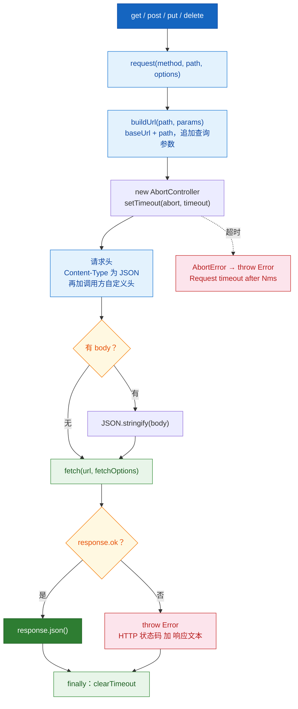
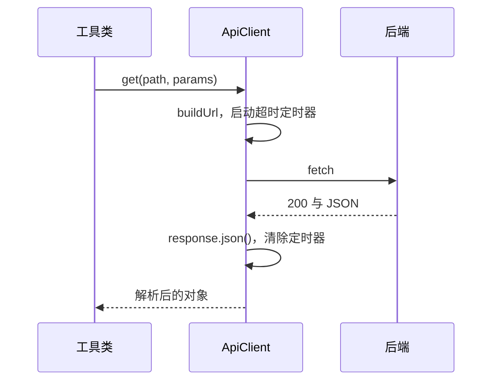
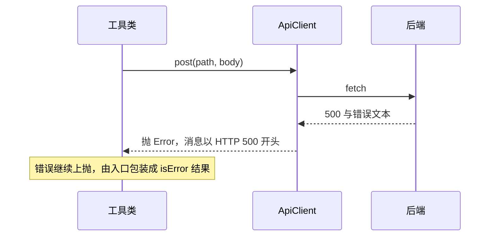

# API 客户端

> 自动生成于 2026-11-26，基于 `99d0037` 版本

| 属性 | 值 |
|------|-----|
| **所属层** | 服务层 |
| **目录** | `src/client/apiClient.ts` |
| **文件数** | 1 个（158 行） |
| **对外接口** | `ApiClient` 类、`getApiClient()`、类型 `ApiResponse<T>`、`RequestOptions` |
| **依赖模块** | 0 个内部模块（只用 Node 内置的 `fetch`、`AbortController`、`URL`） |
| **被依赖数** | 6（入口与 5 个工具文件） |

---

## 1. 模块概述

### 1.1 职责定义

**核心职责**：封装与后端 `hisi-dev-tool` 的 HTTP 通信——拼接 URL 与查询参数、设置请求头、超时控制、把 HTTP 失败归一成 `Error`，并以进程级单例提供。

**职责边界**：

| 本模块负责 ✅ | 本模块不负责 ❌ | 由谁负责 |
|-------------|---------------|---------|
| URL 构造（含查询参数编码） | 业务参数校验 | 各工具文件 |
| 超时（默认 30 秒） | 重试 | 目前没有重试 |
| HTTP 错误归一 | 后端业务失败的判断（HTTP 200 但 `code` 非 200） | 调用方 |
| 单例管理 | 鉴权（只负责把调用方给的请求头原样带上） | [动作工具](./动作工具.md) |

### 1.2 核心文件清单

| 文件 | 类型 | 职责 | 行数 |
|------|------|------|------|
| `src/client/apiClient.ts` | 服务 | HTTP 封装 + 单例 | 158 |

---

## 2. 模块架构

### 2.1 请求处理流程图



---

## 3. 对外接口

### 3.1 导出接口一览

| 接口 | 类型 | 说明 | 调用方 |
|------|------|------|--------|
| `ApiClient` | 类 | HTTP 客户端 | 各工具文件（类型与默认构造） |
| `getApiClient(baseUrl?)` | 函数 | 返回进程级单例 | [MCP服务入口](./MCP服务入口.md) 与 5 个工具文件 |
| `ApiResponse<T>` | 接口 | `{ success, data?, error?, message? }` | 没有调用方 |
| `RequestOptions` | 接口 | `{ timeout?, headers? }` | 各请求方法的第三个参数 |

### 3.2 `ApiClient`

```ts
export class ApiClient {
  constructor(baseUrl: string = 'http://localhost:8080');
  setBaseUrl(url: string): void;
  getBaseUrl(): string;
  get<T>(path: string, params?: Record<string, string>, options?: RequestOptions): Promise<T>;
  post<T>(path: string, body: unknown, options?: RequestOptions): Promise<T>;
  put<T>(path: string, body: unknown, options?: RequestOptions): Promise<T>;
  delete<T>(path: string, options?: RequestOptions): Promise<T>;
  healthCheck(): Promise<boolean>;
}
```

| 成员 | 说明 |
|------|------|
| 构造函数 | 保存 `baseUrl`，去掉末尾的一个 `/` |
| `setBaseUrl()` | 替换地址，同样去掉末尾的一个 `/` |
| `get()` | 查询参数类型是 `Record<string, string>` |
| `post()` / `put()` | 请求体任意类型，发送前 `JSON.stringify` |
| `delete()` | 无请求体 |
| `healthCheck()` | 请求 `GET /api/health`，`status` 为 `ok` 或 `UP` 时返回 `true`，任何异常返回 `false` |

### 3.3 `getApiClient(baseUrl?)`

| 情况 | 行为 |
|------|------|
| 单例还不存在 | 用传入的 `baseUrl`（可为空）创建 |
| 单例已存在且传了 `baseUrl` | 改写单例的地址 |
| 单例已存在且没传 `baseUrl` | 直接返回 |

---

## 4. 内部实现

### 4.1 URL 构造：`buildUrl()`

- 用 `new URL(baseUrl + path)` 拼接。
- 查询参数用 `searchParams.append()` 逐个追加（自动做 URL 编码）；值为 `undefined` 或 `null` 的参数会被跳过。
- 路径里已含的查询串不做处理。

### 4.2 请求头与请求体

- 固定带 `Content-Type: application/json`（GET 请求也带），再合并调用方通过 `options.headers` 传入的头。
- `options.body !== undefined` 时才序列化请求体。

### 4.3 超时

每次请求创建一个 `AbortController`，到时调用 `abort()`；无论成功失败都在 `finally` 里清掉定时器。

### 4.4 响应处理

| 情况 | 结果 |
|------|------|
| HTTP 2xx | `response.json()`，原样返回解析后的对象 |
| HTTP 非 2xx | 读取响应文本，抛 `Error("HTTP <status>: <text>")` |
| 超时导致的中止 | 抛 `Error("Request timeout after <timeout>ms")` |
| 其它 `Error` | 原样抛出 |
| 不是 `Error` 的异常 | 抛 `Error("Unknown error occurred")` |

---

## 5. 交互流程

### 5.1 成功



### 5.2 失败



---

## 6. 依赖关系

### 6.1 上游依赖

无内部依赖，也没有第三方依赖。

### 6.2 下游消费者

| 消费模块 | 用法 |
|---------|------|
| [MCP服务入口](./MCP服务入口.md) | `getApiClient(API_BASE_URL)` 初始化；`kg_select_scope` 的 `list` 动作用 `get()` 调 3 个接口 |
| [知识图谱工具](./知识图谱工具.md) | 23 次 `get()` |
| [混合检索工具](./混合检索工具.md) | `post()` 1 次，`get()` 1 次（0 结果回查） |
| [日志分析工具](./日志分析工具.md) | `post()` 2 次，`get()` 2 次 |
| [APM调试工具](./APM调试工具.md) | `post()` 3 次，`get()` 3 次 |
| [动作工具](./动作工具.md) | `post()` 5 次，带 `Authorization` 请求头 |

所有调用方都没有传 `timeout`，一律使用 30 秒默认值。

---

## 7. 配置项

| 配置项 | 类型 | 默认值 | 来源 | 说明 |
|--------|------|--------|------|------|
| `baseUrl` | `string` | `http://localhost:8080` | 构造参数；入口传入 `HISI_API_URL` | 后端基础地址 |
| `defaultTimeout` | `number` | `30000` | 类内私有字段 | 毫秒；单次请求可用 `options.timeout` 覆盖 |

---

## 8. 错误处理

| 错误场景 | 抛出 | 调用方感知 |
|---------|------|-----------|
| HTTP 非 2xx | `HTTP <status>: <text>` | 入口包装为 `{ success: false, error, tool }` + `isError` |
| 超时 | `Request timeout after <ms>ms` | 同上 |
| 响应体不是合法 JSON（例如空响应体） | `response.json()` 自身抛出的解析错误，原样上抛 | 同上 |
| 非对象响应（如纯文本错误页）且 HTTP 为 2xx | 同上 | 同上 |
| `healthCheck()` 的任何异常 | 不抛出，返回 `false` | 调用方得到 `false` |

---

## 9. 性能考量

| 关注点 | 策略 | 实现 |
|--------|------|------|
| 对象复用 | 进程级单例 | `defaultClient` |
| 连接 | 使用 Node 内置 `fetch` 的默认连接行为，本模块不做连接池配置 | — |
| 悬挂请求 | 每次请求独立定时器 | `AbortController` |

---

## 10. 已知问题与扩展点

| 已知问题 | 影响 |
|---------|------|
| `healthCheck()` 请求 `GET /api/health`，而后端代码里没有这个路径（只有 `/api/ops/health`、`/api/ram/health`、`/api/diagnosis/health`）；并且本服务没有任何地方调用它 | 对着当前后端调用会得到 `false` |
| 类型 `ApiResponse<T>` 的字段是 `success` / `data` / `error` / `message`，而后端通用响应 `ApiResponse` 的字段是 `code` / `message` / `data`（另有 `isSuccess()` 方法）；语义检索接口甚至不包信封 | 这个类型与实际响应不一致，好在没有调用方 |
| `put()` 与 `delete()` 没有调用方 | 冗余代码 |
| GET 请求也带 `Content-Type: application/json` | 通常无害 |
| 没有重试与并发限制 | 后端抖动时调用直接失败 |
| `getApiClient(baseUrl)` 在单例已存在时会改写全局地址 | 任何调用方都能影响其它调用方 |

| 扩展点 | 扩展方式 |
|--------|---------|
| 统一鉴权 | 在 `request()` 里按需追加请求头 |
| 重试 | 在 `request()` 外包一层 |
| 耗时统计 | 在 `try` / `finally` 中记录时间 |

---

> **相关文档**：
> - 架构总览 → [02-架构设计](../02-架构设计/index.md)
> - 使用方 → [知识图谱工具](./知识图谱工具.md)、[动作工具](./动作工具.md)
> - 后端回调路径汇总 → [05-接口文档](../05-接口文档/index.md)
> - 环境变量 → [07-部署运维](../07-部署运维/index.md)
