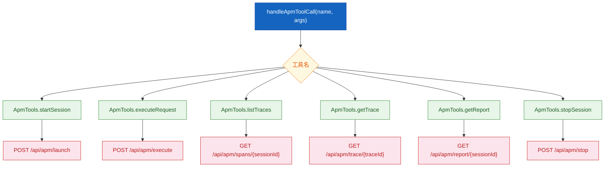
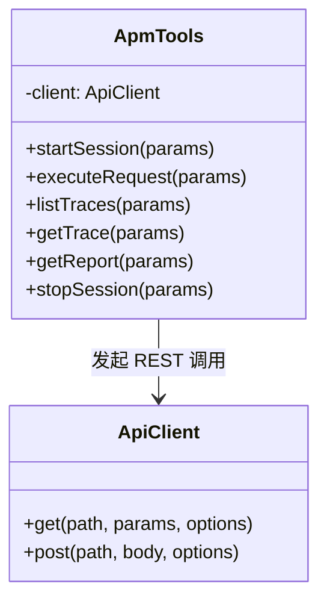
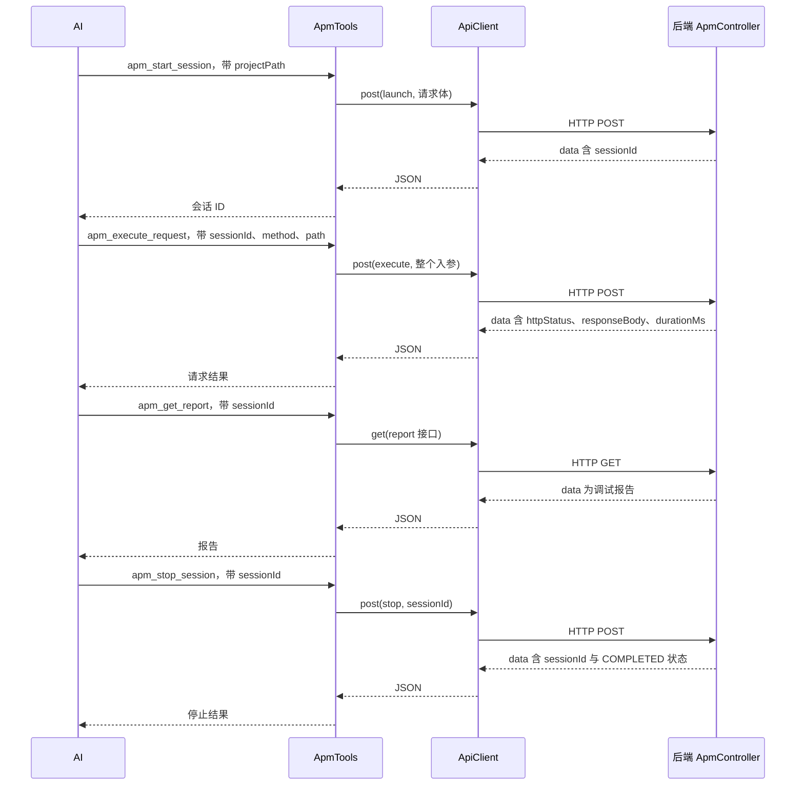
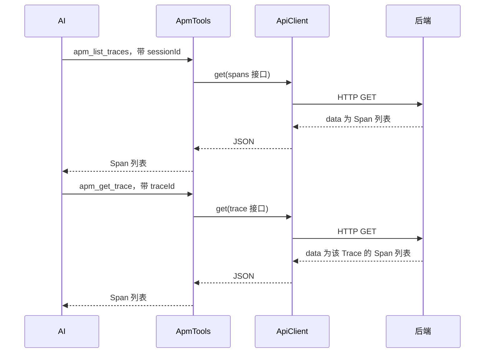

# APM 调试工具

> 自动生成于 2026-11-26，基于 `99d0037` 版本

| 属性 | 值 |
|------|-----|
| **所属层** | 工具实现层 |
| **目录** | `src/tools/apmTools.ts` |
| **文件数** | 1 个（273 行） |
| **对外接口** | 6 个工具定义、`APM_TOOLS`、`ApmTools` 类、`handleApmToolCall()`、6 个入参类型 |
| **依赖模块** | 1 个（[API客户端](./API客户端.md)） |
| **被依赖数** | 1（[工具路由聚合](./工具路由聚合.md)） |

---

## 1. 模块概述

### 1.1 职责定义

**核心职责**：把后端 `ApmController` 的 6 个 APM 调试接口包装成 `apm_*` 工具，支撑「启动调试会话 → 发请求 → 看 Trace / Span → 取报告 → 停会话」这条工作流。

**职责边界**：

| 本模块负责 ✅ | 本模块不负责 ❌ | 由谁负责 |
|-------------|---------------|---------|
| 6 个工具的 schema（描述为英文） | 拉起目标进程、挂载 OpenTelemetry agent | 后端 |
| 入参到请求体 / 路径参数的转换 | Span 采集、报告生成、性能分析 | 后端 |
| 会话状态的约束（写在 description 里） | 是否必须先设项目范围 | 6 个工具都不参与项目范围 |
| — | 鉴权 | 不需要（6 个工具都不带令牌） |

### 1.2 核心文件清单

| 文件 | 类型 | 职责 | 行数 |
|------|------|------|------|
| `src/tools/apmTools.ts` | 工具定义 + 工具类 + 处理函数 | 见下文 | 273 |

---

## 2. 模块架构

### 2.1 内部结构图

### 2.2 类图

---

## 3. 对外接口

### 3.1 导出接口一览

| 接口 | 类型 | 说明 |
|------|------|------|
| `apmToolDefinitions` | 常量数组 | 6 个工具定义 |
| `APM_TOOLS` | 常量数组 | 6 个工具名 |
| `handleApmToolCall(toolName, args)` | 异步函数 | 未知的工具名抛 `Error("Unknown APM tool: <name>")` |
| `ApmTools` | 类 | 6 个方法对应 6 个后端接口 |
| `Apm*Params` × 6 | 接口 | 入参类型 |

### 3.2 工具一览

6 个工具都不需要令牌，也都不参与项目范围。

| 工具 | 方法 | 后端路径 | `required` |
|------|------|---------|-----------|
| `apm_start_session` | POST | `/api/apm/launch` | `projectPath` |
| `apm_execute_request` | POST | `/api/apm/execute` | `sessionId`、`method`、`path` |
| `apm_list_traces` | GET | `/api/apm/spans/{sessionId}` | `sessionId` |
| `apm_get_trace` | GET | `/api/apm/trace/{traceId}` | `traceId` |
| `apm_get_report` | GET | `/api/apm/report/{sessionId}` | `sessionId` |
| `apm_stop_session` | POST | `/api/apm/stop` | `sessionId` |

完整 `description` 原文（英文）见 [05-接口文档](../05-接口文档/index.md)。

### 3.3 入参

| 工具 | 参数 | 类型 | 说明文字（原文为英文，此处为译文） |
|------|------|------|-----------------------------------|
| `apm_start_session` | `projectPath` | `string` | Spring Boot 项目根目录的绝对路径 |
| | `targetPort` | `number` | 目标应用的端口（0 表示自动分配），可选，默认 0 |
| | `serviceName` | `string` | OTel 服务名，可选，省略时由项目目录名推导 |
| `apm_execute_request` | `sessionId` | `string` | `apm_start_session` 返回的会话 ID |
| | `method` | `string`，枚举 `GET` / `POST` / `PUT` / `DELETE` / `PATCH` | HTTP 方法 |
| | `path` | `string` | 请求路径，例如 `/api/users` |
| | `body` | `string` | 请求体（JSON 字符串），GET / DELETE 可不传 |
| | `headers` | `object`，值为 `string` | 请求头键值对，可选 |
| `apm_list_traces` / `apm_get_report` / `apm_stop_session` | `sessionId` | `string` | APM 会话 ID |
| `apm_get_trace` | `traceId` | `string` | Trace ID |

---

## 4. 内部实现

### 4.1 各方法的请求构造

| 方法 | 请求 |
|------|------|
| `startSession()` | 请求体以 `projectPath` 起始；`targetPort`、`serviceName` 只有在 `!== undefined` 时才加入 |
| `executeRequest()` | 把整个入参对象作为请求体 |
| `listTraces()` / `getTrace()` / `getReport()` | `sessionId` / `traceId` 直接拼进路径，不做 URL 编码 |
| `stopSession()` | 请求体固定为 `{ sessionId }` |

### 4.2 路径归一化的影响

分发入口会对路径型键名做反斜杠归一化，因此本模块有两个字段会被处理：

- `apm_start_session` 的 `projectPath`（Windows 风格路径会被换成正斜杠）。
- `apm_execute_request` 的 `path`（命中显式键名 `path`）。

### 4.3 处理函数

实例由模块级变量 `_apmTools` 惰性创建，进程内只创建一次；入参经类型断言后直接传给对应方法。

---

## 5. 交互流程

### 5.1 典型调用：APM 调试全流程

### 5.2 查看采集到的 Trace

---

## 6. 依赖关系

### 6.1 上游依赖

| 依赖模块 | 交互方式 | 使用的接口 |
|---------|---------|-----------|
| `../client/apiClient.js` | import | `ApiClient`、`getApiClient` |

### 6.2 下游消费者

| 消费模块 | 使用的接口 | 使用场景 |
|---------|-----------|---------|
| [工具路由聚合](./工具路由聚合.md) | 定义数组、`APM_TOOLS`、`handleApmToolCall`、类型 | 聚合与路由 |

### 6.3 后端接口对照

后端 `ApmController`（`@RequestMapping("/api/apm")`）中 6 条路径均已核对存在。

| 接口 | 后端请求 / 响应类型 | 成功时 `data` |
|------|--------------------|--------------|
| `POST /launch` | `LaunchRequest` → `ApiResponse<LaunchResult>` | `{ sessionId, serviceName, targetPort, status }` |
| `POST /execute` | `ExecuteRequest` → `ApiResponse<ExecuteResult>` | `{ sessionId, httpStatus, responseHeaders, responseBody, durationMs }` |
| `POST /stop` | `StopRequest` → `ApiResponse<Map>` | `{ sessionId, status }`，`status` 为 `COMPLETED` |
| `GET /spans/{sessionId}` | → `ApiResponse<List<ApmSpanEntity>>` | Span 列表 |
| `GET /trace/{traceId}` | → `ApiResponse<List<ApmSpanEntity>>` | Span 列表 |
| `GET /report/{sessionId}` | → `ApiResponse<DebugReport.Report>` | 调试报告 |

`launch` 与 `execute` 把参数非法映射为 `code` 400、状态冲突映射为 `code` 409；`report` 在会话不存在时返回 `code` 404。这些都出现在响应体里，HTTP 状态仍是 200。

---

## 7. 配置项

无。`targetPort` 的默认值 0 由后端决定，本模块不填。

---

## 8. 错误处理

| 错误场景 | 处理 | 调用方感知 |
|---------|------|-----------|
| 后端返回非 2xx | `ApiClient` 抛 `HTTP <code>: <body>` | `{ success: false, error, tool }` + `isError` |
| 后端业务失败（HTTP 200，`code` 为 400 / 409 / 404） | 本模块不判断，原样透传 | 调用方需检查 `code` 与 `message` |
| 会话不在 READY 或 RUNNING 状态时发请求 | 后端在 `code` 里返回 409 | 工具描述里写明了这一前置条件 |

---

## 9. 性能考量

| 关注点 | 策略 | 实现 |
|--------|------|------|
| 实例复用 | 工具类惰性单例 | `_apmTools` |
| 长耗时操作 | 启动目标进程与执行请求都由后端完成，耗时取决于目标应用；本服务每次请求默认 30 秒超时 | `ApiClient.defaultTimeout` |

---

## 10. 已知问题与扩展点

| 已知问题 | 影响 |
|---------|------|
| 后端 `LaunchRequest` 还有 `entryNodeId` 与 `instrumentationMode` 两个字段，`apm_start_session` 没有暴露 | 无法从工具里选择插桩策略 |
| `apm_execute_request` 把整个入参对象作为请求体 | 入参里混入的其它字段也会发给后端 |
| 3 个 GET 工具的路径参数不做 URL 编码 | 含特殊字符的 ID 可能导致路径错误 |
| 6 个工具的 description 是英文，其余工具是中文 | 风格不一致 |
| 后端会话列表接口 `GET /api/apm/sessions` 没有对应工具 | 无法从工具侧枚举已有会话 |

| 扩展点 | 扩展方式 |
|--------|---------|
| 支持更多 HTTP 方法 | 修改 `apm_execute_request` 的 `method` 枚举 |
| 暴露插桩策略 | schema 加字段，并在 `startSession()` 的请求体里加入 |
| 新增会话列表工具 | 加一条定义、`APM_TOOLS` 加名字、类里加方法、`switch` 加分支 |

---

> **相关文档**：
> - 架构总览 → [02-架构设计](../02-架构设计/index.md)
> - 全量 schema 与 description → [05-接口文档](../05-接口文档/index.md)
> - 入参类型 → [06-数据模型](../06-数据模型/index.md)
> - HTTP 通信 → [API客户端](./API客户端.md)
