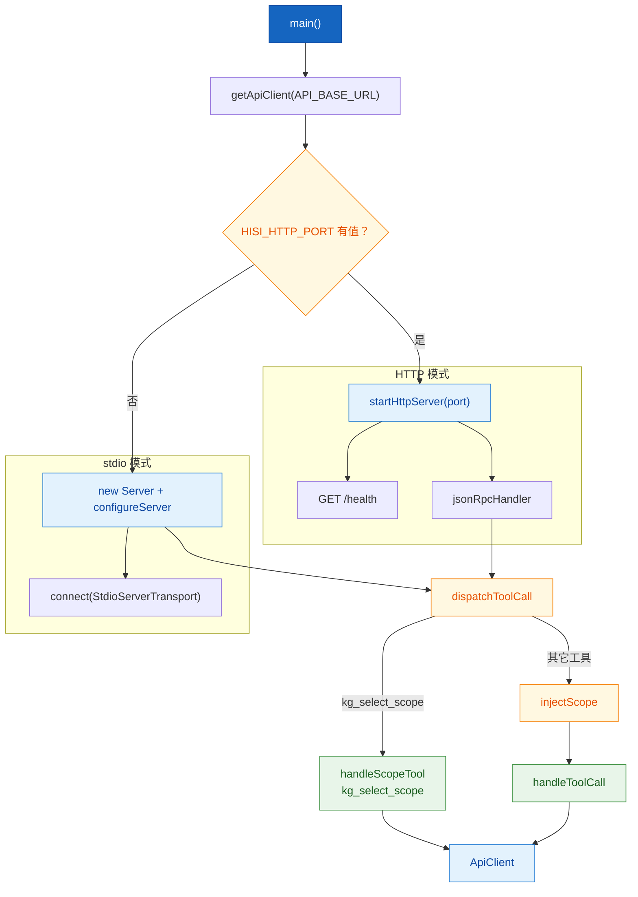
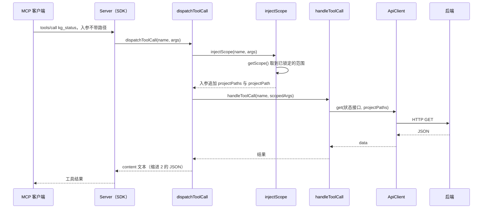
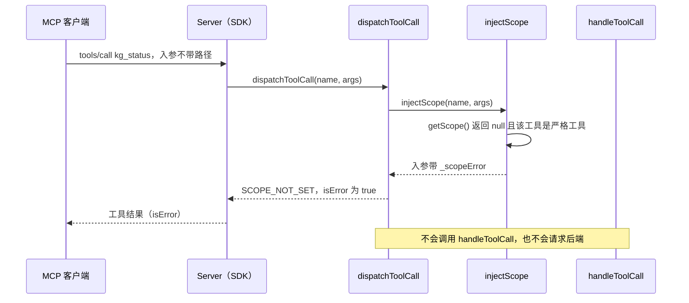
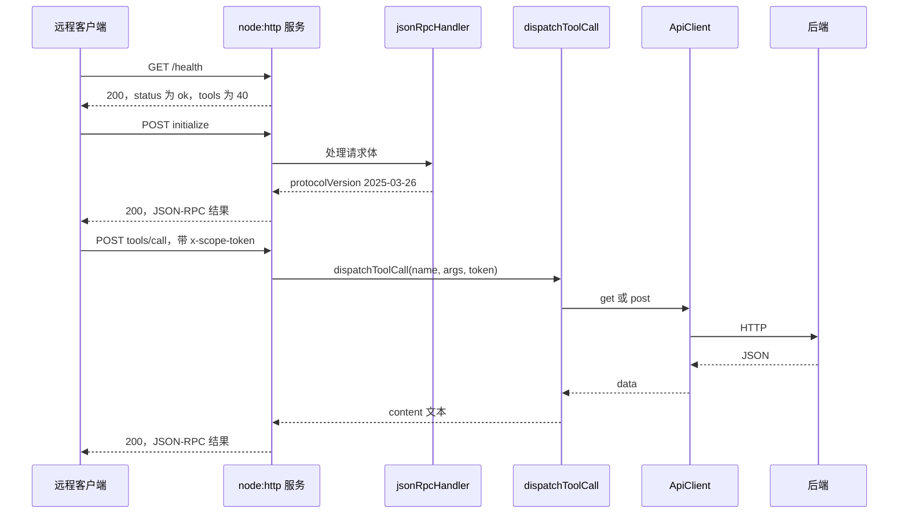
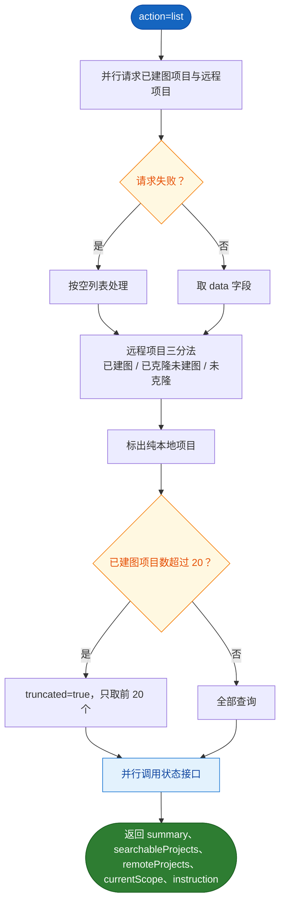

# MCP 服务入口

> 自动生成于 2026-11-26，基于 `99d0037` 版本

| 属性 | 值 |
|------|-----|
| **所属层** | 入口与传输层（同时承担统一分发与项目范围注入） |
| **目录** | `src/index.ts` |
| **文件数** | 1 个（451 行） |
| **对外接口** | 无导出符号（进程入口）；对外暴露 1 个工具 `kg_select_scope`，并统一分发全部 40 个工具 |
| **依赖模块** | 3 个内部模块（[工具路由聚合](./工具路由聚合.md)、[API客户端](./API客户端.md)、[项目范围管理](./项目范围管理.md)）+ MCP SDK + `node:http` |
| **被依赖数** | 0（顶层入口；[stdio中继](./stdio中继.md) 通过 HTTP 调用它） |

---

## 1. 模块概述

### 1.1 职责定义

**核心职责**：读取环境变量并决定传输模式；装配 MCP `Server`（stdio）或 HTTP JSON-RPC 服务；把每一次 `tools/call` 交给统一的 `dispatchToolCall()`；实现项目范围工具 `kg_select_scope` 并在分发前自动注入范围。

**职责边界**：

| 本模块负责 ✅ | 本模块不负责 ❌ | 由谁负责 |
|-------------|---------------|---------|
| 两种传输的装配与请求入口 | 单个工具的 schema 与实现 | `src/tools/*.ts` |
| `kg_select_scope` 工具的定义与实现 | 项目范围的存取与注册表 | [项目范围管理](./项目范围管理.md) |
| 分发前自动注入 `projectPaths` / `projectPath` | 路径归一化 | [工具路由聚合](./工具路由聚合.md) |
| 工具结果的 JSON 文本化与错误包装 | HTTP 通信、超时 | [API客户端](./API客户端.md) |
| 进程信号与未捕获异常的兜底 | — | — |

### 1.2 核心文件清单

| 文件 | 类型 | 职责 | 行数 |
|------|------|------|------|
| `src/index.ts` | 进程入口 | 常量、`kg_select_scope`、`dispatchToolCall`、范围注入、stdio 与 HTTP 两种传输、进程钩子 | 451 |

---

## 2. 模块架构

### 2.1 内部结构图



### 2.2 函数清单

| 函数 / 常量 | 类型 | 说明 |
|------------|------|------|
| `main()` | 异步函数 | 入口：初始化 ApiClient → 按 `HTTP_PORT` 选择模式 |
| `configureServer(server)` | 函数 | stdio 模式：注册 `tools/list` 与 `tools/call` 处理器 |
| `dispatchToolCall(name, rawArgs, scopeToken?)` | 异步函数 | 两种传输共用的分发入口，返回 `{ content, isError? }` |
| `handleScopeTool(args, scopeToken?)` | 异步函数 | 实现 `kg_select_scope` 的四个动作 |
| `injectScope(toolName, args, scopeToken?)` | 函数 | 按注册表决定是否注入项目范围 |
| `noScopeResponse()` | 函数 | 构造 `SCOPE_NOT_SET` 拒绝响应 |
| `jsonRpcHandler(body, scopeToken?)` | 异步函数 | HTTP 模式的 JSON-RPC 方法分发 |
| `startHttpServer(port)` | 异步函数 | 创建 HTTP 服务并监听 |
| `readBody(req)` | 异步函数 | 读取请求体，超过 5 MB 时断开 |
| `SCOPE_TOOL_DEF` | 常量 | `kg_select_scope` 的工具定义 |
| `allDefsWithScope` | 常量 | `allToolDefinitions` 加上 `SCOPE_TOOL_DEF`，共 40 个；`kg_select_scope` 排在最后 |

---

## 3. 对外接口

### 3.1 `kg_select_scope`

| 字段 | 值 |
|------|----|
| **name** | `kg_select_scope` |
| **后端调用** | `list` 动作：`GET /api/v2/knowledge-graph/projects`、`GET /api/remote-projects`、`GET /api/v2/knowledge-graph/status`；其余动作不调用后端 |
| **需要令牌** | 否 |

description（原文）：

```text
[MANDATORY FIRST CALL] Select KG search scope for this session.

Protocol:
1. Call action="list" -> get all indexed KG projects + remote project configs
2. Use AskUserQuestion to ask user "Which projects to search?" (multiSelect=true)
3. Call action="set" with selected projectPaths -> scope is locked
4. All subsequent KG tools auto-use this scope. No need to pass projectPaths again.

projectPaths override: pass explicit projectPaths in any tool to temporarily override scope.
Clear scope: action="clear" resets to full-project search.
```

inputSchema：

| 参数 | 类型 | 必填 | 默认值 | 说明 |
|------|------|------|--------|------|
| `action` | `string`，枚举 `list` / `set` / `get` / `clear` | 是 | 缺省时按 `list` 执行 | `list`=列出项目，`set`=锁定范围，`get`=查看当前范围，`clear`=重置 |
| `projectPaths` | `string[]` | `set` 动作必填 | — | 要设为范围的项目路径；其它动作忽略 |

> schema 里 `projectPaths` 不是必填项，`set` 动作的必填校验在处理函数里做：为空时返回 `{ success: false, error: 'projectPaths is required for action="set"' }`（不带 `isError`）。

### 3.2 四个动作的返回

| 动作 | 返回 | 说明 |
|------|------|------|
| `list` | 见 3.3 | 并行拉取已建图项目与远程项目配置，分类并抽样查询状态 |
| `set` | `{ success: true, scopeToken?, projectPaths, projectCount, message }` | `scopeToken` 只在按令牌存储时出现 |
| `get` | `{ success: true, scoped, projectPaths, projectCount }` | `scoped` 表示当前是否存在范围 |
| `clear` | `{ success: true, message }` | 清除范围 |
| 其它值 | `{ success: false, error: "Unknown action: <action>" }` | — |

### 3.3 `list` 动作的返回结构

| 字段 | 类型 | 说明 |
|------|------|------|
| `success` | `boolean` | 固定为 `true` |
| `summary.totalIndexed` | `number` | 已建图项目数 |
| `summary.totalRemoteConfigs` | `number` | 远程项目配置数 |
| `summary.pureLocal` | `number` | 不属于任何远程项目配置的本地项目数 |
| `summary.indexedRemote` | `number` | 已克隆且已建图的远程项目数 |
| `summary.clonedNotIndexed` | `number` | 已克隆但未建图的远程项目数 |
| `summary.notCloned` | `number` | 未克隆的远程项目数 |
| `truncated` | `boolean` | 已建图项目数是否超过 20 |
| `sampleCount` | `number` | 固定为 20（`MAX_STATS`） |
| `searchableProjects[]` | 对象数组 | `{ path, stats, source }`；`stats` 是该项目状态接口的 `data`，取不到时为 `{ status: "no_data" }` 或 `{ status: "error", detail }`；`source` 为 `local` 或 `remote-indexed` |
| `remoteProjects.indexed[]` | 对象数组 | `{ name, gitUrl, branch, fullPath }`；`fullPath` 取自远程项目响应的同名字段，后端响应里没有这个字段（见第 10 节） |
| `remoteProjects.clonedNotIndexed[]` | 对象数组 | `{ name, gitUrl, fullPath, action }`，`action` 提示先做知识图谱构建；`fullPath` 同上 |
| `remoteProjects.notCloned[]` | 对象数组 | `{ name, gitUrl, cloneStatus, action }`，`action` 提示先克隆再做构建 |
| `currentScope` | `string[]` 或 `null` | 当前范围 |
| `instruction` | `string` | 给 AI 的下一步提示：已锁定范围则提示开始搜索，否则提示让用户选项目后调用 `set` |

---

## 4. 内部实现

### 4.1 常量

| 常量 | 取值 | 来源 |
|------|------|------|
| `SERVER_NAME` | `'hisi-mcp-server'` | 硬编码 |
| `SERVER_VERSION` | `'2.2.0'` | 硬编码（与 `package.json` 的 `1.0.0` 不一致） |
| `API_BASE_URL` | `process.env.HISI_API_URL \|\| 'http://localhost:8080'` | 环境变量 |
| `HTTP_PORT` | `HISI_HTTP_PORT` 能解析成整数则为该值，否则 `null` | 环境变量 |
| `DEBUG` | `process.env.HISI_DEBUG === 'true'` | 环境变量 |
| `MAX_BODY_BYTES` | `5 * 1024 * 1024` | 硬编码 |
| `MAX_STATS` | `20` | `handleScopeTool` 内硬编码 |

### 4.2 统一分发：`dispatchToolCall()`

| 步骤 | 处理 |
|------|------|
| 1 | 工具名是 `kg_select_scope`：直接调用 `handleScopeTool()`；成功时结果以 2 空格缩进 JSON 文本返回；抛错时返回 `{ success: false, error }` 且 `isError: true` |
| 2 | 其它工具：先 `injectScope()`；若入参带 `_scopeError`，返回 `noScopeResponse()` |
| 3 | 调用 `handleToolCall(name, scopedArgs)`；成功时同样以 JSON 文本返回 |
| 4 | 抛错时返回 `{ success: false, error, tool: name }` 且 `isError: true` |

### 4.3 范围注入：`injectScope()`

按顺序判断，命中即返回：

| 顺序 | 条件 | 结果 |
|------|------|------|
| 1 | 工具名是 `kg_select_scope`、`kg_list_projects`、`apm_start_session` | 原样返回 |
| 2 | 工具不在范围注册表里（见 [项目范围管理](./项目范围管理.md)） | 原样返回 |
| 3 | 入参已有 `projectPaths` 或 `projectPath` | 原样返回（显式入参优先） |
| 4 | 当前有范围 | 追加 `projectPaths = 范围`、`projectPath = 范围[0]` |
| 5 | 没有范围，且是严格工具 | 返回带 `_scopeError: true` 的入参 → 最终得到 `SCOPE_NOT_SET` |
| 6 | 没有范围，且是宽松工具 | 原样放行 |

`noScopeResponse()` 的内容：`{ success: false, error: "SCOPE_NOT_SET", message: "Scope not set. Call kg_select_scope(action=\"list\") -> pick projects -> kg_select_scope(action=\"set\")." }`，`isError: true`。

### 4.4 `kg_select_scope` 的 `list` 动作

| 步骤 | 处理 |
|------|------|
| 1 | `Promise.allSettled` 并行请求已建图项目列表与远程项目列表；每个请求自带 `.catch(() => ({ data: [] }))`，任一失败都按空列表处理 |
| 2 | 取两个响应的 `data` 字段；路径比较前统一把反斜杠换成正斜杠并转小写 |
| 3 | 远程项目分类：`cloneStatus === 'CLONED'` 且其路径与某个已建图路径互为包含 → 已建图；已克隆但不满足 → 已克隆未建图；其余 → 未克隆 |
| 4 | 不包含在任何远程项目路径下的已建图项目记为纯本地项目 |
| 5 | 只对前 20 个已建图项目并行调用状态接口（`projectPaths` 为单个路径）；成功且 `success` 与 `data` 都为真时取 `data`，否则记为 `no_data`；单个请求出错记为 `error` 并带 `detail` |
| 6 | 附上 `currentScope` 与 `instruction` 返回 |

### 4.5 stdio 处理器：`configureServer()`

| 请求 | 处理 |
|------|------|
| `tools/list` | 返回 `allDefsWithScope` 的 `name`、`description`、`inputSchema` |
| `tools/call` | 工具名不在 `allDefsWithScope` 中 → `throw new McpError(ErrorCode.MethodNotFound, "Unknown tool: <name>")`；否则调用 `dispatchToolCall(name, arguments ?? {})`，有 `isError` 才带上该字段 |

握手（`initialize`、`notifications/initialized`）与 `ping` 由 MCP SDK 的 `Server` 处理，本模块没有自定义。`Server` 创建时声明的能力只有 `tools: {}`。

### 4.6 HTTP 模式：`startHttpServer()` 与 `jsonRpcHandler()`

| 项目 | 行为 |
|------|------|
| 监听地址 | `0.0.0.0:<HISI_HTTP_PORT>`；不校验请求路径（启动日志提示的路径只是约定） |
| 健康检查 | `GET` 且 URL 恰为 `/health` → 200，返回 `{ status: "ok", server, version, apiBackend, tools, scopeActive }` |
| 方法限制 | 非 `POST` → 405 + JSON-RPC 错误 `-32600 "POST only"` |
| 内容类型 | 请求头 `Content-Type` 不含 `application/json` → 415 |
| 请求体上限 | 累计超过 5 MB 时销毁请求并返回 413 |
| 范围令牌 | 从请求头 `x-scope-token` 读取，传给 `dispatchToolCall()` |
| CORS | 不设置任何 CORS 头（代码注释：这是 API，不是给浏览器用的服务） |
| 鉴权 | 无 |

`jsonRpcHandler()` 支持的方法：

| 方法 | 结果 / 错误 |
|------|-----------|
| `initialize` | `{ protocolVersion: "2025-03-26", capabilities: { tools: {} }, serverInfo: { name, version } }` |
| `tools/list` | `{ tools: [...] }`，与 stdio 模式相同 |
| `tools/call` | 工具名不存在 → `-32601 "Tool not found: <name>"`；否则返回 `dispatchToolCall()` 的结果 |
| `ping` | `{}` |
| 其它方法 | `-32601 "Method not found: <method>"` |
| 请求体不是 JSON | `-32700 "Parse error"`，`id` 为 `null` |

> 通知类消息（如 `notifications/initialized`）没有专门分支，会落到「其它方法」并得到一个不带 `id` 的错误对象。

### 4.7 进程级钩子

| 事件 | 行为 |
|------|------|
| `SIGINT` / `SIGTERM` | `process.exit(0)` |
| `uncaughtException` | stderr 输出 `Uncaught:` 与异常，`exit(1)` |
| `unhandledRejection` | stderr 输出 `Unhandled:` 与原因，`exit(1)` |
| `main()` 失败 | stderr 输出 `Start failed:` 与异常，`exit(1)` |

---

## 5. 交互流程

### 5.1 stdio 模式：已设范围时调用严格工具



### 5.2 stdio 模式：未设范围时调用严格工具



### 5.3 HTTP 模式：一次完整调用



### 5.4 `kg_select_scope` 的 `list` 动作



---

## 6. 依赖关系

### 6.1 上游依赖

| 依赖 | 交互方式 | 使用的接口 |
|------|---------|-----------|
| `./tools/index.js` | import | `allToolDefinitions`、`handleToolCall` |
| `./client/apiClient.js` | import | `getApiClient` |
| `./utils/scopeManager.js` | import | `setScope`、`getScope`、`clearScope`、`isStrictScopedTool`、`isScopedTool`（`generateToken` 被 import 但未使用） |
| `@modelcontextprotocol/sdk/server/index.js` | import | `Server` |
| `@modelcontextprotocol/sdk/server/stdio.js` | import | `StdioServerTransport` |
| `@modelcontextprotocol/sdk/types.js` | import | `CallToolRequestSchema`、`ListToolsRequestSchema`、`ErrorCode`、`McpError` |
| `node:http` | import | `createServer` |

### 6.2 下游消费者

| 消费方 | 使用方式 |
|--------|---------|
| MCP 客户端 | 通过 stdio 拉起 `dist/index.js` |
| `relay.mjs` | 向本模块的 HTTP 模式 POST JSON-RPC |

---

## 7. 配置项

| 配置项 | 类型 | 默认值 | 环境变量 | 说明 |
|--------|------|--------|---------|------|
| 后端地址 | `string` | `http://localhost:8080` | `HISI_API_URL` | MCP 服务回调后端的基础地址 |
| HTTP 端口 | `number` 或 `null` | `null`（即 stdio 模式） | `HISI_HTTP_PORT` | 有值则进入 HTTP JSON-RPC 模式 |
| 调试日志 | `boolean` | `false` | `HISI_DEBUG` | 仅当值恰为字符串 `true` 时开启 |
| 请求体上限 | `number` | 5 MB | — | 硬编码 |
| 协议版本（HTTP 模式） | `string` | `2025-03-26` | — | 硬编码 |

本模块不读取 `HISI_SCOPE_TOKEN`（只有 [动作工具](./动作工具.md) 读取）。

---

## 8. 错误处理

| 错误场景 | 处理 | 调用方感知 |
|---------|------|-----------|
| stdio：未知工具名 | 抛 `McpError(MethodNotFound)` | JSON-RPC 错误响应 |
| HTTP：未知工具名 / 未知方法 | JSON-RPC 错误 `-32601`，HTTP 状态 200 | 错误对象 |
| HTTP：请求体不是 JSON | JSON-RPC 错误 `-32700` | 错误对象 |
| HTTP：方法或内容类型不符 | HTTP 405 / 415 | 错误对象 |
| HTTP：请求体过大 | HTTP 413 | 错误对象 |
| HTTP：处理过程抛出未预期异常 | stderr 记录，HTTP 500 + `-32603` | 错误对象 |
| `kg_select_scope` 内部抛错 | `{ success: false, error }` + `isError` | 工具结果 |
| 严格工具缺范围 | `SCOPE_NOT_SET` + `isError` | 工具结果 |
| `list` 动作里后端接口失败 | 该项按空列表或 `error` 状态处理，整体仍返回 `success: true` | 结果里看不出部分失败，除非看 `stats.status` |
| 监听端口失败 | `startHttpServer()` 的 Promise 被 reject → `main()` 失败 → `Start failed:` + `exit(1)` | 进程退出 |

---

## 9. 性能考量

| 关注点 | 策略 | 实现 |
|--------|------|------|
| `list` 动作的后端压力 | 两个列表请求并行；状态查询限制在前 20 个项目 | `Promise.allSettled` + `MAX_STATS` |
| 启动开销 | 只做一次 `getApiClient()` 与 `Server` 创建，无额外 IO | `main()` |
| 调试日志成本 | 仅 `DEBUG` 为真时才拼接字符串 | 三处 `console.error` |
| 大请求体 | 超限即销毁连接，不再缓冲 | `readBody()` |

---

## 10. 已知问题与扩展点

| 已知问题 | 影响 |
|---------|------|
| `list` 动作输出里的 `remoteProjects.*.fullPath` 取自远程项目接口响应的 `fullPath` 字段，而后端 `ProjectResponse` 没有这个字段（完整路径放在 `localPath`）；匹配逻辑有 `localPath` 兜底，但输出里的 `fullPath` 取不到值，序列化后不会出现 | AI 在输出里看不到远程项目的完整路径 |
| `list` 动作用 `sr.success` 判断状态接口是否成功；后端通用响应 `ApiResponse` 的字段是 `code` / `message` / `data`，另有 `isSuccess()` 方法。JSON 里是否出现 `success` 取决于后端序列化配置，未在代码中确认 | 若不出现，所有项目的 `stats` 都会变成 `no_data` |
| `sampleCount` 固定返回 20，不是实际查询的数量 | 项目少于 20 时该值有误导 |
| HTTP 模式没有鉴权，而动作工具读取的是进程级令牌 | 详见 [02-架构设计](../02-架构设计/index.md) 5.3 节 |
| `generateToken` 被 import 但未使用；HTTP 客户端想得到独立范围必须自带 `x-scope-token` | 不带该请求头的客户端共用全局范围 |
| `SERVER_VERSION`（`2.2.0`）与 `package.json`（`1.0.0`）不一致 | 握手看到的版本号与包版本不同 |
| 文件头注释「Scope Protocol (mandatory)… Tools reject if no scope set」只对 15 个严格工具成立，8 个宽松工具与 17 个不参与范围的工具不会被拒绝 | 以注册表为准 |

| 扩展点 | 扩展方式 |
|--------|---------|
| 新增 JSON-RPC 方法（HTTP 模式） | 在 `jsonRpcHandler()` 的 `switch` 中加分支 |
| 调整哪些工具必须先设范围 | 修改 [项目范围管理](./项目范围管理.md) 的 `TOOL_SCOPE_REGISTRY`，本模块无需改动 |
| HTTP 模式增加鉴权或 CORS | 在 `startHttpServer()` 的请求入口统一处理 |

---

> **相关文档**：
> - 架构总览 → [02-架构设计](../02-架构设计/index.md)
> - 工具路由 → [工具路由聚合](./工具路由聚合.md)
> - 范围存取 → [项目范围管理](./项目范围管理.md)
> - 协议与全部工具 → [05-接口文档](../05-接口文档/index.md)
> - 数据流 → [04-数据流程](../04-数据流程/index.md)
