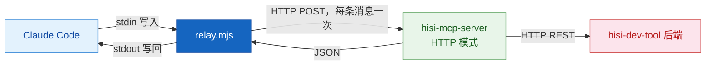
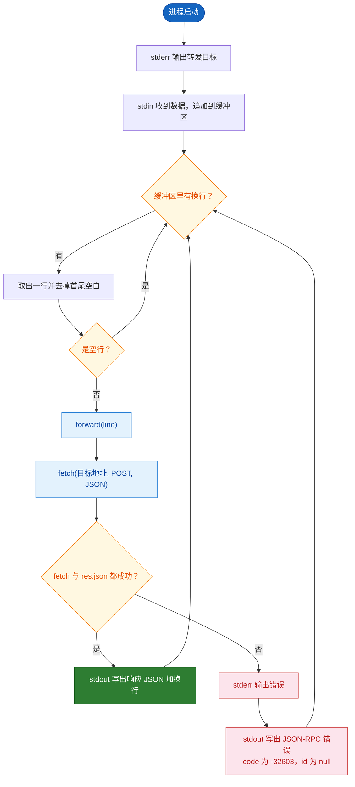
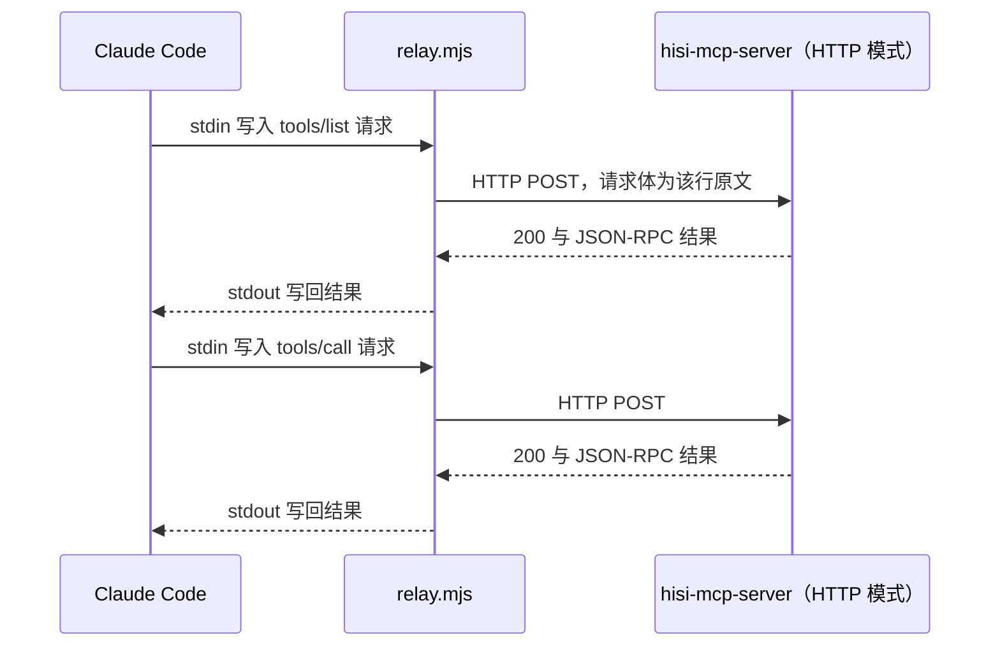

# stdio 中继

> 自动生成于 2026-11-26，基于 `99d0037` 版本

| 属性 | 值 |
|------|-----|
| **所属层** | 入口与传输层 |
| **目录** | `relay.mjs` |
| **文件数** | 1 个（43 行） |
| **对外接口** | 无导出符号（独立脚本，以子进程方式运行） |
| **依赖模块** | 0 个（只用 Node 内置的 `fetch` 与标准输入输出） |
| **被依赖数** | 0（由 MCP 客户端直接拉起） |

---

## 1. 模块概述

### 1.1 职责定义

**核心职责**：把一个 MCP 客户端的 stdio 流量逐行转发到 HTTP JSON-RPC 模式的 `hisi-mcp-server`，再把 HTTP 响应写回 stdout，让只支持 stdio 的客户端能够接入远程部署的服务。

模块文件头的注释原文：

> MCP stdio → HTTP JSON-RPC relay.
> Claude Code launches this as an MCP subprocess.
> It forwards all traffic to/from the remote hisi-mcp-server over HTTP.

**职责边界**：

| 本模块负责 ✅ | 本模块不负责 ❌ | 由谁负责 |
|-------------|---------------|---------|
| 按行切分 stdin 上的 JSON-RPC 消息 | JSON-RPC 方法的处理 | [MCP服务入口](./MCP服务入口.md) 的 HTTP 模式 |
| 每条消息一次 HTTP POST | 工具的实现 | `src/tools/*.ts` |
| 网络失败时回一个 JSON-RPC 错误 | 范围、令牌逻辑 | [MCP服务入口](./MCP服务入口.md)、[动作工具](./动作工具.md) |
| — | 编译 | 不经过 `tsc`，也不在 `package.json` 的脚本里 |

### 1.2 核心文件清单

| 文件 | 类型 | 职责 | 行数 |
|------|------|------|------|
| `relay.mjs` | 独立脚本 | stdio 与 HTTP 之间的转发 | 43 |

---

## 2. 模块架构

### 2.1 位置图



### 2.2 处理流程图



---

## 3. 对外接口

没有导出符号。行为由环境变量决定：

| 变量 | 默认值 | 说明 |
|------|--------|------|
| `MCP_REMOTE_URL` | `http://localhost:3100/mcp` | HTTP JSON-RPC 服务的地址 |

在 MCP 客户端里注册时的形态：

```json
{
  "mcpServers": {
    "hisi-mcp-server": {
      "command": "node",
      "args": ["<hisi-mcp-server 目录>/relay.mjs"],
      "env": {
        "MCP_REMOTE_URL": "http://<主机>:3100/mcp"
      }
    }
  }
}
```

---

## 4. 内部实现

### 4.1 切分规则

stdin 按换行分隔的消息处理：把收到的数据追加到缓冲区，循环取出每一行，去掉首尾空白后非空才转发（代码注释：MCP stdio: newline-delimited JSON-RPC）。

### 4.2 转发

| 项 | 处理 |
|----|------|
| 请求方法与头 | `POST`，`Content-Type: application/json` |
| 请求体 | 那一行的原文，不解析、不改写 |
| 其它请求头 | 没有。不带 `x-scope-token`，也不带任何鉴权信息 |
| 并发 | 每行一次 `fetch`，各次转发互不等待 |

### 4.3 回写

- 成功：把 `res.json()` 的结果重新序列化，加换行写到 stdout。
- 失败（网络错误或响应不是 JSON）：stderr 输出 `[hisi-relay] error: ...`，stdout 写出 `{ jsonrpc: "2.0", error: { code: -32603, message }, id: null }`。

### 4.4 启动日志

启动时向 stderr 写一行 `[hisi-relay] forwarding to <目标地址>`。

---

## 5. 交互流程



---

## 6. 依赖关系

### 6.1 上游依赖

无。不 import 任何内部模块。

### 6.2 下游消费者

| 消费方 | 使用方式 |
|--------|---------|
| Claude Code | 作为 MCP 子进程拉起 |
| hisi-mcp-server 的 HTTP 模式 | 作为被转发的目标 |

---

## 7. 配置项

| 配置项 | 类型 | 默认值 | 环境变量 | 说明 |
|--------|------|--------|---------|------|
| 转发目标 | `string` | `http://localhost:3100/mcp` | `MCP_REMOTE_URL` | HTTP 模式服务的地址 |

本脚本不读取 `HISI_API_URL`、`HISI_SCOPE_TOKEN`、`HISI_HTTP_PORT`、`HISI_DEBUG`。

---

## 8. 错误处理

| 错误场景 | 处理 | 客户端感知 |
|---------|------|-----------|
| 目标服务不可达 | stderr 记录，stdout 回 JSON-RPC 错误（`-32603`） | 一次失败的响应 |
| HTTP 响应不是 JSON（例如 413 / 415 / 500 的某些响应） | `res.json()` 抛错，走同一条失败路径 | JSON-RPC 错误（`-32603`） |
| 目标返回 JSON-RPC 错误对象 | 原样写回 | 原样的错误对象 |

---

## 9. 性能考量

| 关注点 | 策略 | 实现 |
|--------|------|------|
| 消息切分 | 按换行切分，剩余部分留在缓冲区等下一批数据 | `buf.indexOf('\n')` |
| 转发延迟 | 每条消息一次 HTTP 往返 | `fetch()` |

---

## 10. 已知问题与扩展点

| 已知问题 | 影响 |
|---------|------|
| 不转发 `x-scope-token` | 经中继接入的客户端一律共用服务端的全局范围 |
| 不处理通知类消息 | `notifications/initialized` 也会被转发，服务端 HTTP 模式对未知方法会回一个不带 `id` 的错误对象，中继再把它写回客户端；客户端如何处理未在代码中确认 |
| 转发不带鉴权信息；动作工具能否使用取决于 HTTP 模式那个进程的环境里有没有 `HISI_SCOPE_TOKEN` | 见 [02-架构设计](../02-架构设计/index.md) 5.3 节 |
| 没有超时设置 | 目标服务迟迟不响应时，这条转发会一直等待 |
| 不校验 HTTP 状态码，只尝试解析 JSON | 非 2xx 响应若恰好是 JSON，也会被当成结果写回 |

| 扩展点 | 扩展方式 |
|--------|---------|
| 透传范围令牌 | 在 `forward()` 里加一个请求头 |
| 增加超时 | 给 `fetch()` 传 `AbortSignal` |

---

> **相关文档**：
> - 架构总览 → [02-架构设计](../02-架构设计/index.md)
> - 被转发的目标 → [MCP服务入口](./MCP服务入口.md)
> - 接入方式 → [07-部署运维](../07-部署运维/index.md)
