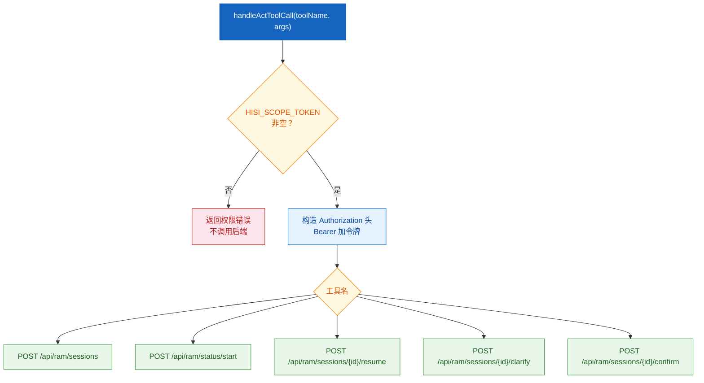
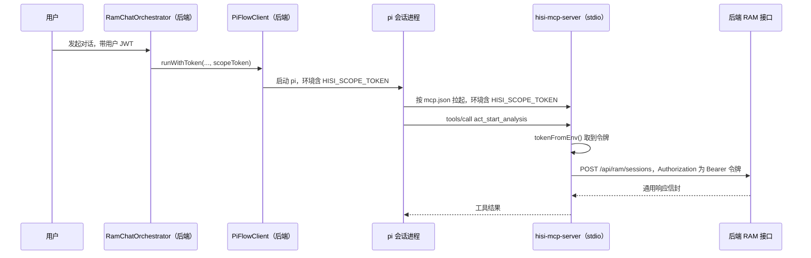
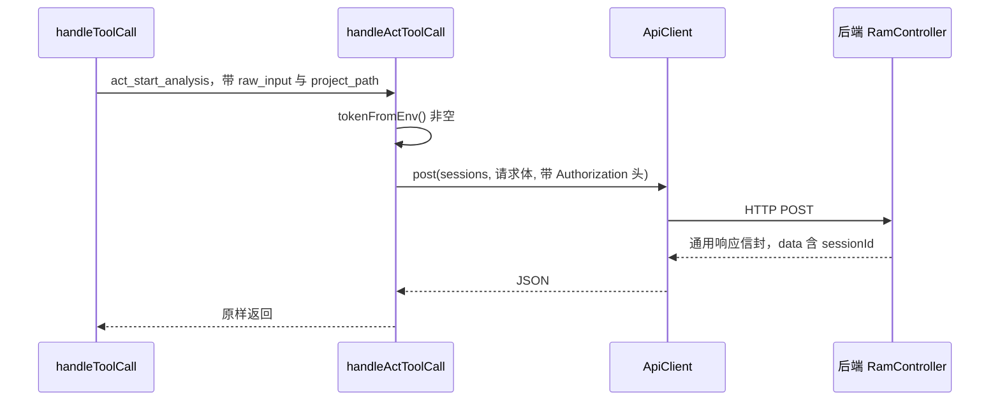
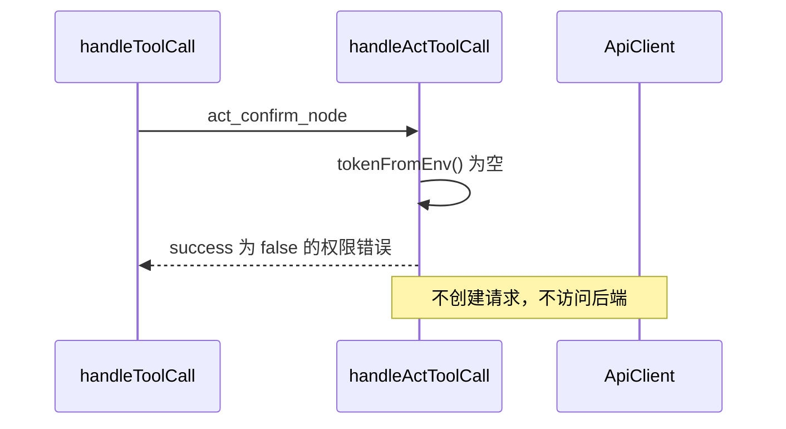

# 动作工具

> 自动生成于 2026-11-26，基于 `99d0037` 版本

| 属性 | 值 |
|------|-----|
| **所属层** | 工具实现层 |
| **目录** | `src/tools/actionTools.ts` |
| **文件数** | 1 个（148 行） |
| **对外接口** | 5 个工具定义、`ACT_TOOLS`、`handleActToolCall()`（没有导出入参类型） |
| **依赖模块** | 1 个（[API客户端](./API客户端.md)） |
| **被依赖数** | 1（[工具路由聚合](./工具路由聚合.md)，只 import 不再导出） |
| **需要令牌** | 是，环境变量 `HISI_SCOPE_TOKEN` |

---

## 1. 模块概述

### 1.1 职责定义

**核心职责**：提供 5 个 `act_*` 工具，让 RAM 对话助手能以**用户身份**回调后端：发起需求分析、发起项目现状分析、恢复等待中的会话、提交澄清回答、确认或驳回节点产出。

模块文件头的注释原文：

> RAM 对话助手的动作工具：以用户身份（HISI_SCOPE_TOKEN）调后端发起分析、提交澄清、确认节点。
> 令牌由 pi 会话的环境变量传入（后端 PiFlowClient.runWithToken 启动 pi 时放入环境，pi 把自身环境
> 原样传给 stdio MCP 子进程——mcp.json 只写启动命令、不写 env，也不写 ${...} 占位引用）。
> 没有令牌时一律返回明确的权限错误——动作工具绝不能以匿名身份执行。

**职责边界**：

| 本模块负责 ✅ | 本模块不负责 ❌ | 由谁负责 |
|-------------|---------------|---------|
| 5 个工具的 schema | 需求分析、现状分析的执行 | 后端 RAM 模块 |
| 每次调用前检查令牌是否存在 | 令牌的签发与校验 | 后端（签发 JWT；`JwtAuthFilter` 负责解析） |
| 把令牌放进 `Authorization: Bearer` 头 | 把令牌放进 MCP 进程环境 | 后端 `PiFlowClient.runWithToken()` |
| 把下划线命名的入参转成后端的驼峰字段 | 会话事件的推送 | 后端（本模块的调用只拿到受理回执） |

### 1.2 核心文件清单

| 文件 | 类型 | 职责 | 行数 |
|------|------|------|------|
| `src/tools/actionTools.ts` | 工具定义 + 处理函数 | 5 个工具、令牌检查、后端调用 | 148 |

---

## 2. 模块架构

### 2.1 内部结构图

### 2.2 令牌从哪里来

依据：

- 后端 `PiFlowClient` 构造 pi 进程环境处的注释：「MCP 服务是 pi 拉起的子进程，直接继承这份环境：后端地址每次都给；动作工具以用户身份调后端时用的令牌只在带用户的流里给——只读流的 MCP 进程里拿不到它，动作工具一律拒绝」。
- 后端 `PiAgentInstaller.writeMcpJson()` 生成的 `mcp.json` 只有启动命令（`command` + `args`），**不写 `env`**：pi 把自身进程环境原样传给 stdio MCP 子进程（实测验证）。
- 后端 `RamChatOrchestrator` 的参数注释：「scopeToken 用户的 JWT（动作工具以用户身份调后端时用）；只读会话可传 null」。

---

## 3. 对外接口

### 3.1 导出接口一览

| 接口 | 类型 | 说明 |
|------|------|------|
| `actToolDefinitions` | 常量数组 | 5 个工具定义 |
| `ACT_TOOLS` | 常量数组（`as const`） | 5 个工具名 |
| `handleActToolCall(toolName, args)` | 异步函数 | 令牌检查 + 按工具名调用后端；未知的工具名抛 `Error("Unknown tool: <name>")` |

### 3.2 工具一览

5 个工具都需要令牌，都不参与项目范围。后端路径中的 `{id}` 是经过 `encodeURIComponent` 的 `session_id`。

| 工具 | 方法 | 后端路径 | `required` |
|------|------|---------|-----------|
| `act_start_analysis` | POST | `/api/ram/sessions` | `raw_input`、`project_path` |
| `act_start_status` | POST | `/api/ram/status/start` | `project_path` |
| `act_resume_session` | POST | `/api/ram/sessions/{id}/resume` | `session_id` |
| `act_submit_clarification` | POST | `/api/ram/sessions/{id}/clarify` | `session_id`、`answers` |
| `act_confirm_node` | POST | `/api/ram/sessions/{id}/confirm` | `session_id`、`node_name`、`action` |

### 3.3 入参

| 工具 | 参数 | 类型 | 说明文字 |
|------|------|------|---------|
| `act_start_analysis` | `raw_input` | `string` | 需求原文 |
| | `project_path` | `string` | 项目绝对路径 |
| | `mode` | `string` | interactive（默认） |
| `act_start_status` | `project_path` | `string` | 项目绝对路径 |
| | `question` | `string` | 要回答的问题（可选） |
| `act_resume_session` | `session_id` | `string` | 会话 id（分析接口返回的那个） |
| `act_submit_clarification` | `session_id` | `string` | — |
| | `answers` | `object` | 问题 → 回答 映射 |
| `act_confirm_node` | `session_id` | `string` | — |
| | `node_name` | `string` | — |
| | `action` | `string`，枚举 `approve` / `reject` | — |
| | `feedback` | `string` | 驳回时的原因（可选） |

完整 `description` 原文见 [05-接口文档](../05-接口文档/index.md)。

---

## 4. 内部实现

### 4.1 令牌检查

| 步骤 | 处理 |
|------|------|
| 取值 | 读 `process.env.HISI_SCOPE_TOKEN`，去掉首尾空白 |
| 为空 | 返回 `{ success: false, error: "缺少用户令牌（HISI_SCOPE_TOKEN）：动作工具不能以匿名身份执行" }`，**不**调用后端 |
| 非空 | 组装请求头 `Authorization: Bearer <token>`，用于本次调用的后端请求 |

注意：这个拒绝响应是「正常返回」而不是抛错，所以工具结果里**不带** `isError`，调用方要靠 `success: false` 来判断。

### 4.2 请求体构造

| 工具 | 发给后端的请求体 |
|------|-----------------|
| `act_start_analysis` | `{ rawInput, projectPath, projectPaths: [projectPath] }`；缺省值按空字符串处理 |
| `act_start_status` | `{ projectPath, question, mode: "full" }`；`question` 缺省为空字符串，`mode` 固定发送 `full` |
| `act_resume_session` | `{}` |
| `act_submit_clarification` | `{ answers }`；`answers` 缺省为空对象，内容原样透传 |
| `act_confirm_node` | `{ nodeName, action, feedback }`；`action` 缺省为 `approve`，`feedback` 缺省为 `null` |

入参名是下划线风格（`session_id`、`raw_input`、`node_name`），发给后端时转成驼峰（`sessionId` 在路径里、`rawInput`、`nodeName`）。

### 4.3 与其它工具的三点不同

| 方面 | 动作工具 | 其它 35 个工具 |
|------|---------|---------------|
| 鉴权头 | 每次请求都带 `Authorization: Bearer` | 不带 |
| 入参命名 | 下划线（`project_path`） | 驼峰（`projectPath`） |
| 路径归一化 | `project_path` 不匹配归一化规则，Windows 反斜杠路径不会被转换 | `projectPath` / `projectPaths` 会被转换 |

---

## 5. 交互流程

### 5.1 有令牌：发起需求分析

### 5.2 无令牌：直接拒绝

---

## 6. 依赖关系

### 6.1 上游依赖

| 依赖模块 | 交互方式 | 使用的接口 |
|---------|---------|-----------|
| `../client/apiClient.js` | import | `getApiClient` |

### 6.2 下游消费者

| 消费方 | 使用方式 |
|--------|---------|
| [工具路由聚合](./工具路由聚合.md) | import 三个符号用于聚合与路由 |
| 后端 pi 会话 | 只有 `ram-act` 流的工具清单里包含这 5 个工具（后端 `FlowToolManifest.RAM_ACT_MCP`） |

### 6.3 后端接口对照

5 条路径均已在后端核对存在。它们都返回后端的通用响应信封；业务失败时在 `code` 里给出 400 / 404 / 500，HTTP 状态仍为 200。

| 接口 | 后端处理要点 | 成功时 `data` |
|------|-------------|--------------|
| `POST /api/ram/sessions` | `rawInput` 为空 → `code` 400；创建会话后**异步**派发需求分析（`mode` 写死为 `interactive`）并立即返回 | `{ sessionId }` |
| `POST /api/ram/status/start` | `projectPath` 为空 → `code` 400；创建会话后**异步**执行现状分析（5 分钟超时）并立即返回 | `{ sessionId }` |
| `POST /api/ram/sessions/{sid}/resume` | 会话不存在 → `code` 404；同步调用 `resume_session`，失败 → `code` 500 | `{ resumed }` |
| `POST /api/ram/sessions/{sid}/clarify` | 会话不存在 → `code` 404；**异步**派发 `submit_clarification` | `{ accepted, nextSeq, status, hitlPayload }` |
| `POST /api/ram/sessions/{sid}/confirm` | 会话不存在 → `code` 404；**异步**派发 `submit_confirmation` | `{ accepted, nextSeq }` |

---

## 7. 配置项

| 配置项 | 类型 | 默认值 | 环境变量 | 说明 |
|--------|------|--------|---------|------|
| 用户令牌 | `string` | 无 | `HISI_SCOPE_TOKEN` | 去掉首尾空白后为空即视为没有令牌；缺失时 5 个工具全部拒绝 |

本模块不读取 `HISI_API_URL`，后端地址由 [API客户端](./API客户端.md) 的单例决定。

---

## 8. 错误处理

| 错误场景 | 处理 | 调用方感知 |
|---------|------|-----------|
| 没有令牌 | 返回权限错误，不访问后端 | `success: false`，不带 `isError` |
| 后端返回非 2xx（例如令牌失效被网关拒绝） | `ApiClient` 抛 `HTTP <code>: <body>` | `{ success: false, error, tool }` + `isError` |
| 后端业务失败（HTTP 200，`code` 非 200） | 本模块不判断，原样透传 | 调用方需检查 `code` 与 `message` |
| 工具名不在 5 个之内 | 抛 `Unknown tool` | `{ success: false, error, tool }` + `isError` |

---

## 9. 性能考量

| 关注点 | 策略 | 实现 |
|--------|------|------|
| 无令牌时的开销 | 在取 HTTP 客户端之前就返回 | `handleActToolCall()` 的第一段判断 |
| 令牌读取 | 每次调用读一次环境变量，不做缓存 | `tokenFromEnv()` |

---

## 10. 已知问题与扩展点

| 已知问题 | 影响 |
|---------|------|
| `act_start_analysis` 的 schema 声明了 `mode`，但请求体里不带它；后端把模式写死为 `interactive` | 传 `mode` 不起作用 |
| 工具描述写「返回 session_id」，后端响应里的字段名是 `data.sessionId` | AI 需要从 `data.sessionId` 取会话 ID |
| `POST /api/ram/sessions` 的用户 ID 取自请求体的 `userId`（为空记为 `anonymous`），不取自令牌；本模块的请求体不带 `userId` | 虽然带了用户令牌，该接口落库的用户 ID 仍是 `anonymous` |
| `act_start_status` 调用的后端控制器已标注 `@Deprecated`（注释称由 `/api/ram/chat/*` 的对话式接口取代），端点目前仍存在 | 后端后续可能移除该端点 |
| 发起分析、提交澄清、确认节点在后端都是异步派发，工具只拿到受理回执 | 分析结果不通过这些工具返回 |
| 权限拒绝响应不带 `isError` | 只看 `isError` 的客户端会漏判 |
| HTTP 模式下没有鉴权，而令牌是进程级的 | 见 [02-架构设计](../02-架构设计/index.md) 5.3 节 |
| 没有导出入参类型；入参不校验是否符合 schema | `answers` 的内容原样透传 |

| 扩展点 | 扩展方式 |
|--------|---------|
| 新增一个动作工具 | 加一条定义、`ACT_TOOLS` 加名字、`switch` 加分支（沿用同一套令牌检查与请求头） |

---

> **相关文档**：
> - 架构总览 → [02-架构设计](../02-架构设计/index.md)
> - 全量 schema 与 description → [05-接口文档](../05-接口文档/index.md)
> - 令牌传递与自动构建 → [07-部署运维](../07-部署运维/index.md)
> - 相关决策 → [08-技术决策](../08-技术决策/index.md)
> - HTTP 通信 → [API客户端](./API客户端.md)
