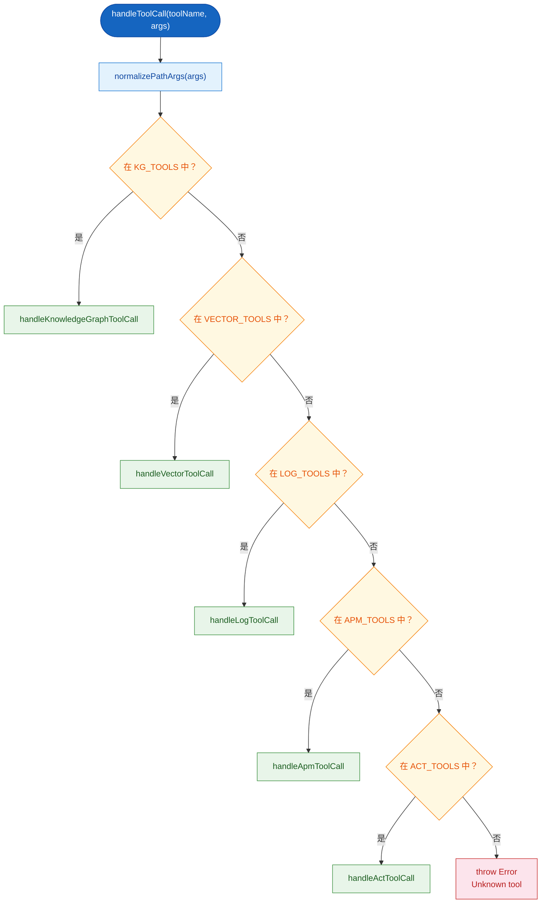
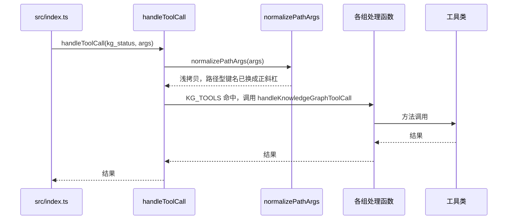
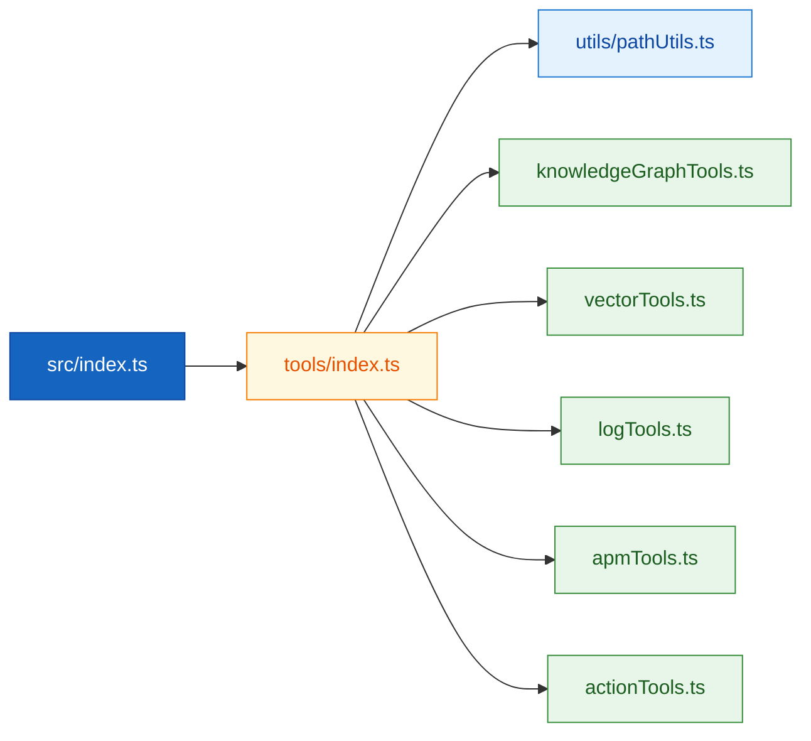

# 工具路由聚合

> 自动生成于 2026-11-26，基于 `99d0037` 版本

| 属性 | 值 |
|------|-----|
| **所属层** | 路由层 |
| **目录** | `src/tools/index.ts` |
| **文件数** | 1 个（125 行） |
| **对外接口** | `allToolDefinitions`、`handleToolCall`，另再导出 4 个工具文件的符号与 30 个入参类型 |
| **依赖模块** | 5 个工具文件 + [路径归一化](./路径归一化.md) |
| **被依赖数** | 1（[MCP服务入口](./MCP服务入口.md)） |

---

## 1. 模块概述

### 1.1 职责定义

**核心职责**：把 5 个工具文件里的 39 个工具定义聚合成一个数组，并提供按工具名分发到对应处理函数的 `handleToolCall()`；分发前统一做一次路径归一化。

**职责边界**：

| 本模块负责 ✅ | 本模块不负责 ❌ | 由谁负责 |
|-------------|---------------|---------|
| 聚合工具定义 `allToolDefinitions` | 单个工具的 schema 与实现 | 5 个工具文件 |
| 分发前的路径归一化 | 归一化的匹配规则 | [路径归一化](./路径归一化.md) |
| 按工具名所属数组转发 | 项目范围的判断与注入 | [MCP服务入口](./MCP服务入口.md) |
| 再导出各工具文件的公开符号 | `kg_select_scope`（不在本模块） | [MCP服务入口](./MCP服务入口.md) |

### 1.2 核心文件清单

| 文件 | 类型 | 职责 | 行数 |
|------|------|------|------|
| `src/tools/index.ts` | 聚合 + 路由 | 再导出、聚合 `allToolDefinitions`、`handleToolCall()` | 125 |

> 该文件头部的注释已经过时：写的是「Knowledge Graph (22 tools)」「Total: 33 tools」，也没有列出动作工具。实际数量以下表为准。

---

## 2. 模块架构

### 2.1 分发流程图



### 2.2 工具分组表

| 分组 | 名单常量 | 数量 | 处理函数 | 定义所在文件 |
|------|---------|------|---------|-------------|
| 知识图谱 | `KG_TOOLS` | 23 | `handleKnowledgeGraphToolCall` | [知识图谱工具](./知识图谱工具.md) |
| 混合检索 | `VECTOR_TOOLS` | 1 | `handleVectorToolCall` | [混合检索工具](./混合检索工具.md) |
| 日志 | `LOG_TOOLS` | 4 | `handleLogToolCall` | [日志分析工具](./日志分析工具.md) |
| APM 调试 | `APM_TOOLS` | 6 | `handleApmToolCall` | [APM调试工具](./APM调试工具.md) |
| 动作 | `ACT_TOOLS` | 5 | `handleActToolCall` | [动作工具](./动作工具.md) |
| **合计** | — | **39** | — | — |

第 40 个工具 `kg_select_scope` 定义在 `src/index.ts`，不经过本模块。六个名单之间没有重名（已逐个核对 40 个工具名，无重复）。

---

## 3. 对外接口

### 3.1 导出接口一览

| 接口 | 类型 | 说明 | 调用方 |
|------|------|------|--------|
| `allToolDefinitions` | 常量数组 | 39 个工具定义，顺序为知识图谱 → 混合检索 → 日志 → APM → 动作 | `src/index.ts` |
| `handleToolCall(toolName, args)` | 异步函数 | 统一分发入口 | `src/index.ts` |
| `knowledgeGraphToolDefinitions`、`handleKnowledgeGraphToolCall`、`KnowledgeGraphTools`、`KG_TOOLS` | 再导出 | 来自 `knowledgeGraphTools.ts`，另含 20 个 `Kg*Params` 类型 | 外部消费者 |
| `vectorToolDefinitions` 等 5 个符号 | 再导出 | 来自 `vectorTools.ts`，含类型 `HybridSearchParams` | 外部消费者 |
| `logToolDefinitions` 等 7 个符号 | 再导出 | 来自 `logTools.ts`，含 3 个 `Log*Params` 类型 | 外部消费者 |
| `apmToolDefinitions` 等 10 个符号 | 再导出 | 来自 `apmTools.ts`，含 6 个 `Apm*Params` 类型 | 外部消费者 |

> `actionTools.ts` 的 `actToolDefinitions`、`handleActToolCall`、`ACT_TOOLS` 只被 import 用于聚合与路由，**没有再导出**。

### 3.2 `handleToolCall()`

```ts
export async function handleToolCall(
  toolName: string,
  args: Record<string, unknown>
): Promise<unknown>
```

| 参数 | 类型 | 必填 | 说明 |
|------|------|------|------|
| `toolName` | `string` | 是 | 工具名 |
| `args` | `Record<string, unknown>` | 是 | 工具入参；本函数先用归一化后的浅拷贝替换它，不修改调用方传入的对象 |

**返回值**：对应处理函数的结果（通常是后端响应 JSON）。

**调用约束**：

- 本函数不校验入参是否符合 `inputSchema`，入参原样（归一化后）转给处理函数。
- 工具名不在任何名单中时抛 `Error("Unknown tool: <toolName>")`；正常情况下不会走到这里，因为入口已经先按 `allDefsWithScope` 过滤过未知工具名。

---

## 4. 内部实现

### 4.1 聚合顺序

```ts
export const allToolDefinitions = [
  ...knowledgeGraphToolDefinitions,
  ...vectorToolDefinitions,
  ...logToolDefinitions,
  ...apmToolDefinitions,
  ...actToolDefinitions,
];
```

入口再追加 `kg_select_scope`，得到 `tools/list` 返回的 40 个工具，`kg_select_scope` 排在最后。

### 4.2 路径归一化的调用点

`handleToolCall()` 第一行调用 `normalizePathArgs(args)`。归一化只处理「路径型键名」：

| 值类型 | 会被归一化的键名 |
|--------|----------------|
| 字符串 | `projectPath`、`filePath`、`path`，以及任何以 `Path` 结尾的键 |
| 字符串数组 | `projectPaths`、`filePaths`、`paths`，以及任何以 `Paths` 结尾的键 |

因此有两类入参不受影响：

- 动作工具的 `project_path`（下划线命名，不匹配 `Path` 后缀）不会被归一化。
- `apm_execute_request` 的 `path` 会被归一化（命中显式键名 `path`）。

规则细节与测试见 [路径归一化](./路径归一化.md)。

---

## 5. 交互流程



---

## 6. 依赖关系

### 6.1 上游依赖

| 依赖模块 | 交互方式 | 使用的接口 |
|---------|---------|-----------|
| `./knowledgeGraphTools.js` | import | 定义数组、`KG_TOOLS`、处理函数、类型 |
| `./vectorTools.js` | import | 同上 |
| `./logTools.js` | import | 同上 |
| `./apmTools.js` | import | 同上 |
| `./actionTools.js` | import | `actToolDefinitions`、`handleActToolCall`、`ACT_TOOLS` |
| `../utils/pathUtils.js` | import | `normalizePathArgs` |

### 6.2 下游消费者

| 消费模块 | 使用的接口 | 使用场景 |
|---------|-----------|---------|
| `src/index.ts` | `allToolDefinitions`、`handleToolCall` | 生成 `tools/list`；`dispatchToolCall()` 分发 |

### 6.3 依赖关系图



---

## 7. 配置项

无。

---

## 8. 错误处理

| 错误场景 | 处理 | 调用方感知 |
|---------|------|-----------|
| 工具名不在任何名单中 | 抛 `Error("Unknown tool: <name>")` | 被 `dispatchToolCall()` 捕获，返回 `{ success: false, error, tool }` + `isError` |
| 处理函数内部抛错 | 原样向上抛 | 同上 |

---

## 9. 性能考量

| 关注点 | 策略 | 实现 |
|--------|------|------|
| 分发开销 | 5 次小数组 `includes` 线性查找 | 名单长度最大为 23 |
| 对象分配 | 每次调用产生一个入参的浅拷贝 | `normalizePathArgs()` |

---

## 10. 已知问题与扩展点

| 已知问题 | 影响 |
|---------|------|
| 文件头注释的工具数（22 / 33）与实际（23 / 39）不符，且未列出动作工具 | 只影响阅读，不影响行为 |
| `ACT_TOOLS` 分支用了 `as (typeof ACT_TOOLS)[number]` 类型断言 | 仅类型层面的处理 |
| `actionTools` 的符号没有再导出 | 外部消费者不能从本模块拿到 `ACT_TOOLS` |

| 扩展点 | 扩展方式 |
|--------|---------|
| 新增一类工具（例如 `db_*`） | 新建 `tools/dbTools.ts`，导出定义数组、名单常量和处理函数；在本文件 import、加入 `allToolDefinitions`、加一个名单分支，并在需要时加入再导出 |
| 调整归一化规则 | 修改 [路径归一化](./路径归一化.md)，本文件不用改 |
| 让新工具受项目范围约束 | 在 `scopeManager.ts` 的 `TOOL_SCOPE_REGISTRY` 登记，本文件不用改 |

---

> **相关文档**：
> - 架构总览 → [02-架构设计](../02-架构设计/index.md)
> - 入口模块 → [MCP服务入口](./MCP服务入口.md)
> - HTTP 通信 → [API客户端](./API客户端.md)
> - 全部工具 schema → [05-接口文档](../05-接口文档/index.md)
