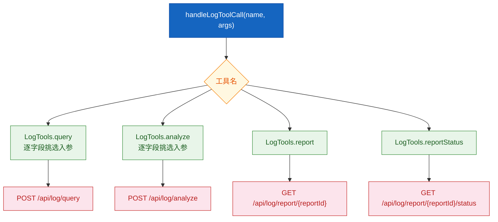
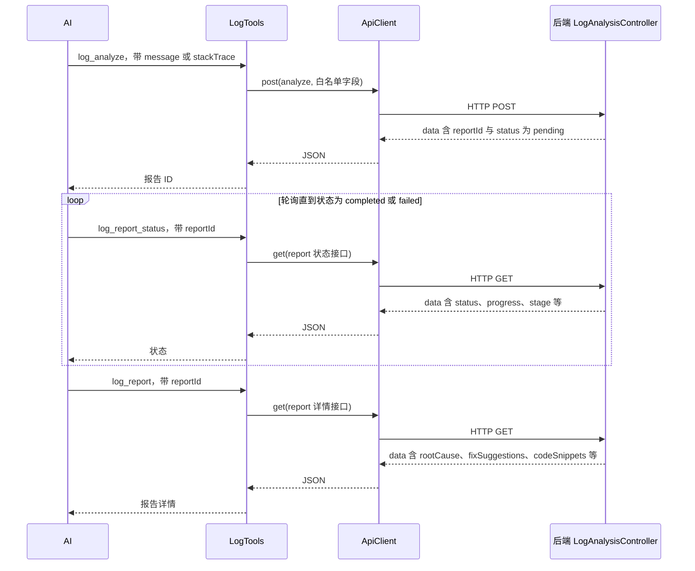
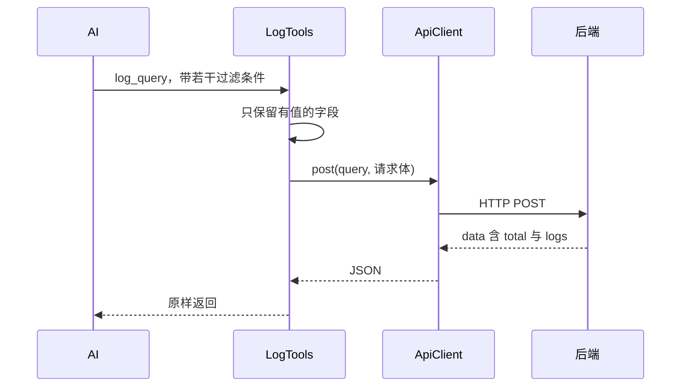

# 日志分析工具

> 自动生成于 2026-11-26，基于 `99d0037` 版本

| 属性 | 值 |
|------|-----|
| **所属层** | 工具实现层 |
| **目录** | `src/tools/logTools.ts` |
| **文件数** | 1 个（267 行） |
| **对外接口** | 4 个工具定义、`LOG_TOOLS`、`LogTools` 类、`handleLogToolCall()`、3 个入参类型 |
| **依赖模块** | 1 个（[API客户端](./API客户端.md)） |
| **被依赖数** | 1（[工具路由聚合](./工具路由聚合.md)） |

---

## 1. 模块概述

### 1.1 职责定义

**核心职责**：把后端日志分析接口包装成 4 个工具——查询日志、提交异步 AI 分析、查询报告状态、获取报告详情。

**职责边界**：

| 本模块负责 ✅ | 本模块不负责 ❌ | 由谁负责 |
|-------------|---------------|---------|
| 4 个工具的 schema | 日志采集、存储与查询实现 | 后端 |
| 请求体的字段白名单（未传的字段不放进请求体） | AI 根因分析、报告生成 | 后端 |
| 轮询节奏的说明（写在 description 里） | 是否必须先设项目范围 | [项目范围管理](./项目范围管理.md)（两个工具是宽松工具） |
| — | 鉴权 | 不需要（4 个工具都不带令牌） |

### 1.2 核心文件清单

| 文件 | 类型 | 职责 | 行数 |
|------|------|------|------|
| `src/tools/logTools.ts` | 工具定义 + 工具类 + 处理函数 | 见下文 | 267 |

---

## 2. 模块架构

### 2.1 内部结构图

---

## 3. 对外接口

### 3.1 导出接口一览

| 接口 | 类型 | 说明 |
|------|------|------|
| `logToolDefinitions` | 常量数组 | 4 个工具定义 |
| `LOG_TOOLS` | 常量数组 | `log_query`、`log_analyze`、`log_report`、`log_report_status` |
| `handleLogToolCall(toolName, args)` | 异步函数 | 未知的工具名抛 `Error("Unknown log tool: <name>")` |
| `LogTools` | 类 | `query()`、`analyze()`、`report()`、`reportStatus()` |
| `LogQueryParams`、`LogAnalyzeParams`、`LogReportParams` | 接口 | 入参类型 |

### 3.2 工具一览

4 个工具都不需要令牌。

| 工具 | 方法 | 后端路径 | 入参 | `required` | 范围 |
|------|------|---------|------|-----------|------|
| `log_query` | POST | `/api/log/query` | 11 个可选字段 | 无 | 宽松 |
| `log_analyze` | POST | `/api/log/analyze` | 5 个可选字段 | 无 | 宽松 |
| `log_report` | GET | `/api/log/report/{reportId}` | `reportId`（number） | `reportId` | 不参与 |
| `log_report_status` | GET | `/api/log/report/{reportId}/status` | `reportId`（number） | `reportId` | 不参与 |

完整 `description` 原文见 [05-接口文档](../05-接口文档/index.md)。

### 3.3 `log_query` 入参

| 参数 | 类型 | 说明文字 |
|------|------|---------|
| `keyword` | `string` | 关键字搜索，模糊匹配日志内容，可选 |
| `logLevel` | `string`，枚举 `ERROR` / `WARN` / `INFO` / `DEBUG` | 日志级别过滤，可选 |
| `appId` | `string` | 应用ID，可选 |
| `traceId` | `string` | 分布式追踪ID，可选 |
| `contentContains` | `string` | 日志内容精确包含的文本，可选 |
| `dslQuery` | `string` | 原始DSL查询字符串，优先级最高，设置后覆盖其他过滤条件。可选 |
| `startTime` | `string` | 查询开始时间，ISO格式，如 "2024-01-01T00:00:00"，可选 |
| `endTime` | `string` | 查询结束时间，ISO格式，如 "2024-01-01T23:59:59"，可选 |
| `size` | `number` | 返回条数，默认100，最大1000 |
| `errorOnly` | `boolean` | 是否仅返回错误日志，默认true。设为false可查询所有级别 |
| `sortOrder` | `string`，枚举 `asc` / `desc` | 按时间排序方向，默认desc（最新优先） |

### 3.4 `log_analyze` 入参

| 参数 | 类型 | 说明文字 |
|------|------|---------|
| `message` | `string` | 错误消息文本，与 stackTrace 至少提供一个 |
| `stackTrace` | `string` | 异常堆栈信息，与 message 至少提供一个 |
| `serviceName` | `string` | 发生错误的服务名，可选 |
| `traceId` | `string` | 分布式追踪ID，可选 |
| `errorType` | `string` | 错误类型，可选 |

---

## 4. 内部实现

### 4.1 字段白名单

`query()` 与 `analyze()` 都先建一个空对象，再逐个判断「入参里该字段 `!== undefined`」才放进请求体。效果：

- 入参里出现 schema 之外的字段（包括入口自动注入的 `projectPaths`、`projectPath`）不会发给后端。
- 未传的可选字段不会以 `null` 或 `undefined` 的形式出现在请求体里。

### 4.2 路径参数

`report()` 与 `reportStatus()` 把 `reportId` 直接拼进 URL，没有做 URL 编码，也没有从 `number` 转字符串。

### 4.3 处理函数

实例由模块级变量 `_logTools` 惰性创建，进程内只创建一次；入参经类型断言后直接传给对应方法。

---

## 5. 交互流程

### 5.1 异步分析三段式

### 5.2 查询日志

---

## 6. 依赖关系

### 6.1 上游依赖

| 依赖模块 | 交互方式 | 使用的接口 |
|---------|---------|-----------|
| `../client/apiClient.js` | import | `ApiClient`、`getApiClient` |

### 6.2 下游消费者

| 消费模块 | 使用的接口 | 使用场景 |
|---------|-----------|---------|
| [工具路由聚合](./工具路由聚合.md) | 定义数组、`LOG_TOOLS`、`handleLogToolCall`、类型 | 聚合与路由 |

### 6.3 后端接口对照

后端 `LogAnalysisController`（`@RequestMapping("/api/log")`）中 4 条路径均已核对存在。

| 接口 | 成功时 `data` 的内容 | 失败时的响应（仍可能是 HTTP 200，看 `code`） |
|------|--------------------|--------------------------------------------|
| `POST /query` | `{ total, logs }` | 查询异常：`code` 为 500，`message` 为异常信息 |
| `POST /analyze` | `{ reportId, status, createdAt }`，`status` 初始为 `pending` | `message` 与 `stackTrace` 都为空：`code` 为 400；两者超长（50000 / 100000 字符）：HTTP 400 |
| `GET /report/{id}` | `{ reportId, status, errorSummary, rootCause, fixSuggestions, codeSnippets, createdAt, updatedAt, occurrenceCount }` | 报告不存在：`code` 为 404；仍在 `pending` / `processing`：`code` 为 400 |
| `GET /report/{id}/status` | `{ reportId, status, createdAt, updatedAt, progress, stage, etaSeconds, queuePosition, occurrenceCount, analysisStatus }` | 报告不存在：`code` 为 404 |

---

## 7. 配置项

无。`size`、`errorOnly`、`sortOrder` 的默认值由后端决定（100 / true / desc），本模块不填默认值。

---

## 8. 错误处理

| 错误场景 | 处理 | 调用方感知 |
|---------|------|-----------|
| 后端返回非 2xx（例如入参超长） | `ApiClient` 抛 `HTTP <code>: <body>` | `{ success: false, error, tool }` + `isError` |
| 后端业务失败（HTTP 200，`code` 非 200） | 本模块不判断，原样透传 | 调用方需检查 `code` 与 `message` |
| 报告未完成就取详情 | 后端在 `code` 里返回 400 并带当前状态 | 调用方应先轮询 `log_report_status` |

---

## 9. 性能考量

| 关注点 | 策略 | 实现 |
|--------|------|------|
| 请求体大小 | 只发送有值的字段 | 字段白名单 |
| 实例复用 | 工具类惰性单例 | `_logTools` |
| 长耗时分析 | 异步提交 + 轮询 | `log_analyze` → `log_report_status` → `log_report` |

---

## 10. 已知问题与扩展点

| 已知问题 | 影响 |
|---------|------|
| `log_query` 与 `log_analyze` 被登记为宽松工具：设了范围后入口会给入参追加 `projectPaths` / `projectPath`，但本模块的白名单不会把它们放进请求体 | 项目范围对这两个工具没有实际作用 |
| 后端 `LogAnalyzeRequest` 有 `projectPath` 字段（注释说明用于 KG 检索），但 `log_analyze` 的 schema 没有声明该字段，白名单也不转发 | 即使 AI 传了 `projectPath` 也不会到后端 |
| 后端 `LogQueryDto` 有 `sortBy` 字段（默认 `@timestamp`），工具没有暴露 | 只能按时间排序 |
| `log_analyze` 的 schema 不强制 `message` / `stackTrace` 至少一个 | 两个都缺时后端在 `code` 里返回 400 |
| 文件头注释把日志级别写成「ERROR/WARN/INFO」，schema 的枚举里还有 `DEBUG` | 只影响阅读 |

| 扩展点 | 扩展方式 |
|--------|---------|
| 暴露 `sortBy` | schema 加字段，并在 `query()` 的白名单里加一行 |
| 让 `log_analyze` 带 `projectPath` | schema 加字段，并在 `analyze()` 的白名单里加一行 |

---

> **相关文档**：
> - 架构总览 → [02-架构设计](../02-架构设计/index.md)
> - 全量 schema 与 description → [05-接口文档](../05-接口文档/index.md)
> - 范围注册表 → [项目范围管理](./项目范围管理.md)
> - HTTP 通信 → [API客户端](./API客户端.md)
