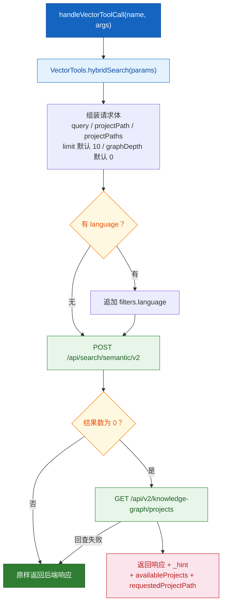
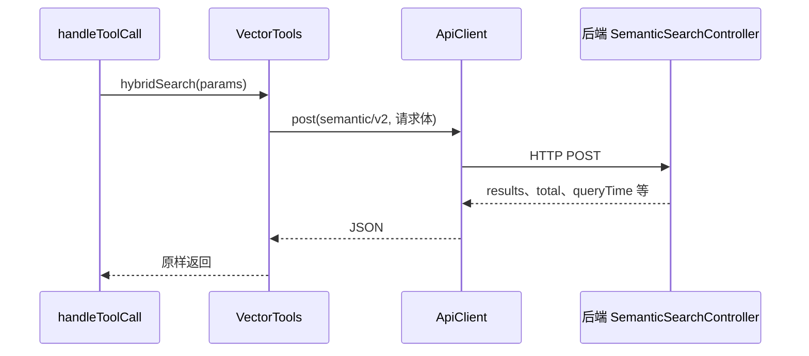
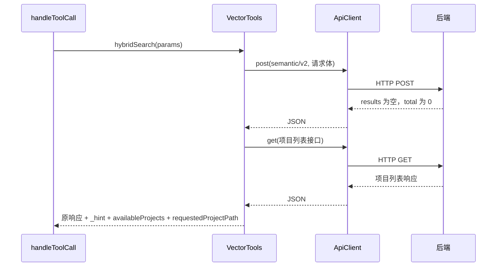

# 混合检索工具

> 自动生成于 2026-11-26，基于 `99d0037` 版本

| 属性 | 值 |
|------|-----|
| **所属层** | 工具实现层 |
| **目录** | `src/tools/vectorTools.ts` |
| **文件数** | 1 个（149 行） |
| **对外接口** | 1 个工具定义、`VECTOR_TOOLS`、`VectorTools` 类、`handleVectorToolCall()`、类型 `HybridSearchParams` |
| **依赖模块** | 1 个（[API客户端](./API客户端.md)） |
| **被依赖数** | 1（[工具路由聚合](./工具路由聚合.md)） |

---

## 1. 模块概述

### 1.1 职责定义

**核心职责**：提供唯一的工具 `hybrid_search`，把自然语言查询 POST 到后端的语义检索 v2 接口（多路召回 + 加权 RRF 融合）；结果为 0 条时自动附上可用项目列表，提示 AI 换路径重试。

**职责边界**：

| 本模块负责 ✅ | 本模块不负责 ❌ | 由谁负责 |
|-------------|---------------|---------|
| `hybrid_search` 的 schema 与请求体组装 | 分词、多路召回、RRF 融合、精排 | 后端 |
| `limit`、`graphDepth` 的默认值 | 向量化与索引 | 后端 |
| 0 结果时回查可用项目 | 是否必须先设项目范围 | [项目范围管理](./项目范围管理.md)（本工具是严格工具） |
| 把 `language` 包装成 `filters.language` | 前后端绑定目录的范围展开、前端节点合并 | 后端 |

### 1.2 核心文件清单

| 文件 | 类型 | 职责 | 行数 |
|------|------|------|------|
| `src/tools/vectorTools.ts` | 工具定义 + 工具类 + 处理函数 | 见下文 | 149 |

---

## 2. 模块架构

### 2.1 内部结构图

---

## 3. 对外接口

### 3.1 导出接口一览

| 接口 | 类型 | 说明 |
|------|------|------|
| `vectorToolDefinitions` | 常量数组 | 1 个工具定义 |
| `VECTOR_TOOLS` | 常量数组 | `['hybrid_search']` |
| `handleVectorToolCall(toolName, args)` | 异步函数 | 未知的工具名抛 `Error("Unknown vector tool: <name>")` |
| `VectorTools` | 类 | 只有 `hybridSearch()` 一个方法 |
| `HybridSearchParams` | 接口 | 入参类型 |

### 3.2 `hybrid_search`

| 字段 | 值 |
|------|----|
| **name** | `hybrid_search` |
| **后端调用** | `POST /api/search/semantic/v2`（0 结果时另调 `GET /api/v2/knowledge-graph/projects`） |
| **需要令牌** | 否 |
| **范围要求** | 严格：没有范围且入参不带路径时返回 `SCOPE_NOT_SET` |

| 参数 | 类型 | 必填 | 默认值 | 说明文字 |
|------|------|------|--------|---------|
| `query` | `string` | 是 | — | 自然语言查询，描述要查找的功能或行为 |
| `projectPath` | `string` | 否 | — | 项目根目录的绝对路径（与 projectPaths 二选一） |
| `projectPaths` | `string[]` | 否 | — | 项目路径列表，支持多项目同时查询 |
| `limit` | `number` | 否 | 10 | 最多返回结果数量，默认10，建议5~20 |
| `graphDepth` | `number` | 否 | 0 | 调用链图遍历深度，默认0。注意：多路召回（v2）路径下固定为0不做图扩展，仅查询退化为单路检索时此参数才生效 |
| `language` | `string`，枚举 `java` / `python` | 否 | — | 编程语言过滤（不传则查询全部语言） |

完整 `description` 原文见 [05-接口文档](../05-接口文档/index.md)。

---

## 4. 内部实现

### 4.1 请求体

| 字段 | 取值 |
|------|------|
| `query` | 入参原值 |
| `projectPath` | `projectPath`，没有则取 `projectPaths[0]` |
| `projectPaths` | `projectPaths`，没有则 `[projectPath]`（两者都没有时为 `undefined`，JSON 里不出现） |
| `limit` | `limit ?? 10` |
| `graphDepth` | `graphDepth ?? 0` |
| `filters` | 仅当 `language` 有值时出现：`{ language }` |

请求体里没有 `threshold`（旧版有过，随切到 v2 接口一并删除）。

### 4.2 0 结果回退

判定条件：`results` 是数组时取其长度，否则取 `total`，再否则按 0 处理。结果为 0 时：

1. 请求已建图项目列表，成功则在原响应上追加三个字段：
   - `_hint`：固定文案，提示「可能是 projectPath 不在已建图的项目里」，让 AI 从 `availableProjects` 选一个路径重搜，或先调用 `kg_list_projects` 让用户选择。
   - `availableProjects`：项目列表接口的响应。
   - `requestedProjectPath`：本次请求体里的 `projectPath`。
2. 回查失败时静默忽略，返回原始的空结果。

代码注释说明了意图：0 结果时附上可用项目列表，让 AI 请用户选对项目后重试。

### 4.3 处理函数

实例由模块级变量 `_vecTools` 惰性创建，进程内只创建一次；入参经类型断言后直接传给 `hybridSearch()`。

---

## 5. 交互流程

### 5.1 命中

### 5.2 未命中（自动回退）

---

## 6. 依赖关系

### 6.1 上游依赖

| 依赖模块 | 交互方式 | 使用的接口 |
|---------|---------|-----------|
| `../client/apiClient.js` | import | `ApiClient`、`getApiClient` |

### 6.2 下游消费者

| 消费模块 | 使用的接口 | 使用场景 |
|---------|-----------|---------|
| [工具路由聚合](./工具路由聚合.md) | 定义数组、`VECTOR_TOOLS`、`handleVectorToolCall`、类型 | 聚合与路由 |

### 6.3 后端接口对照

| 项 | MCP 侧 | 后端 `POST /api/search/semantic/v2` |
|----|--------|-----------------------------------|
| `limit` 默认值 | 10 | 20（请求体未带时） |
| `graphDepth` 默认值 | 0 | 0 |
| `language` | 放在 `filters.language` | 先看 `filters.language`，再看顶层 `language` |
| 未给任何项目路径 | 被范围协议拦截（严格工具） | 取第一个已建图项目；一个都没有时返回空结果 |
| `query` 为空 | 不校验 | 返回 HTTP 400 与 `{ error, results, total, queryTime }` |
| 检索过程异常 | — | 返回 HTTP 200 与空结果 |
| 成功响应 | 原样透传 | 裸对象 `{ results, total, queryTime, suggestedQueries, subQueries, rrfScores }`，**没有**通用响应信封 |

---

## 7. 配置项

无。

---

## 8. 错误处理

| 错误场景 | 处理 | 调用方感知 |
|---------|------|-----------|
| 未设范围且入参不带路径 | 入口拦截 | `SCOPE_NOT_SET` + `isError` |
| 后端返回非 2xx | `ApiClient` 抛错 | `{ success: false, error, tool }` + `isError` |
| 检索 0 结果 | 追加 `_hint` 等三个字段 | 正常结果（不带 `isError`） |
| 回查项目列表失败 | 静默忽略 | 只看到原始的空结果 |

---

## 9. 性能考量

| 关注点 | 策略 | 实现 |
|--------|------|------|
| 额外请求 | 只在 0 结果时多发一次项目列表请求 | `if (!total)` |
| 实例复用 | 工具类惰性单例 | `_vecTools` |

---

## 10. 已知问题与扩展点

| 已知问题 | 影响 |
|---------|------|
| `availableProjects` 的类型标注是 `string[]`，但项目列表接口返回的是后端的通用响应信封，路径数组在它的 `data` 字段里；运行时它是一个对象 | `_hint` 让 AI「从 availableProjects 中选路径」，AI 需要自己从 `data` 里取 |
| 后端在检索过程抛异常时也返回 HTTP 200 与空结果 | 这种失败会被当成 0 结果，触发项目列表回查与 `_hint`，提示方向有误导 |
| `_hint` 文案只提到 `projectPath` | 用 `projectPaths` 调用时提示不完全对应 |
| `graphDepth` 入参在 v2 路径下不生效（见其说明文字） | 传了也没有效果 |

| 扩展点 | 扩展方式 |
|--------|---------|
| 暴露更多检索选项（例如精排开关） | 在 `inputSchema` 加字段，并在 `hybridSearch()` 里放进请求体 |
| 让 `_hint` 更准确 | 根据入参里实际用的是 `projectPath` 还是 `projectPaths` 生成文案 |

---

> **相关文档**：
> - 架构总览 → [02-架构设计](../02-架构设计/index.md)
> - 全量 schema → [05-接口文档](../05-接口文档/index.md)
> - 项目列表的来源 → [知识图谱工具](./知识图谱工具.md)
> - HTTP 通信 → [API客户端](./API客户端.md)
