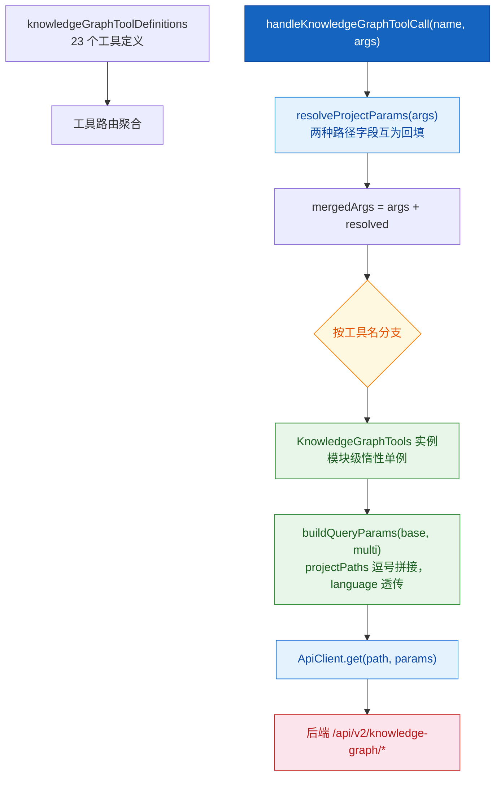
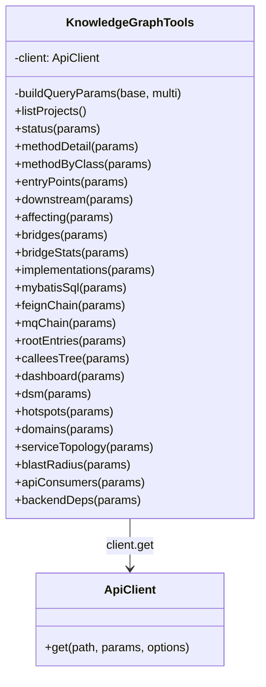
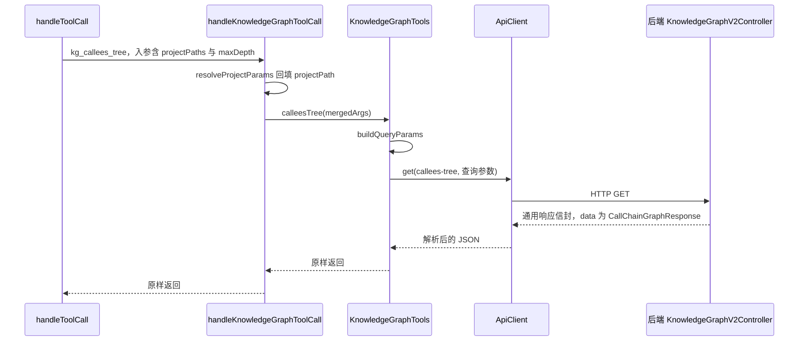

# 知识图谱工具

> 自动生成于 2026-11-26，基于 `99d0037` 版本

| 属性 | 值 |
|------|-----|
| **所属层** | 工具实现层 |
| **目录** | `src/tools/knowledgeGraphTools.ts` |
| **文件数** | 1 个（816 行） |
| **对外接口** | 23 个工具定义、`KG_TOOLS`、`KnowledgeGraphTools` 类、`handleKnowledgeGraphToolCall()`、20 个入参类型 |
| **依赖模块** | 1 个（[API客户端](./API客户端.md)） |
| **被依赖数** | 1（[工具路由聚合](./工具路由聚合.md)） |

---

## 1. 模块概述

### 1.1 职责定义

**核心职责**：把后端 `/api/v2/knowledge-graph/*` 下的 23 个 GET 接口包装成 `kg_*` 工具：声明 `inputSchema`，把入参整理成查询参数，调用 `ApiClient` 并原样返回后端响应。

**职责边界**：

| 本模块负责 ✅ | 本模块不负责 ❌ | 由谁负责 |
|-------------|---------------|---------|
| 23 个工具的 `name` / `description` / `inputSchema` | 知识图谱的构建与存储 | 后端 |
| `projectPath` 与 `projectPaths` 互为回填 | 路径反斜杠归一化 | [路径归一化](./路径归一化.md) |
| 多个项目路径用逗号拼成一个查询参数 | 是否必须先设项目范围 | [项目范围管理](./项目范围管理.md) |
| 服务名、主题名、节点 ID 的 URL 编码（部分工具） | HTTP 超时与错误归一 | [API客户端](./API客户端.md) |
| — | 鉴权 | 不需要（23 个工具都不带令牌） |

### 1.2 核心文件清单

| 文件 | 类型 | 职责 | 行数 |
|------|------|------|------|
| `src/tools/knowledgeGraphTools.ts` | 工具定义 + 工具类 + 处理函数 | 见下文 | 816 |

> 该文件有两处过时注释：文件头写「Provides 15 tools」，定义区标题写「Tool Definitions (15 tools)」。实际是 23 个。

---

## 2. 模块架构

### 2.1 内部结构图



### 2.2 类图



---

## 3. 对外接口

### 3.1 导出接口一览

| 接口 | 类型 | 说明 |
|------|------|------|
| `knowledgeGraphToolDefinitions` | 常量数组 | 23 个工具定义 |
| `KG_TOOLS` | 常量数组 | 23 个工具名，供路由匹配 |
| `handleKnowledgeGraphToolCall(toolName, args)` | 异步函数 | 处理函数；未知的工具名抛 `Error("Unknown knowledge graph tool: <name>")` |
| `KnowledgeGraphTools` | 类 | 23 个方法对应 23 个后端接口；构造函数可注入 `ApiClient`，缺省用 `getApiClient()` |
| `Kg*Params` × 20 | 接口 | 入参类型 |

### 3.2 工具一览

所有工具都不需要令牌，后端调用全部是 `GET`。路径以 `/api/v2/knowledge-graph` 为前缀（下表省略）。「范围」一列来自 [项目范围管理](./项目范围管理.md) 的注册表。

| # | 工具 | 后端路径 | 除 `projectPaths` 外发出的查询参数 | `required` | 范围 |
|---|------|---------|-----------------------------------|-----------|------|
| 1 | `kg_list_projects` | `/projects` | 无（不发 `projectPaths`） | 无 | 不参与 |
| 2 | `kg_status` | `/status` | `language` | `projectPaths` | 严格 |
| 3 | `kg_method_detail` | `/method/detail` | `nodeId`、`language` | `nodeId`、`projectPaths` | 严格 |
| 4 | `kg_method_by_class` | `/method/by-class` | `className`、`language` | `className`、`projectPaths` | 严格 |
| 5 | `kg_root_entries` | `/root-entries` | `className`、`methodName`、`language` | `className`、`methodName`、`projectPaths` | 严格 |
| 6 | `kg_callees_tree` | `/callees-tree` | `className`、`methodName`、`maxDepth`、`language` | `className`、`methodName`、`projectPaths` | 严格 |
| 7 | `kg_entry_points` | `/entry-points` | `entryType`、`language` | `projectPaths` | 严格 |
| 8 | `kg_downstream` | `/call-chain/downstream` | `nodeId`、`maxDepth`、`language` | `nodeId`、`projectPaths` | 严格 |
| 9 | `kg_affecting` | `/call-chain/affecting` | `className`、`methodName`、`language` | `className`、`methodName`、`projectPaths` | 严格 |
| 10 | `kg_bridges` | `/call-chain/{nodeId}/bridges` | `language` | `nodeId`、`projectPaths` | 宽松 |
| 11 | `kg_bridge_stats` | `/bridge-stats` | `language` | `projectPaths` | 宽松 |
| 12 | `kg_implementations` | `/implementations` | `interfaceName`、`language` | `interfaceName`、`projectPaths` | 宽松 |
| 13 | `kg_mybatis_sql` | `/mybatis/sql` | `mapperInterface`、`statementType`、`language` | `projectPaths` | 宽松 |
| 14 | `kg_feign_chain` | `/feign/{serviceName}/call-chain` | `language` | `serviceName`、`projectPaths` | 宽松 |
| 15 | `kg_mq_chain` | `/mq/{topic}/call-chain` | `language` | `topic`、`projectPaths` | 宽松 |
| 16 | `kg_dashboard` | `/dashboard` | `language` | `projectPaths` | 严格 |
| 17 | `kg_dsm` | `/dsm` | `level`、`language` | `projectPaths` | 严格 |
| 18 | `kg_hotspots` | `/hotspots` | `limit`、`language` | `projectPaths` | 严格 |
| 19 | `kg_domains` | `/domains` | `language` | `projectPaths` | 严格 |
| 20 | `kg_service_topology` | `/service-topology` | `language` | `projectPaths` | 严格 |
| 21 | `kg_blast_radius` | `/blast-radius/{nodeId}` | `maxDepth`、`language` | `nodeId`、`projectPaths` | 严格 |
| 22 | `kg_api_consumers` | `/api-consumers` | `entryId`（不发 `projectPaths`） | `entryId` | 不参与 |
| 23 | `kg_backend_deps` | `/backend-deps` | `apiClientId`（不发 `projectPaths`） | `apiClientId` | 不参与 |

完整 `description` 与入参说明见 [05-接口文档](../05-接口文档/index.md)。

### 3.3 公共入参片段

| 片段 | 字段 | schema | 说明文字 |
|------|------|--------|---------|
| `commonRequiredProperties` | `projectPaths` | `string[]` | 项目路径列表（必填），支持多项目同时查询 |
| `commonOptionalProperties` | `projectPath` | `string` | 单项目路径（兼容旧调用，优先使用 projectPaths） |
| `commonOptionalProperties` | `language` | `string`，枚举 `java` / `python` / `typescript` | 编程语言过滤（不传则查询全部语言） |

带 `projectPaths` 的 20 个工具都把 `projectPaths` 放进 `required`；`projectPath` 与 `language` 都是可选。

---

## 4. 内部实现

### 4.1 路径字段互为回填：`resolveProjectParams()`

| 入参情况 | `projectPath` | `projectPaths` |
|---------|--------------|----------------|
| 只给 `projectPath` | 原值 | `[projectPath]` |
| 只给 `projectPaths` | `projectPaths[0]` | 原值 |
| 两个都给 | 原值 | 原值（`projectPaths` 优先） |
| 都不给 | `undefined` | `undefined` |

### 4.2 查询参数构造：`buildQueryParams()`

- 以 `base` 起始，追加 `projectPaths`（数组用逗号连接成一个字符串）和 `language`（有值才加）。
- `projectPath` **不会**发给后端，只用于回填 `projectPaths`。

### 4.3 各工具的参数处理差异

| 工具 | 处理 |
|------|------|
| `kg_entry_points` | `entryType` 未传或等于 `ALL` 时不发该参数 |
| `kg_downstream`、`kg_callees_tree` | `maxDepth !== undefined` 时才发 |
| `kg_mybatis_sql` | `mapperInterface`、`statementType` 有值才发 |
| `kg_dsm` | `level` 有值才发 |
| `kg_hotspots`、`kg_blast_radius` | `limit` / `maxDepth` 为真值才发（传 `0` 不会发出） |
| `kg_feign_chain`、`kg_mq_chain`、`kg_blast_radius` | 路径里的 `serviceName` / `topic` / `nodeId` 经过 `encodeURIComponent` |
| `kg_bridges` | 路径里的 `nodeId` 直接拼接，**没有**做 URL 编码 |
| `kg_api_consumers`、`kg_backend_deps` | 只发 `entryId` / `apiClientId`，转成字符串 |

### 4.4 处理函数

```ts
export async function handleKnowledgeGraphToolCall(
  toolName: string,
  args: Record<string, unknown>
): Promise<unknown>
```

`resolveProjectParams()` 的结果展开到入参之上得到 `mergedArgs`，再按工具名调用实例方法。实例由模块级变量 `_kgTools` 惰性创建，进程内只创建一次。

---

## 5. 交互流程



---

## 6. 依赖关系

### 6.1 上游依赖

| 依赖模块 | 交互方式 | 使用的接口 |
|---------|---------|-----------|
| `../client/apiClient.js` | import | `ApiClient`（类型与默认构造）、`getApiClient` |

### 6.2 下游消费者

| 消费模块 | 使用的接口 | 使用场景 |
|---------|-----------|---------|
| [工具路由聚合](./工具路由聚合.md) | 定义数组、`KG_TOOLS`、`handleKnowledgeGraphToolCall`、类型 | 聚合与路由 |
| [MCP服务入口](./MCP服务入口.md) | 无直接依赖，但直接调用同一批后端接口 | `kg_select_scope` 的 `list` 动作 |

### 6.3 与后端的对应关系

23 条路径都已在后端 `KnowledgeGraphV2Controller`（`@RequestMapping("/api/v2/knowledge-graph")`）中逐条核对，全部存在且都是 `GET`。后端各接口的 `data` 类型：

| `data` 类型 | 接口 |
|------------|------|
| `List<String>` | `/projects`、`/implementations` |
| `Map<String, Object>` | `/status`、`/method/detail`、`/entry-points`、`/root-entries`、`/dashboard`、`/dsm`、`/hotspots`、`/domains`、`/service-topology`、`/blast-radius/{nodeId}` |
| `List<Map<String, Object>>` | `/method/by-class`、`/call-chain/affecting` |
| `CallChainGraphResponse` | `/callees-tree`、`/call-chain/downstream`、`/feign/.../call-chain`、`/mq/.../call-chain` |
| `List<BridgeRelation>` | `/call-chain/{nodeId}/bridges` |
| `BridgeStats` | `/bridge-stats` |
| `List<SqlNode>` | `/mybatis/sql` |
| `Map`，含 `entryId` 与 `consumers` | `/api-consumers` |
| `Map`，含 `apiClientId` 与 `deps` | `/backend-deps` |

---

## 7. 配置项

无。后端地址由 [API客户端](./API客户端.md) 的单例决定。

---

## 8. 错误处理

| 错误场景 | 处理 | 调用方感知 |
|---------|------|-----------|
| 后端返回非 2xx（例如缺 `projectPaths` 时的 400） | `ApiClient` 抛 `HTTP <code>: <body>` | `isError: true` + `{ success: false, error, tool }` |
| 后端超过 30 秒未响应 | `ApiClient` 抛 `Request timeout after 30000ms` | 同上 |
| 严格工具未设范围且入参不带路径 | 在入口被拦截 | `SCOPE_NOT_SET` |
| 宽松工具未设范围且入参不带路径 | 入口放行，但请求里没有 `projectPaths`；后端把它声明为必填查询参数，缺失时返回 400 | `HTTP 400: ...` |
| 后端业务失败（HTTP 200，`code` 非 200） | 本模块不判断，原样透传 | 调用方需检查响应体里的 `code` |

---

## 9. 性能考量

| 关注点 | 策略 | 实现 |
|--------|------|------|
| 实例复用 | 工具类惰性单例 | `_kgTools`、`getKgTools()` |
| 请求体 | 全部是 GET，无请求体 | `client.get()` |
| 多项目 | 一次请求携带多个路径 | `projectPaths` 逗号拼接 |

---

## 10. 已知问题与扩展点

| 已知问题 | 影响 |
|---------|------|
| `language` 入参在 20 个带项目路径的工具里都有，但后端 v2 控制器里只有 `/dashboard`、`/dsm`、`/hotspots`、`/domains`、`/service-topology` 这 5 个接口声明了 `language` 参数 | 其余 15 个工具传 `language` 不起过滤作用 |
| 6 个聚合工具（`kg_dashboard`、`kg_dsm`、`kg_hotspots`、`kg_domains`、`kg_service_topology`、`kg_blast_radius`）的 `properties` 把 `language` 写在公共片段展开之后，覆盖了带枚举的定义 | 这 6 个工具的 `language` 没有 `enum` 限制 |
| `kg_entry_points` 没有暴露分页参数；后端该接口有 `page`（默认 1）和 `pageSize`（默认 20） | 工具只能拿到第 1 页的 20 条 |
| `kg_feign_chain`、`kg_mq_chain` 不发 `maxDepth`；后端默认 10 | 无法调整追踪深度 |
| `kg_bridges` 的 `nodeId` 未做 URL 编码，与 `kg_blast_radius` 的做法不一致 | 含特殊字符的节点 ID 可能导致路径错误 |
| `kg_hotspots` 的 `limit`、`kg_blast_radius` 的 `maxDepth` 用真值判断 | 传 `0` 时参数不会发出，落到后端默认值（20 / 5） |
| 多个路径用逗号拼成一个参数 | 路径本身含逗号时会被拆开 |
| 文件头与定义区的注释仍写 15 个工具 | 只影响阅读 |

| 扩展点 | 扩展方式 |
|--------|---------|
| 新增一个知识图谱工具 | 加一条定义、`KG_TOOLS` 加名字、类里加方法、`switch` 加分支 |
| 暴露 `entry-points` 的分页 | 在 `entryPoints()` 的 `base` 里加 `page` / `pageSize`，并在 schema 声明 |
| 让新工具受项目范围约束 | 在 `scopeManager.ts` 的 `TOOL_SCOPE_REGISTRY` 登记 |

---

> **相关文档**：
> - 架构总览 → [02-架构设计](../02-架构设计/index.md)
> - 全量 schema 与 description → [05-接口文档](../05-接口文档/index.md)
> - 入参类型 → [06-数据模型](../06-数据模型/index.md)
> - HTTP 通信 → [API客户端](./API客户端.md)
> - 与检索的配合 → [混合检索工具](./混合检索工具.md)
