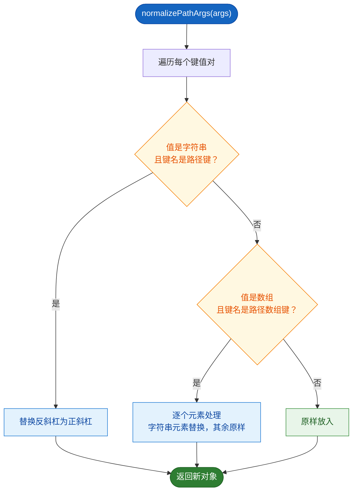
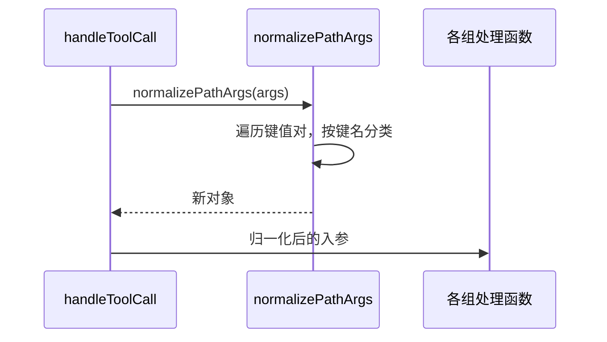

# 路径归一化

> 自动生成于 2026-11-26，基于 `99d0037` 版本

| 属性 | 值 |
|------|-----|
| **所属层** | 公共组件 |
| **目录** | `src/utils/pathUtils.ts`（实现）、`src/utils/pathUtils.test.ts`（测试） |
| **文件数** | 2 个（60 行 + 68 行） |
| **对外接口** | 1 个导出函数 `normalizePathArgs` |
| **依赖模块** | 0 个 |
| **被依赖数** | 1（[工具路由聚合](./工具路由聚合.md)） |

---

## 1. 模块概述

### 1.1 职责定义

**核心职责**：在每次工具分发前，把入参里「路径型键名」对应的字符串值中的反斜杠换成正斜杠，返回一个新的入参对象。

模块文件头的注释说明了原因与约定：

> Windows users frequently paste backslash paths … into MCP clients, but the knowledge graph's Neo4j store keys nodes by forward-slash paths. `normalizePathArgs` is invoked once per tool dispatch in `src/tools/index.ts` to coerce path-shaped arguments before they reach the downstream services.
> Assumption: all known consumers only inspect TOP-LEVEL keys of the args object, so a shallow copy is sufficient — nested objects are passed through by reference.

**职责边界**：

| 本模块负责 ✅ | 本模块不负责 ❌ | 由谁负责 |
|-------------|---------------|---------|
| 按键名识别路径型入参 | 判断值是不是真的路径 | — |
| 反斜杠 → 正斜杠 | 大小写、盘符、尾斜杠、`.` / `..` 的处理 | — |
| 返回浅拷贝，不改写入参 | 在每次分发前调用 | [工具路由聚合](./工具路由聚合.md) |
| — | 路径是否存在 | 后端 |

### 1.2 核心文件清单

| 文件 | 类型 | 职责 | 行数 |
|------|------|------|------|
| `src/utils/pathUtils.ts` | 纯函数 | `normalizePathArgs()` | 60 |
| `src/utils/pathUtils.test.ts` | 单元测试 | 10 个 `node:test` 用例 | 68 |

---

## 2. 模块架构

### 2.1 处理流程图



### 2.2 键名匹配规则

| 值类型 | 显式键名 | 后缀规则 | 判定函数 |
|--------|---------|---------|---------|
| 字符串 | `projectPath`、`filePath`、`path` | 键名以 `Path` 结尾（区分大小写） | `isPathKey()` |
| 数组 | `projectPaths`、`filePaths`、`paths` | 键名以 `Paths` 结尾（区分大小写） | `isPathArrayKey()` |

两个正则是模块级常量：`PATH_SUFFIX_RE = /Path$/`、`PATHS_SUFFIX_RE = /Paths$/`。

---

## 3. 对外接口

### `normalizePathArgs(args)`

```ts
export function normalizePathArgs(
  args: Record<string, unknown>,
): Record<string, unknown>;
```

| 参数 | 类型 | 说明 |
|------|------|------|
| `args` | `Record<string, unknown>` | 工具入参 |

**返回值**：新的普通对象。函数注释的约定：

- 只处理路径型键名的字符串值，以及路径型数组键名里的字符串元素。
- 非字符串值、无关键名、`undefined`、`null` 原样通过。
- 输入对象永远不会被修改。

**调用约束**：只做浅拷贝；嵌套对象按引用传递，不做处理。

---

## 4. 内部实现

### 4.1 对各工具入参的影响

| 入参字段 | 所在工具 | 是否归一化 | 原因 |
|---------|---------|-----------|------|
| `projectPath` | 20 个 `kg_*` 工具、`hybrid_search`、`apm_start_session` | 是 | 显式键名 |
| `projectPaths` | 20 个 `kg_*` 工具、`hybrid_search` | 是（逐个元素） | 显式数组键名 |
| `path` | `apm_execute_request` | 是 | 显式键名 |
| `project_path` | `act_start_analysis`、`act_start_status` | 否 | 下划线命名，不匹配 `Path` 后缀 |
| `raw_input`、`session_id`、`node_name`、`answers`、`feedback` | `act_*` | 否 | 非路径键名 |
| `dslQuery`、`stackTrace`、`message`、`contentContains`、`keyword` | `log_*` | 否 | 非路径键名，其中的反斜杠会保留 |
| `className`、`methodName`、`nodeId`、`serviceName`、`topic` | `kg_*` | 否 | 非路径键名 |

### 4.2 一个绕过点

`kg_select_scope(action="set")` 传入的 `projectPaths` 不经过本函数：该工具在入口就地处理，不走 `handleToolCall()`。这些路径原样存进范围；之后被注入到其它工具的 `projectPaths` 字段时，会在那次分发里被归一化。

### 4.3 测试用例

| 用例 | 断言 |
|------|------|
| `projectPath` 含反斜杠 | 全部换成正斜杠 |
| `projectPaths` 数组 | 每个元素都被处理 |
| 非路径键（`className` 含反斜杠、`limit`） | 原样保留 |
| 不修改输入对象 | 处理后输入与快照相等 |
| `projectPath` 为 `undefined`、`filePath` 为 `null` | 不抛错，原样返回 |
| 自定义后缀键（`sourcePath`、`targetPaths`） | 同样被处理 |
| 小写显式键 `path` | 被处理 |
| 空数组 | 返回新数组引用（与输入不是同一个对象） |
| 数组里的非字符串元素（数字、`null`） | 原样通过 |
| 路径键下的非字符串值 | 原样通过 |

运行方式：`package.json` 没有定义 `test` 脚本；测试文件会被 `tsc` 一并编译（`tsconfig.json` 的 `include` 是 `src/**/*`）。

---

## 5. 交互流程



---

## 6. 依赖关系

### 6.1 上游依赖

无。

### 6.2 下游消费者

| 消费模块 | 使用的接口 | 使用场景 |
|---------|-----------|---------|
| [工具路由聚合](./工具路由聚合.md) | `normalizePathArgs` | `handleToolCall()` 的第一行 |

---

## 7. 配置项

无。

---

## 8. 错误处理

本模块不抛错，也没有错误分支。

---

## 9. 性能考量

| 关注点 | 策略 | 实现 |
|--------|------|------|
| 正则复用 | 正则字面量提升为模块级常量 | `BACKSLASH_RE`、`PATH_SUFFIX_RE`、`PATHS_SUFFIX_RE` |
| 拷贝成本 | 浅拷贝，只遍历第一层 | `Object.entries()` |

---

## 10. 已知问题与扩展点

| 已知问题 | 影响 |
|---------|------|
| 动作工具的 `project_path` 不在处理范围内 | Windows 风格路径会原样发给后端 |
| 假设调用方只看入参的第一层 | 若将来有工具需要归一化嵌套对象里的路径，需要改实现 |
| `apm_execute_request` 的 `path` 也会被处理 | 请求路径里的反斜杠会被换成正斜杠 |
| 没有 `npm test` 脚本 | 测试要手工运行编译后的文件 |

| 扩展点 | 扩展方式 |
|--------|---------|
| 把 `project_path` 纳入归一化 | 把它加进 `EXPLICIT_PATH_KEYS`，并补测试用例 |
| 支持嵌套对象 | 改为递归实现，并同步更新文件头的假设说明 |

---

> **相关文档**：
> - 架构总览 → [02-架构设计](../02-架构设计/index.md)
> - 调用方 → [工具路由聚合](./工具路由聚合.md)
> - 相关决策 → [08-技术决策](../08-技术决策/index.md)
