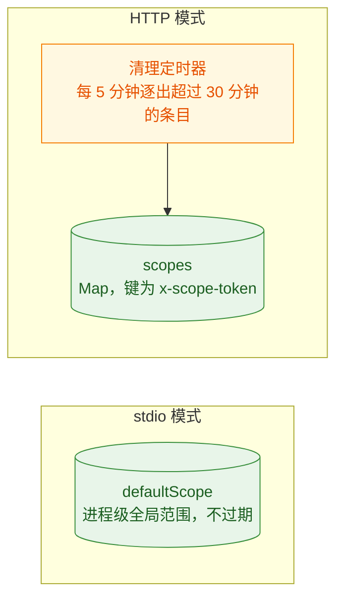
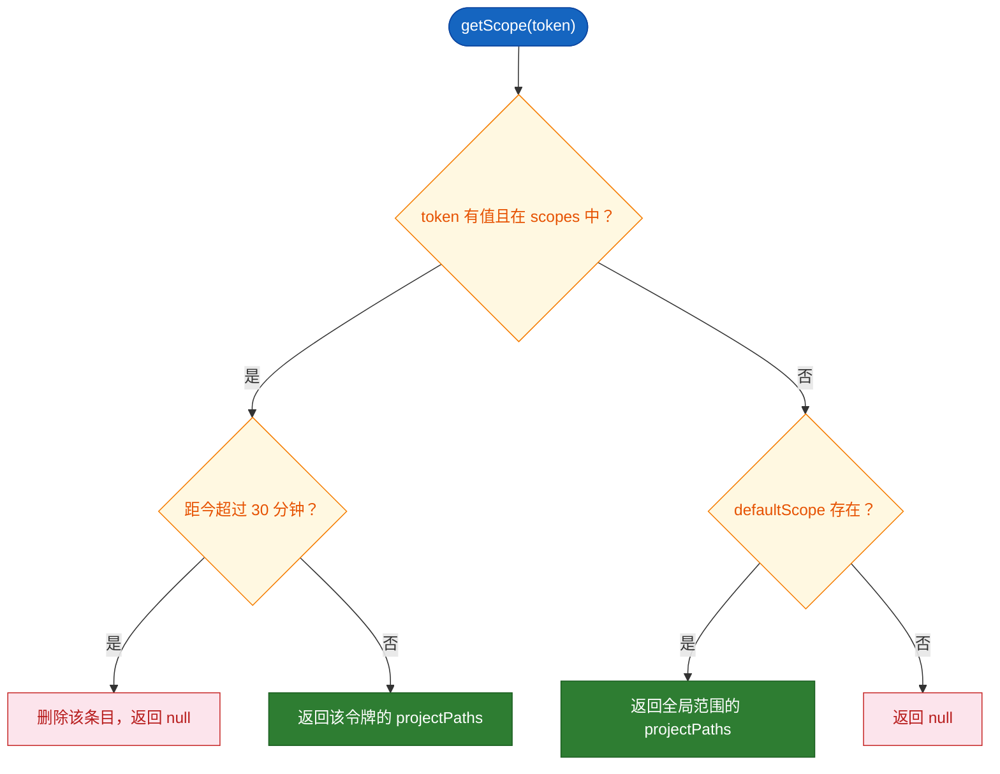
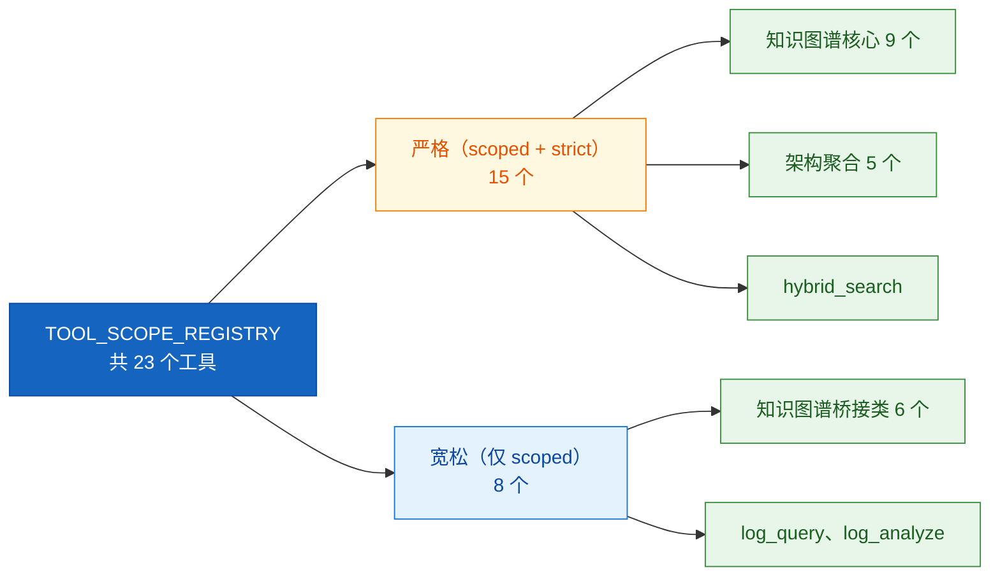
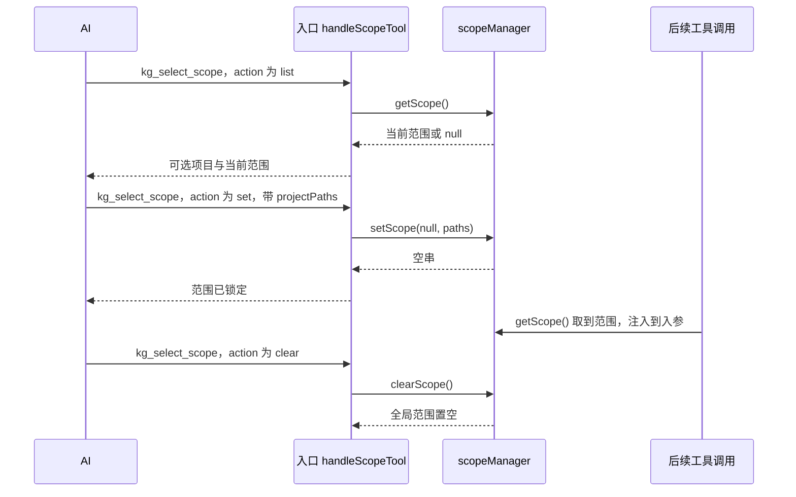

# 项目范围管理

> 自动生成于 2026-11-26，基于 `99d0037` 版本

| 属性 | 值 |
|------|-----|
| **所属层** | 公共组件 |
| **目录** | `src/utils/scopeManager.ts` |
| **文件数** | 1 个（124 行） |
| **对外接口** | 6 个导出函数（`setScope`、`getScope`、`clearScope`、`generateToken`、`isScopedTool`、`isStrictScopedTool`） |
| **依赖模块** | 0 个内部模块（只用 `node:crypto`） |
| **被依赖数** | 1（[MCP服务入口](./MCP服务入口.md)） |

---

## 1. 模块概述

### 1.1 职责定义

**核心职责**：保存「这次会话要查哪些项目」，并用一张注册表声明每个工具是否受项目范围约束、缺范围时是否拒绝。

模块文件头的注释原文：

> Session-scope manager for KG project selection.
> Protocol:
> 1. kg_select_scope(action="list") -> enumerate projects
> 2. AI uses AskUserQuestion to pick projects
> 3. kg_select_scope(action="set", projectPaths=[...]) -> scope locked
> 4. Subsequent tools auto-inherit scope (no need to repeat projectPaths)
> For stdio mode: single session, defaults to global scope.
> For HTTP mode: token-keyed per-client scope with TTL eviction.

**职责边界**：

| 本模块负责 ✅ | 本模块不负责 ❌ | 由谁负责 |
|-------------|---------------|---------|
| 范围的存、取、清 | `kg_select_scope` 工具本身 | [MCP服务入口](./MCP服务入口.md) |
| HTTP 模式下按令牌分桶与过期逐出 | 把范围注入工具入参 | [MCP服务入口](./MCP服务入口.md) 的 `injectScope()` |
| 工具范围注册表（单一事实来源） | 列出可选项目 | [MCP服务入口](./MCP服务入口.md) 调后端接口 |
| 生成范围令牌的函数 | 调用 `generateToken()` | 目前没有调用方 |

### 1.2 核心文件清单

| 文件 | 类型 | 职责 | 行数 |
|------|------|------|------|
| `src/utils/scopeManager.ts` | 状态管理 | 范围存取、TTL 清理、工具注册表 | 124 |

---

## 2. 模块架构

### 2.1 两种存储

> 两种存储在同一个模块里同时存在：带令牌的操作走 `scopes`，不带令牌的操作走 `defaultScope`。stdio 模式调用方从不传令牌，所以只会用到 `defaultScope`。

### 2.2 `getScope()` 判定流程

### 2.3 工具范围注册表

注册表 `TOOL_SCOPE_REGISTRY` 的注释：「Tool registry — single source of truth for scope awareness」。每项有两个开关：`scoped`（有范围时是否自动注入）、`strict`（没有范围时是否拒绝）。

| 类别 | 工具 | 没有范围且入参不带路径时 |
|------|------|------------------------|
| 严格 · 知识图谱核心（注释：KG core — strict: search/trace tools MUST have project scope） | `kg_status`、`kg_method_detail`、`kg_method_by_class`、`kg_entry_points`、`kg_root_entries`、`kg_callees_tree`、`kg_downstream`、`kg_affecting`、`kg_blast_radius` | 拒绝，`SCOPE_NOT_SET` |
| 严格 · 架构聚合（注释：Architecture tools — strict） | `kg_dashboard`、`kg_dsm`、`kg_hotspots`、`kg_domains`、`kg_service_topology` | 拒绝，`SCOPE_NOT_SET` |
| 严格 · 检索 | `hybrid_search` | 拒绝，`SCOPE_NOT_SET` |
| 宽松 · 桥接类（注释：soft scoped，有显式 projectPath 也能工作） | `kg_bridges`、`kg_bridge_stats`、`kg_implementations`、`kg_mybatis_sql`、`kg_feign_chain`、`kg_mq_chain` | 放行；但后端要求 `projectPaths`，最终会得到 HTTP 400 |
| 宽松 · 日志（注释：Log — soft scoped） | `log_query`、`log_analyze` | 放行，且范围对它们不起作用（见 4.4） |
| 未登记（17 个） | `kg_select_scope`、`kg_list_projects`、`kg_api_consumers`、`kg_backend_deps`、`log_report`、`log_report_status`、6 个 `apm_*`、5 个 `act_*` | 既不注入也不拒绝 |

---

## 3. 对外接口

| 函数 | 签名 | 说明 | 调用方 |
|------|------|------|--------|
| `setScope` | `(token: string \| null, projectPaths: string[]): string` | `token` 为真：写入令牌桶并返回该令牌；否则写入全局范围并返回空串 | `handleScopeTool()` 的 `set` |
| `getScope` | `(token?: string \| null): string[] \| null` | 取范围，流程见 2.2 | `injectScope()`、`handleScopeTool()` 的 `list` / `get`、HTTP 模式 `/health` |
| `clearScope` | `(token?: string \| null): void` | `token` 为真：删除该令牌的条目；否则清空全局范围 | `handleScopeTool()` 的 `clear` |
| `generateToken` | `(): string` | 返回 `scope_` 加一个随机 UUID | 无调用方 |
| `isScopedTool` | `(name: string): boolean` | 注册表里 `scoped` 是否为真 | `injectScope()` |
| `isStrictScopedTool` | `(name: string): boolean` | 注册表里 `strict` 是否为真 | `injectScope()` |

---

## 4. 内部实现

### 4.1 数据结构

| 名称 | 类型 | 说明 |
|------|------|------|
| `ScopeEntry` | `{ projectPaths: string[]; setAt: number }` | 一条范围记录；`setAt` 是写入时刻的毫秒时间戳 |
| `scopes` | `Map<string, ScopeEntry>` | 令牌 → 范围记录 |
| `defaultScope` | `ScopeEntry \| null` | 全局范围 |
| `SCOPE_TTL_MS` | `30 * 60 * 1000` | 注释：Maximum scope lifetime: 30 minutes |
| `CLEANUP_INTERVAL_MS` | `5 * 60 * 1000` | 注释：Cleanup stale scopes every 5 minutes |
| `cleanupTimer` | 定时器句柄或 `null` | 首次写入令牌桶时创建；调用 `unref()`，注释：don't block process exit |

### 4.2 过期规则

- 有效期从写入时刻算起，读取不会续期。
- 两条逐出路径：读取时发现过期（删除并返回 `null`）；定时器每 5 分钟扫描删除过期条目。
- 两种「取不到」的结果不同：**条目存在但已过期**返回 `null`；**令牌没有对应条目**（从未设置或已被定时器清掉）则回退到全局范围。

### 4.3 状态变化

| 操作 | 条件 | 结果 |
|------|------|------|
| `setScope(有值令牌, paths)` | — | 覆盖该令牌的条目；首次调用时启动清理定时器 |
| `setScope(null, paths)` | — | 覆盖全局范围 |
| `getScope(令牌)` | 条目存在且未过期 | 令牌范围 |
| `getScope(令牌)` | 条目不存在 | 全局范围或 `null` |
| `getScope()` / `getScope(null)` | — | 全局范围或 `null` |
| `clearScope(令牌)` | — | 只清该令牌的条目 |
| `clearScope()` | — | 只清全局范围 |

### 4.4 注入之后发生了什么

注册表只决定「是否注入」，注入的是 `projectPaths` 与 `projectPath` 两个入参字段。各工具对这些字段的处理不同：

| 工具类别 | 对注入字段的处理 |
|---------|----------------|
| 20 个带项目路径的 `kg_*` 工具 | 被回填并作为 `projectPaths` 查询参数发给后端，范围生效 |
| `hybrid_search` | 进入请求体的 `projectPath` / `projectPaths`，范围生效 |
| `log_query`、`log_analyze` | 请求体走字段白名单，这两个字段不会转发，范围不起作用 |

---

## 5. 交互流程

---

## 6. 依赖关系

### 6.1 上游依赖

| 依赖 | 交互方式 | 用途 |
|------|---------|------|
| `node:crypto` | import | `randomUUID()`，仅 `generateToken()` 使用 |

### 6.2 下游消费者

| 消费模块 | 使用的接口 | 使用场景 |
|---------|-----------|---------|
| [MCP服务入口](./MCP服务入口.md) | `setScope`、`getScope`、`clearScope`、`isScopedTool`、`isStrictScopedTool` | `kg_select_scope` 与 `injectScope()` |

---

## 7. 配置项

无环境变量。有效期（30 分钟）与清理间隔（5 分钟）是硬编码常量。

---

## 8. 错误处理

本模块不抛错：取不到范围时返回 `null`，由调用方决定如何响应（严格工具得到 `SCOPE_NOT_SET`）。

---

## 9. 性能考量

| 关注点 | 策略 | 实现 |
|--------|------|------|
| 查找开销 | `Map` 按令牌直接取 | `scopes.has()` / `scopes.get()` |
| 定时器不拖住进程 | `unref()` | `cleanupTimer.unref()` |
| 全局范围不占用定时器 | 只有写入令牌桶时才启动清理 | `ensureCleanup()` |

---

## 10. 已知问题与扩展点

| 已知问题 | 影响 |
|---------|------|
| 「条目过期」返回 `null`，「令牌不存在」回退到全局范围，两种情况的结果不一致 | HTTP 模式下，过期后与从未设置的表现可能不同 |
| `generateToken()` 没有调用方；HTTP 客户端必须自己提供 `x-scope-token` 才能得到独立范围 | 不带该请求头的客户端共用全局范围 |
| 全局范围没有有效期 | stdio 进程存活期间一直有效 |
| 清理定时器只清理令牌桶 | 与上一条相同 |
| 两个日志工具被登记为宽松受控，但范围对它们不起作用 | 登记与实际效果不一致 |

| 扩展点 | 扩展方式 |
|--------|---------|
| 调整某个工具的范围要求 | 修改 `TOOL_SCOPE_REGISTRY` |
| 让 HTTP 模式自动签发范围令牌 | 在 `kg_select_scope` 的 `set` 动作里调用 `generateToken()` |
| 调整有效期 | 修改 `SCOPE_TTL_MS` |

---

> **相关文档**：
> - 架构总览 → [02-架构设计](../02-架构设计/index.md)
> - 使用方 → [MCP服务入口](./MCP服务入口.md)
> - 范围相关的数据流 → [04-数据流程](../04-数据流程/index.md)
> - 相关决策 → [08-技术决策](../08-技术决策/index.md)
