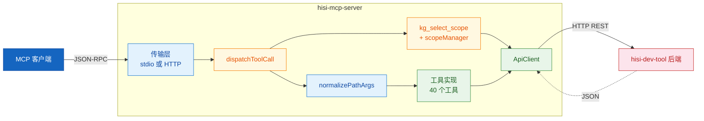
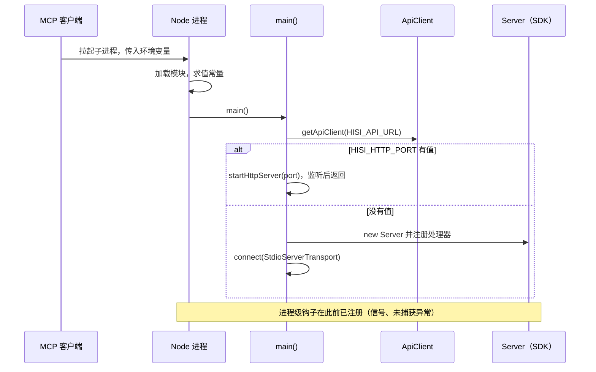
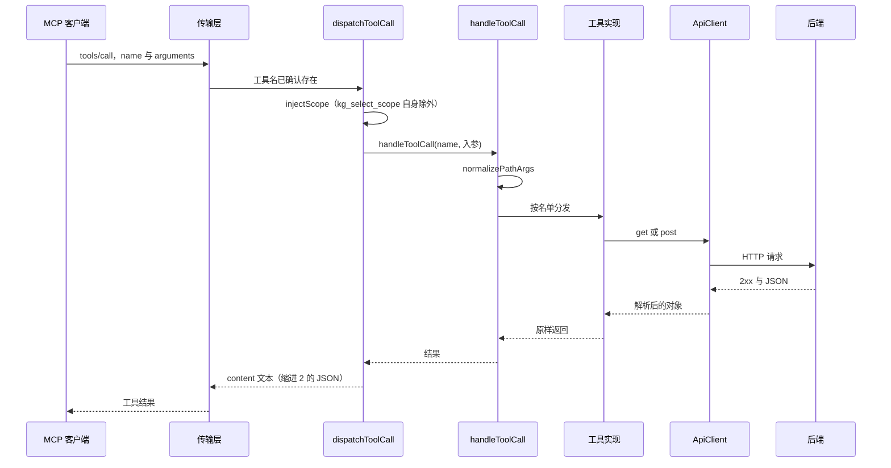
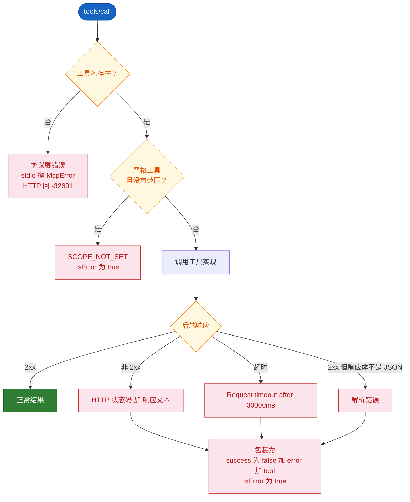
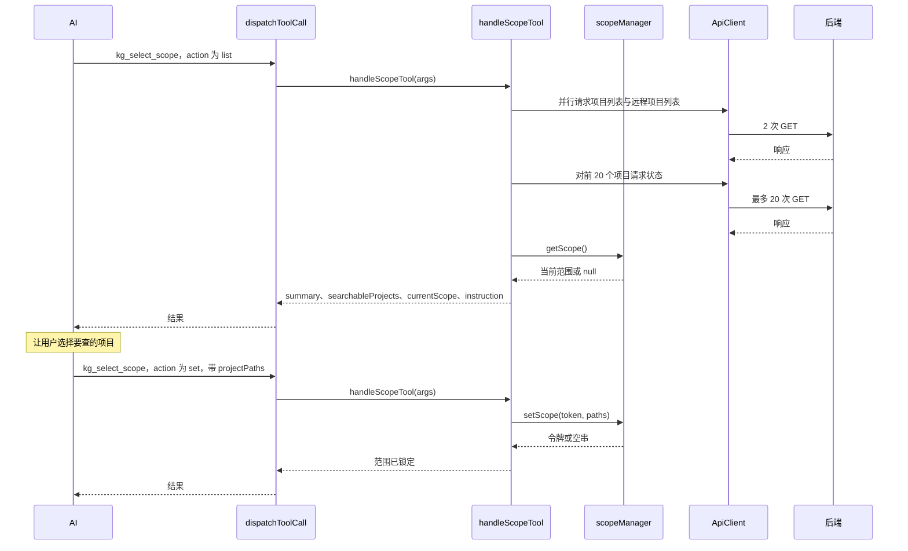
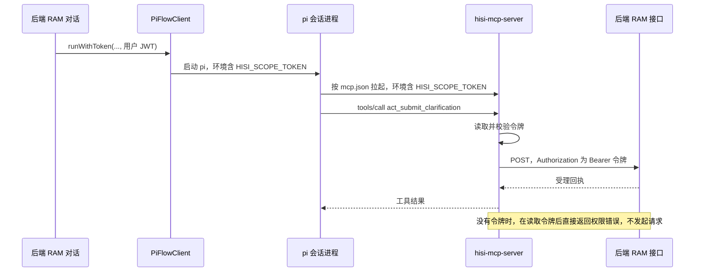
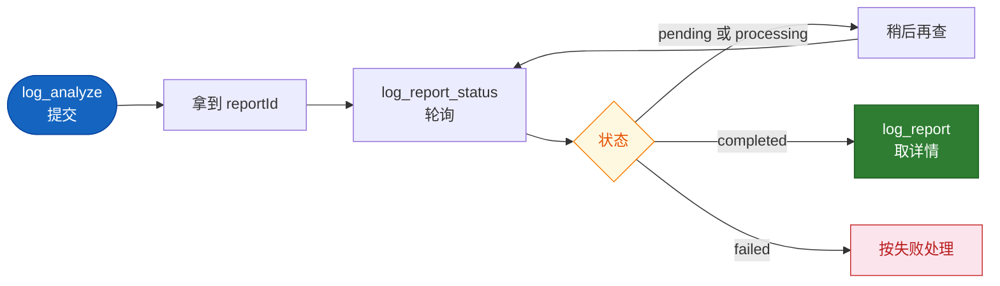
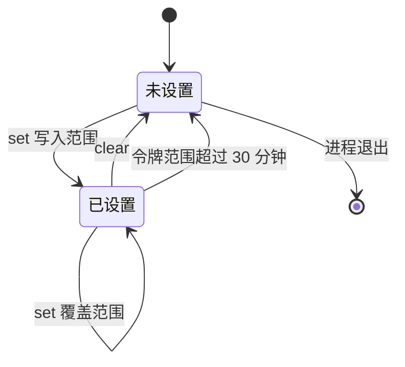

# 数据流程

> 自动生成于 2026-11-26，基于 `99d0037` 版本

本文描述 `hisi-mcp-server` 中的端到端数据流：一条 MCP 请求如何从客户端出发，经过入口、范围注入、路由、工具实现与 HTTP 客户端到达后端，再原路返回。

---

## 1. 数据流概览

### 1.1 核心数据流清单

| # | 流程名 | 触发方 | 关键路径 | 重要性 |
|---|--------|--------|---------|--------|
| 1 | 进程启动 | MCP 客户端或手工运行 | `main()` → 选传输 → 就绪 | 核心 |
| 2 | 列出工具 | MCP 客户端 | 传输层 → `allDefsWithScope` → 40 个工具定义 | 辅助 |
| 3 | 调用工具 | MCP 客户端 | 传输层 → `dispatchToolCall` → `injectScope` → `handleToolCall` → 工具实现 → `ApiClient` → 后端 | 核心 |
| 4 | 项目范围协议 | AI（经 MCP 客户端） | `kg_select_scope list` → 用户选择 → `set` → 后续工具自动注入 | 核心 |
| 5 | 动作工具与令牌传递 | 后端 pi 会话 | 用户 JWT → 进程环境 → `act_*` → 带 `Authorization` 回调 | 核心 |
| 6 | 日志异步分析 | AI | `log_analyze` → `log_report_status` 轮询 → `log_report` | 辅助 |
| 7 | 检索 0 结果回退 | AI | `hybrid_search` → 回查项目列表 → 附带 `_hint` | 辅助 |

### 1.2 数据流全景图

---

## 2. 流程 1：进程启动

| 属性 | 值 |
|------|-----|
| **触发方式** | MCP 客户端按配置拉起子进程，或手工执行 `node dist/index.js` |
| **触发条件** | pi 会话开始；或外部客户端启动 |
| **涉及模块** | [MCP服务入口](../03-模块说明/MCP服务入口.md)、[API客户端](../03-模块说明/API客户端.md) |
| **数据流向** | 环境变量 → 进程常量 → ApiClient / Server 或 HTTP 服务 |

| 步骤 | 参与者 | 操作 | 数据 |
|------|--------|------|------|
| 1 | Node 进程 | 求值模块级常量 | `HISI_API_URL`、`HISI_HTTP_PORT`、`HISI_DEBUG` |
| 2 | Node 进程 | 注册进程钩子 | `SIGINT`、`SIGTERM`、`uncaughtException`、`unhandledRejection` |
| 3 | `main()` | 初始化 HTTP 客户端单例 | `API_BASE_URL` |
| 4 | `main()` | 按是否有端口选择模式 | `HTTP_PORT` |
| 5 | 所选传输 | 开始接收请求 | stdio 或 HTTP |

---

## 3. 流程 2：列出工具

两种传输都返回同一份列表：`allDefsWithScope` 中的 `name`、`description`、`inputSchema`，共 40 项，顺序为知识图谱 23 → 混合检索 1 → 日志 4 → APM 6 → 动作 5 → `kg_select_scope`。这一步不访问后端。

---

## 4. 流程 3：调用工具（端到端）

| 属性 | 值 |
|------|-----|
| **触发方式** | MCP 客户端发送 `tools/call` |
| **涉及模块** | [MCP服务入口](../03-模块说明/MCP服务入口.md) → [工具路由聚合](../03-模块说明/工具路由聚合.md) → [路径归一化](../03-模块说明/路径归一化.md) → 工具实现 → [API客户端](../03-模块说明/API客户端.md) |
| **数据流向** | `arguments` → 归一化并可能注入范围的入参 → 查询参数或请求体 → 后端 JSON → `content[0].text` |

### 4.1 正常流程

### 4.2 数据转换节点

| 节点 | 输入 | 输出 | 转换规则 | 实现位置 |
|------|------|------|---------|---------|
| 范围注入 | 原始 `arguments` | 追加了 `projectPaths` / `projectPath` 的入参 | 只对注册表里的工具；显式入参优先 | `index.ts` 的 `injectScope()` |
| 路径归一化 | 入参对象 | 浅拷贝 | 路径型键名的字符串值：反斜杠 → 正斜杠 | `pathUtils.ts` 的 `normalizePathArgs()` |
| 项目路径回填（知识图谱） | `projectPath` 或 `projectPaths` | 两者都有 | 缺哪个补哪个 | `knowledgeGraphTools.ts` 的 `resolveProjectParams()` |
| 查询参数（知识图谱） | 入参对象 | `Record<string, string>` | `projectPaths` 用逗号拼接；`language` 透传 | `KnowledgeGraphTools.buildQueryParams()` |
| 字段白名单（日志） | 入参对象 | 只含有值字段的请求体 | `!== undefined` 才加入 | `logTools.ts` 的 `query()` / `analyze()` |
| 字段改名（动作） | 下划线入参 | 驼峰请求体 + 路径参数 | `raw_input` → `rawInput` 等 | `actionTools.ts` |
| 结果文本化 | 任意结果 | JSON 字符串 | `JSON.stringify(result, null, 2)` | `index.ts` 的 `dispatchToolCall()` |

### 4.3 异常流程

| 异常场景 | 触发条件 | 处理策略 | 调用方感知 | 数据影响 |
|---------|---------|---------|-----------|---------|
| 工具名不存在 | `name` 不在 40 个工具里 | 协议层直接报错 | JSON-RPC 错误 | 无 |
| 缺少项目范围 | 严格工具且入参不带路径 | 入口拦截，不请求后端 | `SCOPE_NOT_SET` + `isError` | 无 |
| 后端 HTTP 失败 | 非 2xx | `ApiClient` 抛错，入口包装 | `error` 形如 `HTTP 400: ...` | 无 |
| 后端超时 | 30 秒内没有响应 | 中止请求并抛错 | `Request timeout after 30000ms` | 无 |
| 后端业务失败 | HTTP 200，`code` 非 200 | **不处理**，原样透传 | 看起来是正常结果 | 无 |
| 工具实现自身异常 | 例如未知的工具名落到 `default` | 入口包装 | `Unknown ... tool` + `isError` | 无 |

---

## 5. 流程 4：项目范围协议

范围的状态流转见第 8 节。各工具对注入范围的处理差异见 [项目范围管理](../03-模块说明/项目范围管理.md)。

---

## 6. 流程 5：动作工具与令牌传递

---

## 7. 流程 6：日志异步分析

轮询的间隔与次数由 AI 决定，本服务没有内置。未完成就调用 `log_report` 时，后端会在响应体的 `code` 里返回 400 并带上当前状态。

---

## 8. 状态流转

### 8.1 项目范围状态机

### 8.2 状态转换规则

| 当前状态 | 事件 | 目标状态 | 前置条件 | 副作用 | 实现位置 |
|---------|------|---------|---------|--------|---------|
| 未设置 | `set` | 已设置 | `projectPaths` 非空 | 令牌模式下首次启动清理定时器 | `scopeManager.ts` 的 `setScope()` |
| 已设置 | `set` | 已设置 | `projectPaths` 非空 | 覆盖，计时重新开始 | 同上 |
| 已设置 | `clear` | 未设置 | — | 只清当前令牌或全局范围 | `clearScope()` |
| 已设置（令牌范围） | 超过 30 分钟 | 未设置 | — | 读取时删除或定时器删除 | `getScope()`、清理定时器 |
| 已设置（全局范围） | 进程退出 | — | — | 内存状态消失 | — |

### 8.3 状态不变量

| 不变量 | 说明 | 校验方式 |
|--------|------|---------|
| 全局范围与每个令牌范围各自最多一份 | `set` 总是覆盖 | 代码路径保证 |
| 范围只在内存 | 进程重启即丢失 | 没有持久化代码 |

---

## 9. 数据校验规则

### 9.1 输入校验

本服务不对 `arguments` 做 JSON Schema 校验。少量校验分散在处理函数里：

| 数据 | 校验规则 | 校验位置 | 失败行为 |
|------|---------|---------|---------|
| 工具名 | 必须在 40 个工具里 | 入口 | 协议层错误 |
| `kg_select_scope` 的 `projectPaths` | `set` 时必须非空 | `handleScopeTool()` | `success: false`，不带 `isError` |
| `kg_select_scope` 的 `action` | 必须是四个值之一 | `handleScopeTool()` | `Unknown action` |
| `HISI_SCOPE_TOKEN` | 动作工具必须非空 | `handleActToolCall()` | 权限错误，不带 `isError` |
| HTTP 请求体（HTTP 模式） | 必须是 JSON、不超过 5 MB、`Content-Type` 为 JSON | `startHttpServer()` | `-32700` 或 HTTP 413 / 415 |
| 其余入参 | 交给后端 | 后端 | HTTP 4xx，或响应体 `code` 非 200 |

### 9.2 数据一致性保障

| 一致性约束 | 保障方式 | 违反时处理 | 实现位置 |
|-----------|---------|-----------|---------|
| 入参对象不被修改 | 归一化返回新对象 | — | `normalizePathArgs()` |
| 未传的可选字段不出现在日志请求体里 | 字段白名单 | — | `logTools.ts` |
| 动作工具绝不匿名执行 | 先取令牌再建请求 | 直接返回 | `actionTools.ts` |

---

## 10. 性能相关路径

本服务没有实测耗时数据（未在代码中确认）。与耗时相关的代码事实：

| 路径 | 相关事实 |
|------|---------|
| 任意工具调用 | 等价于一次后端请求；默认 30 秒超时 |
| `kg_select_scope` 的 `list` | 2 个列表请求并行 + 最多 20 个状态请求并行 |
| `hybrid_search` 0 结果 | 多一次项目列表请求 |
| 启动 | 无网络请求，只创建一次 `ApiClient` |

---

## 11. 数据安全与脱敏

| 数据类型 | 敏感级别 | 存储方式 | 传输 | 说明 |
|---------|---------|---------|------|------|
| 用户令牌 `HISI_SCOPE_TOKEN` | 高 | 只在进程环境变量里，不落盘 | 以 `Authorization: Bearer` 头发给后端；是否加密取决于 `HISI_API_URL` 是否为 https | 代码中的日志语句都不输出令牌 |
| 项目范围 | 低 | 内存，最长 30 分钟（令牌范围） | — | — |
| 需求原文、澄清回答、日志内容 | 中 | 不存储，只透传 | 同上 | 不写入日志 |
| 远程项目的 `gitUrl` | 视仓库而定 | 不存储 | — | `kg_select_scope` 的 `list` 输出会把它带给 AI |
| 调试日志 | — | 不存储 | — | `HISI_DEBUG=true` 时输出后端地址与状态查询失败的项目路径，不输出工具入参 |

---

> **延伸阅读**：
> - 入口与分发 → [MCP服务入口](../03-模块说明/MCP服务入口.md)
> - 范围存取 → [项目范围管理](../03-模块说明/项目范围管理.md)
> - 协议与工具定义 → [05-接口文档](../05-接口文档/index.md)
> - 类型定义 → [06-数据模型](../06-数据模型/index.md)
