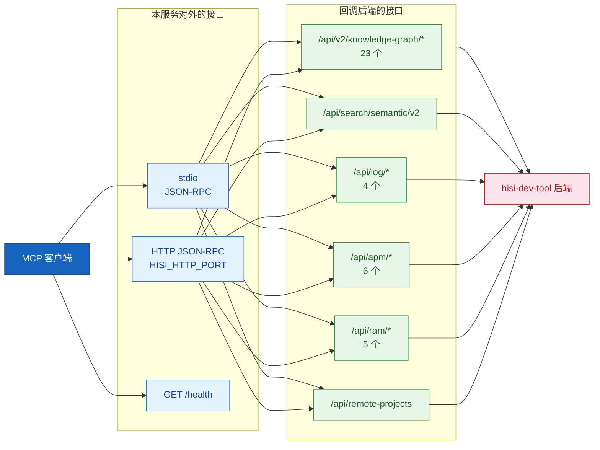
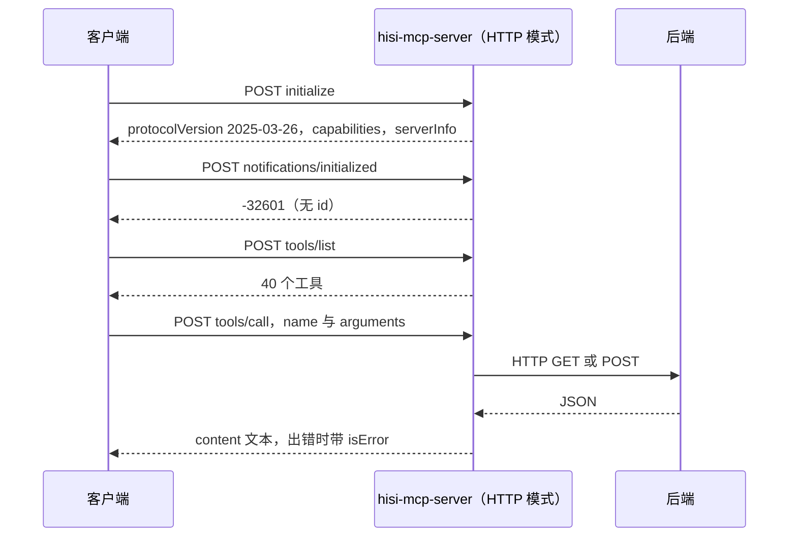

# 接口文档

> 自动生成于 2026-11-26，基于 `99d0037` 版本

本文给出 `hisi-mcp-server` 对外的 MCP 接口（两种传输、40 个工具）以及它回调后端的全部 REST 路径。所有条目均按当前代码逐个核对。

---

## 1. 接口概览

### 1.1 接口总览

| 接口类型 | 数量 | 协议 | 认证方式 |
|---------|------|------|---------|
| MCP over stdio | 1 个服务，40 个工具 | 换行分隔的 JSON-RPC 2.0 | 无；动作工具另需进程环境里有 `HISI_SCOPE_TOKEN` |
| MCP over HTTP | 1 个 JSON-RPC 端点 + 1 个健康检查 | HTTP POST + JSON-RPC 2.0 | 无 |
| 回调后端 REST | 40 个接口 | HTTP GET / POST | 只有 5 个 RAM 接口带 `Authorization: Bearer` |

### 1.2 接口分组关系图



### 1.3 通用约定

**工具结果**（两种传输一致）：

```json
// 成功
{ "content": [ { "type": "text", "text": "<工具结果的 JSON 字符串，缩进 2 空格>" } ] }
```

```json
// 工具执行出错
{
  "content": [ { "type": "text", "text": "<{ success: false, error, tool } 的 JSON 字符串>" } ],
  "isError": true
}
```

| 项 | 说明 |
|----|------|
| 入参校验 | 本服务不按 `inputSchema` 校验 `arguments`，入参原样（经归一化与范围注入后）交给工具实现 |
| 路径分隔符 | 路径型键名（`projectPath`、`projectPaths`、`path` 等）里的反斜杠会被换成正斜杠；`project_path` 不在其中 |
| `projectPaths` / `projectPath` | 知识图谱与检索工具的两个字段互为回填；设了项目范围后自动注入 |
| 超时 | 本服务到后端默认 30 秒；客户端到本服务没有超时设置 |
| 令牌 | 只有 5 个 `act_*` 工具读取 `HISI_SCOPE_TOKEN` 并带 `Authorization` 头；其余 35 个工具不带任何凭据 |
| 后端响应信封 | 知识图谱、日志、APM、RAM、远程项目接口返回 `{ code, message, data }`（`code` 为 200 表示成功）；语义检索接口返回裸对象。本服务原样透传，不再包装 |
| 业务失败 | 后端多数业务失败仍是 HTTP 200，只在 `code` 里体现；这类结果在本服务看来是「成功」 |

---

## 2. MCP 协议

### 2.1 传输方式对照

| 项 | stdio（默认） | HTTP JSON-RPC |
|----|--------------|---------------|
| 启动 | `node dist/index.js` | `HISI_HTTP_PORT=<端口> node dist/index.js` |
| 监听 / 通道 | stdin 读入、stdout 写回，换行分隔的 JSON-RPC | 监听 `0.0.0.0:<HISI_HTTP_PORT>`，请求为 `POST` + `application/json` |
| 实现位置 | MCP SDK 的 `Server` + `StdioServerTransport`，`configureServer()` | `node:http`，`startHttpServer()` / `jsonRpcHandler()` |
| 请求体上限 | 由 SDK 决定，未在本服务代码中确认 | 5 MB |
| 鉴权 | 无 | 无；不设 CORS |
| 范围存储 | 进程级全局范围 | 按请求头 `x-scope-token` 分桶（30 分钟过期），不带该头则用全局范围 |
| 健康检查 | 无 | `GET /health` |
| 服务信息 | `name` 为 `hisi-mcp-server`，`version` 为 `2.2.0` | 同左 |

`GET /health` 的响应：

```json
{
  "status": "ok",
  "server": "hisi-mcp-server",
  "version": "2.2.0",
  "apiBackend": "<HISI_API_URL>",
  "tools": 40,
  "scopeActive": false
}
```

### 2.2 方法一览

| 方法 | stdio 模式 | HTTP 模式 | 请求参数 | 结果 |
|------|-----------|-----------|---------|------|
| `initialize` | 由 SDK 处理，本服务未自定义 | 支持 | 标准握手参数 | `{ protocolVersion: "2025-03-26", capabilities: { tools: {} }, serverInfo: { name, version } }` |
| `notifications/initialized` | 由 SDK 处理，本服务未自定义 | 没有专门分支，按未知方法返回 `-32601`（对象里没有 `id`） | — | — |
| `tools/list` | 支持 | 支持 | 无 | `{ tools: [ { name, description, inputSchema } ] }`，共 40 项 |
| `tools/call` | 支持 | 支持 | `name`、`arguments` | `{ content: [...], isError? }` |
| `ping` | 由 SDK 处理，本服务未自定义 | 支持 | 无 | `{}` |
| 其它方法 | 由 SDK 处理 | `-32601 "Method not found: <method>"` | — | — |

stdio 模式下握手返回的协议版本、以及 SDK 对非法请求的处理，取决于所装 SDK 版本（lock 文件为 1.29.0），未在本服务代码中确认。

### 2.3 握手与调用时序（HTTP 模式）



### 2.4 `tools/call`

| 字段 | 类型 | 必填 | 说明 |
|------|------|------|------|
| `name` | `string` | 是 | 工具名，必须是 40 个之一 |
| `arguments` | `object` | 否 | 工具入参；缺省按 `{}` 处理 |

| 情形 | stdio 模式 | HTTP 模式 |
|------|-----------|-----------|
| `name` 不是已注册工具 | 抛 `McpError(ErrorCode.MethodNotFound, "Unknown tool: <name>")` | JSON-RPC 错误 `-32601 "Tool not found: <name>"` |
| 工具正常返回 | `result.content` 为结果文本 | 同左 |
| 工具抛错 | `result.content` + `result.isError = true` | 同左 |

---

## 3. 工具总表

「范围」含义见 [项目范围管理](../03-模块说明/项目范围管理.md)。

| # | 工具 | 分组 | 回调后端（方法 + 路径） | 令牌 | 范围 |
|---|------|------|------------------------|------|------|
| 1 | `kg_list_projects` | 知识图谱 | `GET /api/v2/knowledge-graph/projects` | 否 | 不参与 |
| 2 | `kg_status` | 知识图谱 | `GET /api/v2/knowledge-graph/status` | 否 | 严格 |
| 3 | `kg_method_detail` | 知识图谱 | `GET /api/v2/knowledge-graph/method/detail` | 否 | 严格 |
| 4 | `kg_method_by_class` | 知识图谱 | `GET /api/v2/knowledge-graph/method/by-class` | 否 | 严格 |
| 5 | `kg_root_entries` | 知识图谱 | `GET /api/v2/knowledge-graph/root-entries` | 否 | 严格 |
| 6 | `kg_callees_tree` | 知识图谱 | `GET /api/v2/knowledge-graph/callees-tree` | 否 | 严格 |
| 7 | `kg_entry_points` | 知识图谱 | `GET /api/v2/knowledge-graph/entry-points` | 否 | 严格 |
| 8 | `kg_downstream` | 知识图谱 | `GET /api/v2/knowledge-graph/call-chain/downstream` | 否 | 严格 |
| 9 | `kg_affecting` | 知识图谱 | `GET /api/v2/knowledge-graph/call-chain/affecting` | 否 | 严格 |
| 10 | `kg_bridges` | 知识图谱 | `GET /api/v2/knowledge-graph/call-chain/{nodeId}/bridges` | 否 | 宽松 |
| 11 | `kg_bridge_stats` | 知识图谱 | `GET /api/v2/knowledge-graph/bridge-stats` | 否 | 宽松 |
| 12 | `kg_implementations` | 知识图谱 | `GET /api/v2/knowledge-graph/implementations` | 否 | 宽松 |
| 13 | `kg_mybatis_sql` | 知识图谱 | `GET /api/v2/knowledge-graph/mybatis/sql` | 否 | 宽松 |
| 14 | `kg_feign_chain` | 知识图谱 | `GET /api/v2/knowledge-graph/feign/{serviceName}/call-chain` | 否 | 宽松 |
| 15 | `kg_mq_chain` | 知识图谱 | `GET /api/v2/knowledge-graph/mq/{topic}/call-chain` | 否 | 宽松 |
| 16 | `kg_dashboard` | 知识图谱 | `GET /api/v2/knowledge-graph/dashboard` | 否 | 严格 |
| 17 | `kg_dsm` | 知识图谱 | `GET /api/v2/knowledge-graph/dsm` | 否 | 严格 |
| 18 | `kg_hotspots` | 知识图谱 | `GET /api/v2/knowledge-graph/hotspots` | 否 | 严格 |
| 19 | `kg_domains` | 知识图谱 | `GET /api/v2/knowledge-graph/domains` | 否 | 严格 |
| 20 | `kg_service_topology` | 知识图谱 | `GET /api/v2/knowledge-graph/service-topology` | 否 | 严格 |
| 21 | `kg_blast_radius` | 知识图谱 | `GET /api/v2/knowledge-graph/blast-radius/{nodeId}` | 否 | 严格 |
| 22 | `kg_api_consumers` | 知识图谱 | `GET /api/v2/knowledge-graph/api-consumers` | 否 | 不参与 |
| 23 | `kg_backend_deps` | 知识图谱 | `GET /api/v2/knowledge-graph/backend-deps` | 否 | 不参与 |
| 24 | `hybrid_search` | 混合检索 | `POST /api/search/semantic/v2` | 否 | 严格 |
| 25 | `log_query` | 日志 | `POST /api/log/query` | 否 | 宽松 |
| 26 | `log_analyze` | 日志 | `POST /api/log/analyze` | 否 | 宽松 |
| 27 | `log_report` | 日志 | `GET /api/log/report/{reportId}` | 否 | 不参与 |
| 28 | `log_report_status` | 日志 | `GET /api/log/report/{reportId}/status` | 否 | 不参与 |
| 29 | `apm_start_session` | APM | `POST /api/apm/launch` | 否 | 不参与 |
| 30 | `apm_execute_request` | APM | `POST /api/apm/execute` | 否 | 不参与 |
| 31 | `apm_list_traces` | APM | `GET /api/apm/spans/{sessionId}` | 否 | 不参与 |
| 32 | `apm_get_trace` | APM | `GET /api/apm/trace/{traceId}` | 否 | 不参与 |
| 33 | `apm_get_report` | APM | `GET /api/apm/report/{sessionId}` | 否 | 不参与 |
| 34 | `apm_stop_session` | APM | `POST /api/apm/stop` | 否 | 不参与 |
| 35 | `act_start_analysis` | 动作 | `POST /api/ram/sessions` | 是 | 不参与 |
| 36 | `act_start_status` | 动作 | `POST /api/ram/status/start` | 是 | 不参与 |
| 37 | `act_resume_session` | 动作 | `POST /api/ram/sessions/{sid}/resume` | 是 | 不参与 |
| 38 | `act_submit_clarification` | 动作 | `POST /api/ram/sessions/{sid}/clarify` | 是 | 不参与 |
| 39 | `act_confirm_node` | 动作 | `POST /api/ram/sessions/{sid}/confirm` | 是 | 不参与 |
| 40 | `kg_select_scope` | 项目范围 | `list` 动作：`GET /api/v2/knowledge-graph/projects`、`GET /api/remote-projects`、`GET /api/v2/knowledge-graph/status` | 否 | 自身 |

`tools/list` 返回的顺序即上表顺序（`kg_select_scope` 最后）。合计 40 个工具，对应 40 个不同的后端接口。

---

## 4. 工具详解

每条给出 `description` 原文、入参、回调的后端接口与返回形态。

### 4.1 项目范围工具

#### `kg_select_scope`

> [MANDATORY FIRST CALL] Select KG search scope for this session.
>
> Protocol:
> 1. Call action="list" -> get all indexed KG projects + remote project configs
> 2. Use AskUserQuestion to ask user "Which projects to search?" (multiSelect=true)
> 3. Call action="set" with selected projectPaths -> scope is locked
> 4. All subsequent KG tools auto-use this scope. No need to pass projectPaths again.
>
> projectPaths override: pass explicit projectPaths in any tool to temporarily override scope.
> Clear scope: action="clear" resets to full-project search.

| 参数 | 类型 | 必填 | 说明文字 |
|------|------|------|---------|
| `action` | `string`，枚举 `list` / `set` / `get` / `clear` | 是 | list=show all projects, set=lock scope, get=view current, clear=reset |
| `projectPaths` | `string[]` | 否（`set` 时必须非空） | Project paths to set as scope (required for action="set") |

- **回调后端**：只有 `list` 动作访问后端——`GET /api/v2/knowledge-graph/projects`、`GET /api/remote-projects`，并对前 20 个已建图项目调用 `GET /api/v2/knowledge-graph/status`（查询参数 `projectPaths`）。
- **令牌**：不需要。
- **返回**（本服务自己构造，不是后端信封）：四个动作的返回结构见 [MCP服务入口](../03-模块说明/MCP服务入口.md)。

### 4.2 知识图谱工具（23 个）

**公共入参**：除 `kg_list_projects`、`kg_api_consumers`、`kg_backend_deps` 外，其余 20 个工具都带下面三个字段；各工具表中不再重复。

| 参数 | 类型 | 必填 | 说明文字 |
|------|------|------|---------|
| `projectPaths` | `string[]` | 是 | 项目路径列表（必填），支持多项目同时查询 |
| `projectPath` | `string` | 否 | 单项目路径（兼容旧调用，优先使用 projectPaths） |
| `language` | `string` | 否 | 编程语言过滤（不传则查询全部语言）；17 个工具的枚举为 `java` / `python` / `typescript`，6 个聚合工具单独声明、没有枚举 |

**公共约定**：全部是 `GET`，不需要令牌；`projectPaths` 以逗号拼成一个查询参数发出，`projectPath` 不发给后端；返回后端通用响应信封，本服务原样透传。后端的 `language` 参数只在 `/dashboard`、`/dsm`、`/hotspots`、`/domains`、`/service-topology` 这 5 个接口上存在。

#### 1. `kg_list_projects`

> 【⚠️必须最先调用】列出知识图谱中所有已建图的项目路径。在调用任何其他 kg_* 或 hybrid_search 工具之前，必须先用此工具获取可用的项目路径列表，然后向用户确认应该在哪些项目里搜索/查询，再用用户选定的路径作为后续工具的 projectPaths 入参。不要自己猜测项目路径（例如把仓库根目录或工作目录直接当 projectPath），那样会查到 0 条结果。

- **入参**：无（`properties` 为空）。
- **回调后端**：`GET /api/v2/knowledge-graph/projects`，无查询参数。
- **返回**：信封；`data` 为字符串数组（已建图的项目路径）。

#### 2. `kg_status`

> 获取知识图谱服务状态，检查指定项目的服务是否正常运行。返回节点数、关系数、入口点数等统计信息。用于确认项目图谱数据是否就绪。

- **入参**：公共入参。
- **回调后端**：`GET /api/v2/knowledge-graph/status`。
- **返回**：`data` 为对象。

#### 3. `kg_method_detail`

> 获取方法详细信息，包括参数、返回值、注解、方法体、复杂度、异常声明等。适合在检索到方法后深入了解其实现细节。需要 nodeId（从其他 KG 工具的结果中获取）。

| 参数 | 类型 | 必填 | 说明文字 |
|------|------|------|---------|
| `nodeId` | `string` | 是 | 方法节点ID |
| 公共入参 | — | `projectPaths` 必填 | 见本节开头 |

- **回调后端**：`GET /api/v2/knowledge-graph/method/detail`，另加查询参数 `nodeId`。
- **返回**：`data` 为对象。

#### 4. `kg_method_by_class`

> 获取类中的所有方法列表（全限定类名）。返回类内所有方法的签名、参数、注解等信息。用于浏览类的 API 表面。

| 参数 | 类型 | 必填 | 说明文字 |
|------|------|------|---------|
| `className` | `string` | 是 | 类名（全限定名） |
| 公共入参 | — | `projectPaths` 必填 | 见本节开头 |

- **回调后端**：`GET /api/v2/knowledge-graph/method/by-class`，另加查询参数 `className`。
- **返回**：`data` 为对象数组。

#### 5. `kg_root_entries`

> 查询指定方法的上游信息（合并接口），返回 rootEntries（根入口点：Controller/MQ/Feign/定时任务等）和 directCallers（直接调用方，含 callType/callLine）

| 参数 | 类型 | 必填 | 说明文字 |
|------|------|------|---------|
| `className` | `string` | 是 | 类名（全限定名） |
| `methodName` | `string` | 是 | 方法名 |
| 公共入参 | — | `projectPaths` 必填 | 见本节开头 |

- **回调后端**：`GET /api/v2/knowledge-graph/root-entries`，另加查询参数 `className`、`methodName`。
- **返回**：`data` 为对象。

#### 6. `kg_callees_tree`

> 获取方法的完整下游调用树（含深度、循环检测），返回带层级的节点和边。比 kg_downstream 更结构化，适合生成调用链路图。需要 className + methodName。

| 参数 | 类型 | 必填 | 说明文字 |
|------|------|------|---------|
| `className` | `string` | 是 | 类名（全限定名） |
| `methodName` | `string` | 是 | 方法名 |
| `maxDepth` | `number` | 否 | 最大追踪深度，默认10 |
| 公共入参 | — | `projectPaths` 必填 | 见本节开头 |

- **回调后端**：`GET /api/v2/knowledge-graph/callees-tree`，另加查询参数 `className`、`methodName`、`maxDepth`（有值才发）。
- **返回**：`data` 为调用链图结构（后端类型 `CallChainGraphResponse`）。

#### 7. `kg_entry_points`

> 获取项目的入口点列表，如Controller、定时任务、消息监听器、Feign Client等。可按 entryType 过滤，用于了解项目的对外 API 面和入口架构。

| 参数 | 类型 | 必填 | 说明文字 |
|------|------|------|---------|
| `entryType` | `string`，枚举 `CONTROLLER` / `SCHEDULED` / `MQ_LISTENER` / `FEIGN_CLIENT` / `ALL` | 否 | 入口点类型（可选，默认ALL） |
| 公共入参 | — | `projectPaths` 必填 | 见本节开头 |

- **回调后端**：`GET /api/v2/knowledge-graph/entry-points`；`entryType` 未传或等于 `ALL` 时不发该参数。
- **返回**：`data` 为对象。后端该接口有 `page`（默认 1）与 `pageSize`（默认 20）参数，工具没有暴露。

#### 8. `kg_downstream`

> 获取节点的下游调用链，从指定节点向下游追踪调用关系（BFS）。返回层级化的节点和边，含调用类型（DIRECT/LAMBDA）和循环检测。适合问"这个方法调了什么"。需要 nodeId。

| 参数 | 类型 | 必填 | 说明文字 |
|------|------|------|---------|
| `nodeId` | `string` | 是 | 节点ID |
| `maxDepth` | `number` | 否 | 最大追踪深度（可选，默认10） |
| 公共入参 | — | `projectPaths` 必填 | 见本节开头 |

- **回调后端**：`GET /api/v2/knowledge-graph/call-chain/downstream`，另加查询参数 `nodeId`、`maxDepth`（有值才发）。
- **返回**：`data` 为调用链图结构（`CallChainGraphResponse`）。

#### 9. `kg_affecting`

> 获取影响指定方法的上游调用链，找出哪些代码会影响到当前节点。反向追踪调用方，适合问"改了这方法会影响谁"。需要 className + methodName。

| 参数 | 类型 | 必填 | 说明文字 |
|------|------|------|---------|
| `className` | `string` | 是 | 类名（全限定名） |
| `methodName` | `string` | 是 | 方法名 |
| 公共入参 | — | `projectPaths` 必填 | 见本节开头 |

- **回调后端**：`GET /api/v2/knowledge-graph/call-chain/affecting`，另加查询参数 `className`、`methodName`。
- **返回**：`data` 为对象数组。

#### 10. `kg_bridges`

> 获取节点的桥接点，找出连接不同模块或服务的关键节点（跨包/跨模块调用）。定位架构中的耦合点，帮助评估重构风险。需要 nodeId。

| 参数 | 类型 | 必填 | 说明文字 |
|------|------|------|---------|
| `nodeId` | `string` | 是 | 节点ID |
| 公共入参 | — | `projectPaths` 必填 | 见本节开头 |

- **回调后端**：`GET /api/v2/knowledge-graph/call-chain/{nodeId}/bridges`；`nodeId` 直接拼进路径，不做 URL 编码。
- **返回**：`data` 为桥接关系数组（后端类型 `BridgeRelation`）。

#### 11. `kg_bridge_stats`

> 获取项目的桥接点统计信息，包括Feign、MQ、HTTP、JPA、MAPPER 等跨服务/跨层调用统计。返回各类型桥接点数量和占比，用于架构健康度评估。

- **入参**：公共入参。
- **回调后端**：`GET /api/v2/knowledge-graph/bridge-stats`。
- **返回**：`data` 为桥接统计对象（后端类型 `BridgeStats`）。

#### 12. `kg_implementations`

> 获取接口的所有实现类。输入接口全限定名，返回所有 implements 该接口的类名列表。用于多态分析和架构理解。

| 参数 | 类型 | 必填 | 说明文字 |
|------|------|------|---------|
| `interfaceName` | `string` | 是 | 接口名（全限定名） |
| 公共入参 | — | `projectPaths` 必填 | 见本节开头 |

- **回调后端**：`GET /api/v2/knowledge-graph/implementations`，另加查询参数 `interfaceName`。
- **返回**：`data` 为字符串数组（实现类的类名）。

#### 13. `kg_mybatis_sql`

> 获取MyBatis SQL映射信息，包括 SELECT/INSERT/UPDATE/DELETE 语句及对应的 Mapper 接口。用于理解数据访问层的 SQL 逻辑和表结构。可指定 mapperInterface 过滤。

| 参数 | 类型 | 必填 | 说明文字 |
|------|------|------|---------|
| `mapperInterface` | `string` | 否 | Mapper接口名（全限定名），可选，不提供则返回所有 |
| `statementType` | `string`，枚举 `SELECT` / `INSERT` / `UPDATE` / `DELETE` | 否 | SQL语句类型过滤，可选 |
| 公共入参 | — | `projectPaths` 必填 | 见本节开头 |

- **回调后端**：`GET /api/v2/knowledge-graph/mybatis/sql`；`mapperInterface`、`statementType` 有值才发。
- **返回**：`data` 为 SQL 节点数组（后端类型 `SqlNode`）。

#### 14. `kg_feign_chain`

> 获取Feign服务的调用链，追踪微服务间的调用关系。输入 Feign 服务名，返回服务间的 RPC 调用链。适合分析分布式系统的服务依赖。

| 参数 | 类型 | 必填 | 说明文字 |
|------|------|------|---------|
| `serviceName` | `string` | 是 | Feign服务名 |
| 公共入参 | — | `projectPaths` 必填 | 见本节开头 |

- **回调后端**：`GET /api/v2/knowledge-graph/feign/{serviceName}/call-chain`；`serviceName` 经过 URL 编码。
- **返回**：`data` 为调用链图结构（`CallChainGraphResponse`）。

#### 15. `kg_mq_chain`

> 获取MQ消息的调用链，追踪消息队列的生产者和消费者。输入 MQ topic 名，返回该消息的完整生产和消费链路。适合异步通信架构分析。

| 参数 | 类型 | 必填 | 说明文字 |
|------|------|------|---------|
| `topic` | `string` | 是 | MQ主题名 |
| 公共入参 | — | `projectPaths` 必填 | 见本节开头 |

- **回调后端**：`GET /api/v2/knowledge-graph/mq/{topic}/call-chain`；`topic` 经过 URL 编码。
- **返回**：`data` 为调用链图结构（`CallChainGraphResponse`）。

#### 16. `kg_dashboard`

> 获取项目架构仪表盘聚合数据：模块列表、依赖关系、KPI摘要、风险列表。一次性获取项目全景视图，适合快速了解项目结构和技术债。

| 参数 | 类型 | 必填 | 说明文字 |
|------|------|------|---------|
| `projectPaths` | `string[]` | 是 | 项目路径列表（必填），支持多项目同时查询 |
| `projectPath` | `string` | 否 | 单项目路径（兼容旧调用，优先使用 projectPaths） |
| `language` | `string` | 否 | 编程语言过滤: java \| python (可选) |

- **回调后端**：`GET /api/v2/knowledge-graph/dashboard`。
- **返回**：`data` 为对象。

#### 17. `kg_dsm`

> 获取 DSM 依赖结构矩阵，返回 N×N 模块依赖关系和循环依赖/分层违规标记。用于依赖分析和架构治理，可视化模块间的耦合关系。

| 参数 | 类型 | 必填 | 说明文字 |
|------|------|------|---------|
| `projectPaths` | `string[]` | 是 | 项目路径列表（必填），支持多项目同时查询 |
| `projectPath` | `string` | 否 | 单项目路径（兼容旧调用，优先使用 projectPaths） |
| `language` | `string` | 否 | 语言过滤 (可选) |
| `level` | `string` | 否 | 粒度: package (默认) \| build-module |

- **回调后端**：`GET /api/v2/knowledge-graph/dsm`；`level` 有值才发。
- **返回**：`data` 为对象。

#### 18. `kg_hotspots`

> 获取项目热点文件列表，按风险分降序排列（复杂度×变更频率×耦合度）。用于识别需要重构的高风险代码区域和测试优先级排序。

| 参数 | 类型 | 必填 | 说明文字 |
|------|------|------|---------|
| `projectPaths` | `string[]` | 是 | 项目路径列表（必填），支持多项目同时查询 |
| `projectPath` | `string` | 否 | 单项目路径（兼容旧调用，优先使用 projectPaths） |
| `language` | `string` | 否 | 语言过滤 (可选) |
| `limit` | `number` | 否 | 返回数量上限 (默认 20) |

- **回调后端**：`GET /api/v2/knowledge-graph/hotspots`；`limit` 为真值才发。
- **返回**：`data` 为对象。

#### 19. `kg_domains`

> 获取自动检测的领域/DDD边界及其跨域交互关系。返回项目的领域划分、领域间依赖和违规标记。用于理解模块化结构和架构边界。

| 参数 | 类型 | 必填 | 说明文字 |
|------|------|------|---------|
| `projectPaths` | `string[]` | 是 | 项目路径列表（必填），支持多项目同时查询 |
| `projectPath` | `string` | 否 | 单项目路径（兼容旧调用，优先使用 projectPaths） |
| `language` | `string` | 否 | 语言过滤 (可选) |

- **回调后端**：`GET /api/v2/knowledge-graph/domains`。
- **返回**：`data` 为对象。

#### 20. `kg_service_topology`

> 获取微服务拓扑图：服务节点、跨服务依赖边（Feign/MQ/HTTP）、调用频率

| 参数 | 类型 | 必填 | 说明文字 |
|------|------|------|---------|
| `projectPaths` | `string[]` | 是 | 项目路径列表（必填），支持多项目同时查询 |
| `projectPath` | `string` | 否 | 单项目路径（兼容旧调用，优先使用 projectPaths） |
| `language` | `string` | 否 | 语言过滤 (可选) |

- **回调后端**：`GET /api/v2/knowledge-graph/service-topology`。
- **返回**：`data` 为对象。

#### 21. `kg_blast_radius`

> 计算指定方法的爆炸半径：下游影响面、上游调用者、受影响的API入口点、风险摘要。用于评估代码变更的影响范围和安全风险评估。需要 nodeId。

| 参数 | 类型 | 必填 | 说明文字 |
|------|------|------|---------|
| `nodeId` | `string` | 是 | 方法节点ID |
| `maxDepth` | `number` | 否 | 遍历深度 (默认 5) |
| `projectPaths` | `string[]` | 是 | 项目路径列表（必填），支持多项目同时查询 |
| `projectPath` | `string` | 否 | 单项目路径（兼容旧调用，优先使用 projectPaths） |
| `language` | `string` | 否 | 语言过滤 (可选) |

- **回调后端**：`GET /api/v2/knowledge-graph/blast-radius/{nodeId}`；`nodeId` 经过 URL 编码，`maxDepth` 为真值才发。
- **返回**：`data` 为对象。

#### 22. `kg_api_consumers`

> 查某后端接口（EntryPoint）的前端调用方列表。沿 INVOKES_API 边反向，返回调用该接口的前端 ApiClient（url/sourceFile/componentName）。用于回答「改这个后端接口会影响哪些前端组件」。需要 entryId。

| 参数 | 类型 | 必填 | 说明文字 |
|------|------|------|---------|
| `entryId` | `string` | 是 | 后端入口点 ID（EntryPoint.entryId） |

- **回调后端**：`GET /api/v2/knowledge-graph/api-consumers`，查询参数 `entryId`；不发 `projectPaths`。
- **返回**：`data` 为 `{ entryId, consumers }`。

#### 23. `kg_backend_deps`

> 查某前端 ApiClient 调用的后端接口列表。沿 INVOKES_API 边正向，返回该前端调用点命中的后端 EntryPoint（entryId/entryKey/entryType）。用于回答「这个前端组件调用了哪些后端接口」。需要 apiClientId。

| 参数 | 类型 | 必填 | 说明文字 |
|------|------|------|---------|
| `apiClientId` | `string` | 是 | 前端 API 调用点 ID（ApiClient.apiClientId） |

- **回调后端**：`GET /api/v2/knowledge-graph/backend-deps`，查询参数 `apiClientId`；不发 `projectPaths`。
- **返回**：`data` 为 `{ apiClientId, deps }`。

### 4.3 混合检索工具

#### `hybrid_search`

> 三层混合检索代码方法：关键词过滤 + 向量语义匹配 + 调用链图遍历扩展（RRF融合）。【重要】调用本工具前必须先用 kg_list_projects 列出可选项目并和用户确认 projectPath，不要把仓库根目录当 projectPath，会查到 0 条。使用自然语言描述要找的功能，返回最相关的方法列表及其文件位置。若所选目录存在前后端绑定，检索范围会自动展开到绑定的对侧目录，结果可同时包含后端方法（type=method）与前端节点（type=component/route/apiclient，带 nodeType 字段）。示例查询：「查找处理支付回调的方法」、「用户创建逻辑」、「订单状态流转」

| 参数 | 类型 | 必填 | 默认值 | 说明文字 |
|------|------|------|--------|---------|
| `query` | `string` | 是 | — | 自然语言查询，描述要查找的功能或行为 |
| `projectPath` | `string` | 否 | — | 项目根目录的绝对路径（与 projectPaths 二选一） |
| `projectPaths` | `string[]` | 否 | — | 项目路径列表，支持多项目同时查询 |
| `limit` | `number` | 否 | 10 | 最多返回结果数量，默认10，建议5~20 |
| `graphDepth` | `number` | 否 | 0 | 调用链图遍历深度，默认0。注意：多路召回（v2）路径下固定为0不做图扩展，仅查询退化为单路检索时此参数才生效 |
| `language` | `string`，枚举 `java` / `python` | 否 | — | 编程语言过滤（不传则查询全部语言） |

- **回调后端**：`POST /api/search/semantic/v2`，不需要令牌，范围要求为严格。
- **请求体**（本服务组装）：

```json
{
  "query": "<自然语言查询>",
  "projectPath": "<projectPath 或 projectPaths[0]>",
  "projectPaths": ["<项目路径>"],
  "limit": 10,
  "graphDepth": 0,
  "filters": { "language": "java" }
}
```

- **返回**：后端的裸对象 `{ results, total, queryTime, suggestedQueries, subQueries, rrfScores }`，没有通用响应信封。
- **0 结果时**：本服务追加三个字段后返回——`_hint`（固定提示文案）、`availableProjects`（项目列表接口的响应，路径数组在其 `data` 字段里）、`requestedProjectPath`（本次请求的 `projectPath`）。
- **后端的边界行为**：`query` 为空返回 HTTP 400；检索过程异常返回 HTTP 200 与空结果。

### 4.4 日志工具（4 个）

全部不需要令牌。

#### `log_query`

> 查询日志，支持关键字、日志级别、TraceId、时间范围等过滤条件。如需精确控制可提供 dslQuery（原始DSL，优先级最高）。示例：查询某TraceId的所有ERROR日志 → logLevel:"ERROR", traceId:"abc123"

| 参数 | 类型 | 必填 | 默认值 | 说明文字 |
|------|------|------|--------|---------|
| `keyword` | `string` | 否 | — | 关键字搜索，模糊匹配日志内容，可选 |
| `logLevel` | `string`，枚举 `ERROR` / `WARN` / `INFO` / `DEBUG` | 否 | — | 日志级别过滤，可选 |
| `appId` | `string` | 否 | — | 应用ID，可选 |
| `traceId` | `string` | 否 | — | 分布式追踪ID，可选 |
| `contentContains` | `string` | 否 | — | 日志内容精确包含的文本，可选 |
| `dslQuery` | `string` | 否 | — | 原始DSL查询字符串，优先级最高，设置后覆盖其他过滤条件。可选 |
| `startTime` | `string` | 否 | — | 查询开始时间，ISO格式，如 "2024-01-01T00:00:00"，可选 |
| `endTime` | `string` | 否 | — | 查询结束时间，ISO格式，如 "2024-01-01T23:59:59"，可选 |
| `size` | `number` | 否 | 100（后端默认） | 返回条数，默认100，最大1000 |
| `errorOnly` | `boolean` | 否 | `true`（后端默认） | 是否仅返回错误日志，默认true。设为false可查询所有级别 |
| `sortOrder` | `string`，枚举 `asc` / `desc` | 否 | `desc`（后端默认） | 按时间排序方向，默认desc（最新优先） |

- **回调后端**：`POST /api/log/query`；请求体只包含入参里有值的上述字段。范围要求为宽松。
- **返回**：信封；`data` 为 `{ total, logs }`。

#### `log_analyze`

> 提交日志异步分析任务，使用AI分析错误日志的根因并给出修复建议。提交后返回reportId，可通过 log_report_status 查询进度，通过 log_report 获取分析结果

| 参数 | 类型 | 必填 | 说明文字 |
|------|------|------|---------|
| `message` | `string` | 否 | 错误消息文本，与 stackTrace 至少提供一个 |
| `stackTrace` | `string` | 否 | 异常堆栈信息，与 message 至少提供一个 |
| `serviceName` | `string` | 否 | 发生错误的服务名，可选 |
| `traceId` | `string` | 否 | 分布式追踪ID，可选 |
| `errorType` | `string` | 否 | 错误类型，可选 |

- **回调后端**：`POST /api/log/analyze`；请求体只包含入参里有值的上述字段。范围要求为宽松。
- **返回**：信封；`data` 为 `{ reportId, status, createdAt }`，`status` 初始为 `pending`。
- **后端约束**：`message` 与 `stackTrace` 都为空时 `code` 为 400；长度上限分别为 50000 与 100000 字符，超限为 HTTP 400。

#### `log_report`

> 获取日志分析报告详情，包含根因分析、修复建议和代码片段。传入 log_analyze 返回的 reportId。若报告仍在处理中，先调用 log_report_status 确认完成。

| 参数 | 类型 | 必填 | 说明文字 |
|------|------|------|---------|
| `reportId` | `number` | 是 | 由 log_analyze 返回的报告ID |

- **回调后端**：`GET /api/log/report/{reportId}`。
- **返回**：信封；`data` 为 `{ reportId, status, errorSummary, rootCause, fixSuggestions, codeSnippets, createdAt, updatedAt, occurrenceCount }`。
- **后端约束**：报告不存在时 `code` 为 404；仍在 `pending` / `processing` 时 `code` 为 400 并带当前状态。

#### `log_report_status`

> 查询日志分析报告状态（pending/processing/completed/failed）

| 参数 | 类型 | 必填 | 说明文字 |
|------|------|------|---------|
| `reportId` | `number` | 是 | 由 log_analyze 返回的报告ID |

- **回调后端**：`GET /api/log/report/{reportId}/status`。
- **返回**：信封；`data` 为 `{ reportId, status, createdAt, updatedAt, progress, stage, etaSeconds, queuePosition, occurrenceCount, analysisStatus }`。
- **后端约束**：报告不存在时 `code` 为 404。

### 4.5 APM 调试工具（6 个）

description 与参数说明的原文是英文，下面照录。全部不需要令牌，也都不参与项目范围。

#### `apm_start_session`

> Start an APM debug session — launches a Spring Boot project with the OpenTelemetry agent attached for trace collection. Returns a sessionId to use with other APM tools.

| 参数 | 类型 | 必填 | 说明文字 |
|------|------|------|---------|
| `projectPath` | `string` | 是 | Absolute path to the Spring Boot project root |
| `targetPort` | `number` | 否 | Port for the target app (0 = auto-assign). Optional, default 0 |
| `serviceName` | `string` | 否 | OTel service name. Optional, derived from project directory if omitted |

- **回调后端**：`POST /api/apm/launch`；请求体以 `projectPath` 起始，另两个字段有值才加入。
- **返回**：信封；`data` 为 `{ sessionId, serviceName, targetPort, status }`。

#### `apm_execute_request`

> Execute an HTTP request against the target service and trigger trace collection. The session must be in READY or RUNNING state.

| 参数 | 类型 | 必填 | 说明文字 |
|------|------|------|---------|
| `sessionId` | `string` | 是 | APM session ID from apm_start_session |
| `method` | `string`，枚举 `GET` / `POST` / `PUT` / `DELETE` / `PATCH` | 是 | HTTP method |
| `path` | `string` | 是 | Request path (e.g., /api/users) |
| `body` | `string` | 否 | Request body (JSON string). Optional for GET/DELETE |
| `headers` | `object`（值为 `string`） | 否 | Request headers as key-value pairs. Optional |

- **回调后端**：`POST /api/apm/execute`；整个入参对象作为请求体。
- **返回**：信封；`data` 为 `{ sessionId, httpStatus, responseHeaders, responseBody, durationMs }`。

#### `apm_list_traces`

> List captured traces and spans for an APM session.

| 参数 | 类型 | 必填 | 说明文字 |
|------|------|------|---------|
| `sessionId` | `string` | 是 | APM session ID |

- **回调后端**：`GET /api/apm/spans/{sessionId}`。
- **返回**：信封；`data` 为 Span 数组（后端类型 `ApmSpanEntity`）。

#### `apm_get_trace`

> Get the full span tree for a specific trace with KG (knowledge graph) method mapping.

| 参数 | 类型 | 必填 | 说明文字 |
|------|------|------|---------|
| `traceId` | `string` | 是 | Trace ID |

- **回调后端**：`GET /api/apm/trace/{traceId}`。
- **返回**：信封；`data` 为 Span 数组（`ApmSpanEntity`）。

#### `apm_get_report`

> Get a debug execution report for an APM session, including span tree, performance hotspots, and error points.

| 参数 | 类型 | 必填 | 说明文字 |
|------|------|------|---------|
| `sessionId` | `string` | 是 | APM session ID |

- **回调后端**：`GET /api/apm/report/{sessionId}`。
- **返回**：信封；`data` 为调试报告（后端类型 `DebugReport.Report`）。

#### `apm_stop_session`

> Stop the target process and end the APM debug session.

| 参数 | 类型 | 必填 | 说明文字 |
|------|------|------|---------|
| `sessionId` | `string` | 是 | APM session ID to stop |

- **回调后端**：`POST /api/apm/stop`；请求体 `{ sessionId }`。
- **返回**：信封；`data` 为 `{ sessionId, status }`，`status` 为 `COMPLETED`。

### 4.6 动作工具（5 个）

全部**需要令牌** `HISI_SCOPE_TOKEN`：进程环境里没有令牌时，直接返回 `{ success: false, error: "缺少用户令牌（HISI_SCOPE_TOKEN）：动作工具不能以匿名身份执行" }`，不访问后端，也不带 `isError`。有令牌时请求带 `Authorization: Bearer <token>`。入参名用下划线风格。

#### `act_start_analysis`

> 以用户身份发起一次需求分析（RAM 需求分析大师）。用户明确要求分析某个需求时使用。参数 raw_input 为需求原文，project_path 为项目绝对路径，mode 默认 interactive。返回 session_id，后续用 act_submit_clarification / act_confirm_node 与它交互。

| 参数 | 类型 | 必填 | 说明文字 |
|------|------|------|---------|
| `raw_input` | `string` | 是 | 需求原文 |
| `project_path` | `string` | 是 | 项目绝对路径 |
| `mode` | `string` | 否 | interactive（默认） |

- **回调后端**：`POST /api/ram/sessions`；请求体 `{ rawInput, projectPath, projectPaths: [projectPath] }`（`mode` 不发送，后端写死为 `interactive`）。
- **返回**：信封；`data` 为 `{ sessionId }`。

#### `act_start_status`

> 以用户身份发起一次项目现状分析。用户要求了解项目现状/健康度时使用。返回 session_id。

| 参数 | 类型 | 必填 | 说明文字 |
|------|------|------|---------|
| `project_path` | `string` | 是 | 项目绝对路径 |
| `question` | `string` | 否 | 要回答的问题（可选） |

- **回调后端**：`POST /api/ram/status/start`；请求体 `{ projectPath, question, mode: "full" }`。
- **返回**：信封；`data` 为 `{ sessionId }`。

#### `act_resume_session`

> 继续一个等待中的 RAM 会话（例如确认门或澄清之后）。

| 参数 | 类型 | 必填 | 说明文字 |
|------|------|------|---------|
| `session_id` | `string` | 是 | 会话 id（分析接口返回的那个） |

- **回调后端**：`POST /api/ram/sessions/{sid}/resume`；`sid` 为 URL 编码后的 `session_id`，请求体为 `{}`。
- **返回**：信封；`data` 为 `{ resumed }`。

#### `act_submit_clarification`

> 回答需求分析器提出的澄清问题。answers 是「问题原文 → 回答」的映射；只提交用户明确给出的答案，不要替用户编。

| 参数 | 类型 | 必填 | 说明文字 |
|------|------|------|---------|
| `session_id` | `string` | 是 | — |
| `answers` | `object` | 是 | 问题 → 回答 映射 |

- **回调后端**：`POST /api/ram/sessions/{sid}/clarify`；请求体 `{ answers }`。
- **返回**：信封；`data` 为 `{ accepted, nextSeq, status, hitlPayload }`。

#### `act_confirm_node`

> 确认或驳回需求分析某个节点的产出。action 为 approve 或 reject；驳回时 feedback 说明原因。用户在页面上说「确认/继续/驳回」时使用。

| 参数 | 类型 | 必填 | 说明文字 |
|------|------|------|---------|
| `session_id` | `string` | 是 | — |
| `node_name` | `string` | 是 | — |
| `action` | `string`，枚举 `approve` / `reject` | 是 | — |
| `feedback` | `string` | 否 | 驳回时的原因（可选） |

- **回调后端**：`POST /api/ram/sessions/{sid}/confirm`；请求体 `{ nodeName, action, feedback }`（`action` 缺省为 `approve`，`feedback` 缺省为 `null`）。
- **返回**：信封；`data` 为 `{ accepted, nextSeq }`。

---

## 5. 回调后端的 REST 路径

共 40 个接口，全部在后端代码中核对存在。「信封」指 `{ code, message, data }`。

### 5.1 知识图谱（23 个，全部 `GET`）

后端控制器：`KnowledgeGraphV2Controller`，前缀 `/api/v2/knowledge-graph`。

| 路径 | 调用方（工具） | 本服务发出的查询参数 | 响应 `data` |
|------|---------------|--------------------|------------|
| `/projects` | `kg_list_projects`、`kg_select_scope`（list）、`hybrid_search`（0 结果回查） | 无 | `string[]` |
| `/status` | `kg_status`、`kg_select_scope`（list） | `projectPaths`（`kg_status` 另可能带 `language`） | `Map` |
| `/method/detail` | `kg_method_detail` | `nodeId`、`projectPaths`、`language` | `Map` |
| `/method/by-class` | `kg_method_by_class` | `className`、`projectPaths`、`language` | `Map[]` |
| `/root-entries` | `kg_root_entries` | `className`、`methodName`、`projectPaths`、`language` | `Map` |
| `/callees-tree` | `kg_callees_tree` | `className`、`methodName`、`maxDepth`、`projectPaths`、`language` | `CallChainGraphResponse` |
| `/entry-points` | `kg_entry_points` | `entryType`、`projectPaths`、`language` | `Map` |
| `/call-chain/downstream` | `kg_downstream` | `nodeId`、`maxDepth`、`projectPaths`、`language` | `CallChainGraphResponse` |
| `/call-chain/affecting` | `kg_affecting` | `className`、`methodName`、`projectPaths`、`language` | `Map[]` |
| `/call-chain/{nodeId}/bridges` | `kg_bridges` | `projectPaths`、`language` | `BridgeRelation[]` |
| `/bridge-stats` | `kg_bridge_stats` | `projectPaths`、`language` | `BridgeStats` |
| `/implementations` | `kg_implementations` | `interfaceName`、`projectPaths`、`language` | `string[]` |
| `/mybatis/sql` | `kg_mybatis_sql` | `mapperInterface`、`statementType`、`projectPaths`、`language` | `SqlNode[]` |
| `/feign/{serviceName}/call-chain` | `kg_feign_chain` | `projectPaths`、`language` | `CallChainGraphResponse` |
| `/mq/{topic}/call-chain` | `kg_mq_chain` | `projectPaths`、`language` | `CallChainGraphResponse` |
| `/dashboard` | `kg_dashboard` | `projectPaths`、`language` | `Map` |
| `/dsm` | `kg_dsm` | `level`、`projectPaths`、`language` | `Map` |
| `/hotspots` | `kg_hotspots` | `limit`、`projectPaths`、`language` | `Map` |
| `/domains` | `kg_domains` | `projectPaths`、`language` | `Map` |
| `/service-topology` | `kg_service_topology` | `projectPaths`、`language` | `Map` |
| `/blast-radius/{nodeId}` | `kg_blast_radius` | `maxDepth`、`projectPaths`、`language` | `Map` |
| `/api-consumers` | `kg_api_consumers` | `entryId` | `Map`（`entryId`、`consumers`） |
| `/backend-deps` | `kg_backend_deps` | `apiClientId` | `Map`（`apiClientId`、`deps`） |

### 5.2 检索（1 个）

| 方法 | 路径 | 调用方 | 后端控制器 | 请求体 | 响应 |
|------|------|--------|-----------|--------|------|
| POST | `/api/search/semantic/v2` | `hybrid_search` | `SemanticSearchController` | `{ query, projectPath, projectPaths, limit, graphDepth, filters? }` | 裸对象（无信封） |

### 5.3 日志（4 个）

后端控制器：`LogAnalysisController`，前缀 `/api/log`。

| 方法 | 路径 | 调用方 | 请求 | 响应 `data` |
|------|------|--------|------|------------|
| POST | `/query` | `log_query` | 请求体（有值的过滤字段） | `{ total, logs }` |
| POST | `/analyze` | `log_analyze` | 请求体（有值的 5 个字段） | `{ reportId, status, createdAt }` |
| GET | `/report/{id}` | `log_report` | 路径参数 `id` | 报告详情对象 |
| GET | `/report/{id}/status` | `log_report_status` | 路径参数 `id` | 状态对象 |

### 5.4 APM（6 个）

后端控制器：`ApmController`，前缀 `/api/apm`。

| 方法 | 路径 | 调用方 | 请求 | 响应 `data` |
|------|------|--------|------|------------|
| POST | `/launch` | `apm_start_session` | 请求体 `{ projectPath, targetPort?, serviceName? }` | `LaunchResult` |
| POST | `/execute` | `apm_execute_request` | 请求体（整个入参） | `ExecuteResult` |
| GET | `/spans/{sessionId}` | `apm_list_traces` | 路径参数 | `ApmSpanEntity[]` |
| GET | `/trace/{traceId}` | `apm_get_trace` | 路径参数 | `ApmSpanEntity[]` |
| GET | `/report/{sessionId}` | `apm_get_report` | 路径参数 | `DebugReport.Report` |
| POST | `/stop` | `apm_stop_session` | 请求体 `{ sessionId }` | `{ sessionId, status }` |

### 5.5 RAM 动作（5 个，全部需要 `Authorization: Bearer`）

后端控制器：`RamController`（前缀 `/api/ram`）与 `RamStatusController`（前缀 `/api/ram/status`）。

| 方法 | 路径 | 调用方 | 请求体 | 响应 `data` |
|------|------|--------|--------|------------|
| POST | `/api/ram/sessions` | `act_start_analysis` | `{ rawInput, projectPath, projectPaths }` | `{ sessionId }` |
| POST | `/api/ram/status/start` | `act_start_status` | `{ projectPath, question, mode }` | `{ sessionId }` |
| POST | `/api/ram/sessions/{sid}/resume` | `act_resume_session` | `{}` | `{ resumed }` |
| POST | `/api/ram/sessions/{sid}/clarify` | `act_submit_clarification` | `{ answers }` | `{ accepted, nextSeq, status, hitlPayload }` |
| POST | `/api/ram/sessions/{sid}/confirm` | `act_confirm_node` | `{ nodeName, action, feedback }` | `{ accepted, nextSeq }` |

### 5.6 远程项目（1 个）

| 方法 | 路径 | 调用方 | 后端控制器 | 响应 `data` |
|------|------|--------|-----------|------------|
| GET | `/api/remote-projects` | `kg_select_scope`（list） | `RemoteProjectController` | 远程项目数组（含 `name`、`gitUrl`、`branch`、`localPath`、`cloneStatus` 等字段） |

### 5.7 未使用的健康检查路径

`ApiClient.healthCheck()` 会请求 `GET /api/health`，但本服务没有任何地方调用它，后端代码里也没有这个路径（后端的健康检查在 `/api/ops/health`、`/api/ram/health`、`/api/diagnosis/health`）。

---

## 6. 错误形态汇总

| 来源 | 形态 | 示例 |
|------|------|------|
| stdio：未知工具名 | `McpError(ErrorCode.MethodNotFound)` | `Unknown tool: <name>` |
| HTTP：未知工具名 / 未知方法 | JSON-RPC 错误 `-32601`，HTTP 200 | `Tool not found: <name>` |
| HTTP：请求体不是 JSON | JSON-RPC 错误 `-32700`，HTTP 200 | `Parse error` |
| HTTP：方法、内容类型、大小不符 | HTTP 405 / 415 / 413，响应体为 JSON-RPC 错误 `-32600` | `POST only` |
| HTTP：处理过程异常 | HTTP 500，JSON-RPC 错误 `-32603` | `Internal error` |
| 严格工具缺少范围 | `isError: true`，`{ success: false, error: "SCOPE_NOT_SET", message }` | — |
| 后端返回非 2xx | `isError: true`，`{ success: false, error, tool }` | `error` 为 `HTTP 400: ...` |
| 后端超时 | 同上 | `Request timeout after 30000ms` |
| 工具实现抛错 | 同上 | `Unknown knowledge graph tool: <name>` 等 |
| 动作工具缺少令牌 | `{ success: false, error }`，**不带** `isError` | `缺少用户令牌（HISI_SCOPE_TOKEN）…` |
| `kg_select_scope` 参数错误 | `{ success: false, error }`，**不带** `isError` | `projectPaths is required for action="set"` |
| 后端业务失败 | 正常结果，**不带** `isError`；响应体里 `code` 非 200 | `code` 为 400 / 404 / 500 |

---

## 7. 认证与安全

| 关注点 | 现状 |
|--------|------|
| 认证机制 | MCP 层没有认证。动作工具的用户身份来自拉起方注入的 `HISI_SCOPE_TOKEN`（后端签发的用户 JWT） |
| 令牌透传 | 只在 5 个 RAM 请求上带 `Authorization: Bearer <token>`；只从进程环境读取，不落盘、不写日志 |
| 速率限制 | 没有 |
| CORS | HTTP 模式不设置（代码注释：这是 API，不是给浏览器用的服务） |
| HTTP 模式的暴露面 | 监听 `0.0.0.0`，没有鉴权；若该进程环境里带有 `HISI_SCOPE_TOKEN`，能访问端口的调用方都能以它触发动作工具 |
| 入参校验 | 本服务不校验 `arguments` 是否符合 `inputSchema` |
| 请求体上限 | HTTP 模式 5 MB |

---

> **延伸阅读**：
> - 各工具的实现 → [MCP服务入口](../03-模块说明/MCP服务入口.md)、[知识图谱工具](../03-模块说明/知识图谱工具.md)、[动作工具](../03-模块说明/动作工具.md)
> - 入参类型定义 → [06-数据模型](../06-数据模型/index.md)
> - 数据流程 → [04-数据流程](../04-数据流程/index.md)
> - 环境变量与接入方式 → [07-部署运维](../07-部署运维/index.md)
