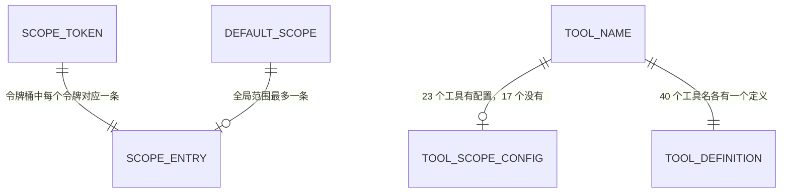
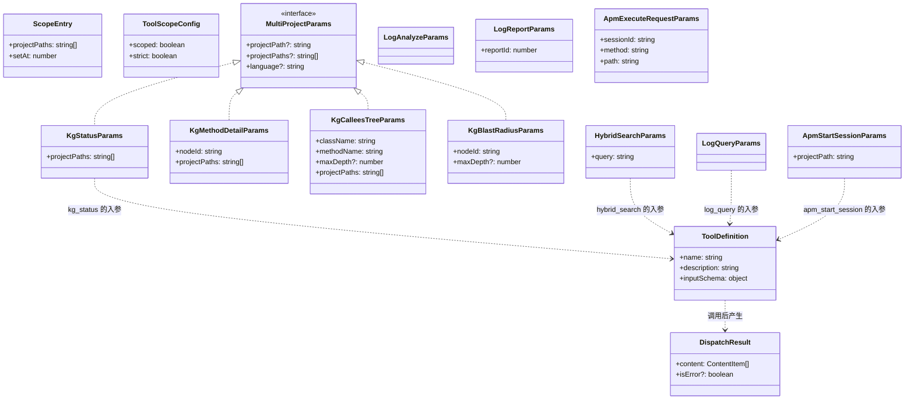

# 数据模型

> 自动生成于 2026-11-26，基于 `99d0037` 版本

本服务不持久化任何业务数据，业务数据结构都由后端定义。本文汇总代码里真实存在的类型：工具定义的结构、各工具的入参接口、项目范围的内存结构、通信层类型、常量与枚举。

---

## 1. 模型概览

### 1.1 核心实体

| 实体 | 说明 | 存储位置 | 所属模块 |
|------|------|---------|---------|
| 工具定义 | `name` + `description` + `inputSchema`，共 40 个 | 模块级常量 | 各工具文件、`src/index.ts` |
| 工具名单 | `KG_TOOLS`、`VECTOR_TOOLS`、`LOG_TOOLS`、`APM_TOOLS`、`ACT_TOOLS` | 模块级常量 | 各工具文件 |
| 项目范围记录 `ScopeEntry` | 项目路径数组 + 写入时刻 | 内存 | [项目范围管理](../03-模块说明/项目范围管理.md) |
| 工具范围配置 `ToolScopeConfig` | `scoped` / `strict` 两个开关 | 模块级常量 | [项目范围管理](../03-模块说明/项目范围管理.md) |
| 分发结果 `DispatchResult` | `content` + 可选 `isError` | 每次调用产生 | [MCP服务入口](../03-模块说明/MCP服务入口.md) |
| 请求选项 `RequestOptions` | 单次请求的超时与请求头 | 每次请求产生 | [API客户端](../03-模块说明/API客户端.md) |

### 1.2 数据存储分布

| 存储类型 | 内容 | 生命周期 |
|---------|------|---------|
| 模块级常量 | 工具定义、名单、范围注册表、各处硬编码常量 | 进程存活期，只读 |
| 模块级变量 | ApiClient 单例、各工具类实例、全局范围、令牌范围表、清理定时器 | 进程存活期 |
| 进程环境变量 | `HISI_API_URL`、`HISI_HTTP_PORT`、`HISI_DEBUG`、`HISI_SCOPE_TOKEN` | 进程存活期，只读 |
| 函数调用栈 | 入参对象、请求体、响应对象 | 单次调用 |

没有数据库、文件或浏览器存储。

---

## 2. 关系图

### 2.1 内存中的实体关系



### 2.2 类型关系



> `ToolDefinition` 与 `ContentItem` 在代码里没有命名的类型，是对象字面量推断出来的结构；`ToolDefinition` 这个名字只是本文的叫法。

---

## 3. 核心类型定义

### 3.1 工具定义

代码中没有为它声明类型，每个工具写成对象字面量：

```ts
{
  name: 'kg_status',                 // string
  description: '…',                  // string
  inputSchema: {
    type: 'object',                  // 字面量类型 'object'
    properties: { /* JSON Schema 属性 */ },
    required: ['projectPaths'],      // string[]；kg_list_projects 为 []
  },
}
```

- **用途**：`tools/list` 原样返回这三项；`tools/call` 按 `name` 路由。
- **使用位置**：5 个 `*ToolDefinitions` 数组（39 个）与 `SCOPE_TOOL_DEF`（1 个），在 `tools/index.ts` 聚合为 `allToolDefinitions`，在 `index.ts` 追加后得到 `allDefsWithScope`。
- **校验规则**：本服务不据此校验入参。

### 3.2 分发结果 `DispatchResult`

```ts
interface DispatchResult {
  content: Array<{ type: string; text: string }>;
  isError?: boolean;
}
```

- **用途**：两种传输共用的返回结构。stdio 模式把它拆成 `{ content, isError? }` 交给 SDK；HTTP 模式把它直接放进 JSON-RPC 的 `result`。
- **使用位置**：`dispatchToolCall()`、`noScopeResponse()`。

### 3.3 项目范围相关（`scopeManager.ts`，未导出）

```ts
interface ScopeEntry {
  projectPaths: string[];
  setAt: number;
}

interface ToolScopeConfig {
  scoped: boolean;   // 有范围时是否自动注入
  strict: boolean;   // 没有范围时是否拒绝
}
```

- **使用位置**：`scopes: Map<string, ScopeEntry>`、`defaultScope: ScopeEntry | null`、`TOOL_SCOPE_REGISTRY: Record<string, ToolScopeConfig>`。

### 3.4 通信层类型（`apiClient.ts`）

```ts
export interface ApiResponse<T> {
  success: boolean;
  data?: T;
  error?: string;
  message?: string;
}

export interface RequestOptions {
  timeout?: number;
  headers?: Record<string, string>;
}
```

- **用途**：`RequestOptions` 是各请求方法的第三个参数（动作工具用它传 `Authorization` 头）。
- **注意**：`ApiResponse<T>` 没有任何调用方，且与后端实际的通用响应（`code` / `message` / `data`）字段不一致，不要用它去读后端响应。

### 3.5 知识图谱入参类型（`knowledgeGraphTools.ts`）

```ts
interface MultiProjectParams {            // 未导出
  projectPath?: string;
  projectPaths?: string[];
  language?: string;
}

export interface KgStatusParams          extends MultiProjectParams { projectPaths: string[]; }
export interface KgMethodDetailParams    extends MultiProjectParams { nodeId: string; projectPaths: string[]; }
export interface KgMethodByClassParams   extends MultiProjectParams { className: string; projectPaths: string[]; }
export interface KgEntryPointsParams     extends MultiProjectParams {
  projectPaths: string[];
  entryType?: 'CONTROLLER' | 'SCHEDULED' | 'MQ_LISTENER' | 'FEIGN_CLIENT' | 'ALL';
}
export interface KgDownstreamParams      extends MultiProjectParams { nodeId: string; projectPaths: string[]; maxDepth?: number; }
export interface KgAffectingParams       extends MultiProjectParams { className: string; methodName: string; projectPaths: string[]; }
export interface KgBridgesParams         extends MultiProjectParams { nodeId: string; projectPaths: string[]; }
export interface KgBridgeStatsParams     extends MultiProjectParams { projectPaths: string[]; }
export interface KgImplementationsParams extends MultiProjectParams { interfaceName: string; projectPaths: string[]; }
export interface KgMybatisSqlParams      extends MultiProjectParams {
  projectPaths: string[];
  mapperInterface?: string;
  statementType?: 'SELECT' | 'INSERT' | 'UPDATE' | 'DELETE';
}
export interface KgFeignChainParams      extends MultiProjectParams { serviceName: string; projectPaths: string[]; }
export interface KgMqChainParams         extends MultiProjectParams { topic: string; projectPaths: string[]; }
export interface KgRootEntriesParams     extends MultiProjectParams { className: string; methodName: string; projectPaths: string[]; }
export interface KgCalleesTreeParams     extends MultiProjectParams { className: string; methodName: string; projectPaths: string[]; maxDepth?: number; }
// 以下 6 个为聚合类参数
export interface KgDashboardParams       extends MultiProjectParams { language?: string; }
export interface KgDsmParams             extends MultiProjectParams { language?: string; level?: string; }
export interface KgHotspotsParams        extends MultiProjectParams { language?: string; limit?: number; }
export interface KgDomainsParams         extends MultiProjectParams { language?: string; }
export interface KgServiceTopologyParams extends MultiProjectParams { language?: string; }
export interface KgBlastRadiusParams     extends MultiProjectParams { nodeId: string; maxDepth?: number; }
```

`kg_list_projects` 没有入参类型；`kg_api_consumers` 与 `kg_backend_deps` 的参数写在方法签名里（`{ entryId: string }`、`{ apiClientId: string }`），没有导出类型。

### 3.6 混合检索入参类型（`vectorTools.ts`）

```ts
export interface HybridSearchParams {
  query: string;
  projectPath?: string;
  projectPaths?: string[];
  limit?: number;
  graphDepth?: number;
  language?: 'java' | 'python';
}
```

### 3.7 日志入参类型（`logTools.ts`）

```ts
export interface LogQueryParams {
  keyword?: string;
  logLevel?: 'ERROR' | 'WARN' | 'INFO' | 'DEBUG';
  appId?: string;
  traceId?: string;
  contentContains?: string;
  dslQuery?: string;
  startTime?: string;
  endTime?: string;
  size?: number;
  errorOnly?: boolean;
  sortOrder?: 'asc' | 'desc';
}

export interface LogAnalyzeParams {
  message?: string;
  stackTrace?: string;
  serviceName?: string;
  traceId?: string;
  errorType?: string;
}

export interface LogReportParams {
  reportId: number;
}
```

### 3.8 APM 入参类型（`apmTools.ts`）

```ts
export interface ApmStartSessionParams { projectPath: string; targetPort?: number; serviceName?: string; }
export interface ApmExecuteRequestParams {
  sessionId: string;
  method: string;
  path: string;
  body?: string;
  headers?: Record<string, string>;
}
export interface ApmListTracesParams { sessionId: string; }
export interface ApmGetTraceParams { traceId: string; }
export interface ApmGetReportParams { sessionId: string; }
export interface ApmStopSessionParams { sessionId: string; }
```

### 3.9 动作工具与范围工具

`actionTools.ts` 没有声明任何入参类型，处理函数里用 `String(args.xxx ?? '')` 取值。`kg_select_scope` 的入参同样没有类型，只有 `inputSchema`。

---

## 4. 数据字典

### 4.1 工具入参公共片段（知识图谱）

| 字段 | 类型 | 必填 | 默认值 | 约束 | 说明 |
|------|------|------|--------|------|------|
| `projectPaths` | `string[]` | 是 | — | 20 个工具必填 | 项目路径列表；以逗号拼接后发给后端 |
| `projectPath` | `string` | 否 | — | — | 兼容字段；不发给后端，只用于回填 `projectPaths` |
| `language` | `string` | 否 | — | 枚举 `java` / `python` / `typescript`（6 个聚合工具无枚举） | 语言过滤；只有 5 个后端接口消费 |

### 4.2 `kg_select_scope` 的 `list` 返回

| 字段 | 类型 | 说明 |
|------|------|------|
| `summary` | 对象 | 六个计数：`totalIndexed`、`totalRemoteConfigs`、`pureLocal`、`indexedRemote`、`clonedNotIndexed`、`notCloned` |
| `truncated` | `boolean` | 已建图项目是否超过 20 个 |
| `sampleCount` | `number` | 固定为 20 |
| `searchableProjects` | 数组 | `{ path, stats, source }`，`source` 为 `local` 或 `remote-indexed` |
| `remoteProjects` | 对象 | `indexed`、`clonedNotIndexed`、`notCloned` 三个数组 |
| `currentScope` | `string[]` 或 `null` | 当前范围 |
| `instruction` | `string` | 给 AI 的下一步提示 |

---

## 5. 模块级状态

| 变量 | 类型 | 初始值 | 变更时机 | 说明 |
|------|------|--------|---------|------|
| `defaultClient` | `ApiClient \| null` | `null` | 首次 `getApiClient()` | 之后传 `baseUrl` 会改写其地址 |
| `defaultScope` | `ScopeEntry \| null` | `null` | `setScope(null, …)`、`clearScope()` | 全局范围 |
| `scopes` | `Map<string, ScopeEntry>` | 空 | `setScope(令牌, …)`、`clearScope(令牌)`、过期清理 | 令牌范围表 |
| `cleanupTimer` | 定时器或 `null` | `null` | 首次写入令牌范围 | 每 5 分钟运行，`unref()` |
| `_kgTools` / `_vecTools` / `_logTools` / `_apmTools` | 各工具类或 `null` | `null` | 首次调用对应工具 | 惰性单例 |

---

## 6. 枚举与常量

### 6.1 入参枚举

| 参数 | 所在工具 | 取值 |
|------|---------|------|
| `action` | `kg_select_scope` | `list`、`set`、`get`、`clear` |
| `entryType` | `kg_entry_points` | `CONTROLLER`、`SCHEDULED`、`MQ_LISTENER`、`FEIGN_CLIENT`、`ALL` |
| `statementType` | `kg_mybatis_sql` | `SELECT`、`INSERT`、`UPDATE`、`DELETE` |
| `language` | 知识图谱 17 个工具 | `java`、`python`、`typescript` |
| `language` | `hybrid_search` | `java`、`python` |
| `logLevel` | `log_query` | `ERROR`、`WARN`、`INFO`、`DEBUG` |
| `sortOrder` | `log_query` | `asc`、`desc` |
| `method` | `apm_execute_request` | `GET`、`POST`、`PUT`、`DELETE`、`PATCH` |
| `action` | `act_confirm_node` | `approve`、`reject` |

### 6.2 常量

| 常量 | 值 | 位置 |
|------|----|------|
| `SERVER_NAME` | `'hisi-mcp-server'` | `index.ts` |
| `SERVER_VERSION` | `'2.2.0'` | `index.ts` |
| `API_BASE_URL` 默认值 | `'http://localhost:8080'` | `index.ts`、`apiClient.ts` |
| `MAX_BODY_BYTES` | `5 * 1024 * 1024` | `index.ts` |
| `MAX_STATS` | `20` | `index.ts` |
| HTTP 模式 `protocolVersion` | `'2025-03-26'` | `index.ts` |
| `SCOPE_TTL_MS` | `30 * 60 * 1000` | `scopeManager.ts` |
| `CLEANUP_INTERVAL_MS` | `5 * 60 * 1000` | `scopeManager.ts` |
| `ApiClient` 构造默认地址 | `'http://localhost:8080'` | `apiClient.ts` |
| `ApiClient.defaultTimeout` | `30000` | `apiClient.ts` |
| `relay.mjs` 默认目标 | `'http://localhost:3100/mcp'` | `relay.mjs` |

### 6.3 JSON-RPC 错误码（HTTP 模式与中继脚本）

| 码 | 出现场景 |
|----|---------|
| `-32700` | 请求体不是 JSON |
| `-32601` | 未知工具名、未知方法 |
| `-32603` | 处理过程异常；中继脚本转发失败 |
| `-32600` | 非 POST、内容类型不符、请求体过大（写在 405 / 415 / 413 的响应体里） |

---

## 7. 数据生命周期

| 数据 | 创建 | 更新 | 删除 / 过期 |
|------|------|------|------------|
| 工具定义、名单、注册表 | 模块加载时 | 不更新 | 进程退出 |
| 全局范围 | `set` 动作 | 再次 `set` | `clear` 动作或进程退出 |
| 令牌范围 | 带 `x-scope-token` 的 `set` | 再次 `set` | `clear`、读取时发现超过 30 分钟、定时器清理 |
| 工具入参与结果 | 每次 `tools/call` | — | 调用结束即不可达 |
| `dist/` 编译产物 | `npm run build` 或后端自动构建 | 源码更新后重新构建 | 不自动清理 |

---

## 8. 数据安全分类

| 数据 | 敏感级别 | 存储方式 | 传输 | 脱敏规则 |
|------|---------|---------|------|---------|
| `HISI_SCOPE_TOKEN` | 高 | 仅进程环境变量，不落盘 | `Authorization: Bearer` 头 | 代码中的日志语句都不输出它 |
| 项目范围 | 低 | 内存 | 不传输 | — |
| 工具入参（需求原文、日志内容等） | 中 | 不存储 | 透传给后端 | 不写入日志 |
| `HISI_API_URL` | 视部署而定 | 进程环境变量 | — | HTTP 模式的 `/health` 会把它放在 `apiBackend` 字段里返回 |

---

> **延伸阅读**：
> - 入参的完整语义与 `description` → [05-接口文档](../05-接口文档/index.md)
> - 类型的使用方 → [工具路由聚合](../03-模块说明/工具路由聚合.md)、[项目范围管理](../03-模块说明/项目范围管理.md)
> - 数据的流转路径 → [04-数据流程](../04-数据流程/index.md)
