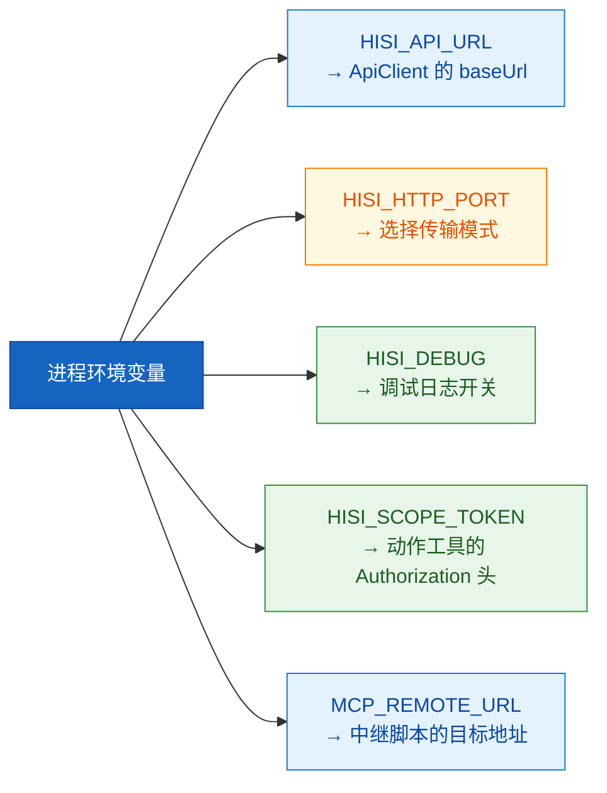
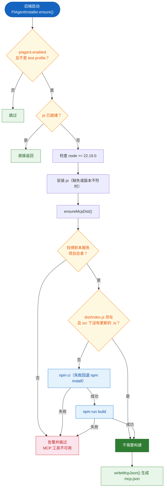
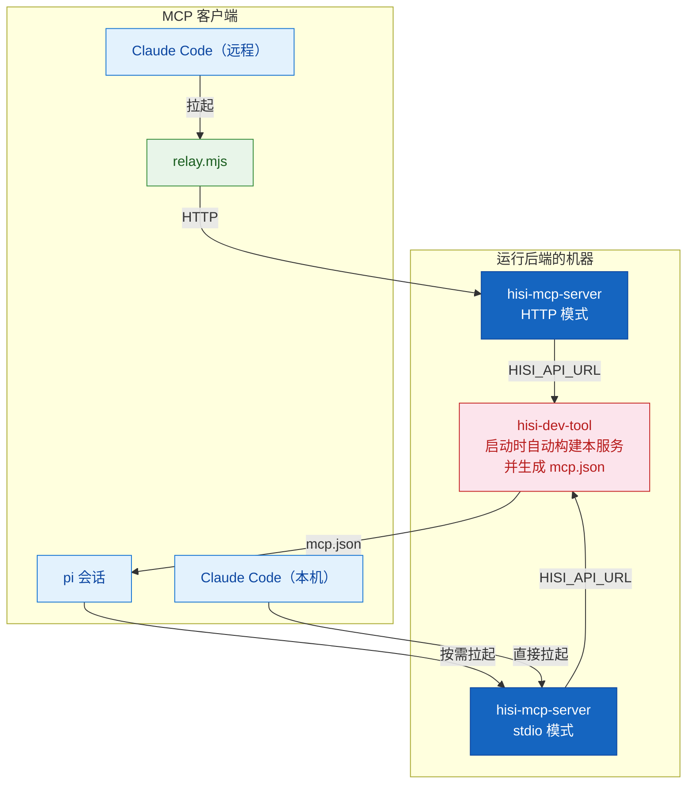

# 部署运维

> 自动生成于 2026-11-26，基于 `99d0037` 版本

---

## 1. 环境要求

### 1.1 运行时依赖

| 依赖 | 版本要求 | 用途 | 验证命令 |
|------|---------|------|---------|
| Node.js | 本服务 `engines.node` `>=18.0.0`；由后端自动构建时实际要求 `>=22.19.0`（pi 的 `engines` 约束） | 运行本服务；构建 | `node --version` |
| npm | 未在代码中声明具体版本 | 安装依赖、执行构建 | `npm --version` |
| `hisi-dev-tool` 后端 | 与本分支配套的版本 | 全部工具的数据来源 | `curl http://localhost:<端口>/api/ops/health` |
| Claude Code CLI（可选） | 未在代码中声明 | 后端安装向导用它注册 MCP | `claude --version` |

> 两个 Node 版本要求不矛盾但要注意顺序：后端启动流程先检查 `node >= 22.19.0`，通过后才检查并构建本服务。机器上的 Node 在 18 与 22.19 之间时，本服务可以手工构建运行，但后端不会代为构建。

### 1.2 运行方式

本服务没有长驻进程：默认由 MCP 客户端按需拉起，客户端会话结束进程随之退出。只有 HTTP 模式是手工启动的常驻服务。

---

## 2. 环境变量

本服务不读取 `.env` 文件，变量只来自进程环境。

| 变量 | 必填 | 默认值 | 读取位置 | 说明 |
|------|------|--------|---------|------|
| `HISI_API_URL` | 否 | `http://localhost:8080` | `src/index.ts` | 回调后端的基础地址 |
| `HISI_HTTP_PORT` | 否 | 无（即 stdio 模式） | `src/index.ts` | 有值则以 HTTP JSON-RPC 模式启动，监听 `0.0.0.0:<端口>` |
| `HISI_DEBUG` | 否 | 关闭 | `src/index.ts` | 值恰为字符串 `true` 时开启 stderr 调试日志 |
| `HISI_SCOPE_TOKEN` | 动作工具需要 | 无 | `src/tools/actionTools.ts` | 用户 JWT；缺失时 5 个 `act_*` 工具全部拒绝 |
| `MCP_REMOTE_URL` | 否 | `http://localhost:3100/mcp` | `relay.mjs` | 中继脚本转发的目标地址 |

| 变量 | 说明 |
|------|------|
| `HISI_PROJECT_DIR` | 后端安装向导注册 Claude Code 时会传入，但本服务代码**不读取**它 |



---

## 3. 构建与启动

### 3.1 手工构建

```bash
cd hisi-mcp-server
npm ci              # 有 package-lock.json；也可以用 npm install
npm run build       # tsc，输出 dist/
```

| 项 | 说明 |
|----|------|
| 输入 | `src/**/*.ts`（`tsconfig.json` 的 `include` 为 `src/**/*`） |
| 输出 | `dist/**/*.js`、`*.d.ts`、`*.js.map`、`*.d.ts.map` |
| 入口 | `dist/index.js`（`package.json` 的 `main`） |
| 模块格式 | ESM（`"type": "module"`） |
| 版本控制 | `dist/` 与 `node_modules/` 已 gitignore |

### 3.2 被后端自动构建（默认方式）

后端启动时由 `PiAgentInstaller` 就地构建本服务。相关注释：

> 远端拉取分支后不再需要手工 npm install / tsc：dist 缺失或源码比 dist 新时，后端启动就地构建 hisi-mcp-server（pi 每次会话按 mcp.json 直接拉起 dist，无长驻 MCP 进程）。



| 条件 | 结果 |
|------|------|
| `piagent.enabled` 为 false，或激活了 `test` profile | 不构建 |
| pi 已就绪（之前安装成功过） | 整个流程直接返回，不再检查本服务 |
| 找不到 `node` 或版本低于 22.19.0 | 抛错，本次初始化失败；**不阻断后端启动**，下次有流要用 pi 时自动重试 |
| 找不到本服务项目目录 | 告警并跳过，不生成 `mcp.json` |
| `dist/index.js` 存在，且 `src/` 下没有比它新的 `.ts` 文件 | 不构建 |
| 其它情况 | 在项目目录执行 `npm ci --no-audit --no-fund --loglevel error --registry <源>`；失败则回退 `npm install`（同样参数）；再执行 `npm run build` |
| 任一命令超过 10 分钟 | 强制结束并视为失败 |
| 构建失败，但旧的 `dist/index.js` 还在 | 告警「MCP 工具不可用」；不过 `writeMcpJson()` 只判断该文件是否存在，`mcp.json` 仍会生成并指向旧产物 |

**项目目录的查找顺序**（`resolveMcpProject()`）：先看后端配置 `piagent.mcp-dist-path`（配置了就只认它，路径必须存在）；没配置则相对后端工作目录依次探测 `../hisi-mcp-server`、`hisi-mcp-server`，以及一个按仓库名拼接的相对路径，以 `package.json` 是否存在为准。

> 注意：配置项名字和它的注释写的是「dist 入口」，但代码把这个值当作**项目目录**来用（再去拼 `dist/index.js`）。

**相关的后端配置项**（前缀 `piagent`）：`enabled`、`install-dir`（默认 `lib/pi`）、`agent-dir`（默认 `lib/pi-agent`）、`mcp-dist-path`（默认空）、`registry`（npm 源）。

### 3.3 `mcp.json`

后端在 `<agent-dir>/mcp.json` 写入的连接配置：

```json
{
  "mcpServers": {
    "hisi-mcp-server": {
      "command": "node",
      "args": ["<本服务项目目录>/dist/index.js"]
    }
  }
}
```

| 项 | 说明 |
|----|------|
| 无 `env` | **故意不写**：pi 会把自身进程环境原样传给 stdio MCP 子进程（实测），所以变量由 pi 进程提供，而不是在 `mcp.json` 里引用 |
| `HISI_API_URL` | 由后端 `PiFlowClient` 每次启动 pi 时按自己的 `server.port` 放入环境（取不到时按 8080）；相关注释：「端口跟着 server.port 走，换端口启动时工具不会打到别的实例上」 |
| `HISI_SCOPE_TOKEN` | 只有带用户令牌的流（RAM 对话助手 `ram-act`）启动 pi 时才放进环境；只读流的 MCP 进程里没有它，动作工具一律拒绝 |
| 为什么不能写 `${HISI_SCOPE_TOKEN}` 引用 | pi 把空值也当未设置、且不支持默认值写法：只读流不带令牌时引用解析失败，**整个 MCP 服务连接失败**，所有只读 ReAct 流都拿不到工具（2026-11-26 真机故障，已修复） |
| 找不到 `dist/index.js` 时 | 不生成 `mcp.json`，日志告警「MCP 工具不可用」 |

### 3.4 启动

| 模式 | 命令 | 说明 |
|------|------|------|
| stdio（默认） | `node dist/index.js` | 在 stdin 上等待 JSON-RPC；通常由 MCP 客户端拉起 |
| HTTP JSON-RPC | `HISI_HTTP_PORT=3100 node dist/index.js` | 常驻；端口由变量决定，3100 只是中继脚本默认目标里用的值 |

---

## 4. 部署架构



| 接入方式 | 需要准备 | 令牌 |
|---------|---------|------|
| pi 会话（后端内部） | 无需手工操作；后端启动时自动构建并生成 `mcp.json` | 动作流由后端注入，只读流不注入 |
| 外部客户端 stdio | 先构建出 `dist/index.js`，在客户端配置里注册 | 取决于客户端配置 |
| 远程：中继脚本 | 服务端以 HTTP 模式启动；客户端注册 `relay.mjs` 并设置 `MCP_REMOTE_URL` | 取决于服务端进程环境 |
| 远程：直连 HTTP | 服务端以 HTTP 模式启动；客户端直接 POST JSON-RPC | 同上 |

### pi 会话如何使用本服务

后端 `FlowToolManifest` 为每类流限定可用的工具（注释：「pi 的工具白名单只在启动时生效，会话内不可改，因此清单即权限边界」）。在 pi 里工具名带前缀 `mcp__hisi_mcp_server__`。

| 流 | 可用的本服务工具 |
|----|-----------------|
| `arch-react` | `kg_select_scope`、`kg_list_projects`、`kg_status`、`kg_method_detail`、`kg_method_by_class`、`kg_root_entries`、`kg_callees_tree`、`kg_entry_points`、`kg_downstream`、`kg_affecting`、`kg_bridges`、`kg_implementations`、`kg_dashboard`、`kg_dsm`、`kg_hotspots`、`kg_domains`、`kg_service_topology`、`kg_blast_radius`、`kg_api_consumers`、`kg_backend_deps`、`hybrid_search` |
| `log-analysis` | `hybrid_search`、`kg_method_detail`、`kg_method_by_class`、`kg_root_entries`、`kg_callees_tree`、`kg_entry_points`、`kg_downstream`、`kg_affecting`、`kg_bridges`、`kg_mybatis_sql`、`log_query`、`log_report`、`log_report_status` |
| `ram`、`workbench-read`、`workbench-dev` | `hybrid_search`、`kg_method_detail`、`kg_method_by_class`、`kg_callees_tree`、`kg_root_entries`、`kg_entry_points`、`kg_bridges`、`kg_mybatis_sql` |
| `ram-act` | 上一行的 8 个，再加 5 个 `act_*` |
| `chat-read` | `hybrid_search`、`kg_method_detail`、`kg_method_by_class`、`kg_root_entries`、`kg_callees_tree`、`kg_entry_points`、`kg_bridges`、`kg_dashboard`、`kg_hotspots`、`kg_domains`、`kg_service_topology`、`kg_blast_radius`、`kg_api_consumers`、`log_query`、`log_report`、`log_report_status`、`apm_list_traces`、`apm_get_trace`、`apm_get_report` |
| `one-shot` 及未知流 | 不使用 MCP |

> `chat-read` 清单里的 APM 工具是本服务 6 个 `apm_*` 工具中的 3 个查询类；`apm_start_session`、`apm_execute_request`、`apm_stop_session` 会动被测应用，不属于只读清单。后端有守卫测试（`FlowToolManifestTest`）保证每张清单里的 MCP 工具名都真实存在于本服务。

因为每个会话各有一个 MCP 进程，项目范围只在那个进程的内存里，不跨会话共享。

---

## 5. 给外部客户端注册

### 5.1 手工注册

```json
{
  "mcpServers": {
    "hisi-mcp-server": {
      "command": "node",
      "args": ["<本服务项目目录>/dist/index.js"],
      "env": {
        "HISI_API_URL": "http://localhost:8080"
      }
    }
  }
}
```

需要动作工具时在 `env` 里加 `HISI_SCOPE_TOKEN`。`package.json` 没有声明 `bin` 字段，不能全局安装成命令。

### 5.2 后端安装向导

后端 `McpController`（`@RequestMapping("/api/mcp")`）提供：

| 接口 | 说明 |
|------|------|
| `POST /api/mcp/install` | 在线安装，以 SSE 流式输出进度；请求体 `{ "mcpDir": "<本服务目录>", "projectDir": "<目标项目目录>" }`，两项都可选 |
| `GET /api/mcp/status?mcpDir=` | 检查安装状态：是否有 `package.json` / `node_modules` / `dist/index.js`、Claude Code 是否安装、MCP 是否已配置 |
| `GET /api/mcp/download` | 打包下载 `package.json`、`tsconfig.json`、`src/`、`dist/`、`skills/` 及安装脚本 |
| `GET /api/mcp/config-template` | 返回一份配置模板（路径是占位值） |
| `GET /api/mcp/install-script` | 返回 Windows 与 Unix 安装脚本内容 |

`POST /api/mcp/install` 的步骤（5 分钟超时，事件名为 `info` / `step` / `success` / `warning` / `error` / `log` / `done`）：

| 步骤 | 动作 |
|------|------|
| 0/5 卸载旧版本 | Claude Code：执行 `claude mcp remove hisi-dev-tool`；Claude Desktop：若配置文件内容包含 `hisi-dev-tool`，**删除整个配置文件** |
| 1/5 检查环境 | 执行 `node -v` |
| 2/5 安装依赖 | 在本服务目录执行 `npm install`（源地址写死在命令里） |
| 3/5 构建 | 执行 `npm run build` |
| 4/5 安装 Skills | 把本服务 `skills/` 目录复制到用户主目录下的 `.claude/skills`（覆盖同名文件） |
| 5/5 配置 Claude | 有 Claude Code CLI：在目标项目目录执行 `claude mcp add hisi-dev-tool -e HISI_API_URL=http://localhost:8080 -e HISI_PROJECT_DIR=<目标项目目录> -- node <dist/index.js>`；否则写 Claude Desktop 配置文件 |

使用向导时要知道的几点（均来自后端代码）：

| 事实 | 影响 |
|------|------|
| 没传 `mcpDir` 时，自动探测只找名为 `hisi-dev-tool-mcp` 的目录，或后端配置 `mcp.project.path` | 在本仓库里目录名是 `hisi-mcp-server`，需要显式传 `mcpDir` 或配置 `mcp.project.path` |
| 注册的服务名是 `hisi-dev-tool`，后端地址写死 `http://localhost:8080` | 与 `mcp.json` 里的名字（`hisi-mcp-server`）和端口来源不同 |
| 不传 `HISI_SCOPE_TOKEN` | 经向导注册的客户端里，5 个动作工具一律被拒绝 |
| 用 `npm install` 而不是 `npm ci` | 依赖版本可能偏离 lock 文件 |
| `GET /api/mcp/info` 返回的是写在后端代码里的一份固定清单（版本 2.0.0、34 个工具，含 `kg_generate`、`vector_sync` 等本服务没有的名字） | **不能**用它核对工具列表，以 [05-接口文档](../05-接口文档/index.md) 为准 |

### 5.3 远程接入

```json
{
  "mcpServers": {
    "hisi-mcp-server": {
      "command": "node",
      "args": ["<本服务项目目录>/relay.mjs"],
      "env": {
        "MCP_REMOTE_URL": "http://<服务端主机>:3100/mcp"
      }
    }
  }
}
```

只支持 stdio 的客户端经中继接入；能直接发 HTTP 的客户端可以跳过中继。HTTP 模式没有鉴权，部署时应限制端口可达范围，并且不要给该进程注入 `HISI_SCOPE_TOKEN`（见 [02-架构设计](../02-架构设计/index.md) 5.3 节）。

---

## 6. 运维操作

### 6.1 健康检查

| 检查项 | 方式 | 预期 |
|--------|------|------|
| 本服务（HTTP 模式） | `GET http://localhost:<HISI_HTTP_PORT>/health` | `status` 为 `ok`，`tools` 为 40，`apiBackend` 指向预期后端 |
| 本服务（stdio 模式） | 没有健康检查端点；在客户端里看 `tools/list` 是否返回 40 项 | 40 项 |
| 后端 | `GET http://localhost:<端口>/api/ops/health` | 由后端定义 |
| `ApiClient.healthCheck()` | 请求 `GET /api/health`，后端没有这个路径，本服务也没有调用它 | 对当前后端会返回 `false` |

### 6.2 日志

| 渠道 | 内容 |
|------|------|
| stdout（stdio 模式） | 只有 JSON-RPC 报文 |
| stderr | 调试日志（`HISI_DEBUG=true`）、HTTP 模式启动信息、HTTP 请求异常、进程级异常 |
| 中继脚本 stderr | 启动时输出转发目标；失败时输出 `[hisi-relay] error: ...` |
| 后端日志 | 自动构建的开始、失败、耗时等信息，以 `[PiAgent]` 开头 |

本服务不写日志文件；日志落在拉起它的客户端或终端里。

### 6.3 优雅关闭

| 信号 / 事件 | 行为 |
|------------|------|
| `SIGINT` / `SIGTERM` | `process.exit(0)` |
| `uncaughtException` | stderr 输出后 `exit(1)` |
| `unhandledRejection` | stderr 输出后 `exit(1)` |
| 启动失败 | stderr 输出 `Start failed:` 后 `exit(1)` |

没有需要清理的外部资源；内存里的项目范围随进程消失。

### 6.4 升级与版本兼容

| 维度 | 当前 | 注意 |
|------|------|------|
| MCP SDK | 声明 `^1.0.0`，锁定 1.29.0 | 升级后确认 `Server`、`StdioServerTransport`、两个 `*RequestSchema` 的导入路径与行为 |
| Node | `>=18.0.0` | 后端自动构建要求 `>=22.19.0` |
| 后端接口 | 40 个回调路径写死在各工具文件里 | 后端接口变动后要同步修改并重新构建 |
| 版本号 | `package.json` 为 `1.0.0`，`SERVER_VERSION` 为 `2.2.0` | 以哪个为准未在代码中说明 |

---

## 7. 常见问题

| 现象 | 可能原因 | 处理 |
|------|---------|------|
| 客户端拿不到工具列表 | `dist/index.js` 不存在或路径配置错误 | 先 `npm run build`；核对 `command` / `args` |
| 后端日志出现「未找到 hisi-mcp-server 项目目录」 | 自动探测找不到目录 | 配置 `piagent.mcp-dist-path`（填项目目录） |
| 后端日志出现「依赖安装失败」或「构建失败」 | 网络或 `tsc` 报错；或 Node 版本低于 22.19.0 | 查看 `[PiAgent]` 日志；手工 `npm ci && npm run build` 验证 |
| 改了源码，pi 会话仍在用旧逻辑 | `dist/` 没有重新构建 | 重启后端（会触发自动构建）或手工构建 |
| 工具返回 `SCOPE_NOT_SET` | 严格工具未设范围 | 先 `kg_select_scope(action="set")`，或在入参里显式给路径 |
| 动作工具返回「缺少用户令牌」 | 进程环境没有 `HISI_SCOPE_TOKEN` | 由拉起方注入；经安装向导注册的客户端默认没有 |
| 工具返回 `HTTP 404` | `HISI_API_URL` 指向的后端没有该接口，或后端版本不匹配 | 核对后端版本与 `HISI_API_URL` |
| 工具返回 `Request timeout after 30000ms` | 后端未启动或响应过慢 | 检查后端健康 |
| 知识图谱工具返回 `HTTP 400` | 宽松工具未带 `projectPaths` | 同 `SCOPE_NOT_SET` 的处理 |
| 远程接入全部失败 | 服务端未以 HTTP 模式启动，或 `MCP_REMOTE_URL` 不对 | 检查 `HISI_HTTP_PORT` 与中继配置 |
| 中继回 `-32603` | 目标不可达，或响应不是 JSON | 查看中继的 stderr |

---

> **延伸阅读**：
> - 架构与安全风险 → [02-架构设计](../02-架构设计/index.md)
> - 入口实现 → [MCP服务入口](../03-模块说明/MCP服务入口.md)
> - 中继脚本 → [stdio中继](../03-模块说明/stdio中继.md)
> - 令牌传递与自动构建的决策依据 → [08-技术决策](../08-技术决策/index.md)
