# 技术决策记录

> 自动生成于 2026-11-26，基于 `99d0037` 版本

本文只收录**能在代码注释或提交记录里找到依据**的决策，每条都注明依据出处。代码里看不出原因的做法（例如选型理由）不推测，列在最后一节的「代码事实型约定」里。

---

## 1. 决策概览

| ADR | 标题 | 状态 | 引入（提交） | 影响范围 |
|-----|------|------|-------------|---------|
| ADR-001 | 默认使用 stdio 传输 | 已采纳 | `1fdfd6b`（2026-05-08） | `src/index.ts` |
| ADR-002 | 增加 HTTP JSON-RPC 通道，不做鉴权、不设 CORS | 已采纳 | `99783e4`（2026-08-12） | `src/index.ts` |
| ADR-003 | 用独立的 stdio 中继脚本接入远程服务 | 已采纳 | `d35594c`（2026-08-12） | `relay.mjs` |
| ADR-004 | 强制的项目范围协议 | 已采纳 | `99783e4`（2026-08-12） | `src/index.ts`、`scopeManager.ts` |
| ADR-005 | 项目范围存内存：stdio 全局，HTTP 按令牌分桶并带有效期 | 已采纳 | `99783e4`（2026-08-12） | `scopeManager.ts` |
| ADR-006 | 范围要求分严格与宽松两级 | 已采纳 | `99783e4`（2026-08-12） | `scopeManager.ts` |
| ADR-007 | 只读工具与动作工具分离 | 已采纳 | `e718a5a`（2026-11-26） | `tools/actionTools.ts` |
| ADR-008 | 动作工具没有用户令牌就拒绝 | 已采纳 | `e718a5a`（2026-11-26） | `tools/actionTools.ts` |
| ADR-009 | 用户令牌经环境变量传递，不落盘 | 已采纳 | `e718a5a`（2026-11-26） | `actionTools.ts` 与后端 `PiFlowClient` |
| ADR-010 | 路径归一化按键名匹配、只做浅拷贝、只在分发入口做一次 | 已采纳 | `a4a4925`、`52f73c7`（2026-05-09） | `utils/pathUtils.ts`、`tools/index.ts` |
| ADR-011 | `hybrid_search` 0 结果时附带可用项目 | 已采纳 | 引入提交未在代码中确认 | `tools/vectorTools.ts` |
| ADR-012 | 知识图谱工具对齐后端 v2 接口，`projectPaths` 必填 | 已采纳 | `b817859`（2026-05-30）、`9b8b119`（2026-05-31） | `knowledgeGraphTools.ts` |
| ADR-013 | `hybrid_search` 切到 v2 多路召回接口并移除 `threshold` | 已采纳 | `0dac484`、`b16a9bd`（2026-08-20） | `tools/vectorTools.ts` |
| ADR-014 | 本服务随后端启动自动构建 | 已采纳 | `e718a5a`（2026-11-26） | 后端 `PiAgentInstaller` |
| ADR-015 | 工具描述面向 AI 理解来写 | 已采纳 | `623cb65`（2026-08-12） | 各工具定义 |
| ADR-016 | `mcp.json` 的后端地址跟随 `server.port` | 已采纳 | `99d0037`（2026-11-26） | 后端 `PiAgentInstaller` |

### 决策关系图

```mermaid
flowchart TD
    T1["ADR-001 stdio 为默认传输"]
    T2["ADR-002 HTTP JSON-RPC 通道"]
    T3["ADR-003 stdio 中继脚本"]
    S1["ADR-004 强制的范围协议"]
    S2["ADR-005 范围存内存"]
    S3["ADR-006 严格与宽松两级"]
    A1["ADR-007 只读与动作分离"]
    A2["ADR-008 无令牌即拒绝"]
    A3["ADR-009 令牌走环境变量"]
    P1["ADR-010 路径归一化"]
    K1["ADR-011 检索 0 结果回退"]
    K2["ADR-012 对齐 v2 接口"]
    K3["ADR-013 检索切 v2"]
    B1["ADR-014 随后端自动构建"]
    D1["ADR-015 描述面向 AI"]
    B2["ADR-016 地址跟随端口"]

    T2 --> T3
    T2 --> S2
    S1 --> S2
    S1 --> S3
    S1 --> K1
    K1 --> K3
    K2 --> S3
    A1 --> A2
    A1 --> A3
    B1 --> B2

    style T1 fill:#1565c0,stroke:#0d47a1,color:#fff
    style S1 fill:#1565c0,stroke:#0d47a1,color:#fff
    style A1 fill:#1565c0,stroke:#0d47a1,color:#fff
    style T2 fill:#e3f2fd,stroke:#1976d2,color:#0d47a1
    style T3 fill:#e3f2fd,stroke:#1976d2,color:#0d47a1
    style S2 fill:#fff8e1,stroke:#f57c00,color:#e65100
    style S3 fill:#fff8e1,stroke:#f57c00,color:#e65100
    style A2 fill:#e8f5e9,stroke:#388e3c,color:#1b5e20
    style A3 fill:#e8f5e9,stroke:#388e3c,color:#1b5e20
    style P1 fill:#e3f2fd,stroke:#1976d2,color:#0d47a1
    style K1 fill:#fff8e1,stroke:#f57c00,color:#e65100
    style K2 fill:#fff8e1,stroke:#f57c00,color:#e65100
    style K3 fill:#fff8e1,stroke:#f57c00,color:#e65100
    style B1 fill:#e8f5e9,stroke:#388e3c,color:#1b5e20
    style D1 fill:#e3f2fd,stroke:#1976d2,color:#0d47a1
    style B2 fill:#e8f5e9,stroke:#388e3c,color:#1b5e20
```

---

## 2. 传输

### ADR-001：默认使用 stdio 传输

- **状态**：已采纳。
- **决策**：不设置 `HISI_HTTP_PORT` 时，本服务作为客户端的子进程运行，用 stdin / stdout 上的 JSON-RPC 通信。
- **依据**：`src/index.ts` 文件头注释——「Transport modes: - stdio (default): local Claude Code subprocess」。
- **影响**：stdio 模式下 stdout 只能是协议报文，所有日志都走 stderr；没有健康检查端点。

### ADR-002：增加 HTTP JSON-RPC 通道，不做鉴权、不设 CORS

- **状态**：已采纳。
- **决策**：设置 `HISI_HTTP_PORT` 时启动一个 `node:http` 服务，直接接收 JSON-RPC 的 `POST` 请求，并提供 `GET /health`；不校验请求路径、不鉴权、不设 CORS，请求体上限 5 MB。
- **依据**：
  - `src/index.ts` 注释：「HTTP server (no CORS — this is an API, not a browser service)」「Max request body size: 5 MB」「Extract scope token from custom header (HTTP clients pass token here)」。
  - 提交 `99783e4` 的说明：「HTTP JSON-RPC bridge (HISI_HTTP_PORT=3100): remote clients POST JSON-RPC directly, no SSE needed. Simple /health endpoint.」
- **影响**：远程客户端不必依赖 SSE 即可接入；同时服务监听 `0.0.0.0` 且无鉴权，需要靠网络隔离保护（见 [02-架构设计](../02-架构设计/index.md) 5.3 节）。

### ADR-003：用独立的 stdio 中继脚本接入远程服务

- **状态**：已采纳。
- **决策**：提供 `relay.mjs`，把 stdio 上的每一行 JSON-RPC 转成一次 HTTP POST，再把响应写回 stdout。
- **依据**：`relay.mjs` 文件头注释——「MCP stdio → HTTP JSON-RPC relay. Claude Code launches this as an MCP subprocess. It forwards all traffic to/from the remote hisi-mcp-server over HTTP.」
- **影响**：只支持 stdio 的客户端可以接入远程服务；中继不转发 `x-scope-token`，所有经中继的调用共用全局范围。

---

## 3. 项目范围

### ADR-004：强制的项目范围协议

- **状态**：已采纳。
- **决策**：AI 必须先用 `kg_select_scope(action="list")` 列出项目、请用户选择、再用 `action="set"` 锁定范围；之后的知识图谱与检索工具自动继承范围，显式传入的 `projectPaths` 可临时覆盖。
- **依据**：`src/index.ts` 文件头注释——「Scope Protocol (mandatory): Step 1: AI calls kg_select_scope(action="list") … Step 4: All subsequent tools auto-inherit scope. Tools reject if no scope set.」
- **影响**：`kg_select_scope` 的 description 以「[MANDATORY FIRST CALL]」开头；注意「Tools reject if no scope set」只对严格工具成立（见 ADR-006）。

### ADR-005：项目范围存内存，stdio 全局，HTTP 按令牌分桶并带有效期

- **状态**：已采纳。
- **决策**：范围只保存在进程内存里。stdio 模式用一个全局范围；HTTP 模式按请求头 `x-scope-token` 分桶保存，有效期 30 分钟，每 5 分钟清理一次过期条目。
- **依据**：`scopeManager.ts` 文件头注释——「For stdio mode: single session, defaults to global scope. For HTTP mode: token-keyed per-client scope with TTL eviction.」；常量注释——「Maximum scope lifetime: 30 minutes」「Cleanup stale scopes every 5 minutes」；`cleanupTimer.unref()` 处注释——「don't block process exit」。
- **影响**：进程重启后范围丢失；全局范围没有有效期。

### ADR-006：范围要求分严格与宽松两级

- **状态**：已采纳。
- **决策**：用注册表 `TOOL_SCOPE_REGISTRY` 给每个工具登记 `scoped` 与 `strict` 两个开关；注册表注释称其为「single source of truth for scope awareness」。
- **依据**：`scopeManager.ts` 中的分组注释——
  - 「KG core — strict: search/trace tools MUST have project scope」
  - 「Architecture tools — strict」
  - 「Bridge tools — soft scoped (can work without if explicit projectPath)」
  - 「Hybrid search — strict」
  - 「Log — soft scoped」
- **影响**：15 个严格工具缺范围时返回 `SCOPE_NOT_SET`；8 个宽松工具照常放行。两个日志工具虽被登记，范围对它们并不起作用（见 [日志分析工具](../03-模块说明/日志分析工具.md)）。

---

## 4. 动作工具与令牌

### ADR-007：只读工具与动作工具分离

- **状态**：已采纳。
- **决策**：会改变后端状态的操作（发起分析、提交澄清、确认节点）单独放在 `actionTools.ts`，以 `act_` 为前缀，走独立的处理函数；其余 35 个工具只读、不带凭据。
- **依据**：
  - `actionTools.ts` 文件头注释——「RAM 对话助手的动作工具：以用户身份（HISI_SCOPE_TOKEN）调后端发起分析、提交澄清、确认节点。」
  - 后端 `FlowToolManifest` 的注释与清单：只读流「只拿到 READ 级工具」；动作工具只出现在 `ram-act` 流的清单里（「RAM 对话助手的动作工具：以用户身份发起分析、提交澄清、确认节点（每次运行带用户令牌）」）。
- **影响**：令牌检查只存在于 `handleActToolCall()` 一处；按流分配工具时可以只给动作流令牌。

### ADR-008：动作工具没有用户令牌就拒绝

- **状态**：已采纳。
- **决策**：5 个 `act_*` 工具在每次调用开头读取 `HISI_SCOPE_TOKEN`；取不到就返回权限错误，不访问后端。
- **依据**：`actionTools.ts` 文件头注释——「没有令牌时一律返回明确的权限错误——动作工具绝不能以匿名身份执行。」
- **影响**：拒绝响应是正常返回（不带 `isError`）；经安装向导注册的客户端默认没有令牌，动作工具不可用。

### ADR-009：用户令牌经进程环境传递，不落盘

- **状态**：已采纳（2026-11-26 修订）。
- **决策**：拉起方把用户 JWT 放进 pi 进程的环境变量 `HISI_SCOPE_TOKEN`；pi 把自身环境原样传给 stdio MCP 子进程（实测验证），因此后端写入 `mcp.json` 的只有启动命令，**不写 `env`、不写占位引用**。
- **依据**：
  - `actionTools.ts` 文件头注释——「令牌由 pi 会话的环境变量传入（后端 PiFlowClient.runWithToken 启动 pi 时放入环境，pi 把自身环境原样传给 stdio MCP 子进程——mcp.json 只写启动命令、不写 env，也不写 ${...} 占位引用）」。
  - 后端 `PiFlowClient` 构造进程环境处的注释——「MCP 服务是 pi 拉起的子进程，直接继承这份环境：……令牌只在带用户的流里给」。
- **修订原因**：此前的写法在 `mcp.json` 里写 `${HISI_SCOPE_TOKEN}` 引用。pi 把空值也当未设置、且不支持默认值写法——只读流不带令牌时引用解析失败，整个 MCP 服务连接失败，所有只读 ReAct 流都拿不到工具（2026-11-26 真机故障）。
- **影响**：磁盘上的配置文件里不会出现真实令牌；令牌是进程级的，HTTP 模式下所有客户端共用同一个（见 ADR-002 的影响）。

---

## 5. 入参处理

### ADR-010：路径归一化按键名匹配、只做浅拷贝、只在分发入口做一次

- **状态**：已采纳。
- **决策**：`normalizePathArgs()` 只处理路径型键名（显式键名集合加 `Path` / `Paths` 后缀规则）的字符串值，返回入参的浅拷贝；它在 `handleToolCall()` 里调用一次，工具实现层不再处理。
- **依据**：`pathUtils.ts` 文件头注释——「Windows users frequently paste backslash paths …, but the knowledge graph's Neo4j store keys nodes by forward-slash paths. normalizePathArgs is invoked once per tool dispatch in src/tools/index.ts …」「Assumption: all known consumers only inspect TOP-LEVEL keys of the args object, so a shallow copy is sufficient」；`tools/index.ts` 中 `handleToolCall()` 的注释——「All path arguments are normalized (backslash → forward slash) before dispatch.」
- **影响**：非路径型入参（例如 `dslQuery`、`raw_input`）里的反斜杠原样保留；动作工具的 `project_path` 不在处理范围内。

### ADR-012：知识图谱工具对齐后端 v2 接口，`projectPaths` 必填

- **状态**：已采纳。
- **决策**：23 个知识图谱工具全部调用 `/api/v2/knowledge-graph/*`；20 个带项目路径的工具把 `projectPaths` 设为必填，`projectPath` 保留为兼容字段；`projectPath` 不发给后端。
- **依据**：`knowledgeGraphTools.ts` 中公共片段的说明文字——「项目路径列表（必填），支持多项目同时查询」「单项目路径（兼容旧调用，优先使用 projectPaths）」；后端 `KnowledgeGraphV2Controller` 的类注释——「所有查询接口统一使用 projectPaths（必填），不再接受单个 projectPath」；提交 `9b8b119` 的说明——「required field changed from projectPath (string) to projectPaths (array); projectPath kept as optional for backward compatibility」。
- **影响**：入参不带路径时请求会被后端以 HTTP 400 拒绝；多项目一次请求即可。

---

## 6. 检索

### ADR-011：`hybrid_search` 0 结果时附带可用项目

- **状态**：已采纳。
- **决策**：检索结果为 0 条时，自动请求已建图项目列表，并在响应上追加 `_hint`、`availableProjects`、`requestedProjectPath`。
- **依据**：`vectorTools.ts` 中的注释——「If 0 results, attach the list of available projects so Claude can ask the user to pick the correct one and retry.」
- **影响**：0 结果时多一次 HTTP 请求；回查失败时静默返回原始空结果。

### ADR-013：`hybrid_search` 切到 v2 多路召回接口并移除 `threshold`

- **状态**：已采纳。
- **决策**：调用 `POST /api/search/semantic/v2`；请求体不再带 `threshold`；`graphDepth` 在 v2 路径下固定为 0。
- **依据**：`vectorTools.ts` 文件头注释——「hybrid_search → POST /api/search/semantic/v2 (multi-query recall + weighted RRF fusion)」；`graphDepth` 的说明文字——「多路召回（v2）路径下固定为0不做图扩展」；提交 `0dac484` 的说明——「MCP hybrid_search 切到 /api/search/semantic/v2（享受多路召回+加权 RRF），删除 threshold 死参数」。
- **影响**：v1 的 `/semantic` 端点已从后端移除；本服务不再暴露相似度阈值。

---

## 7. 构建与描述

### ADR-014：本服务随后端启动自动构建

- **状态**：已采纳。
- **决策**：后端启动时，如果本服务的 `dist/index.js` 缺失或 `src/` 下有更新的 `.ts` 文件，就在本服务目录执行 `npm ci`（失败回退 `npm install`）和 `npm run build`。
- **依据**：后端 `PiAgentInstaller.ensureMcpDist()` 的注释——「远端拉取分支后不再需要手工 npm install / tsc：dist 缺失或源码比 dist 新时，后端启动就地构建 hisi-mcp-server（pi 每次会话按 mcp.json 直接拉起 dist，无长驻 MCP 进程）。」
- **影响**：拉取分支后不需要单独构建本服务；构建失败不阻断后端启动，但 MCP 工具不可用。

### ADR-015：工具描述面向 AI 理解来写

- **状态**：已采纳。
- **决策**：`description` 直接写给模型看：说明何时使用、必须先做什么、常见错误。
- **依据**：提交 `623cb65` 的标题「docs(mcp): enhance tool descriptions for AI understanding」，以及描述文本本身，例如 `kg_list_projects` 的「【⚠️必须最先调用】…不要自己猜测项目路径（例如把仓库根目录或工作目录直接当 projectPath），那样会查到 0 条结果。」代码中没有专门的注释说明这一约定。
- **影响**：描述文案是行为契约的一部分，修改时要同步核对 [05-接口文档](../05-接口文档/index.md)。

### ADR-016：`mcp.json` 的后端地址跟随 `server.port`

- **状态**：已采纳。
- **决策**：后端写 `mcp.json` 时，`HISI_API_URL` 按 `http://localhost:<server.port>` 生成。
- **依据**：后端 `PiAgentInstaller.backendBaseUrl()` 的注释——「MCP 服务回头调后端用的地址：端口跟着 server.port 走，换端口启动时工具不会打到别的实例上。」
- **影响**：后端换端口启动时，pi 会话里的工具仍能回调到同一个实例；安装向导里写死的 8080 不具备这一特性。

---

## 8. 代码事实型约定

以下做法在代码中成立，但**没有注释或提交说明解释原因**，这里只记录事实，不推断理由。

| 约定 | 事实 | 位置 |
|------|------|------|
| 语言与模块 | `strict: true`、`ES2022`、`NodeNext`、`"type": "module"` | `tsconfig.json`、`package.json` |
| HTTP 客户端 | 原生 `fetch` + `AbortController`，没有第三方 HTTP 库 | `apiClient.ts` |
| ApiClient 单例 | 模块注释只有「Singleton instance」 | `apiClient.ts` |
| 工具类惰性单例 | 首次调用时创建，之后复用 | 各工具文件的 `_kgTools` 等变量 |
| 错误表达 | 未知工具名在 stdio 模式抛 `McpError(MethodNotFound)`；工具执行错误包装为 `isError: true` 的结果 | `index.ts` |
| 日志通道 | 所有日志都用 `console.error`（stderr） | `index.ts` |
| HTTP 模式协议版本 | `protocolVersion` 写死为 `2025-03-26` | `index.ts` |
| 动作工具入参命名 | 下划线风格（`session_id`），与其它工具的驼峰风格不同 | `actionTools.ts` |
| 动作工具无入参类型 | 其它工具都有导出的 `*Params` 接口 | `actionTools.ts` |
| 按能力域分文件 | 知识图谱、检索、日志、APM、动作各一个文件，`tools/index.ts` 聚合 | `src/tools/` |

---

## 9. 决策原则

从注释里可以直接读出的几条原则：

| 原则 | 出处 | 体现 |
|------|------|------|
| 动作工具绝不以匿名身份执行 | `actionTools.ts` | ADR-008 |
| 令牌只在环境里传递，不落盘 | `PiFlowClient` | ADR-009 |
| 入参整理集中在分发入口，做一次 | `pathUtils.ts`、`tools/index.ts` | ADR-010 |
| 范围要求只有一个事实来源 | `scopeManager.ts` | ADR-006 |
| 工具清单即权限边界 | 后端 `FlowToolManifest`：「pi 的工具白名单只在启动时生效，会话内不可改，因此清单即权限边界。」 | ADR-007 |
| 安装失败不阻断启动，用时再试 | 后端 `PiAgentInstaller`：「安装失败不阻断启动；…下一次有流要用 pi 时 ensureReady() 会再装一次，不需要重启后端」 | ADR-014 |

---

> **延伸阅读**：
> - 决策在架构上的体现 → [02-架构设计](../02-架构设计/index.md)
> - 各决策的实现 → [MCP服务入口](../03-模块说明/MCP服务入口.md)、[动作工具](../03-模块说明/动作工具.md)、[项目范围管理](../03-模块说明/项目范围管理.md)
> - 部署与自动构建操作 → [07-部署运维](../07-部署运维/index.md)
