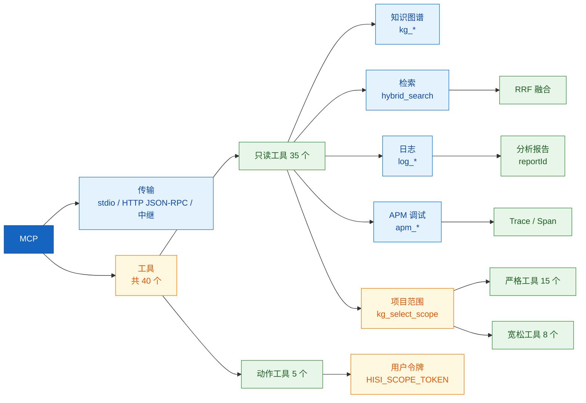

# 术语表

> 自动生成于 2026-11-26，基于 `99d0037` 版本

本术语表收录 `hisi-mcp-server` 代码与注释中出现的专有名词、缩写和领域概念，按主题分组。每条术语的解释都以当前代码为准。

---

## 1. 术语概览

| 主题 | 术语数 | 对应章节 |
|------|--------|---------|
| MCP 与传输 | 15 | 第 2 节 |
| 项目范围 | 9 | 第 3 节 |
| 身份与动作工具 | 8 | 第 4 节 |
| 知识图谱 | 18 | 第 5 节 |
| 检索与日志 | 10 | 第 6 节 |
| APM 调试 | 6 | 第 7 节 |
| 运行与接入 | 9 | 第 8 节 |
| 缩写 | 15 | 第 9 节 |

---

## 2. MCP 与传输

| 术语 | 英文 / 全称 | 定义 | 相关代码 |
|------|------------|------|---------|
| **MCP** | Model Context Protocol | AI 客户端与工具服务之间的标准通信协议；本服务是一个 MCP Server | `src/index.ts` |
| **JSON-RPC** | JSON-RPC 2.0 | MCP 消息的承载格式：请求带 `id`、`method`、`params`，响应带 `result` 或 `error` | `jsonRpcHandler()` |
| **stdio 传输** | stdio transport | 默认传输方式：本服务作为子进程运行，在 stdin / stdout 上收发换行分隔的 JSON-RPC | `StdioServerTransport` |
| **HTTP JSON-RPC 传输** | HTTP JSON-RPC | 设置 `HISI_HTTP_PORT` 后启用的传输方式：客户端直接 `POST` JSON-RPC | `startHttpServer()` |
| **Server** | MCP Server（SDK 类） | MCP SDK 提供的服务实例，负责注册请求处理器 | `@modelcontextprotocol/sdk/server/index.js` |
| **StdioServerTransport** | — | MCP SDK 提供的 stdio 传输实现 | `@modelcontextprotocol/sdk/server/stdio.js` |
| **initialize** | — | 握手方法；HTTP 模式下返回协议版本 `2025-03-26`、能力 `tools` 与服务信息 | `jsonRpcHandler()` |
| **notifications/initialized** | — | 握手完成后的通知；HTTP 模式没有为它写分支，会得到 `-32601` | `jsonRpcHandler()` |
| **tools/list** | — | 列出工具的方法，返回 40 个工具的 `name`、`description`、`inputSchema` | `configureServer()`、`jsonRpcHandler()` |
| **tools/call** | — | 调用工具的方法，参数为 `name` 与 `arguments` | `dispatchToolCall()` |
| **ping** | — | 探活方法；HTTP 模式返回空对象 | `jsonRpcHandler()` |
| **inputSchema** | JSON Schema | 每个工具声明的入参结构；本服务只声明不校验 | 各 `*ToolDefinitions` |
| **isError** | — | 工具结果里表示「执行出错」的标记，出错时 `content` 里是 `{ success, error, tool }` 文本 | `dispatchToolCall()` |
| **McpError / ErrorCode** | — | MCP SDK 的协议级错误；本服务只在 stdio 模式遇到未知工具名时使用 `MethodNotFound` | `configureServer()` |
| **中继** | relay | `relay.mjs`，把 stdio 流量逐行转成 HTTP POST | `relay.mjs` |

---

## 3. 项目范围

| 术语 | 英文 / 全称 | 定义 | 相关代码 |
|------|------------|------|---------|
| **项目范围** | scope | 一次会话里选定的项目路径集合；设置后自动注入到受控工具的入参 | `scopeManager.ts` |
| **kg_select_scope** | — | 范围工具，四个动作：`list`、`set`、`get`、`clear` | `handleScopeTool()` |
| **严格工具** | strict tool | 登记为「没有范围就拒绝」的 15 个工具，拒绝时返回 `SCOPE_NOT_SET` | `TOOL_SCOPE_REGISTRY` |
| **宽松工具** | soft scoped tool | 登记为「有范围就注入、没有也放行」的 8 个工具 | `TOOL_SCOPE_REGISTRY` |
| **范围注册表** | `TOOL_SCOPE_REGISTRY` | 每个工具的范围开关表，注释称其为范围要求的单一事实来源 | `scopeManager.ts` |
| **范围令牌** | scope token | HTTP 模式下区分不同客户端范围的键，放在请求头 `x-scope-token`；与「用户令牌」不是一回事 | `setScope()`、`getScope()` |
| **TTL** | time to live | 令牌范围的有效期，30 分钟 | `SCOPE_TTL_MS` |
| **全局范围** | default scope | 不带令牌时使用的范围；stdio 模式只有这一种 | `defaultScope` |
| **显式入参覆盖** | override | 入参里已经带了 `projectPaths` 或 `projectPath` 时不再注入范围 | `injectScope()` |

---

## 4. 身份与动作工具

| 术语 | 英文 / 全称 | 定义 | 相关代码 |
|------|------------|------|---------|
| **用户令牌** | user token | 动作工具以用户身份回调后端用的凭据，来自环境变量 `HISI_SCOPE_TOKEN` | `tokenFromEnv()` |
| **HISI_SCOPE_TOKEN** | — | 承载用户令牌的环境变量；由拉起方注入，不落盘 | `actionTools.ts` |
| **JWT** | JSON Web Token | 用户令牌的格式，由后端签发 | 后端 `JwtAuthFilter` |
| **Bearer** | — | 令牌在请求头里的携带方式：`Authorization: Bearer <token>` | `handleActToolCall()` |
| **动作工具** | action tool | 5 个会改变后端状态的 `act_*` 工具，必须带用户令牌 | `actionTools.ts` |
| **只读工具** | read-only tool | 只查询、不改变后端状态的 35 个工具，不带任何凭据 | 其余工具文件 |
| **匿名拒绝** | — | 没有令牌时动作工具直接返回权限错误，不访问后端 | `forbidden()` |
| **RAM** | 未在代码中确认全称 | 后端的需求分析模块；工具描述里称「RAM 需求分析大师」，动作工具用于推进 RAM 会话 | `/api/ram/*` |

---

## 5. 知识图谱

| 术语 | 英文 / 全称 | 定义 | 相关代码 |
|------|------------|------|---------|
| **知识图谱** | KG（Knowledge Graph） | 后端构建并存储的代码结构图；本服务通过 23 个 `kg_*` 工具查询 | `knowledgeGraphTools.ts` |
| **v2 接口** | — | 后端 `/api/v2/knowledge-graph/*` 下的查询接口，统一要求 `projectPaths` | 后端 `KnowledgeGraphV2Controller` |
| **projectPaths** | — | 项目路径数组，20 个知识图谱工具的必填入参，发给后端时用逗号拼接 | `commonRequiredProperties` |
| **projectPath** | — | 单个项目路径，兼容字段；不发给后端，只用于回填 `projectPaths` | `commonOptionalProperties` |
| **nodeId** | node ID | 图谱里方法节点的 ID，多个工具用它定位方法 | `kg_method_detail` 等 |
| **入口点** | entry point | 项目被外部或框架调用的入口，如 Controller、定时任务、消息监听器 | `kg_entry_points` |
| **entryType** | — | 入口点类型：`CONTROLLER`、`SCHEDULED`、`MQ_LISTENER`、`FEIGN_CLIENT`、`ALL` | `kg_entry_points` |
| **桥接点** | bridge | 连接不同模块或服务的跨层调用点（Feign、MQ、HTTP、JPA、MAPPER 等） | `kg_bridges`、`kg_bridge_stats` |
| **下游调用链** | downstream | 从指定节点向外追踪的调用关系 | `kg_downstream`、`kg_callees_tree` |
| **上游调用链** | affecting | 会调用到指定方法的代码 | `kg_affecting`、`kg_root_entries` |
| **根入口点** | root entries | 一直向上追溯到的最顶层入口 | `kg_root_entries` |
| **Feign 调用链** | Feign chain | 按 Feign 服务名追踪的微服务间调用 | `kg_feign_chain` |
| **MQ 调用链** | MQ chain | 按主题名追踪的消息生产与消费链路 | `kg_mq_chain` |
| **MyBatis SQL** | — | Mapper 接口与 SQL 语句的映射信息 | `kg_mybatis_sql` |
| **DSM** | Dependency Structure Matrix（依赖结构矩阵） | 模块依赖关系的矩阵视图，含循环依赖与分层违规标记 | `kg_dsm` |
| **热点** | hotspot | 按复杂度、变更频率、耦合度排序的高风险文件 | `kg_hotspots` |
| **爆炸半径** | blast radius | 修改某个方法会影响到的下游、上游与入口范围 | `kg_blast_radius` |
| **INVOKES_API** | — | 图谱里「前端 API 调用点 → 后端入口点」的边；`kg_api_consumers` 反向查，`kg_backend_deps` 正向查 | `kg_api_consumers`、`kg_backend_deps` |

> **注意同名不同义**：MCP 服务里的 `ApiClient` 是 `src/client/apiClient.ts` 中的 HTTP 客户端类；知识图谱里的 ApiClient 指前端代码中的 API 调用点节点（`kg_backend_deps` 的入参 `apiClientId`）。

---

## 6. 检索与日志

| 术语 | 英文 / 全称 | 定义 | 相关代码 |
|------|------------|------|---------|
| **hybrid_search** | hybrid search | 唯一的检索工具：关键词过滤 + 向量语义匹配 + 调用链图遍历扩展 | `vectorTools.ts` |
| **多路召回** | multi-query recall | 后端 v2 检索把查询拆成多个子查询分别检索 | 后端 `SemanticSearchController` |
| **RRF** | Reciprocal Rank Fusion | 把多路结果融合排序的算法 | 后端检索接口；工具描述 |
| **graphDepth** | — | 调用链图遍历深度；v2 路径下固定为 0 | `hybrid_search` 入参 |
| **_hint** | — | 检索 0 结果时本服务附加的提示文案 | `VectorTools.hybridSearch()` |
| **availableProjects** | — | 0 结果时附加的已建图项目列表响应 | `VectorTools.hybridSearch()` |
| **DSL** | Domain Specific Language（此处指查询 DSL） | 日志查询的原始查询语句，优先级最高，会覆盖其它过滤条件 | `log_query` 的 `dslQuery` |
| **TraceId** | trace ID | 分布式追踪 ID，日志查询与分析的可选过滤字段 | `log_query`、`log_analyze` |
| **reportId** | — | 日志分析报告的 ID，由 `log_analyze` 返回 | `logTools.ts` |
| **三段式** | — | 提交分析 → 轮询状态 → 取报告 | `log_analyze`、`log_report_status`、`log_report` |

---

## 7. APM 调试

| 术语 | 英文 / 全称 | 定义 | 相关代码 |
|------|------------|------|---------|
| **APM** | Application Performance Monitoring | 应用性能监控；后端提供的运行时追踪分析能力 | `apmTools.ts` |
| **调试会话** | debug session | 一次 APM 调试的生命周期，由 `apm_start_session` 创建、`apm_stop_session` 结束 | `ApmTools` |
| **sessionId** | — | 调试会话的 ID | 各 `apm_*` 工具 |
| **OTel** | OpenTelemetry | 后端启动目标应用时挂载的追踪 agent | 工具描述 |
| **Trace** | — | 一次请求的完整调用轨迹 | `apm_list_traces`、`apm_get_trace` |
| **Span** | — | Trace 内的单个操作记录 | 后端返回类型 `ApmSpanEntity` |

---

## 8. 运行与接入

| 术语 | 英文 / 全称 | 定义 | 相关代码 |
|------|------------|------|---------|
| **hisi-dev-tool** | — | 后端服务，本服务全部工具的数据来源 | `HISI_API_URL` 指向它 |
| **pi** | — | 后端内置的 agent 运行时，按 `mcp.json` 以 stdio 拉起本服务 | 后端 `PiFlowClient` |
| **mcp.json** | — | 后端生成的连接配置，只写启动命令（`command` + `args`），不写 `env` | 后端 `PiAgentInstaller.writeMcpJson()` |
| **进程环境继承** | — | pi 把自身进程环境（`HISI_API_URL`、`HISI_SCOPE_TOKEN`）原样传给 stdio MCP 子进程，所以 `mcp.json` 不需要环境变量引用 | 实测验证 |
| **工具清单** | `FlowToolManifest` | 后端为每类流限定的可用工具白名单 | 后端 `FlowToolManifest` |
| **自动构建** | — | 后端启动时发现 `dist/` 缺失或过期就执行 `npm ci` 与 `npm run build` | 后端 `PiAgentInstaller.ensureMcpDist()` |
| **安装向导** | — | 后端 `/api/mcp/install` 等接口，为外部客户端安装并注册本服务 | 后端 `McpController` |
| **通用响应信封** | `ApiResponse` | 后端多数接口的响应外形：`code`、`message`、`data` | 后端 `model/ApiResponse.java` |
| **dist** | — | `tsc` 的编译输出目录，`dist/index.js` 是运行入口 | `tsconfig.json`、`package.json` |

---

## 9. 缩写表

| 缩写 | 全称 | 说明 |
|------|------|------|
| APM | Application Performance Monitoring | 应用性能监控 |
| API | Application Programming Interface | 此处多指后端 REST 接口 |
| BFS | Breadth-First Search | 广度优先搜索，`kg_downstream` 描述里的追踪方式 |
| DSL | Domain Specific Language | 此处指日志查询 DSL |
| DDD | Domain-Driven Design | 领域驱动设计，`kg_domains` 描述里的领域边界 |
| DSM | Dependency Structure Matrix | 依赖结构矩阵 |
| JWT | JSON Web Token | 用户令牌的格式 |
| KG | Knowledge Graph | 知识图谱 |
| KPI | Key Performance Indicator | `kg_dashboard` 描述里的关键指标摘要 |
| MCP | Model Context Protocol | 模型上下文协议 |
| MQ | Message Queue | 消息队列 |
| OTel | OpenTelemetry | 开放遥测 |
| RRF | Reciprocal Rank Fusion | 倒数排名融合 |
| SSE | Server-Sent Events | 后端安装向导用它输出进度；HTTP JSON-RPC 通道不依赖它 |
| TTL | Time To Live | 存活时间 |

---

## 10. 术语关系图

---

> **延伸阅读**：
> - 术语对应的工具与接口 → [05-接口文档](../05-接口文档/index.md)
> - 核心概念详解 → [01-项目概览](../01-项目概览/index.md)
> - 两个容易混淆的令牌 → [项目范围管理](../03-模块说明/项目范围管理.md)、[动作工具](../03-模块说明/动作工具.md)
