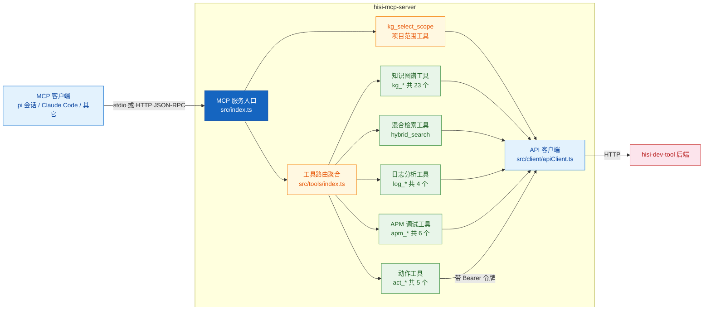

# hisi-mcp-server CodeWiki

> 自动生成于 2026-11-26，基于 `99d0037` 版本

---

## 项目简介

hisi-mcp-server 是 HiSi 开发工具套件的 **MCP（Model Context Protocol）服务**。它把后端 `hisi-dev-tool` 的知识图谱查询、混合检索、日志分析、APM 调试四类只读能力，以及一组必须以用户身份执行的「动作」，包装成 LLM 可直接调用的 **40 个 MCP 工具**。

本服务不实现任何分析算法，也不持久化业务数据（只在内存里保存会话的项目范围）；它的全部工作是协议适配、入参整理和 HTTP 回调后端。

---

## 项目速览

| 维度 | 信息 |
|------|------|
| **项目类型** | MCP Server，支持 stdio（默认）与 HTTP JSON-RPC 两种传输 |
| **技术栈** | Node.js（`engines.node` `>=18.0.0`）· TypeScript（声明 `^5.9.3`）· `@modelcontextprotocol/sdk`（声明 `^1.0.0`，lock 文件锁定 1.29.0）· 原生 `fetch` · `node:http` |
| **架构风格** | 无状态适配器：入口分发层 → 工具路由层 → 工具实现层 → API 客户端层 |
| **代码规模** | `src/` 下 11 个 `.ts` 文件（10 个源码 + 1 个测试）共 2639 行，另有 `relay.mjs` 43 行 |
| **模块数量** | 11 个（见下方模块列表） |
| **MCP 工具数** | 40 个（`kg_*` 23 + `kg_select_scope` 1 + `hybrid_search` 1 + `log_*` 4 + `apm_*` 6 + `act_*` 5） |
| **回调后端接口** | 40 个不同的 REST 接口（方法 + 路径），全部为 GET 或 POST |
| **环境变量** | `HISI_API_URL`、`HISI_HTTP_PORT`、`HISI_DEBUG`、`HISI_SCOPE_TOKEN`；中继脚本另读 `MCP_REMOTE_URL` |
| **部署方式** | 编译为 `dist/index.js`；默认由 MCP 客户端（如 pi 会话）通过 stdio 按需拉起，无长驻进程 |
| **许可证** | 未在代码中确认（`package.json` 未声明 `license` 字段） |

### 全景图



---

## 目录

### 理解项目（入门）

| 章节 | 说明 | 适合谁 |
|------|------|--------|
| [项目概览](01-项目概览/index.md) | 使命与边界、技术栈、项目结构、核心概念、相关项目 | 新成员、首次接触 |
| [术语表](09-术语表/index.md) | MCP / 项目范围 / 令牌 / 桥接点 等术语解释 | 所有读者 |

### 理解设计（深入）

| 章节 | 说明 | 适合谁 |
|------|------|--------|
| [架构设计](02-架构设计/index.md) | 两种传输、分层、模块依赖、质量属性、跨切面关注点 | 架构师、技术负责人 |
| [技术决策](08-技术决策/index.md) | 有代码注释或提交记录为依据的技术决策 | 架构师、新成员 |

### 开发参考（实操）

| 章节 | 说明 | 适合谁 |
|------|------|--------|
| 模块说明 | 11 份，见下方模块列表 | 开发者 |
| [数据流程](04-数据流程/index.md) | 启动、列出工具、调用工具、项目范围、令牌传递、异步报告 | 开发者、测试 |
| [接口文档](05-接口文档/index.md) | MCP 协议、40 个工具的入参出参、回调后端的 REST 路径 | AI 集成方、开发联调 |
| [数据模型](06-数据模型/index.md) | 工具定义结构、入参类型、响应信封、范围注册表 | 开发者 |

### 运维部署（运营）

| 章节 | 说明 | 适合谁 |
|------|------|--------|
| [部署运维](07-部署运维/index.md) | 环境变量、构建、后端自动构建的触发条件、安装向导、故障排查 | 运维、接入 MCP 的开发者 |

---

## 模块列表

| # | 模块 | 文件 | 关键词 | 层级 |
|---|------|------|--------|------|
| 1 | [MCP服务入口](03-模块说明/MCP服务入口.md) | `src/index.ts` | Server / stdio / HTTP JSON-RPC / kg_select_scope | 入口与传输层 |
| 2 | [工具路由聚合](03-模块说明/工具路由聚合.md) | `src/tools/index.ts` | 聚合 / 分发 / 路径归一化入口 | 路由层 |
| 3 | [知识图谱工具](03-模块说明/知识图谱工具.md) | `src/tools/knowledgeGraphTools.ts` | kg_* / 调用链 / 入口点 / 架构聚合 / 前后端联调 | 工具层 |
| 4 | [混合检索工具](03-模块说明/混合检索工具.md) | `src/tools/vectorTools.ts` | hybrid_search / 多路召回 / 0 结果回退 | 工具层 |
| 5 | [日志分析工具](03-模块说明/日志分析工具.md) | `src/tools/logTools.ts` | log_* / DSL / 异步报告 | 工具层 |
| 6 | [APM调试工具](03-模块说明/APM调试工具.md) | `src/tools/apmTools.ts` | apm_* / 调试会话 / Trace / Span | 工具层 |
| 7 | [动作工具](03-模块说明/动作工具.md) | `src/tools/actionTools.ts` | act_* / 用户令牌 / RAM 会话 | 工具层 |
| 8 | [项目范围管理](03-模块说明/项目范围管理.md) | `src/utils/scopeManager.ts` | 会话范围 / 令牌键控 / TTL / 严格与宽松 | 公共组件 |
| 9 | [路径归一化](03-模块说明/路径归一化.md) | `src/utils/pathUtils.ts` | normalizePathArgs / 反斜杠 / 按键名匹配 | 公共组件 |
| 10 | [API客户端](03-模块说明/API客户端.md) | `src/client/apiClient.ts` | fetch / 超时 / 错误归一 / 单例 | 服务层 |
| 11 | [stdio中继](03-模块说明/stdio中继.md) | `relay.mjs` | stdio 转 HTTP / 远程客户端 / MCP_REMOTE_URL | 入口与传输层 |

---

## 工具分组速查

| 分组 | 工具名 | 数量 | 需要令牌 | 模块文档 |
|------|--------|------|---------|---------|
| 项目范围 | `kg_select_scope` | 1 | 否 | [MCP服务入口](03-模块说明/MCP服务入口.md) |
| 知识图谱 | `kg_*` | 23 | 否 | [知识图谱工具](03-模块说明/知识图谱工具.md) |
| 混合检索 | `hybrid_search` | 1 | 否 | [混合检索工具](03-模块说明/混合检索工具.md) |
| 日志 | `log_*` | 4 | 否 | [日志分析工具](03-模块说明/日志分析工具.md) |
| APM 调试 | `apm_*` | 6 | 否 | [APM调试工具](03-模块说明/APM调试工具.md) |
| 动作 | `act_*` | 5 | 是（`HISI_SCOPE_TOKEN`） | [动作工具](03-模块说明/动作工具.md) |
| **合计** | | **40** | | |

完整的工具名、入参与回调路径见 [05-接口文档](05-接口文档/index.md)。

---

## 推荐阅读路径

### 新成员入职

```
01-项目概览 → 09-术语表 → 02-架构设计 → 03-模块说明/MCP服务入口 → 05-接口文档
```

### 新增一个 MCP 工具

```
03-模块说明/工具路由聚合 → 03-模块说明/知识图谱工具（参考实现）→ 05-接口文档 → 06-数据模型
```

### 排查「工具调用失败 / 返回 SCOPE_NOT_SET / 动作工具被拒绝」

```
04-数据流程 → 03-模块说明/项目范围管理 → 03-模块说明/动作工具 → 07-部署运维
```

### 技术选型

```
08-技术决策 → 02-架构设计
```

---

## 技术栈标签云

```
TypeScript strict · ES2022 · NodeNext ESM · @modelcontextprotocol/sdk ·
StdioServerTransport · node:http JSON-RPC · 原生 fetch + AbortController ·
JSON Schema · 项目范围协议 · Bearer 令牌
```

---

## 变更记录

| 日期 | 版本 | 变更内容 |
|------|------|---------|
| 2026-05-08 | — | 初版 CodeWiki（内容已过时） |
| 2026-11-26 | `99d0037` | 全量重写：按当前代码重新核对 40 个工具、两种传输、项目范围协议、动作工具与后端自动构建 |

---

> **延伸阅读**：
> - 快速了解项目 → [项目概览](01-项目概览/index.md)
> - 理解系统设计 → [架构设计](02-架构设计/index.md)
> - 查阅工具定义 → [接口文档](05-接口文档/index.md)
