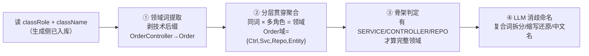

# Design: 架构诊断 AI 升级（灰度过滤 + 4+1 报告书 + 垂直领域识别 + 多项目分组）

## Context

架构诊断当前是"规则看板 + AI 深度分析"两层，但两层各有错位：

- **规则看板**（`ArchSmellDetectorService` 的 Cypher 启发式 + `ArchDiagnosisReportService` 聚合）是确定性的、秒级、零 LLM 成本，但产出**系统性误报**：测试类 `new Impl()` 被判"实现类外泄"（v4.0 实测 6 个 HIGH 假阳性）、REST Controller 的 `get*` 方法被判"贫血数据类"、枚举/DTO/Spring 启动类被判"幽灵类"。
- **AI 深度分析**（`ArchEvidenceCollectNode` → `ArchReActAgentNode` 两节点工作流）有 18 只读工具（method_detail/method_by_class/upstream/root_entries 等），但当前 prompt 只让它"归纳根因"，且证据包**原样透传看板 issues（含误报）**，没有"查证/过滤"职责。
- **领域检测**走 `MultiDimensionCommunityDetector` 图社区检测，聚出"知识图谱/语义搜索"这类**水平耦合社区**，与真实业务领域（订单/风控，自上而下贯穿 controller→service→repo→entity 的垂直类组合）不在一个维度。
- 生成侧已具备**水平分层角色**：`ClassLayerRoleDetector` 三级回退（注解→类名→包名）+ `LayerRoleLlmService` LLM 补全，产出 `ClassNode.classRole ∈ {CONTROLLER, SERVICE, REPOSITORY, MODEL, UTILITY, UNKNOWN}` 已入库 Neo4j。

**硬约束**：不修改生成侧（aggregation pipeline / `MultiDimensionCommunityDetector` / `DomainNameGenerator` 等）。领域识别与灰度过滤都必须在**诊断侧**纯读已有 KG 数据重算。

## Goals / Non-Goals

**Goals:**
1. 误报不靠加规则堵漏，而是让 AI 深度分析用真实代码语义**灰度过滤**（判定 confirmed / false_positive / downgraded + 理由）。
2. AI 深度分析产出《架构现状分析报告书（4+1 视图）+ 问题分析》，价值从"根因摘要"升级为"架构现状报告书生成器"。
3. 项目级领域从图社区推断改为**垂直领域识别**（命名领域词 × 分层角色贯穿），从真实代码读出领域。
4. 多项目诊断时四层分析有清晰分组语义：项目级聚合，模块/类/方法级按项目分组。

**Non-Goals:**
- 不改生成侧 aggregation pipeline、社区检测、领域命名（`DomainNameGenerator`）。
- 不重构现有 11 项确定性检测的 Cypher（误报靠 AI 灰度，不靠改规则）。
- 不看板侧新增"4+1 视图"可视化 tab（4+1 只由 AI 生成）。
- 不做领域识别的跨项目合并（领域只在本项目内识别）。

## Decisions

### D1：误报修复 = AI 灰度过滤，而非加规则

**选择**：`ArchReActAgentNode` 的职责从"归纳根因"扩展为"先逐条查证候选问题，再归纳真实根因"。

- `react-step.json` 的 `final_answer.issues[]` 每项新增 `verdict ∈ {confirmed, false_positive, downgraded}` + `reason`。
- system prompt 新增"灰度验证"指令：对每个候选 issue，用只读工具查证它是真问题、误报、还是严重度虚高（downgraded）。
- `ArchEvidenceCollectNode` 的证据包 issue 条目补**可查证定位信息**：`className` / `methodName` / `nodeId`（当前只透传看板 issue 的 message/source）。

**查证工具映射**（已有 18 只读工具，无需新增）：

| 误报类型 | 查证手段 |
|---|---|
| 实现类外泄（测试类 new Impl） | `upstream`/`root_entries` 查调用方是否全部在 `src/test`；`method_detail` 看调用上下文 |
| 贫血数据类（REST Controller get*） | `method_by_class` 查类内方法是否全是 @GetMapping 之类；`method_detail` 看注解 |
| 幽灵类（枚举/DTO/启动类） | `method_by_class` 查是否纯数据/纯枚举；`class_dependencies` 查是否真孤立 |

**Alternatives considered:**
- *加规则（`NOT =~ 'Test$'`、排 @RestController、排 enum）*：否定。误报变体无穷（缩写、无后缀、复合命名），规则永远补不完，且每条规则都是新维护点。
- *删掉误报检测项（去掉 anemic/ghost）*：否定。真问题（真正的贫血 Service、真正的死类）也会被连带删掉，损失检测覆盖。

### D2：4+1 视图由 AI 生成，非规则拼装

**选择**：报告节点输出从"四段式（现状总览/根因/建议/附录）"升级为"4+1 视图 + 问题分析"。4+1 视图的文字化由 LLM 基于 ReAct 采集的证据生成。

**4+1 视图 ↔ 工具映射**（证据采集素材）：

| 视图 | 素材工具 |
|---|---|
| 逻辑视图（分层/模块/类依赖） | `dashboard` / `dsm` / `class_dependencies` / `domains` |
| 过程视图（调用链/入口点/并发热点） | `root_entries` / `callees_tree` / `downstream` / `upstream` / `hotspots` |
| 开发视图（构建模块/分层违规） | `dsm(level=build-module)` / `package_cycles` / `module_cycles` |
| 物理视图（服务拓扑/跨服务调用） | `service_topology` / `feign_chain` / `mq_chain` |
| 场景视图（入口点用例流程） | `root_entries` / `entry_points` / `blast_radius` |

**Alternatives considered:**
- *图谱规则拼装 4+1*：否定。4+1 视图需要语义判断"哪些类属于同一逻辑单元、哪些调用链构成一个场景"，规则拼装出的 4+1 不可信、不敢用（用户原话）。

### D3：垂直领域识别 = 命名领域词 × 分层贯穿 + LLM 消歧

**选择**：领域识别从"图社区检测"改为"命名领域词提取 + 分层角色贯穿聚合 + LLM 消歧命名"。

算法（诊断侧新增组件，纯读 Neo4j）：

- **① 领域词提取**：类名剥离技术后缀（Controller/Service/ServiceImpl/Impl/Repository/Dao/Mapper/Entity/PO/DO/DTO/VO/QO/BO/Model/Enum/Util/Utils/Config/Configuration/Constant/Constants/Helper/Factory/Builder/Handler/Listener/Filter/Interceptor/Aspect/Exception/Request/Response…），得核心词。
- **② 分层贯穿**：同一领域词在 ≥2 个分层角色出现 → 聚合为一个领域；单角色孤立词（只有 `OrderEntity` 无 `OrderService`）不凑域，归"孤立数据对象"。
- **③ 骨架判定**：领域须含至少一个业务角色（SERVICE/CONTROLLER/REPOSITORY），纯 MODEL 词不算完整领域。
- **④ LLM 只做消歧 + 命名**：复合词拆分（`OrderPaymentService`→Order/Payment）、缩写还原（`OrdSvc`→Order）、领域中文名（Order→订单域）。**LLM 不猜边界，边界由命名 + 分层确定性算出**。

**落点**：诊断侧纯读 `ClassNode.classRole` + `className`（生成侧已算好入库），不写回、不改生成侧 pipeline。领域结果作为 `ArchDiagnosisReportService` 项目级章节的新数据源（替代社区检测 DomainNode），并进入证据包供 AI 引用。**领域名 LLM 结果缓存复用**（SQLite 存领域名），点击"实时生成/刷新"时清缓存并重算命名。

**Alternatives considered:**
- *图社区检测（现状）*：否定。聚的是水平调用耦合，不是垂直业务贯穿。
- *包结构切分（领域=顶层包）*：否定。领域跨包存在（Order 同时出现在 controller 包、service 包、repo 包），包是水平分层不是垂直领域。

### D4：实时报告单项目，AI 深度分析跨项目聚合

**选择**：确定性实时报告退化为**单项目**（前端页面顶部单选项目，`projectPaths` 单值）；跨项目聚合的价值下沉到 AI 深度分析（多选项目 → 一份跨项目架构分析报告书）。

- 实时报告：前端项目选择器单选，报告针对单项目生成。垂直领域识别在本项目内完成（单项目领域识别），项目级/模块级/类级/方法级四章均为单项目视角，无分组逻辑。
- AI 深度分析：前端支持多选项目，证据收集与灰度过滤在多个项目上分别进行，报告节点聚合生成一份跨项目报告书（4+1 视图 + 跨项目问题对比）。
- 后端 `ArchDiagnosisReportService` 保持 `projectPaths` 多值向后兼容（快照仍按项目隔离落库），实时报告前端只传单值。

**Alternatives considered:**
- *实时报告多项目四层分组 + 子面板筛选*：否定。交互复杂，且项目级垂直领域只在单项目内识别，无法跨项目聚合项目级章节，多项目分组语义不完整。
- *四层全聚合（不分项目）*：否定。丢失项目边界。

### D5：精简 Markdown 导出

**选择**：在现有 `ArchReportMarkdownExporter`（已展开 11 项明细 + 扣分明细）基础上**精简**：折叠重复行、同源计数聚合、去除冗余空表，保持"总分 + 等级 + 问题清单 + 四章核心明细 + 扣分"的可评审结构。4+1 报告书本身即为 Markdown，直接复用现有 `markdownReport` 导出路径。

## Risks / Trade-offs

- **[LLM 灰度可能误杀真问题]** → 灰度过滤只在 AI 深度分析报告生效，看板 issues 保持原样；verdict 逐条带 reason，可人工复核；降级（degraded）时回退到不过滤的模板输出。
- **[领域词提取漏识别（缩写/无后缀/拼音）]** → 走 LLM 消歧补全"词"，且 LLM 只补词不补边界；无法识别的类归"技术支撑/孤立数据对象"，不强行入域。
- **[垂直领域识别的 LLM 命名成本]** → 命名仅对"已确定性聚合出的领域"批量调用一次，可缓存；不逐类调用。
- **[实时报告单项目化、跨项目下沉 AI]** → 后端 `projectPaths` 保持多值向后兼容，前端实时报告单选项目，单项目行为与现状一致（回归零影响）；跨项目聚合仅在 AI 深度分析路径新增，不碰实时报告主链路。
- **[在途 arch-deep-analysis 规范未归档]** → 本变更的 `arch-deep-analysis` delta 依赖在途变更 `arch-diagnosis-realtime-agent` 先行归档；归档顺序由 openspec 保证（先归档前者再归档本变更）。

## Decision Log（用户已拍板）

1. **灰度过滤只进 AI 报告**，不回写看板 issue（看板保持确定性原样）。
2. **实时报告单项目**（页面顶部单选项目）；**AI 深度分析跨项目聚合**（多选项目 → 一份跨项目报告书）。
3. **垂直领域命名 LLM 缓存复用**（SQLite 缓存领域名），点击"实时生成/刷新"时清缓存重算。
4. 领域识别仅在单项目内进行，不做跨项目合并（与 D4 实时单项目定位一致）。
